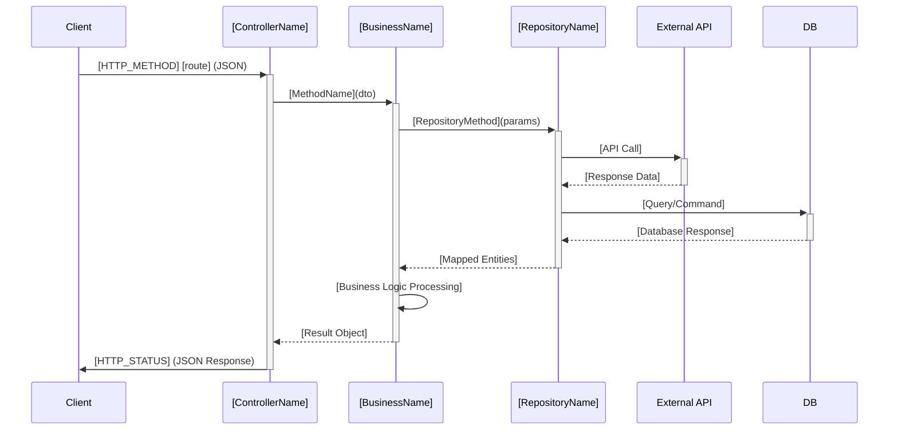
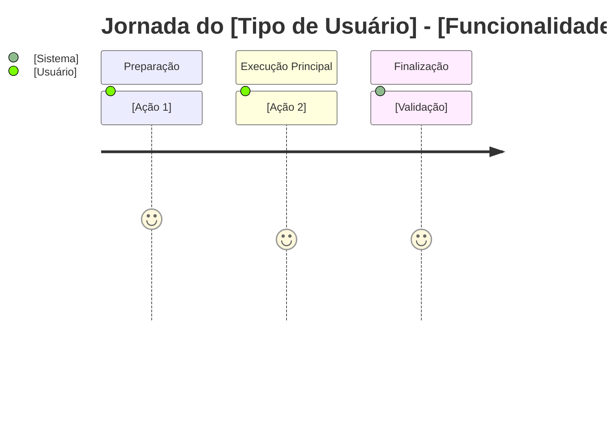
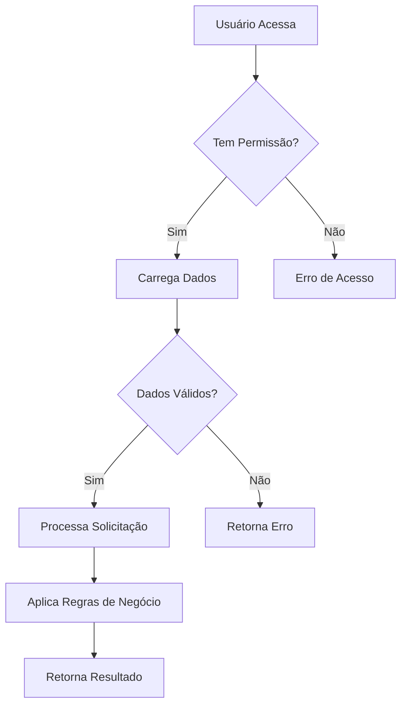

<!-- GERADO por tools/build.py — edite a fonte em kit/, não este arquivo -->

# Documentação contínua do produto

> Argumento esperado: módulo, caminho do arquivo, --auto ou --incremental

Cria e mantém a documentação do produto, por controller ou módulo equivalente da stack, em três camadas de audiência. **A documentação acompanha cada mudança do produto** e devolve os artefatos ao ciclo SDD.

> **Projeto novo:** após a primeira implementação de cada módulo, documente o comportamento entregue; a cada alteração seguinte, atualize os documentos afetados.
> **Projeto existente:** após `/onboard`, documente os módulos já existentes como linha de base; depois atualize os documentos a cada mudança.
> A Matriz de Cenários de BusinessRules também pode alimentar `/shape` quando existe código sem spec BDD.

Também responde a: "documentar", "criar documentação", "gerar docs", "document controller", "api documentation".

## Pré-condições

Antes de qualquer ação, leia (silenciosamente, só comente se ausente):

- [.sdd/STACK.md](../../../.sdd/STACK.md) — linguagem, framework e convenções; define os nomes reais das camadas
- [.sdd/config.json](../../../.sdd/config.json) — bloco `extensions.documenta_ai` (saída, camadas, modo)
- [.sdd/memory/DOMAIN.md](../../../.sdd/memory/DOMAIN.md) — entidades, fluxos e fronteiras já mapeados
- [.sdd/memory/PROJECT.md](../../../.sdd/memory/PROJECT.md) — glossário do projeto (siglas já resolvidas)
- `docs/blueprints/current-architecture.mermaid` — arquitetura real, se existir
- `docs/documenta-ai/INDEX.md` — o que já foi documentado e em qual commit


Aplique também as regras de [documenta-ai-files.md](../../../kit/rules/documenta-ai-files.md).
---

## Identidade

Especialista em documentação técnica que escreve como dev sênior: sistemático, minucioso, sem enfeite. Documenta **o comportamento efetivamente entregue**, não uma intenção ainda não implementada. Relacione a mudança à story e à spec aprovada quando existirem. Toda a documentação em **português (pt-BR)**.

---

## Saída

```
docs/documenta-ai/
├── INDEX.md                                   # rastreio: alvo -> docs -> commit -> story
├── dev/{Controller}-{Regiao}-DevDocs.md       # devs
├── business/{Nome-Amigavel}-{Regiao}-Rules.md # produto e stakeholders
└── debts/{Controller}-{Regiao}-Debts.md       # tech leads e arquitetos
```

Nunca escreva em `DocumentAIReadme/` — três pastas na raiz competem com `docs/`, `specs/` e `.sdd/`, que já são a convenção do kit. Se `DocumentAIReadme/` existir de execuções antigas, ofereça migrar o conteúdo para `docs/documenta-ai/` e pare para confirmação.

### Frontmatter obrigatório em todo arquivo gerado

```yaml
---
source: src/Controllers/PedidoController.cs
commit: 4f2a91c8e7b3d5061a2f8c9e3b7d4a5f6c8e9d0b
generated: 2026-09-03
layers: Controller -> Business -> Repository -> Utils
story: STORY-042
---
```

- `source` — caminho do arquivo raiz documentado (o controller).
- `commit` — SHA completo de `git log -1 --format=%H -- {source}` no momento da geração; use `-` se o arquivo ainda não tiver commit.
- `generated` — data ISO.
- `layers` — cadeia de camadas usada, resultado da Fase 0.
- `story` — story relacionada, ou `-` se não houver.

Sem esse bloco não há como saber se o doc envelheceu. O `session-healthcheck` compara `commit:` com o SHA atual de `source` e avisa quando divergem. Alterações ainda não commitadas exigem comparação direta do código com a documentação, pois o SHA sozinho não as detecta.

---

## Fase 0 — Detecção de camadas

Não assuma `Controller -> Business -> Repository -> Utils`: essa é a arquitetura de um projeto .NET específico. Descubra, nesta ordem:

1. `.sdd/config.json` → `extensions.documenta_ai.layers` preenchido? É a verdade, use e siga.
2. `.sdd/STACK.md` + `docs/blueprints/current-architecture.mermaid` — os nomes das camadas reais.
3. Estrutura de pastas e sufixos de classe no código (`*Service`, `*Handler`, `*UseCase`, `*Repository`, `*Gateway`).
4. Fallback: `Controller -> Business -> Repository -> Utils/Helpers`.

Equivalências comuns:

| Stack | Cadeia típica |
|---|---|
| .NET / Java Spring | Controller -> Service/Business -> Repository -> Utils |
| NestJS | Controller -> Service -> Repository -> Helpers |
| Express | Router -> Controller -> Model/DAO |
| Django | View -> Serializer -> Model -> Utils |
| FastAPI | Router -> Service -> Repository -> Schemas |
| Clean Architecture | Controller -> UseCase -> Gateway -> Entity |

Ao detectar pela primeira vez no projeto, registre a cadeia em `.sdd/config.json` → `extensions.documenta_ai.layers` e informe ao usuário quais camadas foram usadas. Se houver duas arquiteturas plausíveis e a escolha mudar o conteúdo da documentação, peça esclarecimento antes de gerar os arquivos.

---

## Fase 1 — Alvo e modo

Identifique o alvo pelo argumento (nome do controller/módulo ou caminho). Com `--auto` sem alvo, inventarie todos os módulos do produto e documente os ausentes do `INDEX.md`. Com `--incremental` sem alvo, use `.sdd/.pending-docs` e o diff da mudança corrente para localizar os módulos novos ou alterados. No modo normal sem argumento, liste os alvos não documentados e pergunte qual documentar. Em projeto sem código implementado, não invente comportamento: aguarde a primeira entrega.

### Modos

**Normal (padrão)** — um alvo por vez, na sequência DevDocs → BusinessRules → Debts. Pare para revisão entre cada tipo.

**Autônomo (`--auto`)** — cria a linha de base dos módulos ainda não documentados, nos três tipos, sem parar entre alvos. Útil após `/onboard` de projeto existente. Só interrompe em erro irrecuperável ou quando tudo estiver documentado.

**Incremental (`--incremental`)** — atualiza os documentos dos módulos afetados por uma entrega, inclusive arquivos novos e mudanças ainda não commitadas:

1. Identifique os arquivos da entrega pela story, pelo diff do trabalho atual, por `.sdd/.pending-docs` e pelas dependências entre camadas. Não limite a busca ao arquivo `source`.
2. Compare o código atual com os documentos existentes. Use `git diff` entre o commit registrado e `HEAD` **mais** as alterações staged, unstaged e arquivos novos. Se o SHA do `source` for igual, ainda verifique as outras camadas e a árvore de trabalho.
3. Para módulo sem documentação, crie os três documentos. Para módulo existente, atualize apenas seções, regras, fluxos, integrações e débitos afetados; verifique também se houve remoção de comportamento.
4. Atualize `generated:`, `commit:` e a linha no `INDEX.md`; com alterações não commitadas, registre o SHA do último commit do `source` ou `-` para arquivo novo. Após o commit, confira se o rastreio continua válido.

Regenerar o documento inteiro a cada mudança produz diff ilegível que esconde a mudança real. Execute este modo ao fechar `/build`, `/feature` e `/reflect` quando houver mudança de código ou comportamento. Se a alteração for só documental e não afetar o produto, não há o que regenerar.

### Paralelismo

Documentos de controllers diferentes são independentes. Em `--auto`, se o harness permitir subagentes, despache um por controller em lotes de 3 a 5. Gere **o primeiro em modo normal**, com revisão humana, para calibrar tom e nomenclatura antes de paralelizar.

---

## Fase 2 — DevDocs (prioridade máxima)

**Nome**: `docs/documenta-ai/dev/{Controller}-{Regiao}-DevDocs.md`
**Audiência**: desenvolvedores
**Foco**: fluxo completo por todas as camadas, com sequence diagram e detalhamento método a método com links internos.

Antes de escrever, leia o fluxo inteiro: da entrada HTTP até o banco ou API externa, passando por cada camada detectada na Fase 0.

````markdown
---
source: {caminho}
commit: {sha}
generated: {data}
layers: {cadeia}
story: {story-id ou -}
---

# [Nome do Controller] - [Região] - Especificação Técnica

## Índice

- [1. Visão Geral Técnica](#1-visão-geral-técnica)
- [2. Configuração e Dependências](#2-configuração-e-dependências)
- [3. Detalhamento por Rota](#3-detalhamento-por-rota)
  - [3.1. [Nome da Rota 1]](#31-nome-da-rota-1)
- [4. Observações Técnicas](#4-observações-técnicas)

## 1. Visão Geral Técnica

**Propósito**: [O que o controller faz]
**Responsabilidades**: [Principais responsabilidades]
**Integrações**: [Sistemas/APIs integrados]

## 2. Configuração e Dependências

**Dependências Injetadas**:

- [IBusiness]: [Propósito]
- [IRepository]: [Propósito]

**Lista de Endpoints**:

- **GET** `/api/[controller]/[action]` - [Descrição breve]
- **POST** `/api/[controller]/[action]` - [Descrição breve]

## 3. Detalhamento por Rota

### 3.1. [Nome da Rota] - [Propósito Principal]

**Rota**: `[HTTP_METHOD] [caminho_completo]`

**Entrada**:

```json
{ "parametro1": "tipo e descrição" }
```

**Saída**:

```json
{ "resultado1": "tipo e descrição" }
```

#### Fluxo de Execução



#### Detalhamento do Fluxo

**C. Controller ([ControllerName])**

C.1. [MethodName]()

- [Validação de autenticação e autorização]
- [Recepção e processamento dos parâmetros de entrada]
- [Chamada para o BaseController] --> [BC.1](#bc1-methodname)
- [Chamada para a camada de negócio] --> [B1.1](#b11-methodname)
- [Mapeamento de DTOs para models de resposta]
- [Retorno da resposta HTTP com status code apropriado]

**BC. BaseController ([BaseControllerName])**

<a id="bc1-methodname"></a>
BC.1. [BaseMethodName]()

- [Obtenção de dados do usuário logado]
- [Processamento de headers e contexto da requisição]

**B1. Business ([BusinessName])**

<a id="b11-methodname"></a>
B1.1. [BusinessMethodName]()

- [Validações de negócio]
- [Chamada para utilitários] --> [U1.1](#u11-utilmethod)
- [Chamada para repository] --> [R1.1](#r11-repositorymethod)
- [Regras de negócio e transformações]
- [Mapeamento de entidades para DTOs]

**U1. Util ([UtilName])**

<a id="u11-utilmethod"></a>
U1.1. [UtilMethodName]()

- [Lógica utilitária baseada no código]

**R1. Repository ([RepositoryName])**

<a id="r11-repositorymethod"></a>
R1.1. [RepositoryMethodName]()

- [Configuração da chamada externa/query]
- [Execução da operação]
- [Mapeamento para entidades do domínio]

## 4. Observações Técnicas

- **Performance**: [Considerações]
- **Tratamento de Erros**: [Como erros são tratados]
- **Integrações Críticas**: [Dependências importantes]
- **Segurança**: [Autenticação, autorização e validação de input observadas — insumo para o `/check`]
````

---

## Fase 3 — BusinessRulesDocs

**Nome**: `docs/documenta-ai/business/{Nome-Amigavel}-{Regiao}-Rules.md`
**Audiência**: produto, scrum masters, stakeholders
**Foco**: capacidades funcionais em linguagem de negócio.

> A **Matriz de Cenários** (seção 6) é o artefato mais importante deste documento: é a entrada direta do `/shape`. Nomeie cada cenário no imperativo, como um `Scenario:` do Gherkin, e mantenha entrada, ação e resultado em uma linha cada. Cobrir happy path, edge case e error case aqui poupa a sessão inteira de Three Amigos depois.

````markdown
---
source: {caminho}
commit: {sha}
generated: {data}
layers: {cadeia}
story: {story-id ou -}
---

# [Nome Amigável da Funcionalidade] - [Região] - Regras de Negócio

## Índice

- [1. Resumo da Funcionalidade](#1-resumo-da-funcionalidade)
- [2. Jornada do Usuário](#2-jornada-do-usuário)
- [3. Regras de Negócio por Funcionalidade](#3-regras-de-negócio-por-funcionalidade)
- [4. Validações e Restrições](#4-validações-e-restrições)
- [5. Fluxos de Processo](#5-fluxos-de-processo)
- [6. Casos de Uso e Cenários](#6-casos-de-uso-e-cenários)

## 1. Resumo da Funcionalidade

**Propósito**: [O que resolve para o negócio]
**Usuários**: [Quem utiliza]
**Valor de Negócio**: [Benefício para a operação]
**Frequência de Uso**: [Com que frequência]
**Impacto Operacional**: [Como impacta o dia a dia]

## 2. Jornada do Usuário



### Pontos de Contato

- **[Ponto 1]**: [Descrição da interação]

## 3. Regras de Negócio por Funcionalidade

### 3.1. [Nome Funcional]

**O que faz**: [Descrição em linguagem de negócio]

**Regras Aplicadas**:

- **[Regra 1]**: [Explicação clara]
  - _Exemplo_: [Exemplo prático]

**Cenários de Uso**:

- **[Cenário Principal]**: [Quando e como usar]
- **[Cenário Alternativo]**: [Situações específicas]
- **[Cenário de Exceção]**: [Quando algo dá errado]

**Resultado Esperado**: [O que o usuário obtém]

## 4. Validações e Restrições

### Controle de Acesso

- **Permissões**: [Quem pode acessar]
- **Hierarquia**: [Níveis de acesso]

### Dados e Entrada

- **Dados Obrigatórios**: [Informações necessárias]
- **Formatos Aceitos**: [Tipos permitidos]
- **Limitações de Volume**: [Máximos/mínimos]

### Restrições do Sistema

- **Horários**: [Janela de disponibilidade]
- **Dependências**: [O que precisa estar no ar]

## 5. Fluxos de Processo



## 6. Casos de Uso e Cenários

### Caso de Uso 1: [Nome]

**Ator Principal**: [Quem executa]
**Objetivo**: [O que quer alcançar]
**Pré-condições**: [O que precisa estar pronto]

**Fluxo Principal**:

1. [Passo 1]
2. [Passo 2]

**Pós-condições**: [Estado final do sistema]

### Matriz de Cenários

> Entrada direta do `/shape`. Cada linha vira um `Scenario:` Gherkin.

| Cenário | Entrada | Ação do Sistema | Resultado Esperado |
| --- | --- | --- | --- |
| [Aprovar pedido dentro do limite] | [Dados] | [Processamento] | [Saída] |
| [Rejeitar pedido acima do limite] | [Dados] | [Validação] | [Mensagem de erro] |
| [Bloquear acesso sem permissão] | [Dados] | [Autorização] | [403] |
````

---

## Fase 4 — TechnicalDebtsDocs

**Nome**: `docs/documenta-ai/debts/{Controller}-{Regiao}-Debts.md`
**Audiência**: devs, tech leads, arquitetos
**Foco**: débito técnico classificado por criticidade, com plano de ação acionável.

Antes de escrever, leia o arquivo de débitos existente para este alvo: **não duplique** débito já catalogado — atualize a entrada e marque o que foi resolvido como `✅ resolvido em {sha}`.

````markdown
---
source: {caminho}
commit: {sha}
generated: {data}
layers: {cadeia}
story: {story-id ou -}
---

# [Controller] - [Região] - Débitos Técnicos

## Índice

- [1. Resumo Executivo](#1-resumo-executivo)
- [2. Problemas por Criticidade](#2-problemas-por-criticidade)
- [3. Plano de Ação](#3-plano-de-ação)
- [4. User Stories para Implementação](#4-user-stories-para-implementação)

## 1. Resumo Executivo

- **Estado Atual**: [Avaliação geral]
- **Principais Problemas**: [Os mais críticos]
- **Impacto no Negócio**: [Como afeta a operação]

## 2. Problemas por Criticidade

### 🔴 Críticos

- **[Problema]**: [Descrição e impacto]
  - **Categoria**: [OWASP A0N | anti-pattern | performance | acoplamento]
  - **Ação Recomendada**: [O que fazer]

### 🟡 Importantes

- **[Problema]**: [Descrição e impacto]
  - **Ação Recomendada**: [O que fazer]

### 🟢 Menores

- **[Problema]**: [Descrição e impacto]
  - **Ação Recomendada**: [O que fazer]

## 3. Plano de Ação

1. **Fase 1 - Críticos**: [Prioridade máxima]
2. **Fase 2 - Importantes**: [Segunda prioridade]
3. **Fase 3 - Menores**: [Melhorias incrementais]

## 4. User Stories para Implementação

### Story 1: [Nome da Melhoria]

**Contexto Atual**: [Situação e problemas identificados]

**Objetivo**: [O que queremos alcançar]

**Regras de Negócio**:

- [Regra 1]: [Descrição]

**Especificação Técnica**:

- [Detalhe 1]: [Mudança no código]

**Critérios de Aceite**:

- [ ] [Critério 1]
- [ ] [Critério 2]

**Roteiro de Teste**:

1. **Teste 1**: [Descrição]
   - **Entrada**: [Dados]
   - **Resultado Esperado**: [Resultado]
````

Marque com `**Categoria**: OWASP A0N` todo débito que também é risco de segurança — o `/check` usa essa marcação para não reportar duas vezes o mesmo achado.

---

## Fase 5 — Devolver ao ciclo (obrigatória)

Documentação que não realimenta o processo é markdown morto. Ao terminar os três documentos:

### 5.1. Índice

Atualize `docs/documenta-ai/INDEX.md` com uma linha por alvo:

```markdown
| Alvo | DevDocs | Rules | Debts | Source | Commit | Story |
| --- | --- | --- | --- | --- | --- | --- |
| PedidoController | [dev](dev/...) | [rules](business/...) | [debts](debts/...) | `src/...` | `4f2a91c` | STORY-042 |
```

### 5.2. Siglas viram glossário

Toda ocorrência de `[Sigla não definida no contexto - verificar com a equipe]` vira uma linha em `.sdd/memory/PROJECT.md`, seção `## Glossário`:

```markdown
- **XYZ** — ❓ pendente (visto em `src/Controllers/PedidoController.cs`)
```

Não duplique siglas já listadas. Não preencha o significado por conta própria. O humano resolve uma vez e a próxima rodada de documentação já usa o termo correto — é o loop de aprendizado do projeto.

### 5.3. Relação com a spec

Se o módulo já tiver spec BDD, associe a story no frontmatter e confira se a matriz descreve o comportamento entregue. Se houver código sem spec, informe quais linhas da Matriz de Cenários estão prontas para virar BDD e sugira:

> `/shape {story-id}` — a matriz de `docs/documenta-ai/business/{arquivo}` é a entrada.

**Não escreva `spec.bdd.md` aqui.** A spec é produzida em sessão Three Amigos por Produto & Design; este comando entrega o insumo, não o contrato.

### 5.4. Débitos viram backlog

Roteie a seção 4 do TechnicalDebtsDocs por criticidade:

| Criticidade | Destino | Por quê |
|---|---|---|
| 🔴 Crítico | `.discovery/{DISC-ID}/problem.md` | Débito crítico é problema com impacto de negócio — merece decisão Construir/Validar/Diferir/Descartar |
| 🟡 Importante | `specs/{story-id}/story.md` | Já tem contexto, objetivo e critérios de aceite: é story |
| 🟢 Menor | Fica no doc | Backlog de oportunidade, entra em refactor de vizinhança |

**PARE e pergunte** antes de criar qualquer arquivo em `.discovery/` ou `specs/` — o ID e a priorização são decisão do humano.

### 5.5. Domínio

Se apareceram entidades, fluxos ou fronteiras (APIs, filas, webhooks) ausentes de `.sdd/memory/DOMAIN.md`, **proponha** a adição em bloco. Nunca sobrescreva o arquivo.

### 5.6. Pendência de documentação

Se `.sdd/.pending-docs` existir e listar o alvo recém-documentado, remova a linha correspondente. Se o arquivo ficar vazio, apague-o.

---

## Checklist de qualidade

**DevDocs**
- [ ] Frontmatter com `source`, `commit`, `generated`, `layers`
- [ ] Todas as rotas com sequence diagram
- [ ] Fluxo granular por camada (C., BC., B1., R1., U1.) com âncoras `<a id="..."></a>` funcionais
- [ ] Estruturas de entrada/saída explícitas
- [ ] Índice completo

**BusinessRulesDocs**
- [ ] Nomes business-friendly, não técnicos
- [ ] Matriz de Cenários cobre happy path, edge case e error case
- [ ] Cada cenário nomeado como um `Scenario:` Gherkin

**TechnicalDebtsDocs**
- [ ] Problemas classificados por criticidade
- [ ] Débito de segurança marcado com a categoria OWASP
- [ ] User stories com critérios de aceite e roteiro de teste
- [ ] Sem duplicar débito já catalogado

---

## Padrões de execução

**Idioma** — toda documentação em português (pt-BR).

**Siglas** — nunca adivinhe, assuma ou invente significado. Use a sigla como está e anexe `[Sigla não definida no contexto - verificar com a equipe]`. Só expanda quando definida no código ou nos comentários, óbvia pelo contexto imediato, ou padrão universal (HTTP, API, JSON).

**Diagramas** — `sequenceDiagram` para fluxo técnico no DevDocs; `journey` e `flowchart` para o BusinessRules; `graph` para relação entre componentes no DevDocs e no Debts.

**ASCII** — use `-->` (não a seta unicode), aspas retas e hífen simples.

**Progresso** — reporte `Documentando [X/Y]: [Nome da Rota]`. Em modo normal, pare para revisão entre cada tipo de documento.

---

## Regras

- Documente o que o código **faz**, não o que deveria fazer.
- Sigla desconhecida vira pendência de glossário, nunca palpite.
- Este comando só **lê código e escreve markdown**: não refatora, não corrige bug, não abre PR.
- Não escreva `spec.bdd.md` (é do `/shape`) nem ADR (é do `/build`).
- Um alvo por vez em modo normal.
- Nunca regenere um doc inteiro quando o modo incremental resolve.
