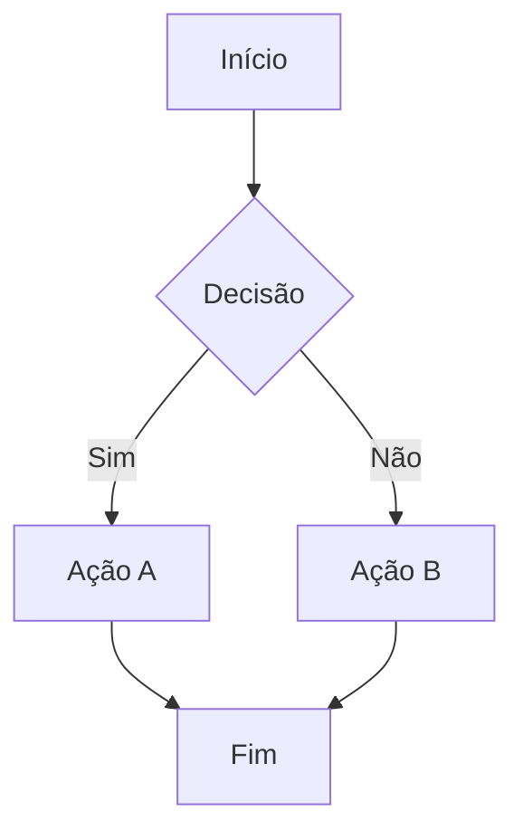
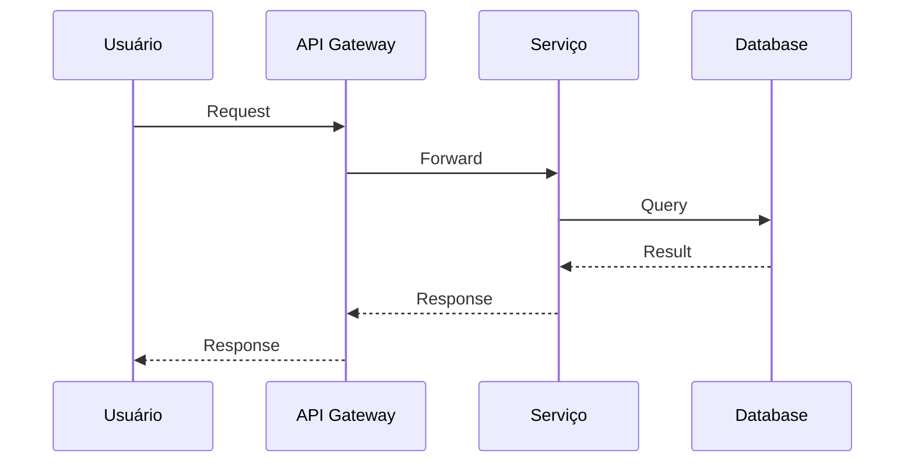
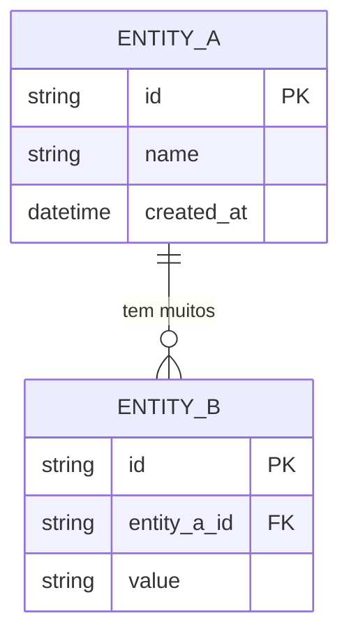

# Blueprint: {STORY-ID} — {Título}

> **Story**: [link para story.md]
> **Tipo**: Fluxo | Sequência | Modelo de Dados | Arquitetura
> **Autor**: {nome}

## Descrição

<!-- O que este diagrama representa e por que é necessário? -->

## Diagrama

<!-- Escolha o tipo de diagrama mais adequado. Exemplos abaixo. -->

### Opção: Fluxo de Processo

### Opção: Diagrama de Sequência

### Opção: Modelo de Dados

## Notas

<!-- Decisões representadas no diagrama, simplificações feitas, aspectos não representados -->
