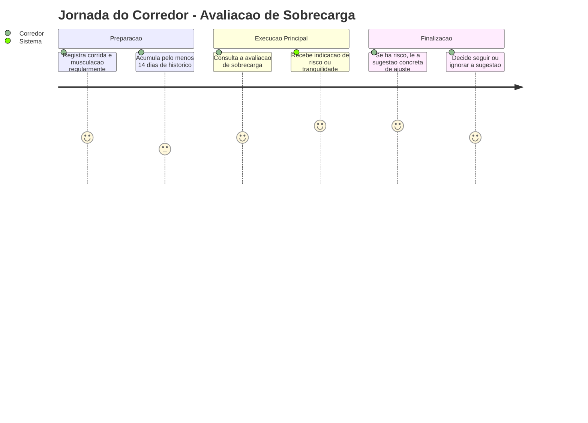
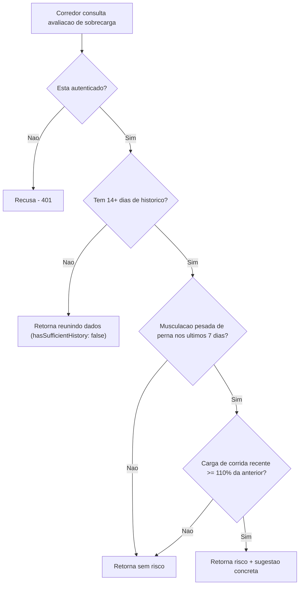
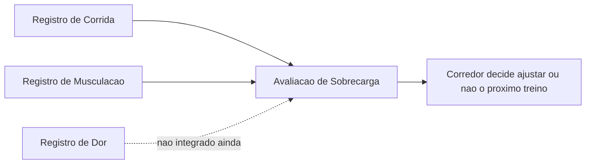

# Avaliacao de Sobrecarga - Sobrecarga - Regras de Negocio

## Indice
- [1. Resumo da Funcionalidade](#1-resumo-da-funcionalidade)
- [2. Jornada do Usuario](#2-jornada-do-usuario)
- [3. Regras de Negocio por Funcionalidade](#3-regras-de-negocio-por-funcionalidade)
- [4. Validacoes e Restricoes](#4-validacoes-e-restricoes)
- [5. Fluxos de Processo](#5-fluxos-de-processo)
- [6. Casos de Uso e Cenarios](#6-casos-de-uso-e-cenarios)

## 1. Resumo da Funcionalidade

**Proposito**: Avisar o corredor, com uma sugestao concreta, quando o padrao combinado dos ultimos 7 dias de musculacao pesada de perna e aumento de carga de corrida indicar risco de sobrecarga - sem nunca bloquear o treino.

**Usuarios**: Corredor amador autenticado que registra corrida e musculacao regularmente.

**Valor de Negocio**: E a funcionalidade central que justifica o Steady - transformar o ajuste de equilibrio entre musculacao e corrida (hoje feito por tentativa e erro) em uma sugestao fundamentada em ciencia do treino, reduzindo episodios de dor recorrente.

**Frequencia de Uso**: Alta - consultada a cada vez que o corredor quer saber se esta em risco, tipicamente apos registrar um novo treino.

**Impacto Operacional**: Um falso positivo gera uma sugestao desnecessaria (custo baixo - a sugestao nunca bloqueia nada); um falso negativo significa que o corredor nao e avisado quando deveria - o risco mais relevante para o negocio.

## 2. Jornada do Usuario

### Visao Geral da Jornada

### Pontos de Contato
- **Consulta sob demanda**: o corredor consulta a avaliacao quando quiser, nao e um alerta automatico empurrado (push).
- **Sugestao concreta, nao generica**: quando ha risco, a mensagem explica o motivo (musculacao pesada de perna + aumento de carga de corrida) e sugere uma acao especifica.
- **Nunca bloqueia**: mesmo com risco identificado, o corredor continua livre para registrar e treinar normalmente.

## 3. Regras de Negocio por Funcionalidade

### 3.1. Avaliacao de Risco de Sobrecarga Combinada

**O que faz**: Analisa o historico de treinos de corrida e musculacao dos ultimos 14 dias do corredor autenticado e indica se ha risco de sobrecarga, com uma sugestao de ajuste quando aplicavel.

**Regras Aplicadas** (fonte: `specs/STORY-001/spec.bdd.md`, regras #3-#6 e #9, fundamentadas em [ADR-001](../../../docs/adr/ADR-001-regra-sobrecarga-combinada.md) e [ADR-004](../../../docs/adr/ADR-004-estado-de-historico-insuficiente-no-contrato-de-avaliacao.md)):
- **Janela movel de 7 dias**: a avaliacao compara os ultimos 7 dias corridos (nao a semana de calendario) com os 7 dias imediatamente anteriores.
- **Gatilho de musculacao**: precisa haver ao menos uma sessao de musculacao de Perna Frontal ou Perna Posterior com intensidade Pesado nos ultimos 7 dias.
  - *Exemplo*: uma sessao de perna com intensidade Leve ou Moderado nao aciona o gatilho, mesmo que seja frequente.
- **Aumento de carga de corrida**: a carga de treino de corrida (duracao x esforco percebido, metodo session-RPE) dos ultimos 7 dias precisa ser pelo menos 110% da carga dos 7 dias anteriores.
  - *Exemplo*: carga anterior de 300 e carga recente de 720 (240%) aciona o gatilho; carga recente de 320 (106%) nao aciona.
- **Ambas as condicoes precisam ocorrer juntas**: so musculacao pesada de perna sem aumento de carga de corrida, ou so aumento de carga sem musculacao pesada de perna, nao geram alerta isoladamente.
- **Historico minimo de 14 dias**: sem pelo menos 14 dias de historico total (contando da sessao mais antiga ate hoje), nenhuma avaliacao e feita - o sistema nunca gera um falso alerta por falta de dados de comparacao.
- **"Reunindo dados" e um estado proprio, distinto de "sem risco" (ADR-004)**: quando o historico e insuficiente, a resposta sinaliza explicitamente esse estado (`hasSufficientHistory: false`) em vez de devolver a mesma resposta de "avaliei e nao ha risco". O app usa esse sinal para exibir "ainda estou reunindo dados" ao corredor novo, em vez de dar a falsa garantia de "esta tudo bem" - um corredor que treina pesado na primeira semana e se lesiona na terceira nao pode ter recebido do app uma tranquilidade que o sistema nunca calculou de verdade.
- **Nunca bloqueia**: mesmo quando ha risco, o registro de qualquer nova sessao continua funcionando normalmente - a avaliacao e informativa, nunca impeditiva.
- **Sugestao concreta**: quando ha risco, a mensagem explica a causa (musculacao pesada de perna + aumento de carga de corrida) e sugere reduzir distancia/ritmo da proxima corrida ou aliviar a intensidade do proximo treino de perna.

**Cenarios de Uso**:
- **Cenario Principal**: corredor com historico suficiente, musculacao pesada de perna recente e aumento de carga de corrida - recebe sugestao concreta.
- **Cenario Alternativo**: corredor consulta a avaliacao sem ter esse padrao - recebe indicacao de "sem risco", sem mensagem.
- **Cenario de Excecao**: corredor novo, com menos de 14 dias de historico - recebe "reunindo dados" (nao "sem risco"), mesmo que o padrao recente pareca arriscado, porque nao ha base de comparacao confiavel (ADR-004).

**Resultado Esperado**: o corredor recebe uma de tres indicacoes claras - "reunindo dados" (historico insuficiente), "sem risco" (avaliado, nada preocupante) ou "risco identificado" (com sugestao especifica de ajuste) - sem qualquer bloqueio de funcionalidade em nenhum dos casos.

## 4. Validacoes e Restricoes

### Controle de Acesso
- **Permissoes**: qualquer corredor autenticado pode consultar sua propria avaliacao de sobrecarga.
- **Hierarquia**: nao ha niveis de acesso diferentes no MVP.

### Dados e Entrada
- **Dados Obrigatorios**: nenhum - a consulta nao recebe parametros, usa o historico ja registrado do proprio corredor e a data atual como referencia.
- **Formatos Aceitos**: nao aplicavel (rota sem entrada).
- **Limitacoes de Volume**: nao aplicavel.

### Restricoes do Sistema
- **Horarios de Funcionamento**: sem restricao.
- **Dependencias**: depende do historico de corrida e musculacao ja registrado - corredor sem nenhum registro recebe automaticamente "sem risco".
- **Limitacoes Tecnicas**: a regra atual so considera corrida e musculacao - nao considera o registro de dor (ver [Registro de Dor](./Registro-de-Dor-Treino-Dor-Rules.md)) no calculo, apesar de a dor ser o sintoma que a regra tenta prevenir.

## 5. Fluxos de Processo

### Fluxo Principal

### Integracoes com Outros Processos

## 6. Casos de Uso e Cenarios

### Caso de Uso 1: Corredor recebe sugestao de ajuste
**Ator Principal**: Corredor autenticado com historico de 14+ dias
**Objetivo**: Saber se o padrao recente de treino indica risco
**Pre-condicoes**: Historico de 14+ dias, musculacao pesada de perna recente, carga de corrida em alta

**Fluxo Principal**:
1. Corredor registra a sessao que completa o padrao de risco
2. Corredor consulta a avaliacao de sobrecarga
3. Sistema retorna risco identificado e a sugestao concreta

**Pos-condicoes**: Corredor informado, decide se segue ou nao a sugestao - nenhum bloqueio ocorre.

### Caso de Uso 2: Corredor novo sem historico suficiente
**Ator Principal**: Corredor recem-cadastrado
**Objetivo**: Consultar a avaliacao de sobrecarga logo nos primeiros dias de uso
**Pre-condicoes**: Menos de 14 dias de historico total

**Fluxo Principal**:
1. Corredor registra suas primeiras sessoes de treino
2. Consulta a avaliacao de sobrecarga
3. Sistema retorna "reunindo dados" (nao "sem risco"), mesmo que o padrao recente pudesse parecer arriscado - o app comunica que a avaliacao ainda nao esta disponivel, nao que ja avaliou e nao ha risco (ADR-004)

**Pos-condicoes**: Nenhum falso alerta gerado por falta de dados, e nenhuma falsa garantia de seguranca transmitida ao corredor.

### Matriz de Cenarios
| Cenario | Entrada | Acao do Sistema | Resultado Esperado |
|---------|---------|-----------------|-------------------|
| Sem historico | Corredor novo, zero sessoes | Retorna "reunindo dados" | 200 - `hasRisk: false`, `suggestion: null`, `hasSufficientHistory: false` |
| Historico insuficiente | Menos de 14 dias de historico | Retorna "reunindo dados" | 200 - `hasRisk: false`, `hasSufficientHistory: false` |
| Padrao de sobrecarga completo | Perna pesada recente + carga de corrida >= 110% | Retorna risco com sugestao | 200 - `hasRisk: true`, sugestao especifica, `hasSufficientHistory: true` |
| So musculacao pesada, sem aumento de carga | Perna pesada recente, carga de corrida estavel | Retorna sem risco | 200 - `hasRisk: false`, `hasSufficientHistory: true` |
| So aumento de carga, sem musculacao pesada | Carga de corrida em alta, sem perna pesada | Retorna sem risco | 200 - `hasRisk: false`, `hasSufficientHistory: true` |
| Sem autenticacao | Requisicao sem token | Recusa antes de processar | 401 |
