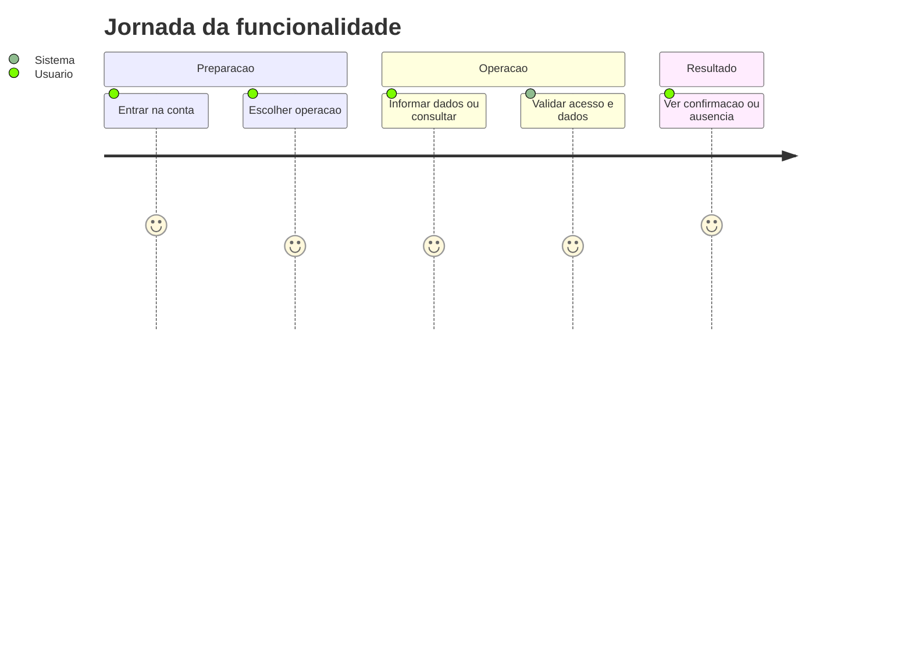
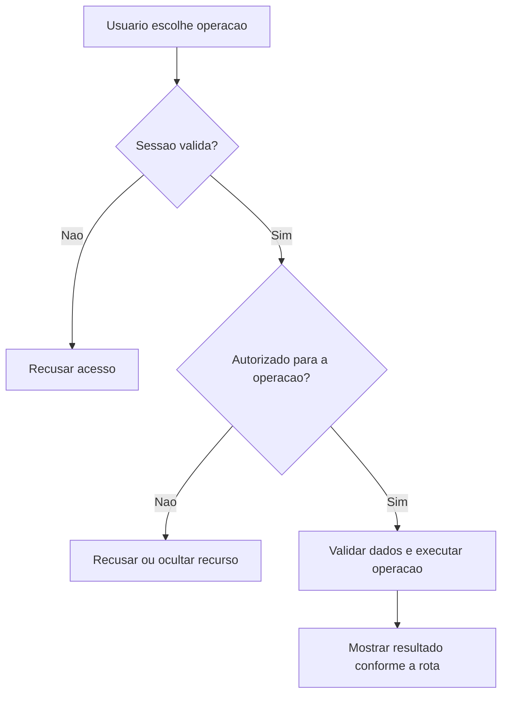
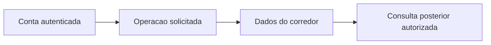

# Ficha e Execucao - Ficha - Regras de Negócio

## Índice

- [1. Resumo da Funcionalidade](#resumo)
- [2. Jornada do Usuário](#jornada)
- [3. Regras de Negócio por Funcionalidade](#regras)
- [4. Validações e Restrições](#validacoes)
- [5. Fluxos de Processo](#fluxos)
- [6. Casos de Uso e Cenários](#casos)

## 1. Resumo da Funcionalidade

**Propósito**: Publicar ficha versionada, registrar musculação ou treino combinado e disponibilizar histórico ao personal vinculado.

**Usuários**: corredor autenticado; personal autenticado nas ações de acompanhamento que exigem esse papel.

**Valor de Negócio**: manter registros e decisões acessíveis somente a quem tem autorização, com resultado consistente entre consultas e sincronização.

**Frequência de Uso**: conforme registros e consultas do usuário, sem frequência obrigatória imposta por estas rotas.

**Impacto Operacional**: o servidor mantém o estado persistido; a disponibilidade de rede e da persistência determina quando o resultado pode ser confirmado.

**Fontes da verdade**: [STORY-013](../../../specs/STORY-013/spec.bdd.md), [STORY-014](../../../specs/STORY-014/spec.bdd.md), [STORY-015](../../../specs/STORY-015/spec.bdd.md), [STORY-017](../../../specs/STORY-017/spec.bdd.md), [STORY-019](../../../specs/STORY-019/spec.bdd.md), [ADR-002](../../../docs/adr/ADR-002-autenticacao-e-isolamento-de-dados.md), [ADR-009](../../../docs/adr/ADR-009-ficha-ativa-e-execucao-imutavel.md), [ADR-010](../../../docs/adr/ADR-010-ficha-com-prescricoes-de-corrida-por-dia.md), [ADR-011](../../../docs/adr/ADR-011-registro-combinado-de-musculacao-e-corrida.md), [ADR-012](../../../docs/adr/ADR-012-prescricao-de-corrida-estruturada.md), [ADR-018](../../../docs/adr/ADR-018-outbox-transacional-da-revisao.md), [ADR-019](../../../docs/adr/ADR-019-identidade-historica-do-exercicio.md). As regras abaixo distinguem comportamento observável atual e limitações identificadas no código; não criam decisão nova de produto.

## 2. Jornada do Usuário

### Visão Geral da Jornada

### Pontos de Contato

- **Conta**: a identidade vem do login Google; nome e e-mail não determinam quem é dono dos registros.
- **Operação**: o usuário acessa as ações descritas abaixo no aplicativo; este documento descreve o serviço que as sustenta.
- **Retorno**: confirmação, dados ou erro explícito; indisponibilidade técnica não representa histórico vazio.

## 3. Regras de Negócio por Funcionalidade

### 3.1. Publicar ficha

**O que faz**: Publicar ficha para o usuário autorizado.

**Regras Aplicadas**:

- **Acesso**: usa a conta autenticada e as restrições específicas da operação. Dados próprios não podem ser solicitados com um dono escolhido no corpo.
- **Execução atual**: Exige Personal; lê ficha ativa para allowedExerciseKeys; TryCreateSheet exige os seis blocos e keys sem duplicação; mapping cria exercícios e prescrições; PublishAsync exige vínculo ativo e troca a ficha em transação; audit; relê ativa para resposta.
- **Resposta observável**: 201 publicada; 400 inválida; 403 sem papel; 404 sem vínculo.

**Cenários de Uso**:

- **Principal**: pessoa autorizada envia os dados válidos e recebe confirmação.
- **Alternativo**: reenvio segue as regras explícitas da operação; ações sem chave não ganham idempotência por suposição.
- **Exceção**: token inválido impede a operação; papel/vínculo/dono são conferidos quando exigidos.

**Resultado Esperado**: TrainingSheetResponse.

### 3.2. Ler ficha ativa própria

**O que faz**: Ler ficha ativa própria para o usuário autorizado.

**Regras Aplicadas**:

- **Acesso**: usa a conta autenticada e as restrições específicas da operação. Dados próprios não podem ser solicitados com um dono escolhido no corpo.
- **Execução atual**: Busca ativa de current.Id e sugestões de carga a partir de execuções dessa ficha; Mapping.Respond serializa workouts e faixas.
- **Resposta observável**: 200 ficha; 404 ausente.

**Cenários de Uso**:

- **Principal**: pessoa autorizada consulta dados existentes e recebe a visão correspondente.
- **Alternativo**: ausência segue a resposta da rota: lista vazia ou recurso não encontrado.
- **Exceção**: token inválido impede a operação; papel/vínculo/dono são conferidos quando exigidos.

**Resultado Esperado**: TrainingSheetResponse.

### 3.3. Registrar execução de ficha

**O que faz**: Registrar execução de ficha para o usuário autorizado.

**Regras Aplicadas**:

- **Acesso**: usa a conta autenticada e as restrições específicas da operação. Dados próprios não podem ser solicitados com um dono escolhido no corpo.
- **Execução atual**: Exige chave; traduz tipo exceto run; data yyyy-MM-dd; busca ficha por id e dono, inclusive inativa; desserializa prescrição; exige todos os exercícios uma vez; copia nome/séries/repetições/key/duração da prescrição; executado usa loadKg ?? 0; pulado não usa carga; salva dor e outbox.
- **Resposta observável**: 201 nova; 200 reenvio; 400 inválida; 404 ficha alheia/ausente.

**Cenários de Uso**:

- **Principal**: pessoa autorizada envia os dados válidos e recebe confirmação.
- **Alternativo**: reenvio segue as regras explícitas da operação; ações sem chave não ganham idempotência por suposição.
- **Exceção**: token inválido impede a operação; papel/vínculo/dono são conferidos quando exigidos.

**Resultado Esperado**: StrengthWorkoutExecutionResponse.

### 3.4. Registrar treino combinado

**O que faz**: Registrar treino combinado para o usuário autorizado.

**Regras Aplicadas**:

- **Acesso**: usa a conta autenticada e as restrições específicas da operação. Dados próprios não podem ser solicitados com um dono escolhido no corpo.
- **Execução atual**: Valida Strength igual à execução de ficha e RunningSession.Create separadamente; AddCombinedExecutionAsync insere as duas modalidades, um evento Combined e dor com Strength.PainReported; Running.PainReported não é passado; responde com os dois registros.
- **Resposta observável**: 201 novo; 200 reenvio de ambas; 400 validação; 404 ficha.

**Cenários de Uso**:

- **Principal**: pessoa autorizada envia os dados válidos e recebe confirmação.
- **Alternativo**: reenvio segue as regras explícitas da operação; ações sem chave não ganham idempotência por suposição.
- **Exceção**: token inválido impede a operação; papel/vínculo/dono são conferidos quando exigidos.

**Resultado Esperado**: Objeto { strength: StrengthWorkoutExecutionResponse, running: RunningSessionResponse }.

### 3.5. Ler histórico pelo personal

**O que faz**: Ler histórico pelo personal para o usuário autorizado.

**Regras Aplicadas**:

- **Acesso**: usa a conta autenticada e as restrições específicas da operação. Dados próprios não podem ser solicitados com um dono escolhido no corpo.
- **Execução atual**: Exige Personal e HasActiveAsync; consulta execuções de ficha, corridas e revisões do corredor; audit; projeta três coleções. Não inclui musculação avulsa.
- **Resposta observável**: 200 histórico; 403 sem papel; 404 sem vínculo.

**Cenários de Uso**:

- **Principal**: pessoa autorizada consulta dados existentes e recebe a visão correspondente.
- **Alternativo**: ausência segue a resposta da rota: lista vazia ou recurso não encontrado.
- **Exceção**: token inválido impede a operação; papel/vínculo/dono são conferidos quando exigidos.

**Resultado Esperado**: CoachingHistoryResponse.

## 4. Validações e Restrições

### Controle de Acesso

- Todas as ações requerem sessão válida. Papel Personal é necessário somente nas rotas explicitamente descritas acima.
- O acesso do personal a histórico/revisão depende de vínculo ativo; encerrá-lo remove esse acesso nas consultas protegidas.

### Dados e Entrada

TryCreateSheet chama TrainingSheet.Create com Push, Pull, Lower e RunningWorkout de terça/quinta/sábado. TrainingSheetMapping.CreateExercises gera Id novo; key ausente ganha nova identidade, key fornecida deve pertencer à ativa. RunPrescription.Create valida descrição e faixas; números ausentes permanecem null. TryCreateExecution valida conjunto completo de ExerciseId e cria snapshot por prescrição; nota é opcional e tem no máximo 200 caracteres; executado exige carga de 0,01 a 999,99 kg, com até duas casas decimais (loadKg ausente vira zero e é rejeitado). Exercício prescrito exige nome aparado de 2 a 100 caracteres, 1..20 séries, 1..100 repetições e tempo opcional positivo; observação aparada tem até 200 caracteres e vazio vira null. Cada treino de força exige pelo menos um exercício. Faixa numérica exige máximo maior que mínimo quando fornecido; esforço mínimo fica entre 1 e 10.

- Tipos e campos completos estão na [especificação técnica](../DevDocs/TrainingSheetEndpoints-Ficha-DevDocs.md).
- Registro que exige chave de sincronização sem essa chave é recusado. Reenvio não significa edição do dado original.

### Restrições do Sistema

TrainingSheetMapping separa conversão de roteamento. A execução guarda ExerciseKey e DurationSeconds no snapshot, mas não campo de duração efetivamente realizada. Faixas de corrida aceitam km decimal. TrainingSheetResponse contém runDescriptions por dia. Reenvio é validado antes da consulta de deduplicação. Location de ficha/execução aponta a caminhos sem GET individual mapeado.

Não há janela de horário de funcionamento codificada nestes endpoints. O serviço depende de token válido, configuração do provedor de login e persistência.

## 5. Fluxos de Processo

### Fluxo Principal

### Integrações com Outros Processos

## 6. Casos de Uso e Cenários

### Caso de Uso 1: Publicar ficha

**Ator Principal**: usuário autorizado para esta ação.

**Objetivo**: Publicar ficha.

**Pré-condições**: sessão válida; papel, vínculo e recurso quando exigidos pela regra acima.

**Fluxo Principal**:

1. Usuário escolhe a ação e informa corredorId: Guid; PublishTrainingSheetBody.
2. Sistema executa as validações de acesso e dados descritas para esta ação.
3. Sistema devolve TrainingSheetResponse.

**Pós-condições**: 201 publicada; 400 inválida; 403 sem papel; 404 sem vínculo. Uma resposta de erro não deve ser exibida pelo app como confirmação.

### Caso de Uso 2: Ler ficha ativa própria

**Ator Principal**: usuário autorizado para esta ação.

**Objetivo**: Ler ficha ativa própria.

**Pré-condições**: sessão válida; papel, vínculo e recurso quando exigidos pela regra acima.

**Fluxo Principal**:

1. Usuário escolhe a ação e informa Sem corpo.
2. Sistema executa as validações de acesso e dados descritas para esta ação.
3. Sistema devolve TrainingSheetResponse.

**Pós-condições**: 200 ficha; 404 ausente. Uma resposta de erro não deve ser exibida pelo app como confirmação.

### Caso de Uso 3: Registrar execução de ficha

**Ator Principal**: usuário autorizado para esta ação.

**Objetivo**: Registrar execução de ficha.

**Pré-condições**: sessão válida; papel, vínculo e recurso quando exigidos pela regra acima.

**Fluxo Principal**:

1. Usuário escolhe a ação e informa StrengthWorkoutExecutionBody; Idempotency-Key obrigatório.
2. Sistema executa as validações de acesso e dados descritas para esta ação.
3. Sistema devolve StrengthWorkoutExecutionResponse.

**Pós-condições**: 201 nova; 200 reenvio; 400 inválida; 404 ficha alheia/ausente. Uma resposta de erro não deve ser exibida pelo app como confirmação.

### Caso de Uso 4: Registrar treino combinado

**Ator Principal**: usuário autorizado para esta ação.

**Objetivo**: Registrar treino combinado.

**Pré-condições**: sessão válida; papel, vínculo e recurso quando exigidos pela regra acima.

**Fluxo Principal**:

1. Usuário escolhe a ação e informa CombinedWorkoutExecutionBody; Idempotency-Key obrigatório.
2. Sistema executa as validações de acesso e dados descritas para esta ação.
3. Sistema devolve Objeto { strength: StrengthWorkoutExecutionResponse, running: RunningSessionResponse }.

**Pós-condições**: 201 novo; 200 reenvio de ambas; 400 validação; 404 ficha. Uma resposta de erro não deve ser exibida pelo app como confirmação.

### Caso de Uso 5: Ler histórico pelo personal

**Ator Principal**: usuário autorizado para esta ação.

**Objetivo**: Ler histórico pelo personal.

**Pré-condições**: sessão válida; papel, vínculo e recurso quando exigidos pela regra acima.

**Fluxo Principal**:

1. Usuário escolhe a ação e informa corredorId: Guid; sem corpo.
2. Sistema executa as validações de acesso e dados descritas para esta ação.
3. Sistema devolve CoachingHistoryResponse.

**Pós-condições**: 200 histórico; 403 sem papel; 404 sem vínculo. Uma resposta de erro não deve ser exibida pelo app como confirmação.

### Matriz de Cenários

| Cenário | Entrada | Ação do Sistema | Resultado Esperado |
|---|---|---|---|
| Publicar ficha | corredorId: Guid; PublishTrainingSheetBody | Validar acesso e executar regras acima | 201 publicada; 400 inválida; 403 sem papel; 404 sem vínculo |
| Ler ficha ativa própria | Sem corpo | Validar acesso e executar regras acima | 200 ficha; 404 ausente |
| Registrar execução de ficha | StrengthWorkoutExecutionBody; Idempotency-Key obrigatório | Validar acesso e executar regras acima | 201 nova; 200 reenvio; 400 inválida; 404 ficha alheia/ausente |
| Registrar treino combinado | CombinedWorkoutExecutionBody; Idempotency-Key obrigatório | Validar acesso e executar regras acima | 201 novo; 200 reenvio de ambas; 400 validação; 404 ficha |
| Ler histórico pelo personal | corredorId: Guid; sem corpo | Validar acesso e executar regras acima | 200 histórico; 403 sem papel; 404 sem vínculo |
| Sessão inválida | Token ausente/expirado | Recusar antes da lógica do handler | 401 |

**Revisão eventual (STORY-014 / ADR-018)**: registro confirmado não aguarda a explicação. Execução aderente não gera card; explicação indisponível preserva comparação e treino. A tentativa manual reutiliza os fatos originais. Compreender ou contestar não altera prescrição nem execução. Nenhuma sugestão da revisão modifica automaticamente um treino futuro.

**Navegação**: [Técnica](../DevDocs/TrainingSheetEndpoints-Ficha-DevDocs.md), [Débitos](../TechnicalDebtsDocs/TrainingSheetEndpoints-Ficha-Debts.md), [Índice](README.md).
