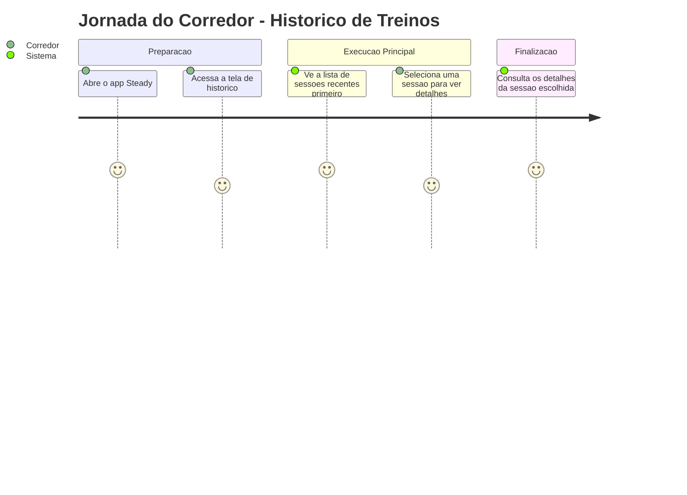
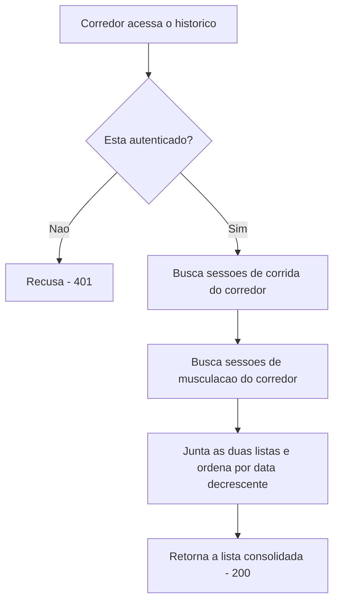

# Historico de Treinos - Historico - Regras de Negocio

## Indice
- [1. Resumo da Funcionalidade](#1-resumo-da-funcionalidade)
- [2. Jornada do Usuario](#2-jornada-do-usuario)
- [3. Regras de Negocio por Funcionalidade](#3-regras-de-negocio-por-funcionalidade)
- [4. Validacoes e Restricoes](#4-validacoes-e-restricoes)
- [5. Fluxos de Processo](#5-fluxos-de-processo)
- [6. Casos de Uso e Cenarios](#6-casos-de-uso-e-cenarios)

## 1. Resumo da Funcionalidade

**Proposito**: Permitir que o corredor consulte, de forma unificada, todas as suas sessoes de treino ja registradas - corrida e musculacao juntas, ordenadas da mais recente para a mais antiga - e tambem consulte uma sessao especifica pelo identificador.

**Usuarios**: Corredor amador autenticado que quer revisar seu proprio historico de treino.

**Valor de Negocio**: Da visibilidade ao corredor sobre a consistencia do proprio treino ao longo do tempo, alem de ser a base de dados usada pela avaliacao de sobrecarga.

**Frequencia de Uso**: Alta - tipicamente consultada ao abrir o app, para acompanhar o progresso.

**Impacto Operacional**: Nenhum efeito colateral - e uma funcionalidade somente leitura, sem alterar dados.

## 2. Jornada do Usuario

### Visao Geral da Jornada

### Pontos de Contato
- **Lista consolidada**: uma unica tela mostra corrida e musculacao juntas, sem precisar alternar entre secoes separadas.
- **Ordenacao por recencia**: as sessoes mais recentes aparecem primeiro.
- **Detalhe individual**: o corredor pode abrir uma sessao especifica para ver todos os seus dados.

## 3. Regras de Negocio por Funcionalidade

### 3.1. Listagem do Historico Consolidado

**O que faz**: Retorna todas as sessoes de treino (corrida e musculacao) do corredor autenticado, em uma unica lista, da mais recente para a mais antiga.

**Regras Aplicadas** (fonte: `specs/STORY-002/spec.bdd.md`, regras #1-#3):
- **Autenticacao obrigatoria**: mesmo requisito de qualquer outra funcionalidade da API.
- **Isolamento por corredor**: o corredor so recebe suas proprias sessoes, nunca de outro corredor.
  - *Exemplo*: corredor A registra 2 sessoes e corredor B registra 1 - a consulta do corredor A retorna exatamente 2 sessoes, nunca a de B.
- **Sem historico, lista vazia**: um corredor que ainda nao registrou nenhuma sessao recebe uma lista vazia, nao um erro.
- **Ordenacao por data decrescente**: a sessao mais recente aparece primeiro na lista.
- **Tipo identificado por campo**: cada item da lista indica se e "Corrida" ou "Musculacao", com os campos relevantes de cada tipo preenchidos (os campos do outro tipo ficam vazios/nulos).

**Cenarios de Uso**:
- **Cenario Principal**: corredor com sessoes de corrida e musculacao registradas consulta o historico e ve tudo junto, mais recente primeiro.
- **Cenario Alternativo**: corredor recem-cadastrado sem nenhuma sessao consulta o historico e ve uma lista vazia.

**Resultado Esperado**: uma visao completa e cronologica do treino do corredor, sem misturar dados de outros usuarios.

### 3.2. Consulta de Sessao Individual

**O que faz**: Retorna os dados completos de uma sessao especifica (corrida ou musculacao) a partir do seu identificador.

**Regras Aplicadas** (fonte: `specs/STORY-002/spec.bdd.md`, regra #4):
- **Isolamento estrito**: se a sessao pertencer a outro corredor, o sistema responde como se ela nao existisse (nao revela que o recurso existe para outro usuario).
  - *Exemplo*: corredor A tenta acessar diretamente o identificador de uma sessao do corredor B - recebe a mesma resposta de "nao encontrado" que receberia para um identificador inexistente.
- **Busca em ambos os tipos**: o sistema procura o identificador tanto entre as sessoes de corrida quanto entre as de musculacao, sem que o corredor precise informar qual tipo e.

**Cenarios de Uso**:
- **Cenario Principal**: corredor abre o detalhe de uma sessao propria a partir da lista de historico.
- **Cenario de Excecao**: corredor tenta acessar um identificador que nao existe, ou que pertence a outro corredor - recebe "nao encontrado" em ambos os casos.

**Resultado Esperado**: acesso aos detalhes completos da sessao quando ela pertence ao corredor consultante; nenhuma informacao vaza sobre sessoes de outros corredores.

## 4. Validacoes e Restricoes

### Controle de Acesso
- **Permissoes**: qualquer corredor autenticado pode consultar seu proprio historico.
- **Hierarquia**: nao ha niveis de acesso diferentes no MVP - isolamento e estritamente por identidade do corredor.

### Dados e Entrada
- **Dados Obrigatorios**: nenhum para a listagem; o identificador da sessao para a consulta individual.
- **Formatos Aceitos**: identificador no formato GUID.
- **Limitacoes de Volume**: nenhuma - a listagem retorna todas as sessoes existentes do corredor, sem paginacao (ver observacao tecnica na documentacao de debitos).

### Restricoes do Sistema
- **Horarios de Funcionamento**: sem restricao.
- **Dependencias**: exige o servico de login do Google disponivel.
- **Limitacoes Tecnicas**: os registros de dor (ver [Registro de Dor](./Registro-de-Dor-Treino-Dor-Rules.md)) nao aparecem neste historico consolidado - apenas corrida e musculacao.

## 5. Fluxos de Processo

### Fluxo Principal

### Integracoes com Outros Processos

## 6. Casos de Uso e Cenarios

### Caso de Uso 1: Corredor revisa o proprio progresso
**Ator Principal**: Corredor autenticado
**Objetivo**: Ver todas as sessoes de treino registradas, mais recentes primeiro
**Pre-condicoes**: Corredor com sessoes de corrida e/ou musculacao ja registradas

**Fluxo Principal**:
1. Corredor abre a tela de historico
2. Sistema retorna a lista consolidada, ordenada por data
3. Corredor seleciona uma sessao para ver detalhes

**Pos-condicoes**: Corredor visualiza os detalhes completos da sessao escolhida.

### Caso de Uso 2: Corredor tenta acessar sessao de outro usuario
**Ator Principal**: Corredor autenticado mal-intencionado ou por engano (ex.: link compartilhado)
**Objetivo**: Acessar diretamente uma sessao pelo identificador
**Pre-condicoes**: Identificador de uma sessao que pertence a outro corredor

**Fluxo Principal**:
1. Corredor tenta consultar a sessao pelo identificador
2. Sistema responde como se a sessao nao existisse

**Pos-condicoes**: Nenhum dado de outro corredor e exposto.

### Matriz de Cenarios
| Cenario | Entrada | Acao do Sistema | Resultado Esperado |
|---------|---------|-----------------|-------------------|
| Historico com sessoes | Corredor com 2+ sessoes registradas | Retorna lista consolidada ordenada | 200 - lista com corrida e musculacao juntas |
| Sem historico | Corredor sem nenhuma sessao | Retorna lista vazia | 200 - `[]` |
| Consulta individual valida | ID de sessao propria | Retorna os detalhes da sessao | 200 - dados completos |
| Consulta individual de outro corredor | ID de sessao de outro corredor | Recusa sem revelar existencia | 404 |
| Consulta individual inexistente | ID que nao existe | Recusa | 404 |
| Sem autenticacao | Requisicao sem token | Recusa antes de processar | 401 |
