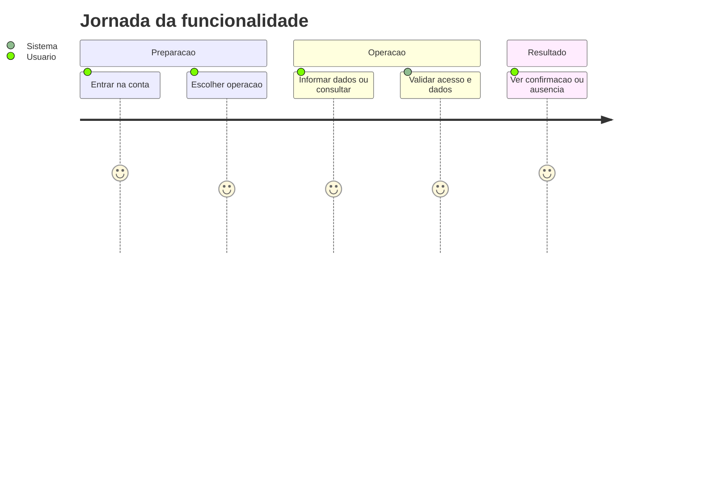
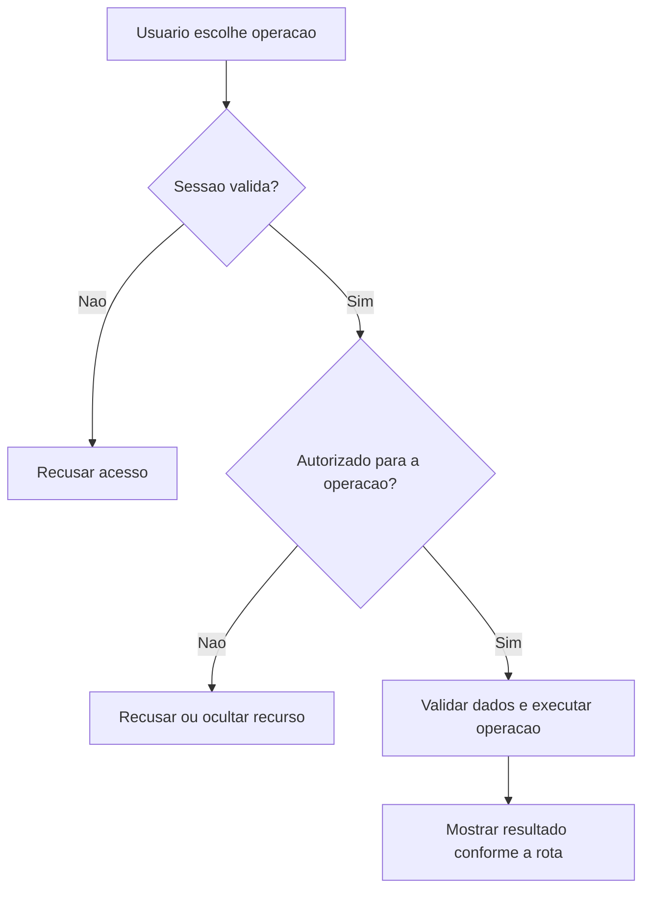
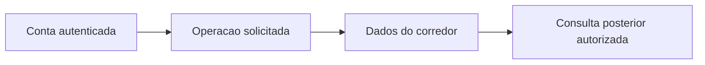

# Historico de Treinos - Historico - Regras de Negócio

## Índice

- [1. Resumo da Funcionalidade](#resumo)
- [2. Jornada do Usuário](#jornada)
- [3. Regras de Negócio por Funcionalidade](#regras)
- [4. Validações e Restrições](#validacoes)
- [5. Fluxos de Processo](#fluxos)
- [6. Casos de Uso e Cenários](#casos)

## 1. Resumo da Funcionalidade

**Propósito**: Unificar corridas, musculação avulsa e execuções da ficha no histórico do corredor.

**Usuários**: corredor autenticado; personal autenticado nas ações de acompanhamento que exigem esse papel.

**Valor de Negócio**: manter registros e decisões acessíveis somente a quem tem autorização, com resultado consistente entre consultas e sincronização.

**Frequência de Uso**: conforme registros e consultas do usuário, sem frequência obrigatória imposta por estas rotas.

**Impacto Operacional**: o servidor mantém o estado persistido; a disponibilidade de rede e da persistência determina quando o resultado pode ser confirmado.

**Fontes da verdade**: [STORY-001](../../../specs/STORY-001/spec.bdd.md), [STORY-002](../../../specs/STORY-002/spec.bdd.md), [STORY-013](../../../specs/STORY-013/spec.bdd.md), [STORY-018](../../../specs/STORY-018/spec.bdd.md), [ADR-002](../../../docs/adr/ADR-002-autenticacao-e-isolamento-de-dados.md), [ADR-009](../../../docs/adr/ADR-009-ficha-ativa-e-execucao-imutavel.md). As regras abaixo distinguem comportamento observável atual e limitações identificadas no código; não criam decisão nova de produto.

## 2. Jornada do Usuário

### Visão Geral da Jornada

### Pontos de Contato

- **Conta**: a identidade vem do login Google; nome e e-mail não determinam quem é dono dos registros.
- **Operação**: o usuário acessa as ações descritas abaixo no aplicativo; este documento descreve o serviço que as sustenta.
- **Retorno**: confirmação, dados ou erro explícito; indisponibilidade técnica não representa histórico vazio.

## 3. Regras de Negócio por Funcionalidade

### 3.1. Listar histórico

**O que faz**: Listar histórico para o usuário autorizado.

**Regras Aplicadas**:

- **Acesso**: usa a conta autenticada e as restrições específicas da operação. Dados próprios não podem ser solicitados com um dono escolhido no corpo.
- **Execução atual**: Lê as três origens sequencialmente; corrida usa Type Corrida, força avulsa e ficha usam Musculacao; ficha tem durationMinutes null e workoutType push/pull/lower; converte sua data yyyy-MM-dd; concatena e ordena data decrescente.
- **Resposta observável**: 200 lista, inclusive vazia.

**Cenários de Uso**:

- **Principal**: pessoa autorizada consulta dados existentes e recebe a visão correspondente.
- **Alternativo**: ausência segue a resposta da rota: lista vazia ou recurso não encontrado.
- **Exceção**: token inválido impede a operação; papel/vínculo/dono são conferidos quando exigidos.

**Resultado Esperado**: Lista de TrainingSessionResponse.

### 3.2. Consultar sessão

**O que faz**: Consultar sessão para o usuário autorizado.

**Regras Aplicadas**:

- **Acesso**: usa a conta autenticada e as restrições específicas da operação. Dados próprios não podem ser solicitados com um dono escolhido no corpo.
- **Execução atual**: Procura corrida com id e dono; se não existe, procura força avulsa; retorna 404 se nenhuma for encontrada. Esta rota não consulta execução de ficha.
- **Resposta observável**: 200 encontrada; 404 ausente ou de outro corredor.

**Cenários de Uso**:

- **Principal**: pessoa autorizada consulta dados existentes e recebe a visão correspondente.
- **Alternativo**: ausência segue a resposta da rota: lista vazia ou recurso não encontrado.
- **Exceção**: token inválido impede a operação; papel/vínculo/dono são conferidos quando exigidos.

**Resultado Esperado**: TrainingSessionResponse.

## 4. Validações e Restrições

### Controle de Acesso

- Todas as ações requerem sessão válida. Papel Personal é necessário somente nas rotas explicitamente descritas acima.
- O acesso do personal a histórico/revisão depende de vínculo ativo; encerrá-lo remove esse acesso nas consultas protegidas.

### Dados e Entrada

Não invoca factories ou serviços de domínio. A composição é uma projeção dos registros já persistidos. Nenhuma duração ou intensidade é inferida para execução de ficha.

- Tipos e campos completos estão na [especificação técnica](../DevDocs/TrainingHistoryEndpoints-Historico-DevDocs.md).
- Registro que exige chave de sincronização sem essa chave é recusado. Reenvio não significa edição do dado original.

### Restrições do Sistema

Histórico próprio permanece acessível depois do encerramento do vínculo. DTO tem durationMinutes opcional e workoutType opcional. A execução da ficha aparece na lista, mas não possui detalhe nesta rota.

Não há janela de horário de funcionamento codificada nestes endpoints. O serviço depende de token válido, configuração do provedor de login e persistência.

## 5. Fluxos de Processo

### Fluxo Principal

### Integrações com Outros Processos

## 6. Casos de Uso e Cenários

### Caso de Uso 1: Listar histórico

**Ator Principal**: usuário autorizado para esta ação.

**Objetivo**: Listar histórico.

**Pré-condições**: sessão válida; papel, vínculo e recurso quando exigidos pela regra acima.

**Fluxo Principal**:

1. Usuário escolhe a ação e informa Sem corpo; sem paginação.
2. Sistema executa as validações de acesso e dados descritas para esta ação.
3. Sistema devolve Lista de TrainingSessionResponse.

**Pós-condições**: 200 lista, inclusive vazia. Uma resposta de erro não deve ser exibida pelo app como confirmação.

### Caso de Uso 2: Consultar sessão

**Ator Principal**: usuário autorizado para esta ação.

**Objetivo**: Consultar sessão.

**Pré-condições**: sessão válida; papel, vínculo e recurso quando exigidos pela regra acima.

**Fluxo Principal**:

1. Usuário escolhe a ação e informa id: Guid da sessão.
2. Sistema executa as validações de acesso e dados descritas para esta ação.
3. Sistema devolve TrainingSessionResponse.

**Pós-condições**: 200 encontrada; 404 ausente ou de outro corredor. Uma resposta de erro não deve ser exibida pelo app como confirmação.

### Matriz de Cenários

| Cenário | Entrada | Ação do Sistema | Resultado Esperado |
|---|---|---|---|
| Listar histórico | Sem corpo; sem paginação | Validar acesso e executar regras acima | 200 lista, inclusive vazia |
| Consultar sessão | id: Guid da sessão | Validar acesso e executar regras acima | 200 encontrada; 404 ausente ou de outro corredor |
| Sessão inválida | Token ausente/expirado | Recusar antes da lógica do handler | 401 |

**Navegação**: [Técnica](../DevDocs/TrainingHistoryEndpoints-Historico-DevDocs.md), [Débitos](../TechnicalDebtsDocs/TrainingHistoryEndpoints-Historico-Debts.md), [Índice](README.md).
