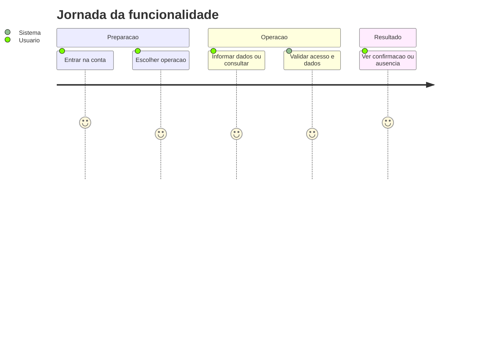
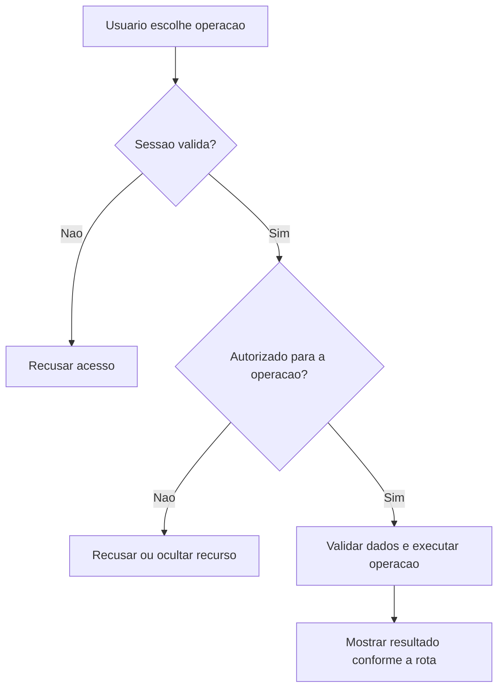
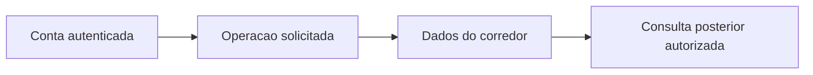

# Pedidos de Planejamento - Planejamento - Regras de Negócio

## Índice

- [1. Resumo da Funcionalidade](#resumo)
- [2. Jornada do Usuário](#jornada)
- [3. Regras de Negócio por Funcionalidade](#regras)
- [4. Validações e Restrições](#validacoes)
- [5. Fluxos de Processo](#fluxos)
- [6. Casos de Uso e Cenários](#casos)

## 1. Resumo da Funcionalidade

**Propósito**: Persistir o contexto do planejamento do corredor com identidade estável criada antes da sincronização.

**Usuários**: corredor autenticado; personal autenticado nas ações de acompanhamento que exigem esse papel.

**Valor de Negócio**: manter registros e decisões acessíveis somente a quem tem autorização, com resultado consistente entre consultas e sincronização.

**Frequência de Uso**: conforme registros e consultas do usuário, sem frequência obrigatória imposta por estas rotas.

**Impacto Operacional**: o servidor mantém o estado persistido; a disponibilidade de rede e da persistência determina quando o resultado pode ser confirmado.

**Fontes da verdade**: [STORY-010](../../../specs/STORY-010/spec.bdd.md), [ADR-002](../../../docs/adr/ADR-002-autenticacao-e-isolamento-de-dados.md), [ADR-003](../../../docs/adr/ADR-003-chave-de-idempotencia-para-sincronizacao-offline.md), [ADR-007](../../../docs/adr/ADR-007-persistencia-do-pedido-de-plano-de-treino.md). As regras abaixo distinguem comportamento observável atual e limitações identificadas no código; não criam decisão nova de produto.

## 2. Jornada do Usuário

### Visão Geral da Jornada

### Pontos de Contato

- **Conta**: a identidade vem do login Google; nome e e-mail não determinam quem é dono dos registros.
- **Operação**: o usuário acessa as ações descritas abaixo no aplicativo; este documento descreve o serviço que as sustenta.
- **Retorno**: confirmação, dados ou erro explícito; indisponibilidade técnica não representa histórico vazio.

## 3. Regras de Negócio por Funcionalidade

### 3.1. Criar pedido

**O que faz**: Criar pedido para o usuário autorizado.

**Regras Aplicadas**:

- **Acesso**: usa a conta autenticada e as restrições específicas da operação. Dados próprios não podem ser solicitados com um dono escolhido no corpo.
- **Execução atual**: Exige chave; PlanRequestWire traduz distância/equipamento/dores; data estrita yyyy-MM-dd; factory compara data da prova ao dia UTC e valida perfil; salva dono e chave; Responder traduz enums para vocabulário do app.
- **Resposta observável**: 201 novo; 200 reenvio; 400 validação.

**Cenários de Uso**:

- **Principal**: pessoa autorizada envia os dados válidos e recebe confirmação.
- **Alternativo**: reenvio segue as regras explícitas da operação; ações sem chave não ganham idempotência por suposição.
- **Exceção**: token inválido impede a operação; papel/vínculo/dono são conferidos quando exigidos.

**Resultado Esperado**: PlanRequestResponse.

### 3.2. Listar pedidos

**O que faz**: Listar pedidos para o usuário autorizado.

**Regras Aplicadas**:

- **Acesso**: usa a conta autenticada e as restrições específicas da operação. Dados próprios não podem ser solicitados com um dono escolhido no corpo.
- **Execução atual**: Busca pedidos do dono e projeta Responder; sem geração de exercícios.
- **Resposta observável**: 200 lista, inclusive vazia.

**Cenários de Uso**:

- **Principal**: pessoa autorizada consulta dados existentes e recebe a visão correspondente.
- **Alternativo**: ausência segue a resposta da rota: lista vazia ou recurso não encontrado.
- **Exceção**: token inválido impede a operação; papel/vínculo/dono são conferidos quando exigidos.

**Resultado Esperado**: Lista de PlanRequestResponse.

### 3.3. Consultar pedido

**O que faz**: Consultar pedido para o usuário autorizado.

**Regras Aplicadas**:

- **Acesso**: usa a conta autenticada e as restrições específicas da operação. Dados próprios não podem ser solicitados com um dono escolhido no corpo.
- **Execução atual**: Busca pela chave de sincronização e CurrentCorredor.Id; não usa Id interno da entidade.
- **Resposta observável**: 200 encontrado; 404 inexistente ou de outro corredor.

**Cenários de Uso**:

- **Principal**: pessoa autorizada consulta dados existentes e recebe a visão correspondente.
- **Alternativo**: ausência segue a resposta da rota: lista vazia ou recurso não encontrado.
- **Exceção**: token inválido impede a operação; papel/vínculo/dono são conferidos quando exigidos.

**Resultado Esperado**: PlanRequestResponse.

## 4. Validações e Restrições

### Controle de Acesso

- Todas as ações requerem sessão válida. Papel Personal é necessário somente nas rotas explicitamente descritas acima.
- O acesso do personal a histórico/revisão depende de vínculo ativo; encerrá-lo remove esse acesso nas consultas protegidas.

### Dados e Entrada

PlanRequest.Create exige prova futura, longestRecentRunKm>0, trainingDaysPerWeek 3..6; opcionais currentWeeklyRunningDays 0..7, referenceDistanceKm>0, strengthSessionMinutes 20..90 e referenceDuration HH:MM:SS. Normaliza textos vazios em null, deduplica dores; nenhuma sozinha vira lista vazia, combinada com outras é erro.

- Tipos e campos completos estão na [especificação técnica](../DevDocs/PlanRequestEndpoints-Planejamento-DevDocs.md).
- Registro que exige chave de sincronização sem essa chave é recusado. Reenvio não significa edição do dado original.

### Restrições do Sistema

Valores de distância: 5, 10, 21.1, 42.2, ultra. Equipamento: academia_completa, halteres_casa, peso_corporal. Dor: canela, joelho, it_band, lombar, tornozelo, panturrilha, nenhuma. it_band é um valor de contrato; não se inventa expansão. PriorInjuries é dado sensível e não é logado pelo endpoint. Location usa chave, não Id.

Não há janela de horário de funcionamento codificada nestes endpoints. O serviço depende de token válido, configuração do provedor de login e persistência.

## 5. Fluxos de Processo

### Fluxo Principal

### Integrações com Outros Processos

## 6. Casos de Uso e Cenários

### Caso de Uso 1: Criar pedido

**Ator Principal**: usuário autorizado para esta ação.

**Objetivo**: Criar pedido.

**Pré-condições**: sessão válida; papel, vínculo e recurso quando exigidos pela regra acima.

**Fluxo Principal**:

1. Usuário escolhe a ação e informa PlanRequestBody; Idempotency-Key obrigatório.
2. Sistema executa as validações de acesso e dados descritas para esta ação.
3. Sistema devolve PlanRequestResponse.

**Pós-condições**: 201 novo; 200 reenvio; 400 validação. Uma resposta de erro não deve ser exibida pelo app como confirmação.

### Caso de Uso 2: Listar pedidos

**Ator Principal**: usuário autorizado para esta ação.

**Objetivo**: Listar pedidos.

**Pré-condições**: sessão válida; papel, vínculo e recurso quando exigidos pela regra acima.

**Fluxo Principal**:

1. Usuário escolhe a ação e informa Sem corpo; sem parâmetros.
2. Sistema executa as validações de acesso e dados descritas para esta ação.
3. Sistema devolve Lista de PlanRequestResponse.

**Pós-condições**: 200 lista, inclusive vazia. Uma resposta de erro não deve ser exibida pelo app como confirmação.

### Caso de Uso 3: Consultar pedido

**Ator Principal**: usuário autorizado para esta ação.

**Objetivo**: Consultar pedido.

**Pré-condições**: sessão válida; papel, vínculo e recurso quando exigidos pela regra acima.

**Fluxo Principal**:

1. Usuário escolhe a ação e informa idempotencyKey: Guid gerado pelo cliente.
2. Sistema executa as validações de acesso e dados descritas para esta ação.
3. Sistema devolve PlanRequestResponse.

**Pós-condições**: 200 encontrado; 404 inexistente ou de outro corredor. Uma resposta de erro não deve ser exibida pelo app como confirmação.

### Matriz de Cenários

| Cenário | Entrada | Ação do Sistema | Resultado Esperado |
|---|---|---|---|
| Criar pedido | PlanRequestBody; Idempotency-Key obrigatório | Validar acesso e executar regras acima | 201 novo; 200 reenvio; 400 validação |
| Listar pedidos | Sem corpo; sem parâmetros | Validar acesso e executar regras acima | 200 lista, inclusive vazia |
| Consultar pedido | idempotencyKey: Guid gerado pelo cliente | Validar acesso e executar regras acima | 200 encontrado; 404 inexistente ou de outro corredor |
| Sessão inválida | Token ausente/expirado | Recusar antes da lógica do handler | 401 |

**Navegação**: [Técnica](../DevDocs/PlanRequestEndpoints-Planejamento-DevDocs.md), [Débitos](../TechnicalDebtsDocs/PlanRequestEndpoints-Planejamento-Debts.md), [Índice](README.md).
