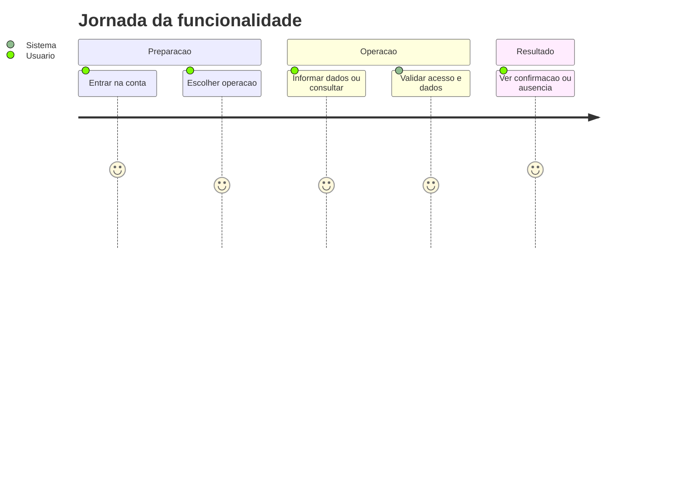
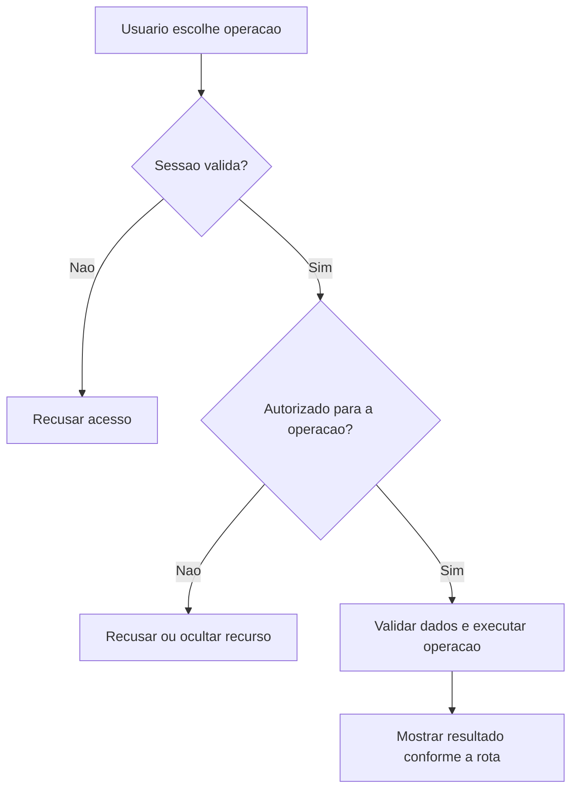
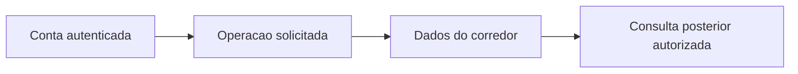

# Plano do Steady - Planejamento - Regras de Negócio

## Índice

- [1. Resumo da Funcionalidade](#resumo)
- [2. Jornada do Usuário](#jornada)
- [3. Regras de Negócio por Funcionalidade](#regras)
- [4. Validações e Restrições](#validacoes)
- [5. Fluxos de Processo](#fluxos)
- [6. Casos de Uso e Cenários](#casos)

## 1. Resumo da Funcionalidade

**Propósito**: Ler o documento versionado associado ao corredor, mantendo prescrições e mobilidade sem calcular progressão.

**Usuários**: corredor autenticado; personal autenticado nas ações de acompanhamento que exigem esse papel.

**Valor de Negócio**: manter registros e decisões acessíveis somente a quem tem autorização, com resultado consistente entre consultas e sincronização.

**Frequência de Uso**: conforme registros e consultas do usuário, sem frequência obrigatória imposta por estas rotas.

**Impacto Operacional**: o servidor mantém o estado persistido; a disponibilidade de rede e da persistência determina quando o resultado pode ser confirmado.

**Fontes da verdade**: [STORY-016](../../../specs/STORY-016/spec.bdd.md), [STORY-020](../../../specs/STORY-020/spec.bdd.md), [ADR-002](../../../docs/adr/ADR-002-autenticacao-e-isolamento-de-dados.md), [ADR-006](../../../docs/adr/ADR-006-interpolacao-do-longao-semanal.md), [ADR-013](../../../docs/adr/ADR-013-plano-do-steady-como-fonte-de-prescricao.md). As regras abaixo distinguem comportamento observável atual e limitações identificadas no código; não criam decisão nova de produto.

## 2. Jornada do Usuário

### Visão Geral da Jornada

### Pontos de Contato

- **Conta**: a identidade vem do login Google; nome e e-mail não determinam quem é dono dos registros.
- **Operação**: o usuário acessa as ações descritas abaixo no aplicativo; este documento descreve o serviço que as sustenta.
- **Retorno**: confirmação, dados ou erro explícito; indisponibilidade técnica não representa histórico vazio.

## 3. Regras de Negócio por Funcionalidade

### 3.1. Ler plano associado

**O que faz**: Ler plano associado para o usuário autorizado.

**Regras Aplicadas**:

- **Acesso**: usa a conta autenticada e as restrições específicas da operação. Dados próprios não podem ser solicitados com um dono escolhido no corpo.
- **Execução atual**: Busca a versão apontada pelo corredor; se ausente devolve 404; TrainingPlanMapping.Respond projeta conteúdo e weekPlan, incluindo RunPrescription e faixas opcionais.
- **Resposta observável**: 200 documento; 404 associação/versão ausente.

**Cenários de Uso**:

- **Principal**: pessoa autorizada consulta dados existentes e recebe a visão correspondente.
- **Alternativo**: ausência segue a resposta da rota: lista vazia ou recurso não encontrado.
- **Exceção**: token inválido impede a operação; papel/vínculo/dono são conferidos quando exigidos.

**Resultado Esperado**: SteadyTrainingPlanResponse.

## 4. Validações e Restrições

### Controle de Acesso

- Todas as ações requerem sessão válida. Papel Personal é necessário somente nas rotas explicitamente descritas acima.
- O acesso do personal a histórico/revisão depende de vínculo ativo; encerrá-lo remove esse acesso nas consultas protegidas.

### Dados e Entrada

SteadyTrainingPlan é documento imutável por versão. A leitura não chama PlanRequest nem gera exercícios. RunPrescription ausente permanece null; faixas por fase de longRunProgression não são convertidas em distância diária.

- Tipos e campos completos estão na [especificação técnica](../DevDocs/TrainingPlanEndpoints-Planejamento-DevDocs.md).
- Registro que exige chave de sincronização sem essa chave é recusado. Reenvio não significa edição do dado original.

### Restrições do Sistema

TrainingPlanMapping.Respond converte título, subtítulo, princípio, fases, notas, visão semanal, dias, taper, progressão por fase, mobilidade, regras e nota de ritmo. Publicar versão nova não realoca o corredor automaticamente. A ordem de mobilidade recebida é preservada; mover a apresentação para a aba Semana pertence ao app (STORY-020).

Não há janela de horário de funcionamento codificada nestes endpoints. O serviço depende de token válido, configuração do provedor de login e persistência.

## 5. Fluxos de Processo

### Fluxo Principal

### Integrações com Outros Processos

## 6. Casos de Uso e Cenários

### Caso de Uso 1: Ler plano associado

**Ator Principal**: usuário autorizado para esta ação.

**Objetivo**: Ler plano associado.

**Pré-condições**: sessão válida; papel, vínculo e recurso quando exigidos pela regra acima.

**Fluxo Principal**:

1. Usuário escolhe a ação e informa Sem corpo; não recebe corredorId.
2. Sistema executa as validações de acesso e dados descritas para esta ação.
3. Sistema devolve SteadyTrainingPlanResponse.

**Pós-condições**: 200 documento; 404 associação/versão ausente. Uma resposta de erro não deve ser exibida pelo app como confirmação.

### Matriz de Cenários

| Cenário | Entrada | Ação do Sistema | Resultado Esperado |
|---|---|---|---|
| Ler plano associado | Sem corpo; não recebe corredorId | Validar acesso e executar regras acima | 200 documento; 404 associação/versão ausente |
| Sessão inválida | Token ausente/expirado | Recusar antes da lógica do handler | 401 |

**Navegação**: [Técnica](../DevDocs/TrainingPlanEndpoints-Planejamento-DevDocs.md), [Débitos](../TechnicalDebtsDocs/TrainingPlanEndpoints-Planejamento-Debts.md), [Índice](README.md).
