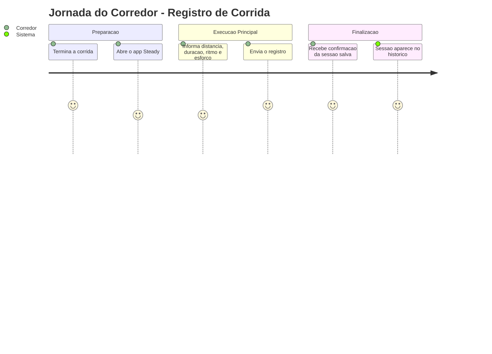
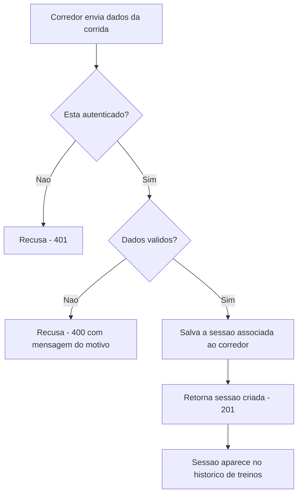
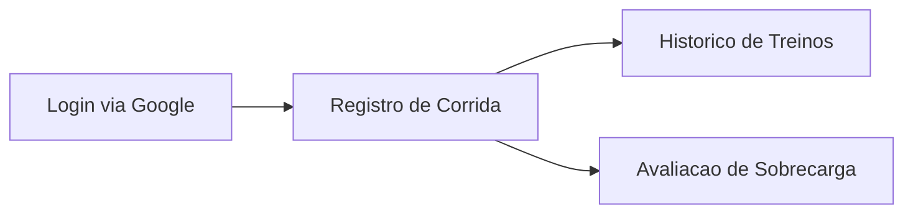

# Registro de Corrida - Treino-Corrida - Regras de Negocio

## Indice
- [1. Resumo da Funcionalidade](#1-resumo-da-funcionalidade)
- [2. Jornada do Usuario](#2-jornada-do-usuario)
- [3. Regras de Negocio por Funcionalidade](#3-regras-de-negocio-por-funcionalidade)
- [4. Validacoes e Restricoes](#4-validacoes-e-restricoes)
- [5. Fluxos de Processo](#5-fluxos-de-processo)
- [6. Casos de Uso e Cenarios](#6-casos-de-uso-e-cenarios)

## 1. Resumo da Funcionalidade

**Proposito**: Permitir que o corredor registre uma sessao de treino de corrida (distancia, duracao, ritmo, percepcao de esforco) para que ela fique salva no seu historico e sirva de base para a deteccao de sobrecarga.

**Usuarios**: Corredor amador autenticado (via Google Sign-In) usando o app Steady.

**Valor de Negocio**: E o dado primario que alimenta a avaliacao de risco de sobrecarga e o historico de treinos - sem esse registro, o Steady nao consegue cumprir sua promessa central de treino seguro para a maratona.

**Frequencia de Uso**: Alta - a cada sessao de corrida concluida, potencialmente varias vezes por semana.

**Impacto Operacional**: Dado incorreto ou rejeitado aqui compromete diretamente a qualidade do alerta de sobrecarga (ver [Avaliacao de Sobrecarga](./Avaliacao-de-Sobrecarga-Sobrecarga-Rules.md)) e do historico consolidado.

## 2. Jornada do Usuario

### Visao Geral da Jornada

### Pontos de Contato
- **Registro pos-corrida**: o corredor informa os dados da corrida logo apos o treino (ou depois, sem restricao de prazo).
- **Confirmacao imediata**: o sistema responde com os dados da sessao criada, incluindo o identificador gerado.
- **Reflexo no historico**: a sessao passa a aparecer junto com as demais sessoes de treino (corrida e musculacao) no historico consolidado.

## 3. Regras de Negocio por Funcionalidade

### 3.1. Registro de Sessao de Treino de Corrida

**O que faz**: Recebe os dados de uma corrida realizada e salva permanentemente, associada ao corredor autenticado.

**Regras Aplicadas** (fonte: `specs/STORY-001/spec.bdd.md`, regra de negocio #1, e `specs/STORY-002/spec.bdd.md`, regras #1-#5):
- **Autenticacao obrigatoria**: so e possivel registrar uma corrida com um login valido do Google. Sem isso, o sistema recusa a requisicao antes de qualquer processamento.
  - *Exemplo*: um app que nao envie o token de login recebe recusa imediata (nao chega a salvar nada).
- **Distancia deve ser maior que zero**: nao e possivel registrar uma corrida com distancia zero ou negativa.
  - *Exemplo*: tentar registrar 0 km e rejeitado com a mensagem "A distância deve ser maior que zero."
- **Duracao deve ser maior que zero**: nao e possivel registrar uma corrida sem tempo de duracao valido.
  - *Exemplo*: tentar registrar uma corrida de -10 minutos e rejeitado.
- **Percepcao de esforco entre 1 e 10**: a escala subjetiva de esforco do corredor deve estar dentro desse intervalo.
  - *Exemplo*: informar esforco 12 e rejeitado com a mensagem "A percepção de esforço deve estar entre 1 e 10."
- **Isolamento por corredor**: a sessao criada e sempre associada ao corredor autenticado que fez a requisicao - nunca a outro usuario.

**Cenarios de Uso**:
- **Cenario Principal**: corredor autenticado envia distancia, duracao, ritmo medio e percepcao de esforco validos - sessao e salva e aparece no historico.
- **Cenario Alternativo**: corredor registra a corrida horas ou dias depois de te-la realizado (nao ha exigencia de registro em tempo real).
- **Cenario de Excecao**: corredor informa um dado invalido (distancia zero, duracao negativa, esforco fora de 1-10) - sistema rejeita e explica o motivo.

**Resultado Esperado**: a sessao de corrida fica salva, associada ao corredor, disponivel no historico de treinos e passa a compor os calculos de carga usados na avaliacao de sobrecarga.

## 4. Validacoes e Restricoes

### Controle de Acesso
- **Permissoes**: qualquer corredor autenticado pode registrar suas proprias sessoes de corrida.
- **Hierarquia**: nao ha niveis de acesso diferentes no MVP - todo corredor tem o mesmo conjunto de permissoes sobre seus proprios dados.

### Dados e Entrada
- **Dados Obrigatorios**: data, distancia (km), duracao (minutos), ritmo medio (min/km), percepcao de esforco (1 a 10).
- **Formatos Aceitos**: distancia e ritmo em numeros decimais; duracao e esforco em numeros inteiros; data no formato `AAAA-MM-DD`.
- **Limitacoes de Volume**: distancia e duracao devem ser maiores que zero; nao ha limite maximo definido nesta versao.

### Restricoes do Sistema
- **Horarios de Funcionamento**: sem restricao - disponivel a qualquer momento.
- **Dependencias**: exige que o servico de login do Google esteja disponivel para validar o token a cada requisicao.
- **Limitacoes Tecnicas**: a mensagem de erro devolvida ao usuario e exatamente a mensagem de validacao escrita no dominio (`Steady.Domain`) - nao ha uma camada de traducao/formatacao adicional para o usuario final.

## 5. Fluxos de Processo

### Fluxo Principal

### Integracoes com Outros Processos

## 6. Casos de Uso e Cenarios

### Caso de Uso 1: Registrar corrida logo apos o treino
**Ator Principal**: Corredor autenticado
**Objetivo**: Salvar os dados da corrida recem concluida
**Pre-condicoes**: Corredor logado no app com sessao valida do Google

**Fluxo Principal**:
1. Corredor abre o app e seleciona "registrar corrida"
2. Informa distancia, duracao, ritmo medio e percepcao de esforco
3. Confirma o envio

**Pos-condicoes**: Sessao salva, visivel no historico, disponivel para o calculo de sobrecarga.

### Caso de Uso 2: Tentativa de registro com dado invalido
**Ator Principal**: Corredor autenticado
**Objetivo**: Registrar uma corrida, mas informa um dado fora das regras
**Pre-condicoes**: Corredor logado no app

**Fluxo Principal**:
1. Corredor informa distancia zero (ex.: erro de digitacao)
2. Sistema recusa o registro e explica o motivo
3. Corredor corrige o dado e reenvia

**Pos-condicoes**: Nenhuma sessao invalida e salva; corredor recebe a mensagem de erro para corrigir.

### Matriz de Cenarios
| Cenario | Entrada | Acao do Sistema | Resultado Esperado |
|---------|---------|-----------------|-------------------|
| Registro valido | Distancia 10km, duracao 55min, esforco 7 | Salva e associa ao corredor | 201 - sessao criada |
| Sem autenticacao | Requisicao sem token | Recusa antes de processar | 401 |
| Distancia invalida | Distancia 0 ou negativa | Rejeita com mensagem de dominio | 400 - "A distância deve ser maior que zero." |
| Duracao invalida | Duracao 0 ou negativa | Rejeita com mensagem de dominio | 400 - "A duração deve ser maior que zero." |
| Esforco fora da escala | Esforco 0 ou 11 | Rejeita com mensagem de dominio | 400 - "A percepção de esforço deve estar entre 1 e 10." |
