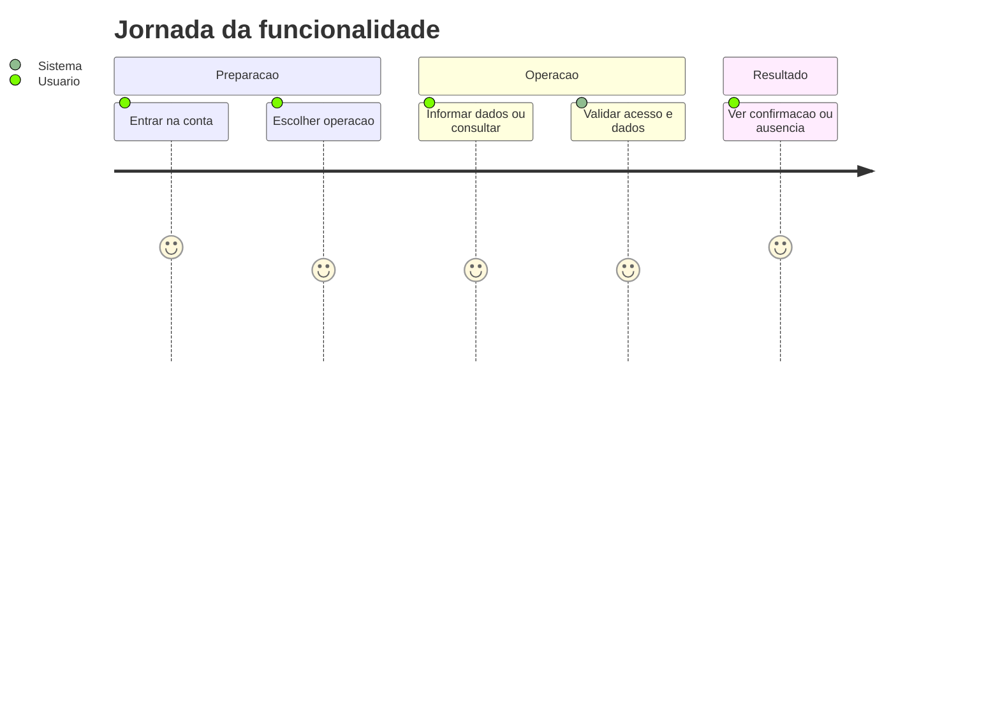
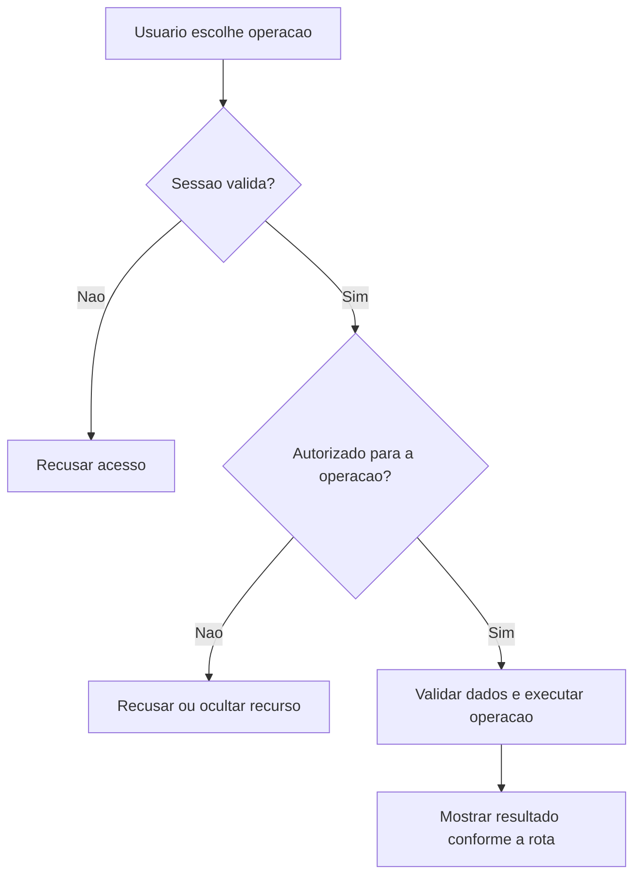
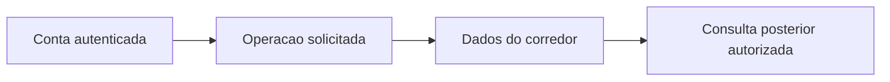

# Registro de Corrida - Treino-Corrida - Regras de Negócio

## Índice

- [1. Resumo da Funcionalidade](#resumo)
- [2. Jornada do Usuário](#jornada)
- [3. Regras de Negócio por Funcionalidade](#regras)
- [4. Validações e Restrições](#validacoes)
- [5. Fluxos de Processo](#fluxos)
- [6. Casos de Uso e Cenários](#casos)

## 1. Resumo da Funcionalidade

**Propósito**: Registrar a corrida do corredor e sua intenção durável de revisão, sem esperar o provedor de explicação.

**Usuários**: corredor autenticado; personal autenticado nas ações de acompanhamento que exigem esse papel.

**Valor de Negócio**: manter registros e decisões acessíveis somente a quem tem autorização, com resultado consistente entre consultas e sincronização.

**Frequência de Uso**: conforme registros e consultas do usuário, sem frequência obrigatória imposta por estas rotas.

**Impacto Operacional**: o servidor mantém o estado persistido; a disponibilidade de rede e da persistência determina quando o resultado pode ser confirmado.

**Fontes da verdade**: [STORY-001](../../../specs/STORY-001/spec.bdd.md), [STORY-002](../../../specs/STORY-002/spec.bdd.md), [STORY-014](../../../specs/STORY-014/spec.bdd.md), [ADR-002](../../../docs/adr/ADR-002-autenticacao-e-isolamento-de-dados.md), [ADR-003](../../../docs/adr/ADR-003-chave-de-idempotencia-para-sincronizacao-offline.md), [ADR-018](../../../docs/adr/ADR-018-outbox-transacional-da-revisao.md). As regras abaixo distinguem comportamento observável atual e limitações identificadas no código; não criam decisão nova de produto.

## 2. Jornada do Usuário

### Visão Geral da Jornada

### Pontos de Contato

- **Conta**: a identidade vem do login Google; nome e e-mail não determinam quem é dono dos registros.
- **Operação**: o usuário acessa as ações descritas abaixo no aplicativo; este documento descreve o serviço que as sustenta.
- **Retorno**: confirmação, dados ou erro explícito; indisponibilidade técnica não representa histórico vazio.

## 3. Regras de Negócio por Funcionalidade

### 3.1. Registrar corrida

**O que faz**: Registrar corrida para o usuário autorizado.

**Regras Aplicadas**:

- **Acesso**: usa a conta autenticada e as restrições específicas da operação. Dados próprios não podem ser solicitados com um dono escolhido no corpo.
- **Execução atual**: Exige chave; valida distância e duração maiores que zero e esforço entre 1 e 10; pace é recebido sem guard clause própria; cria sessão; persiste sob CurrentCorredor.Id com painReported; projeta resposta sem dados de dor.
- **Resposta observável**: 201 na criação; 200 no reenvio; 400 sem chave ou factory inválida.

**Cenários de Uso**:

- **Principal**: pessoa autorizada envia os dados válidos e recebe confirmação.
- **Alternativo**: reenvio segue as regras explícitas da operação; ações sem chave não ganham idempotência por suposição.
- **Exceção**: token inválido impede a operação; papel/vínculo/dono são conferidos quando exigidos.

**Resultado Esperado**: RunningSessionResponse.

## 4. Validações e Restrições

### Controle de Acesso

- Todas as ações requerem sessão válida. Papel Personal é necessário somente nas rotas explicitamente descritas acima.
- O acesso do personal a histórico/revisão depende de vínculo ativo; encerrá-lo remove esse acesso nas consultas protegidas.

### Dados e Entrada

RunningSession.Create(Date, DistanceKm, DurationMinutes, AveragePaceMinPerKm, PerceivedEffort); Load = DurationMinutes * PerceivedEffort. A factory não valida a data nem o pace.

- Tipos e campos completos estão na [especificação técnica](../DevDocs/RunningSessionEndpoints-Treino-Corrida-DevDocs.md).
- Registro que exige chave de sincronização sem essa chave é recusado. Reenvio não significa edição do dado original.

### Restrições do Sistema

A revisão é eventual. A resposta não contém reviewId. O worker pode classificar como aderente e não criar revisão. O Location /api/training-sessions/{id} aponta para a rota de detalhe existente.

Não há janela de horário de funcionamento codificada nestes endpoints. O serviço depende de token válido, configuração do provedor de login e persistência.

## 5. Fluxos de Processo

### Fluxo Principal

### Integrações com Outros Processos

## 6. Casos de Uso e Cenários

### Caso de Uso 1: Registrar corrida

**Ator Principal**: usuário autorizado para esta ação.

**Objetivo**: Registrar corrida.

**Pré-condições**: sessão válida; papel, vínculo e recurso quando exigidos pela regra acima.

**Fluxo Principal**:

1. Usuário escolhe a ação e informa RunningSessionRequest; Idempotency-Key obrigatório.
2. Sistema executa as validações de acesso e dados descritas para esta ação.
3. Sistema devolve RunningSessionResponse.

**Pós-condições**: 201 na criação; 200 no reenvio; 400 sem chave ou factory inválida. Uma resposta de erro não deve ser exibida pelo app como confirmação.

### Matriz de Cenários

| Cenário | Entrada | Ação do Sistema | Resultado Esperado |
|---|---|---|---|
| Registrar corrida | RunningSessionRequest; Idempotency-Key obrigatório | Validar acesso e executar regras acima | 201 na criação; 200 no reenvio; 400 sem chave ou factory inválida |
| Sessão inválida | Token ausente/expirado | Recusar antes da lógica do handler | 401 |

**Revisão eventual (STORY-014 / ADR-018)**: registro confirmado não aguarda a explicação. Execução aderente não gera card; explicação indisponível preserva comparação e treino. A tentativa manual reutiliza os fatos originais. Compreender ou contestar não altera prescrição nem execução. Nenhuma sugestão da revisão modifica automaticamente um treino futuro.

**Navegação**: [Técnica](../DevDocs/RunningSessionEndpoints-Treino-Corrida-DevDocs.md), [Débitos](../TechnicalDebtsDocs/RunningSessionEndpoints-Treino-Corrida-Debts.md), [Índice](README.md).
