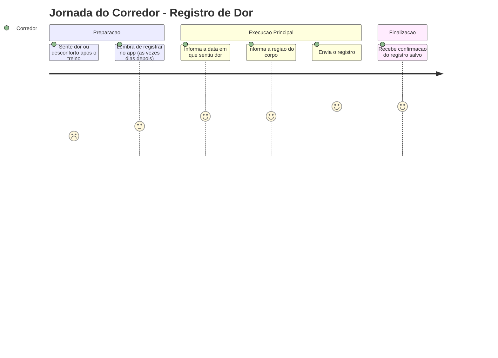
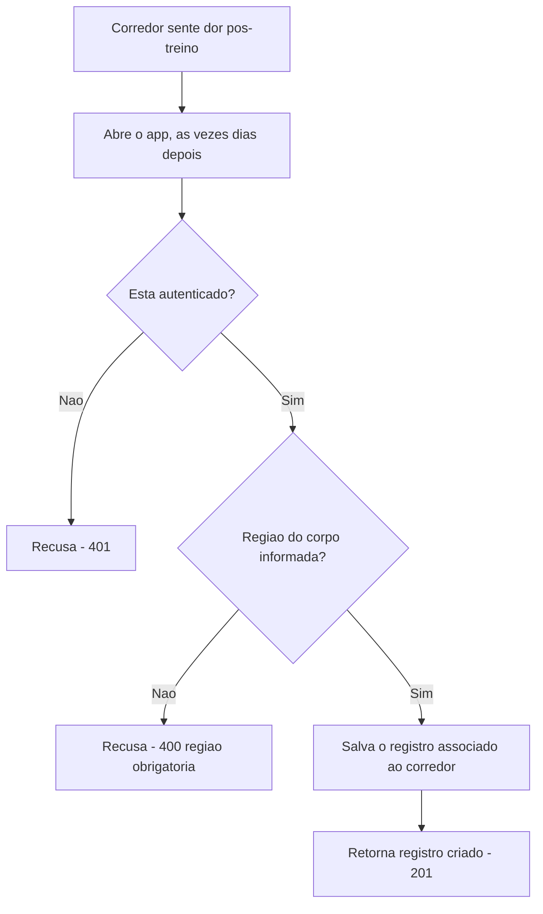
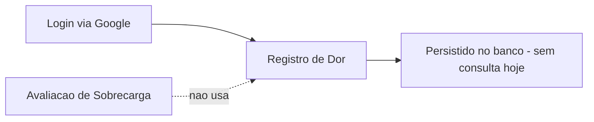

# Registro de Dor - Treino-Dor - Regras de Negocio

## Indice
- [1. Resumo da Funcionalidade](#1-resumo-da-funcionalidade)
- [2. Jornada do Usuario](#2-jornada-do-usuario)
- [3. Regras de Negocio por Funcionalidade](#3-regras-de-negocio-por-funcionalidade)
- [4. Validacoes e Restricoes](#4-validacoes-e-restricoes)
- [5. Fluxos de Processo](#5-fluxos-de-processo)
- [6. Casos de Uso e Cenarios](#6-casos-de-uso-e-cenarios)

## 1. Resumo da Funcionalidade

**Proposito**: Permitir que o corredor registre dor ou desconforto sentido apos o treino, informando a regiao do corpo afetada, mesmo que o registro aconteca dias depois do treino que a originou.

**Usuarios**: Corredor amador autenticado que sentiu dor/desconforto pos-treino.

**Valor de Negocio**: E o sinal que originou a criacao do Steady - o corredor que validou o produto relatou dor recorrente que "migra" de local no corpo. O registro de dor serve como fonte de calibracao futura da regra de deteccao de sobrecarga.

**Frequencia de Uso**: Baixa a media - depende da ocorrencia real de dor, nao de toda sessao de treino.

**Impacto Operacional**: Hoje o registro de dor e apenas armazenado - nao alimenta nenhum calculo automatico do sistema (nem a avaliacao de sobrecarga, nem o historico consolidado de treinos).

## 2. Jornada do Usuario

### Visao Geral da Jornada

### Pontos de Contato
- **Registro tardio**: o corredor pode registrar a dor a qualquer momento, nao precisa ser logo apos o treino.
- **Sem vinculo obrigatorio a uma sessao**: nao e necessario escolher "qual treino causou a dor" - apenas data e regiao.
- **Confirmacao imediata**: o sistema responde com o registro criado.

## 3. Regras de Negocio por Funcionalidade

### 3.1. Registro de Dor Pos-Treino

**O que faz**: Recebe data e regiao do corpo onde o corredor sentiu dor/desconforto, e salva permanentemente associado ao corredor.

**Regras Aplicadas** (fonte: `specs/STORY-001/spec.bdd.md`, regra de negocio #7, e `specs/STORY-002/spec.bdd.md`, regras #1-#5):
- **Autenticacao obrigatoria**: mesmo requisito de qualquer outro registro.
- **Regiao do corpo obrigatoria**: nao e possivel registrar dor sem informar onde ela ocorreu.
  - *Exemplo*: enviar o registro sem regiao (ou so com espacos em branco) e rejeitado com "A região do corpo é obrigatória para registrar dor."
- **Independente de sessao especifica**: o registro de dor nao exige vinculo com uma Sessao de Treino de corrida ou musculacao especifica - e um registro autonomo (data + regiao).
- **Pode ser tardio**: o corredor pode registrar a dor dias depois de te-la sentido, sem restricao de prazo.
- **Modelo binario**: no MVP, a existencia do registro ja representa "doeu" - nao ha escala de intensidade de dor (ex.: leve/moderada/forte).

**Cenarios de Uso**:
- **Cenario Principal**: corredor treinou ha alguns dias, sentiu dor na canela, e registra data + regiao a qualquer momento depois.
- **Cenario Alternativo**: corredor registra dor sem associar a nenhuma sessao de treino especifica.
- **Cenario de Excecao**: corredor tenta registrar sem informar a regiao do corpo - sistema rejeita e explica o motivo.

**Resultado Esperado**: o registro de dor fica salvo, associado ao corredor, disponivel para consulta futura por quem tiver acesso direto ao banco de dados ou por uma futura funcionalidade de consulta (nao existe endpoint de leitura hoje - ver [Observacao Importante](#4-validacoes-e-restricoes)).

## 4. Validacoes e Restricoes

### Controle de Acesso
- **Permissoes**: qualquer corredor autenticado pode registrar sua propria dor.
- **Hierarquia**: nao ha niveis de acesso diferentes no MVP.

### Dados e Entrada
- **Dados Obrigatorios**: data e regiao do corpo (texto livre).
- **Formatos Aceitos**: `region` e texto livre, sem lista fechada de opcoes (diferente do grupo muscular de musculacao). Data no formato `AAAA-MM-DD`.
- **Limitacoes de Volume**: nenhuma restricao de quantidade de registros por dia/semana.

### Restricoes do Sistema
- **Horarios de Funcionamento**: sem restricao.
- **Dependencias**: exige o servico de login do Google disponivel.
- **Limitacoes Tecnicas Importantes para o Negocio**: hoje **nao existe** nenhuma forma de o corredor consultar seus proprios registros de dor pelo app (nao ha rota de leitura). O dado e coletado, mas ainda nao ha nenhuma tela ou API de consulta, nem uso automatizado no calculo de sobrecarga.

## 5. Fluxos de Processo

### Fluxo Principal

### Integracoes com Outros Processos

## 6. Casos de Uso e Cenarios

### Caso de Uso 1: Registrar dor alguns dias apos o treino
**Ator Principal**: Corredor autenticado
**Objetivo**: Registrar que sentiu dor, mesmo sem lembrar exatamente qual treino a causou
**Pre-condicoes**: Corredor logado no app; sentiu dor em algum momento recente

**Fluxo Principal**:
1. Corredor abre o app dias depois do treino
2. Informa a data em que sentiu a dor
3. Informa a regiao do corpo (ex.: "Canela")
4. Confirma o envio

**Pos-condicoes**: Registro salvo, associado ao corredor, com data e regiao.

### Caso de Uso 2: Tentativa de registro sem informar a regiao
**Ator Principal**: Corredor autenticado
**Objetivo**: Registrar dor, mas esquece de preencher a regiao do corpo
**Pre-condicoes**: Corredor logado no app

**Fluxo Principal**:
1. Corredor envia o registro com regiao vazia
2. Sistema recusa e explica que a regiao e obrigatoria
3. Corredor corrige e reenvia

**Pos-condicoes**: Nenhum registro invalido e salvo.

### Matriz de Cenarios
| Cenario | Entrada | Acao do Sistema | Resultado Esperado |
|---------|---------|-----------------|-------------------|
| Registro valido | Data ha 2 dias, regiao "Canela" | Salva e associa ao corredor | 201 - registro criado |
| Sem autenticacao | Requisicao sem token | Recusa antes de processar | 401 |
| Regiao ausente/vazia | `region: ""` ou `null` | Rejeita com mensagem de dominio | 400 - "A região do corpo é obrigatória para registrar dor." |
| Registro tardio | Data de dias atras, sem sessao vinculada | Salva normalmente | 201 - registro criado |
