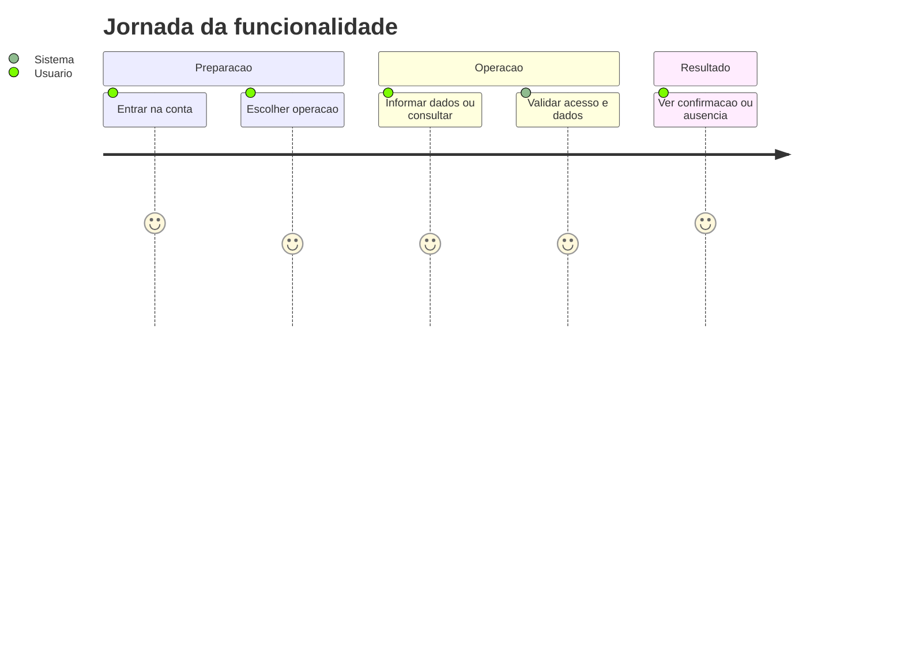
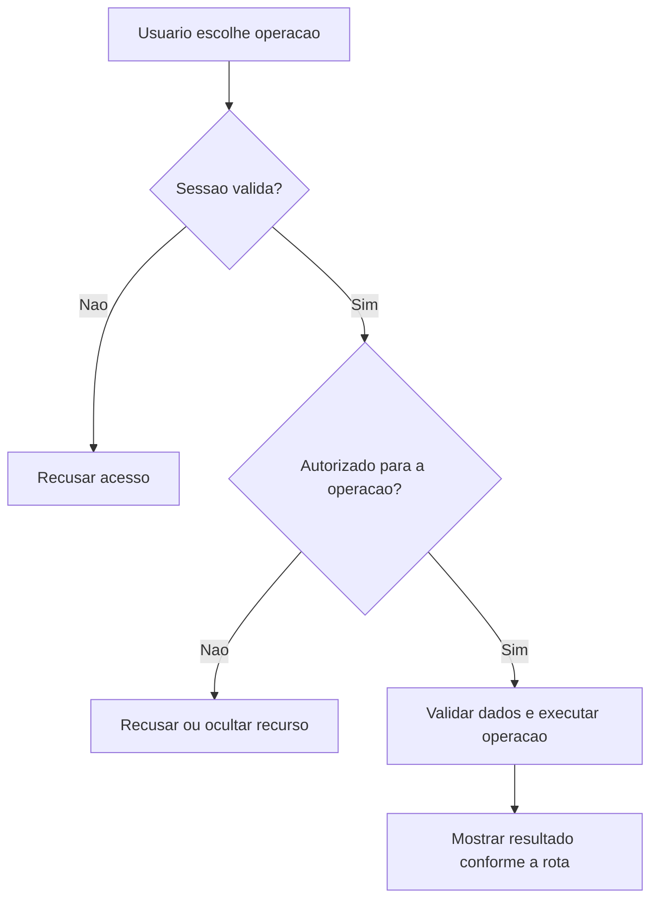
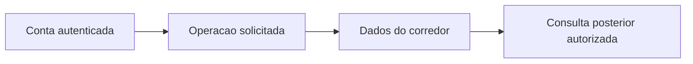

# Registro de Musculacao - Treino-Forca - Regras de Negócio

## Índice

- [1. Resumo da Funcionalidade](#resumo)
- [2. Jornada do Usuário](#jornada)
- [3. Regras de Negócio por Funcionalidade](#regras)
- [4. Validações e Restrições](#validacoes)
- [5. Fluxos de Processo](#fluxos)
- [6. Casos de Uso e Cenários](#casos)

## 1. Resumo da Funcionalidade

**Propósito**: Registrar musculação avulsa com grupo, intensidade e duração, e opcionalmente dor no encerramento.

**Usuários**: corredor autenticado; personal autenticado nas ações de acompanhamento que exigem esse papel.

**Valor de Negócio**: manter registros e decisões acessíveis somente a quem tem autorização, com resultado consistente entre consultas e sincronização.

**Frequência de Uso**: conforme registros e consultas do usuário, sem frequência obrigatória imposta por estas rotas.

**Impacto Operacional**: o servidor mantém o estado persistido; a disponibilidade de rede e da persistência determina quando o resultado pode ser confirmado.

**Fontes da verdade**: [STORY-001](../../../specs/STORY-001/spec.bdd.md), [STORY-002](../../../specs/STORY-002/spec.bdd.md), [STORY-014](../../../specs/STORY-014/spec.bdd.md), [ADR-002](../../../docs/adr/ADR-002-autenticacao-e-isolamento-de-dados.md), [ADR-003](../../../docs/adr/ADR-003-chave-de-idempotencia-para-sincronizacao-offline.md). As regras abaixo distinguem comportamento observável atual e limitações identificadas no código; não criam decisão nova de produto.

## 2. Jornada do Usuário

### Visão Geral da Jornada

### Pontos de Contato

- **Conta**: a identidade vem do login Google; nome e e-mail não determinam quem é dono dos registros.
- **Operação**: o usuário acessa as ações descritas abaixo no aplicativo; este documento descreve o serviço que as sustenta.
- **Retorno**: confirmação, dados ou erro explícito; indisponibilidade técnica não representa histórico vazio.

## 3. Regras de Negócio por Funcionalidade

### 3.1. Registrar musculação avulsa

**O que faz**: Registrar musculação avulsa para o usuário autorizado.

**Regras Aplicadas**:

- **Acesso**: usa a conta autenticada e as restrições específicas da operação. Dados próprios não podem ser solicitados com um dono escolhido no corpo.
- **Execução atual**: Exige chave; cria StrengthSession com grupo e intensidade obrigatórios e duração positiva; persiste painReported; responde com enums numéricos, pois Program não instala conversor textual de enums.
- **Resposta observável**: 201 novo; 200 reenvio; 400 entrada inválida.

**Cenários de Uso**:

- **Principal**: pessoa autorizada envia os dados válidos e recebe confirmação.
- **Alternativo**: reenvio segue as regras explícitas da operação; ações sem chave não ganham idempotência por suposição.
- **Exceção**: token inválido impede a operação; papel/vínculo/dono são conferidos quando exigidos.

**Resultado Esperado**: StrengthSessionResponse.

## 4. Validações e Restrições

### Controle de Acesso

- Todas as ações requerem sessão válida. Papel Personal é necessário somente nas rotas explicitamente descritas acima.
- O acesso do personal a histórico/revisão depende de vínculo ativo; encerrá-lo remove esse acesso nas consultas protegidas.

### Dados e Entrada

StrengthSession.Create valida grupo/intensidade não nulos e duração positiva. Create não verifica Enum.IsDefined. Load usa Leve=3, Moderado=6, Pesado=9, mas não é retornado nem calculado no handler.

- Tipos e campos completos estão na [especificação técnica](../DevDocs/StrengthSessionEndpoints-Treino-Forca-DevDocs.md).
- Registro que exige chave de sincronização sem essa chave é recusado. Reenvio não significa edição do dado original.

### Restrições do Sistema

Não confundir sessão avulsa com StrengthWorkoutExecution: são contratos e tabelas diferentes. Musculação avulsa não produz intenção de revisão no código atual.

Não há janela de horário de funcionamento codificada nestes endpoints. O serviço depende de token válido, configuração do provedor de login e persistência.

## 5. Fluxos de Processo

### Fluxo Principal

### Integrações com Outros Processos

## 6. Casos de Uso e Cenários

### Caso de Uso 1: Registrar musculação avulsa

**Ator Principal**: usuário autorizado para esta ação.

**Objetivo**: Registrar musculação avulsa.

**Pré-condições**: sessão válida; papel, vínculo e recurso quando exigidos pela regra acima.

**Fluxo Principal**:

1. Usuário escolhe a ação e informa StrengthSessionRequest; Idempotency-Key obrigatório.
2. Sistema executa as validações de acesso e dados descritas para esta ação.
3. Sistema devolve StrengthSessionResponse.

**Pós-condições**: 201 novo; 200 reenvio; 400 entrada inválida. Uma resposta de erro não deve ser exibida pelo app como confirmação.

### Matriz de Cenários

| Cenário | Entrada | Ação do Sistema | Resultado Esperado |
|---|---|---|---|
| Registrar musculação avulsa | StrengthSessionRequest; Idempotency-Key obrigatório | Validar acesso e executar regras acima | 201 novo; 200 reenvio; 400 entrada inválida |
| Sessão inválida | Token ausente/expirado | Recusar antes da lógica do handler | 401 |

**Navegação**: [Técnica](../DevDocs/StrengthSessionEndpoints-Treino-Forca-DevDocs.md), [Débitos](../TechnicalDebtsDocs/StrengthSessionEndpoints-Treino-Forca-Debts.md), [Índice](README.md).
