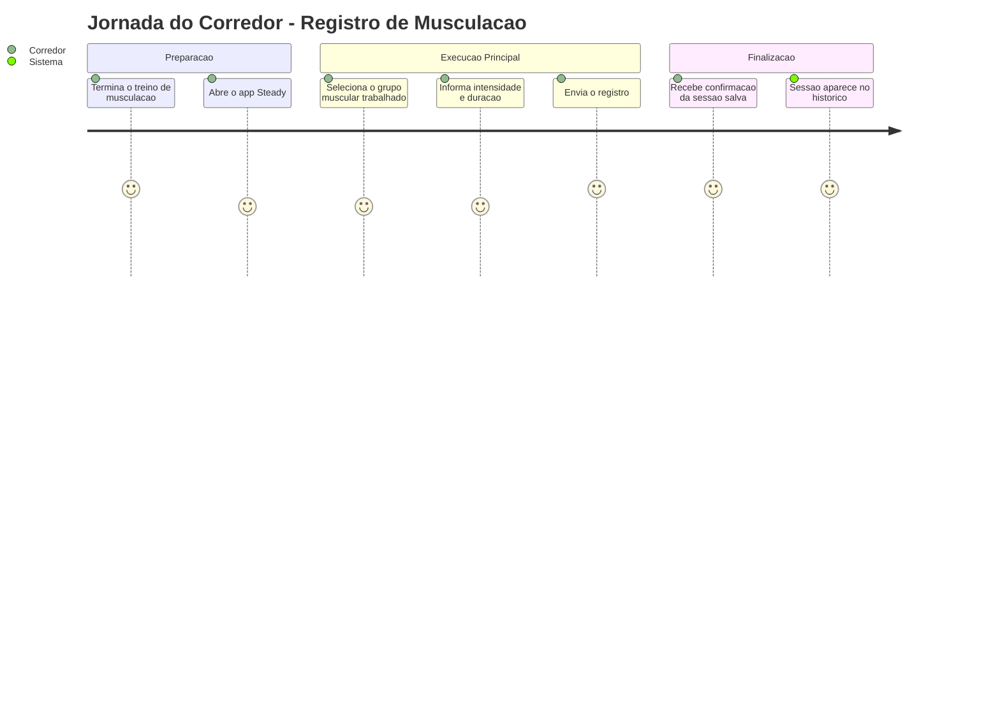
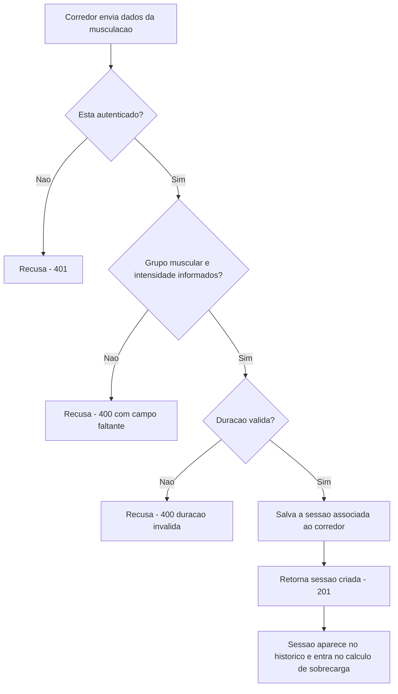
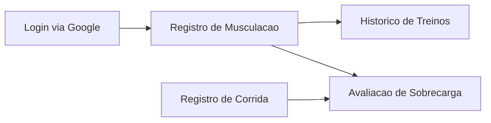

# Registro de Musculacao - Treino-Forca - Regras de Negocio

## Indice
- [1. Resumo da Funcionalidade](#1-resumo-da-funcionalidade)
- [2. Jornada do Usuario](#2-jornada-do-usuario)
- [3. Regras de Negocio por Funcionalidade](#3-regras-de-negocio-por-funcionalidade)
- [4. Validacoes e Restricoes](#4-validacoes-e-restricoes)
- [5. Fluxos de Processo](#5-fluxos-de-processo)
- [6. Casos de Uso e Cenarios](#6-casos-de-uso-e-cenarios)

## 1. Resumo da Funcionalidade

**Proposito**: Permitir que o corredor registre uma sessao de treino de musculacao (grupo muscular, intensidade, duracao), especialmente relevante porque musculacao pesada de perna e um dos dois sinais usados na deteccao de sobrecarga.

**Usuarios**: Corredor amador autenticado que combina musculacao com o treino de corrida.

**Valor de Negocio**: Sem o registro de musculacao, o sistema nao consegue identificar o padrao "musculacao pesada de perna + aumento de carga de corrida" que motivou a criacao do Steady (dor recorrente pos-treino relatada pelo usuario original).

**Frequencia de Uso**: Media a alta - conforme a rotina de musculacao do corredor, tipicamente algumas vezes por semana.

**Impacto Operacional**: Um registro de musculacao ausente ou incorreto (ex.: grupo muscular errado) pode causar um falso negativo na deteccao de sobrecarga - o alerta nao dispara quando deveria.

## 2. Jornada do Usuario

### Visao Geral da Jornada

### Pontos de Contato
- **Registro pos-treino**: o corredor informa os dados da sessao de musculacao apos o treino.
- **Selecao de grupo muscular**: interface apresenta as opcoes fixas de grupo muscular (Peito+Triceps, Ombro, Perna Frontal, Perna Posterior, Biceps+Costas).
- **Reflexo no historico e na avaliacao de sobrecarga**: a sessao passa a compor tanto o historico consolidado quanto o calculo de risco de sobrecarga.

## 3. Regras de Negocio por Funcionalidade

### 3.1. Registro de Sessao de Treino de Musculacao

**O que faz**: Recebe os dados de uma sessao de musculacao e salva permanentemente, associada ao corredor autenticado.

**Regras Aplicadas** (fonte: `specs/STORY-001/spec.bdd.md`, regra de negocio #2, `specs/STORY-002/spec.bdd.md`, regras #1-#5, e `specs/STORY-003/spec.bdd.md` para a idempotencia, fundamentada em [ADR-003](../../../docs/adr/ADR-003-chave-de-idempotencia-para-sincronizacao-offline.md)):
- **Autenticacao obrigatoria**: mesmo requisito de qualquer outro registro - login valido do Google.
- **Reenvio da fila offline nao cria treino duplicado**: mesma protecao aplicada ao registro de corrida - a chave gerada quando o item entra na fila local garante que reenviar apos falha de rede devolve o registro ja salvo, sem duplicar. Especialmente relevante aqui, porque uma sessao de "Perna Pesada" duplicada poderia disparar um alerta de sobrecarga falso.
- **Grupo muscular obrigatorio**: deve ser um dos cinco valores fixos suportados (Peito+Triceps, Ombro, Perna Frontal, Perna Posterior, Biceps+Costas).
  - *Exemplo*: enviar o registro sem grupo muscular e rejeitado com "O grupo muscular é obrigatório para registrar uma sessão de musculação."
- **Intensidade obrigatoria**: deve ser Leve, Moderado ou Pesado.
  - *Exemplo*: enviar o registro sem intensidade e rejeitado com "A intensidade é obrigatória para registrar uma sessão de musculação."
- **Duracao deve ser maior que zero**: mesma regra aplicada a sessoes de corrida.
  - *Exemplo*: duracao zero ou negativa e rejeitada.
- **Perna + Pesado e o gatilho critico de sobrecarga**: sessoes de Perna Frontal ou Perna Posterior com intensidade Pesado nos ultimos 7 dias sao o sinal de musculacao usado pela regra de deteccao de sobrecarga (ver [Avaliacao de Sobrecarga](./Avaliacao-de-Sobrecarga-Sobrecarga-Rules.md)).

**Cenarios de Uso**:
- **Cenario Principal**: corredor informa grupo muscular, intensidade e duracao validos - sessao salva e aparece no historico.
- **Cenario Alternativo**: corredor registra musculacao de perna pesada, o que pode disparar um alerta de sobrecarga em conjunto com o volume de corrida recente.
- **Cenario de Excecao**: corredor nao informa grupo muscular ou intensidade - sistema rejeita e explica quais campos faltam.

**Resultado Esperado**: a sessao de musculacao fica salva, associada ao corredor, disponivel no historico e considerada no calculo de risco de sobrecarga quando aplicavel.

## 4. Validacoes e Restricoes

### Controle de Acesso
- **Permissoes**: qualquer corredor autenticado pode registrar suas proprias sessoes de musculacao.
- **Hierarquia**: nao ha niveis de acesso diferentes no MVP.

### Dados e Entrada
- **Dados Obrigatorios**: data, grupo muscular (um dos cinco valores fixos), intensidade (Leve/Moderado/Pesado), duracao (minutos), alem da chave de idempotencia (gerada pelo app, nao digitada pelo corredor).
- **Formatos Aceitos**: grupo muscular e intensidade sao valores de lista fechada (nao texto livre); duracao em numero inteiro; data no formato `AAAA-MM-DD`.
- **Limitacoes de Volume**: duracao deve ser maior que zero; nao ha limite maximo definido nesta versao.

### Restricoes do Sistema
- **Horarios de Funcionamento**: sem restricao.
- **Dependencias**: exige o servico de login do Google disponivel para validar o token.
- **Limitacoes Tecnicas**: as opcoes de grupo muscular e intensidade sao fixas no codigo (enums) - adicionar um novo grupo muscular exige mudanca de codigo, nao e configuravel.

## 5. Fluxos de Processo

### Fluxo Principal

### Integracoes com Outros Processos

## 6. Casos de Uso e Cenarios

### Caso de Uso 1: Registrar sessao de musculacao de perna pesada
**Ator Principal**: Corredor autenticado
**Objetivo**: Salvar um treino de perna intenso
**Pre-condicoes**: Corredor logado no app

**Fluxo Principal**:
1. Corredor seleciona "Perna Frontal" (ou "Perna Posterior") como grupo muscular
2. Seleciona intensidade "Pesado"
3. Informa a duracao e confirma

**Pos-condicoes**: Sessao salva; se combinada com aumento recente de carga de corrida, pode disparar sugestao de ajuste na proxima consulta de sobrecarga.

### Caso de Uso 2: Tentativa de registro sem grupo muscular
**Ator Principal**: Corredor autenticado
**Objetivo**: Registrar musculacao, mas esquece de selecionar o grupo muscular
**Pre-condicoes**: Corredor logado no app

**Fluxo Principal**:
1. Corredor envia o registro sem grupo muscular
2. Sistema recusa e informa que o campo e obrigatorio
3. Corredor corrige e reenvia

**Pos-condicoes**: Nenhuma sessao invalida e salva.

### Matriz de Cenarios
| Cenario | Entrada | Acao do Sistema | Resultado Esperado |
|---------|---------|-----------------|-------------------|
| Registro valido | PernaFrontal, Pesado, 45min | Salva e associa ao corredor | 201 - sessao criada |
| Sem autenticacao | Requisicao sem token | Recusa antes de processar | 401 |
| Grupo muscular ausente | `muscleGroup: null` | Rejeita com mensagem de dominio | 400 - "O grupo muscular é obrigatório..." |
| Intensidade ausente | `intensity: null` | Rejeita com mensagem de dominio | 400 - "A intensidade é obrigatória..." |
| Duracao invalida | Duracao 0 ou negativa | Rejeita com mensagem de dominio | 400 - "A duração deve ser maior que zero." |
| Reenvio do mesmo item da fila offline | Mesma chave de idempotencia de um envio ja processado | Devolve o registro ja existente, sem criar outro | 200 - sessao ja existente (nao um novo 201) |
