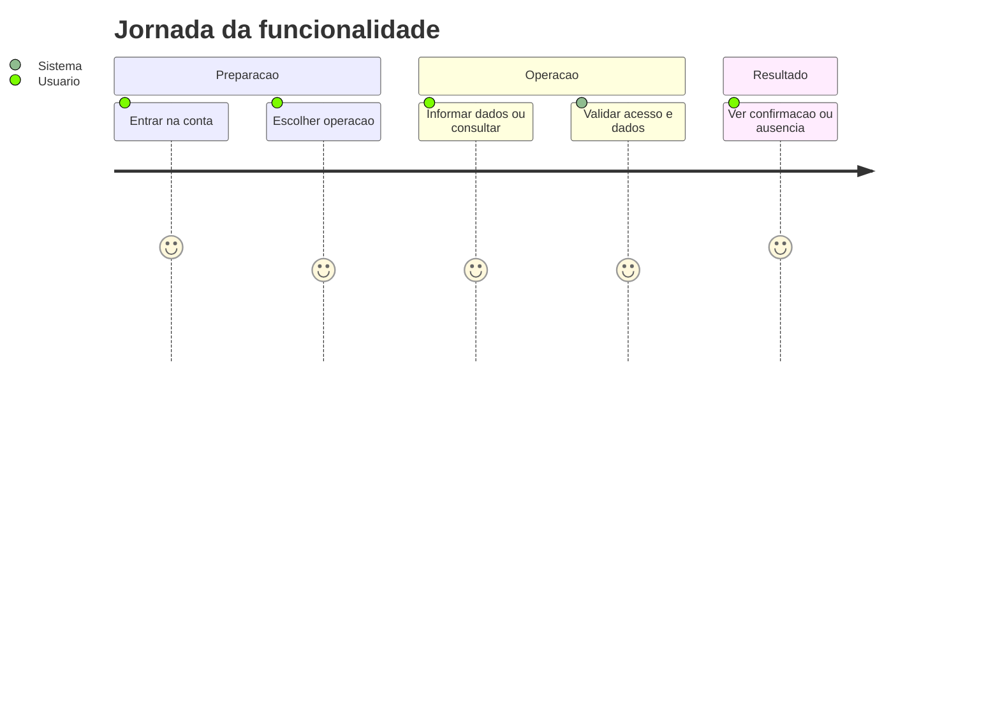
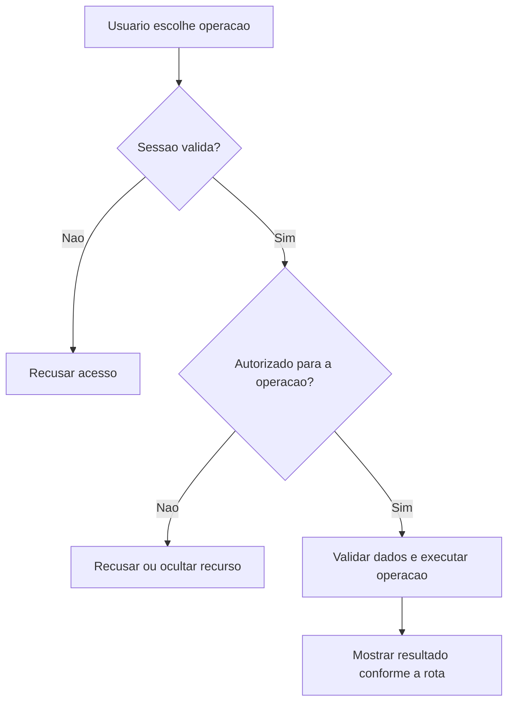
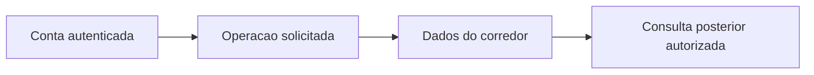

# Revisao do Treino - Revisao - Regras de Negócio

## Índice

- [1. Resumo da Funcionalidade](#resumo)
- [2. Jornada do Usuário](#jornada)
- [3. Regras de Negócio por Funcionalidade](#regras)
- [4. Validações e Restrições](#validacoes)
- [5. Fluxos de Processo](#fluxos)
- [6. Casos de Uso e Cenários](#casos)

## 1. Resumo da Funcionalidade

**Propósito**: Consultar revisão determinística, registrar compreensão/contestação e solicitar nova explicação sem alterar o treino.

**Usuários**: corredor autenticado; personal autenticado nas ações de acompanhamento que exigem esse papel.

**Valor de Negócio**: manter registros e decisões acessíveis somente a quem tem autorização, com resultado consistente entre consultas e sincronização.

**Frequência de Uso**: conforme registros e consultas do usuário, sem frequência obrigatória imposta por estas rotas.

**Impacto Operacional**: o servidor mantém o estado persistido; a disponibilidade de rede e da persistência determina quando o resultado pode ser confirmado.

**Fontes da verdade**: [STORY-014](../../../specs/STORY-014/spec.bdd.md), [ADR-002](../../../docs/adr/ADR-002-autenticacao-e-isolamento-de-dados.md), [ADR-014](../../../docs/adr/ADR-014-fronteira-deterministica-da-revisao.md), [ADR-015](../../../docs/adr/ADR-015-tolerancias-e-politicas-versionadas.md), [ADR-016](../../../docs/adr/ADR-016-provedor-da-explicacao-da-revisao.md), [ADR-018](../../../docs/adr/ADR-018-outbox-transacional-da-revisao.md), [ADR-019](../../../docs/adr/ADR-019-identidade-historica-do-exercicio.md). As regras abaixo distinguem comportamento observável atual e limitações identificadas no código; não criam decisão nova de produto.

## 2. Jornada do Usuário

### Visão Geral da Jornada

### Pontos de Contato

- **Conta**: a identidade vem do login Google; nome e e-mail não determinam quem é dono dos registros.
- **Operação**: o usuário acessa as ações descritas abaixo no aplicativo; este documento descreve o serviço que as sustenta.
- **Retorno**: confirmação, dados ou erro explícito; indisponibilidade técnica não representa histórico vazio.

## 3. Regras de Negócio por Funcionalidade

### 3.1. Ler revisão mais recente

**O que faz**: Ler revisão mais recente para o usuário autorizado.

**Regras Aplicadas**:

- **Acesso**: usa a conta autenticada e as restrições específicas da operação. Dados próprios não podem ser solicitados com um dono escolhido no corpo.
- **Execução atual**: GetLatestAsync ordena ExecutionDate e CreatedAt decrescentes; Respond projeta versão de política/plano, snapshots e estados de explicação/coerência.
- **Resposta observável**: 200 revisão; 404 nenhuma.

**Cenários de Uso**:

- **Principal**: pessoa autorizada consulta dados existentes e recebe a visão correspondente.
- **Alternativo**: ausência segue a resposta da rota: lista vazia ou recurso não encontrado.
- **Exceção**: token inválido impede a operação; papel/vínculo/dono são conferidos quando exigidos.

**Resultado Esperado**: WorkoutReviewResponse.

### 3.2. Ler revisão por execução

**O que faz**: Ler revisão por execução para o usuário autorizado.

**Regras Aplicadas**:

- **Acesso**: usa a conta autenticada e as restrições específicas da operação. Dados próprios não podem ser solicitados com um dono escolhido no corpo.
- **Execução atual**: Busca review.ExecutionId e dono; não produz revisão na leitura.
- **Resposta observável**: 200; 404 revisão não existente ou alheia.

**Cenários de Uso**:

- **Principal**: pessoa autorizada consulta dados existentes e recebe a visão correspondente.
- **Alternativo**: ausência segue a resposta da rota: lista vazia ou recurso não encontrado.
- **Exceção**: token inválido impede a operação; papel/vínculo/dono são conferidos quando exigidos.

**Resultado Esperado**: WorkoutReviewResponse.

### 3.3. Registrar compreensão

**O que faz**: Registrar compreensão para o usuário autorizado.

**Regras Aplicadas**:

- **Acesso**: usa a conta autenticada e as restrições específicas da operação. Dados próprios não podem ser solicitados com um dono escolhido no corpo.
- **Execução atual**: MarkUnderstoodAsync usa UnderstoodAt ??= UtcNow; preserva primeiro aceite; não altera execução ou recomendação.
- **Resposta observável**: 204; 404 revisão ausente ou alheia.

**Cenários de Uso**:

- **Principal**: pessoa autorizada envia os dados válidos e recebe confirmação.
- **Alternativo**: reenvio segue as regras explícitas da operação; ações sem chave não ganham idempotência por suposição.
- **Exceção**: token inválido impede a operação; papel/vínculo/dono são conferidos quando exigidos.

**Resultado Esperado**: Sem corpo.

### 3.4. Contestar revisão

**O que faz**: Contestar revisão para o usuário autorizado.

**Regras Aplicadas**:

- **Acesso**: usa a conta autenticada e as restrições específicas da operação. Dados próprios não podem ser solicitados com um dono escolhido no corpo.
- **Execução atual**: MarkContestedAsync marca Contested=true no registro do dono; não recalcula comparação.
- **Resposta observável**: 204; 404 revisão ausente ou alheia.

**Cenários de Uso**:

- **Principal**: pessoa autorizada envia os dados válidos e recebe confirmação.
- **Alternativo**: reenvio segue as regras explícitas da operação; ações sem chave não ganham idempotência por suposição.
- **Exceção**: token inválido impede a operação; papel/vínculo/dono são conferidos quando exigidos.

**Resultado Esperado**: Sem corpo.

### 3.5. Solicitar nova explicação

**O que faz**: Solicitar nova explicação para o usuário autorizado.

**Regras Aplicadas**:

- **Acesso**: usa a conta autenticada e as restrições específicas da operação. Dados próprios não podem ser solicitados com um dono escolhido no corpo.
- **Execução atual**: RetryAsync busca revisão do dono; sem Action retorna true sem provedor; reutiliza ComparisonJson e ação; timeout 15 segundos; domínio valida ação e números; persiste explicação aceita ou Unavailable sem mudar comparação.
- **Resposta observável**: 204 mesmo se explicação indisponível; 404 revisão ausente/alheia.

**Cenários de Uso**:

- **Principal**: pessoa autorizada envia os dados válidos e recebe confirmação.
- **Alternativo**: reenvio segue as regras explícitas da operação; ações sem chave não ganham idempotência por suposição.
- **Exceção**: token inválido impede a operação; papel/vínculo/dono são conferidos quando exigidos.

**Resultado Esperado**: Sem corpo.

### 3.6. Ler revisão pelo personal

**O que faz**: Ler revisão pelo personal para o usuário autorizado.

**Regras Aplicadas**:

- **Acesso**: usa a conta autenticada e as restrições específicas da operação. Dados próprios não podem ser solicitados com um dono escolhido no corpo.
- **Execução atual**: Exige Personal; GetForPersonalAsync verifica vínculo ativo, depois busca revisão do corredor e execução.
- **Resposta observável**: 200; 403 sem papel; 404 sem vínculo ou revisão.

**Cenários de Uso**:

- **Principal**: pessoa autorizada consulta dados existentes e recebe a visão correspondente.
- **Alternativo**: ausência segue a resposta da rota: lista vazia ou recurso não encontrado.
- **Exceção**: token inválido impede a operação; papel/vínculo/dono são conferidos quando exigidos.

**Resultado Esperado**: WorkoutReviewResponse.

## 4. Validações e Restrições

### Controle de Acesso

- Todas as ações requerem sessão válida. Papel Personal é necessário somente nas rotas explicitamente descritas acima.
- O acesso do personal a histórico/revisão depende de vínculo ativo; encerrá-lo remove esse acesso nas consultas protegidas.

### Dados e Entrada

Não calcula aderência nos GET/POST de confirmação. Retry usa WorkoutReview.Create e TrySetExplanation para impedir ação incompatível e números fora dos fatos autorizados. Comparação, ação, política e prescrição foram capturadas pelo processamento original; não se recarrega ficha atual para explicar novamente.

- Tipos e campos completos estão na [especificação técnica](../DevDocs/WorkoutReviewEndpoints-Revisao-DevDocs.md).
- Registro que exige chave de sincronização sem essa chave é recusado. Reenvio não significa edição do dado original.

### Restrições do Sistema

Respond devolve ComparisonJson e ExplanationJson como strings JSON, não objetos expandidos. Enums são strings ToString (por exemplo Running), com Action opcional. Retry não exige ExplanationStatus indisponível: pode repetir revisão já explicada e responde sem detalhes da tentativa. Falta de revisão pode significar aderência, processamento pendente ou ausência de recurso; GET não distingue esses estados.

Não há janela de horário de funcionamento codificada nestes endpoints. O serviço depende de token válido, configuração do provedor de login e persistência.

## 5. Fluxos de Processo

### Fluxo Principal

### Integrações com Outros Processos

## 6. Casos de Uso e Cenários

### Caso de Uso 1: Ler revisão mais recente

**Ator Principal**: usuário autorizado para esta ação.

**Objetivo**: Ler revisão mais recente.

**Pré-condições**: sessão válida; papel, vínculo e recurso quando exigidos pela regra acima.

**Fluxo Principal**:

1. Usuário escolhe a ação e informa Sem corpo.
2. Sistema executa as validações de acesso e dados descritas para esta ação.
3. Sistema devolve WorkoutReviewResponse.

**Pós-condições**: 200 revisão; 404 nenhuma. Uma resposta de erro não deve ser exibida pelo app como confirmação.

### Caso de Uso 2: Ler revisão por execução

**Ator Principal**: usuário autorizado para esta ação.

**Objetivo**: Ler revisão por execução.

**Pré-condições**: sessão válida; papel, vínculo e recurso quando exigidos pela regra acima.

**Fluxo Principal**:

1. Usuário escolhe a ação e informa executionId: Guid.
2. Sistema executa as validações de acesso e dados descritas para esta ação.
3. Sistema devolve WorkoutReviewResponse.

**Pós-condições**: 200; 404 revisão não existente ou alheia. Uma resposta de erro não deve ser exibida pelo app como confirmação.

### Caso de Uso 3: Registrar compreensão

**Ator Principal**: usuário autorizado para esta ação.

**Objetivo**: Registrar compreensão.

**Pré-condições**: sessão válida; papel, vínculo e recurso quando exigidos pela regra acima.

**Fluxo Principal**:

1. Usuário escolhe a ação e informa reviewId: Guid; sem corpo.
2. Sistema executa as validações de acesso e dados descritas para esta ação.
3. Sistema devolve Sem corpo.

**Pós-condições**: 204; 404 revisão ausente ou alheia. Uma resposta de erro não deve ser exibida pelo app como confirmação.

### Caso de Uso 4: Contestar revisão

**Ator Principal**: usuário autorizado para esta ação.

**Objetivo**: Contestar revisão.

**Pré-condições**: sessão válida; papel, vínculo e recurso quando exigidos pela regra acima.

**Fluxo Principal**:

1. Usuário escolhe a ação e informa reviewId: Guid; sem corpo.
2. Sistema executa as validações de acesso e dados descritas para esta ação.
3. Sistema devolve Sem corpo.

**Pós-condições**: 204; 404 revisão ausente ou alheia. Uma resposta de erro não deve ser exibida pelo app como confirmação.

### Caso de Uso 5: Solicitar nova explicação

**Ator Principal**: usuário autorizado para esta ação.

**Objetivo**: Solicitar nova explicação.

**Pré-condições**: sessão válida; papel, vínculo e recurso quando exigidos pela regra acima.

**Fluxo Principal**:

1. Usuário escolhe a ação e informa reviewId: Guid; sem corpo.
2. Sistema executa as validações de acesso e dados descritas para esta ação.
3. Sistema devolve Sem corpo.

**Pós-condições**: 204 mesmo se explicação indisponível; 404 revisão ausente/alheia. Uma resposta de erro não deve ser exibida pelo app como confirmação.

### Caso de Uso 6: Ler revisão pelo personal

**Ator Principal**: usuário autorizado para esta ação.

**Objetivo**: Ler revisão pelo personal.

**Pré-condições**: sessão válida; papel, vínculo e recurso quando exigidos pela regra acima.

**Fluxo Principal**:

1. Usuário escolhe a ação e informa corredorId e executionId: Guid.
2. Sistema executa as validações de acesso e dados descritas para esta ação.
3. Sistema devolve WorkoutReviewResponse.

**Pós-condições**: 200; 403 sem papel; 404 sem vínculo ou revisão. Uma resposta de erro não deve ser exibida pelo app como confirmação.

### Matriz de Cenários

| Cenário | Entrada | Ação do Sistema | Resultado Esperado |
|---|---|---|---|
| Ler revisão mais recente | Sem corpo | Validar acesso e executar regras acima | 200 revisão; 404 nenhuma |
| Ler revisão por execução | executionId: Guid | Validar acesso e executar regras acima | 200; 404 revisão não existente ou alheia |
| Registrar compreensão | reviewId: Guid; sem corpo | Validar acesso e executar regras acima | 204; 404 revisão ausente ou alheia |
| Contestar revisão | reviewId: Guid; sem corpo | Validar acesso e executar regras acima | 204; 404 revisão ausente ou alheia |
| Solicitar nova explicação | reviewId: Guid; sem corpo | Validar acesso e executar regras acima | 204 mesmo se explicação indisponível; 404 revisão ausente/alheia |
| Ler revisão pelo personal | corredorId e executionId: Guid | Validar acesso e executar regras acima | 200; 403 sem papel; 404 sem vínculo ou revisão |
| Sessão inválida | Token ausente/expirado | Recusar antes da lógica do handler | 401 |

**Revisão eventual (STORY-014 / ADR-018)**: registro confirmado não aguarda a explicação. Execução aderente não gera card; explicação indisponível preserva comparação e treino. A tentativa manual reutiliza os fatos originais. Compreender ou contestar não altera prescrição nem execução. Nenhuma sugestão da revisão modifica automaticamente um treino futuro.

**Navegação**: [Técnica](../DevDocs/WorkoutReviewEndpoints-Revisao-DevDocs.md), [Débitos](../TechnicalDebtsDocs/WorkoutReviewEndpoints-Revisao-Debts.md), [Índice](README.md).
