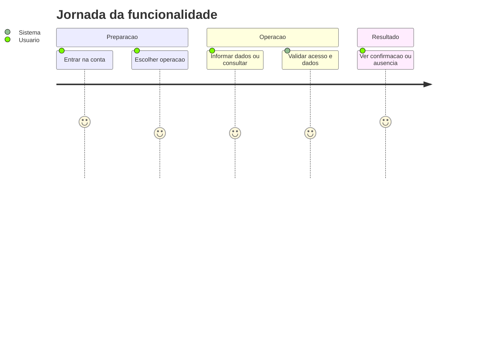
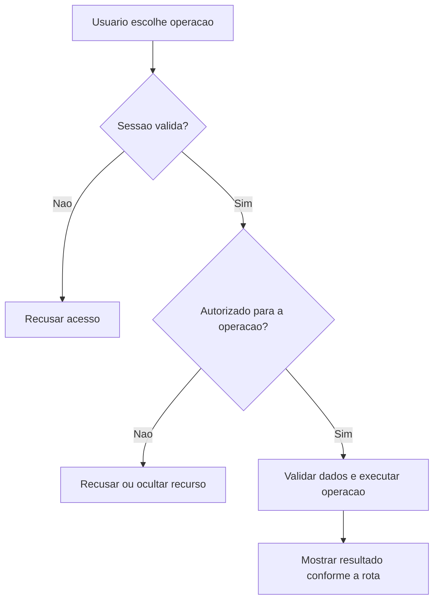
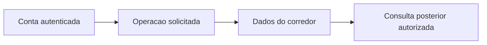

# Vinculos com Personal - Acompanhamento - Regras de Negócio

## Índice

- [1. Resumo da Funcionalidade](#resumo)
- [2. Jornada do Usuário](#jornada)
- [3. Regras de Negócio por Funcionalidade](#regras)
- [4. Validações e Restrições](#validacoes)
- [5. Fluxos de Processo](#fluxos)
- [6. Casos de Uso e Cenários](#casos)

## 1. Resumo da Funcionalidade

**Propósito**: Solicitar, aceitar e encerrar vínculos de acompanhamento, com descoberta por e-mail e acesso restrito por papel.

**Usuários**: corredor autenticado; personal autenticado nas ações de acompanhamento que exigem esse papel.

**Valor de Negócio**: manter registros e decisões acessíveis somente a quem tem autorização, com resultado consistente entre consultas e sincronização.

**Frequência de Uso**: conforme registros e consultas do usuário, sem frequência obrigatória imposta por estas rotas.

**Impacto Operacional**: o servidor mantém o estado persistido; a disponibilidade de rede e da persistência determina quando o resultado pode ser confirmado.

**Fontes da verdade**: [STORY-013](../../../specs/STORY-013/spec.bdd.md), [STORY-019](../../../specs/STORY-019/spec.bdd.md), [ADR-002](../../../docs/adr/ADR-002-autenticacao-e-isolamento-de-dados.md), [ADR-008](../../../docs/adr/ADR-008-roles-vinculo-e-autorizacao-do-personal.md). As regras abaixo distinguem comportamento observável atual e limitações identificadas no código; não criam decisão nova de produto.

## 2. Jornada do Usuário

### Visão Geral da Jornada

### Pontos de Contato

- **Conta**: a identidade vem do login Google; nome e e-mail não determinam quem é dono dos registros.
- **Operação**: o usuário acessa as ações descritas abaixo no aplicativo; este documento descreve o serviço que as sustenta.
- **Retorno**: confirmação, dados ou erro explícito; indisponibilidade técnica não representa histórico vazio.

## 3. Regras de Negócio por Funcionalidade

### 3.1. Ler conta atual

**O que faz**: Ler conta atual para o usuário autorizado.

**Regras Aplicadas**:

- **Acesso**: usa a conta autenticada e as restrições específicas da operação. Dados próprios não podem ser solicitados com um dono escolhido no corpo.
- **Execução atual**: Retorna id e roles já carregados por AuthenticationFilter; não faz consulta adicional no handler.
- **Resposta observável**: 200 conta.

**Cenários de Uso**:

- **Principal**: pessoa autorizada consulta dados existentes e recebe a visão correspondente.
- **Alternativo**: ausência segue a resposta da rota: lista vazia ou recurso não encontrado.
- **Exceção**: token inválido impede a operação; papel/vínculo/dono são conferidos quando exigidos.

**Resultado Esperado**: CurrentAccountResponse.

### 3.2. Buscar corredor

**O que faz**: Buscar corredor para o usuário autorizado.

**Regras Aplicadas**:

- **Acesso**: usa a conta autenticada e as restrições específicas da operação. Dados próprios não podem ser solicitados com um dono escolhido no corpo.
- **Execução atual**: Exige role Personal; trim de email e rejeita vazio; FindRunnerByEmailAsync limita a corredor; verifica vínculo ativo e retorna available e name opcional.
- **Resposta observável**: 200; 400 vazio; 403 sem papel; 404 não encontrado.

**Cenários de Uso**:

- **Principal**: pessoa autorizada consulta dados existentes e recebe a visão correspondente.
- **Alternativo**: ausência segue a resposta da rota: lista vazia ou recurso não encontrado.
- **Exceção**: token inválido impede a operação; papel/vínculo/dono são conferidos quando exigidos.

**Resultado Esperado**: RunnerSearchResponse.

### 3.3. Solicitar vínculo

**O que faz**: Solicitar vínculo para o usuário autorizado.

**Regras Aplicadas**:

- **Acesso**: usa a conta autenticada e as restrições específicas da operação. Dados próprios não podem ser solicitados com um dono escolhido no corpo.
- **Execução atual**: Exige Personal; verifica indisponibilidade por vínculo ativo; conta precisa existir e conter Corredor; RequestAsync preserva pendência existente; audit registra ids e created; ArgumentException vira 400.
- **Resposta observável**: 201 novo; 200 pendente existente; 409 indisponível; 403 sem papel; 404 conta; 400 domínio.

**Cenários de Uso**:

- **Principal**: pessoa autorizada envia os dados válidos e recebe confirmação.
- **Alternativo**: reenvio segue as regras explícitas da operação; ações sem chave não ganham idempotência por suposição.
- **Exceção**: token inválido impede a operação; papel/vínculo/dono são conferidos quando exigidos.

**Resultado Esperado**: CoachingLinkResponse.

### 3.4. Listar solicitações recebidas

**O que faz**: Listar solicitações recebidas para o usuário autorizado.

**Regras Aplicadas**:

- **Acesso**: usa a conta autenticada e as restrições específicas da operação. Dados próprios não podem ser solicitados com um dono escolhido no corpo.
- **Execução atual**: Busca pendências em que current.Id é corredor, ordenadas por RequestedAt decrescente.
- **Resposta observável**: 200 lista.

**Cenários de Uso**:

- **Principal**: pessoa autorizada consulta dados existentes e recebe a visão correspondente.
- **Alternativo**: ausência segue a resposta da rota: lista vazia ou recurso não encontrado.
- **Exceção**: token inválido impede a operação; papel/vínculo/dono são conferidos quando exigidos.

**Resultado Esperado**: Lista de CoachingLinkResponse.

### 3.5. Ler vínculo do corredor

**O que faz**: Ler vínculo do corredor para o usuário autorizado.

**Regras Aplicadas**:

- **Acesso**: usa a conta autenticada e as restrições específicas da operação. Dados próprios não podem ser solicitados com um dono escolhido no corpo.
- **Execução atual**: Busca vínculo ativo do corredor atual.
- **Resposta observável**: 200 vínculo; 404 sem vínculo.

**Cenários de Uso**:

- **Principal**: pessoa autorizada consulta dados existentes e recebe a visão correspondente.
- **Alternativo**: ausência segue a resposta da rota: lista vazia ou recurso não encontrado.
- **Exceção**: token inválido impede a operação; papel/vínculo/dono são conferidos quando exigidos.

**Resultado Esperado**: CoachingLinkResponse.

### 3.6. Aceitar vínculo

**O que faz**: Aceitar vínculo para o usuário autorizado.

**Regras Aplicadas**:

- **Acesso**: usa a conta autenticada e as restrições específicas da operação. Dados próprios não podem ser solicitados com um dono escolhido no corpo.
- **Execução atual**: AcceptAsync exige dono da pendência; usa transação, verifica vínculo ativo, ativa escolhido e expira outras pendências; audit somente em Accepted.
- **Resposta observável**: 200 aceito; 409 já vinculado; 404 pendência ausente ou alheia.

**Cenários de Uso**:

- **Principal**: pessoa autorizada envia os dados válidos e recebe confirmação.
- **Alternativo**: reenvio segue as regras explícitas da operação; ações sem chave não ganham idempotência por suposição.
- **Exceção**: token inválido impede a operação; papel/vínculo/dono são conferidos quando exigidos.

**Resultado Esperado**: Sem corpo.

### 3.7. Encerrar vínculo

**O que faz**: Encerrar vínculo para o usuário autorizado.

**Regras Aplicadas**:

- **Acesso**: usa a conta autenticada e as restrições específicas da operação. Dados próprios não podem ser solicitados com um dono escolhido no corpo.
- **Execução atual**: EndAsync aceita participante PersonalId ou CorredorId e estado Pending/Active; marca Ended e EndedAt; audit quando encerrado.
- **Resposta observável**: 204 encerrado; 404 não acessível ou já encerrado.

**Cenários de Uso**:

- **Principal**: pessoa autorizada envia os dados válidos e recebe confirmação.
- **Alternativo**: reenvio segue as regras explícitas da operação; ações sem chave não ganham idempotência por suposição.
- **Exceção**: token inválido impede a operação; papel/vínculo/dono são conferidos quando exigidos.

**Resultado Esperado**: Sem corpo.

### 3.8. Listar corredores vinculados

**O que faz**: Listar corredores vinculados para o usuário autorizado.

**Regras Aplicadas**:

- **Acesso**: usa a conta autenticada e as restrições específicas da operação. Dados próprios não podem ser solicitados com um dono escolhido no corpo.
- **Execução atual**: Exige Personal; join de vínculo ativo com conta; ordena por Name ou Email e projeta name opcional.
- **Resposta observável**: 200 lista; 403 sem papel.

**Cenários de Uso**:

- **Principal**: pessoa autorizada consulta dados existentes e recebe a visão correspondente.
- **Alternativo**: ausência segue a resposta da rota: lista vazia ou recurso não encontrado.
- **Exceção**: token inválido impede a operação; papel/vínculo/dono são conferidos quando exigidos.

**Resultado Esperado**: Lista de LinkedRunnerResponse.

## 4. Validações e Restrições

### Controle de Acesso

- Todas as ações requerem sessão válida. Papel Personal é necessário somente nas rotas explicitamente descritas acima.
- O acesso do personal a histórico/revisão depende de vínculo ativo; encerrá-lo remove esse acesso nas consultas protegidas.

### Dados e Entrada

CoachingLink.Request é chamado dentro de RequestAsync para validar ids e evitar vínculo consigo mesmo. Aceite/encerramento são transições implementadas no repositório, não chamadas de uma factory no handler.

- Tipos e campos completos estão na [especificação técnica](../DevDocs/CoachingLinkEndpoints-Acompanhamento-DevDocs.md).
- Registro que exige chave de sincronização sem essa chave é recusado. Reenvio não significa edição do dado original.

### Restrições do Sistema

Nenhum handler recebe roles do corpo. Consultas de conta/vínculo próprio não exigem explicitamente role Corredor. Status da resposta de vínculo é lowercase. Aceite não devolve objeto nem Location. Encerramento revoga leitura do personal nas consultas que exigem vínculo ativo.

Não há janela de horário de funcionamento codificada nestes endpoints. O serviço depende de token válido, configuração do provedor de login e persistência.

## 5. Fluxos de Processo

### Fluxo Principal

### Integrações com Outros Processos

## 6. Casos de Uso e Cenários

### Caso de Uso 1: Ler conta atual

**Ator Principal**: usuário autorizado para esta ação.

**Objetivo**: Ler conta atual.

**Pré-condições**: sessão válida; papel, vínculo e recurso quando exigidos pela regra acima.

**Fluxo Principal**:

1. Usuário escolhe a ação e informa Sem corpo.
2. Sistema executa as validações de acesso e dados descritas para esta ação.
3. Sistema devolve CurrentAccountResponse.

**Pós-condições**: 200 conta. Uma resposta de erro não deve ser exibida pelo app como confirmação.

### Caso de Uso 2: Buscar corredor

**Ator Principal**: usuário autorizado para esta ação.

**Objetivo**: Buscar corredor.

**Pré-condições**: sessão válida; papel, vínculo e recurso quando exigidos pela regra acima.

**Fluxo Principal**:

1. Usuário escolhe a ação e informa Query email: string obrigatório.
2. Sistema executa as validações de acesso e dados descritas para esta ação.
3. Sistema devolve RunnerSearchResponse.

**Pós-condições**: 200; 400 vazio; 403 sem papel; 404 não encontrado. Uma resposta de erro não deve ser exibida pelo app como confirmação.

### Caso de Uso 3: Solicitar vínculo

**Ator Principal**: usuário autorizado para esta ação.

**Objetivo**: Solicitar vínculo.

**Pré-condições**: sessão válida; papel, vínculo e recurso quando exigidos pela regra acima.

**Fluxo Principal**:

1. Usuário escolhe a ação e informa CreateCoachingLinkBody.
2. Sistema executa as validações de acesso e dados descritas para esta ação.
3. Sistema devolve CoachingLinkResponse.

**Pós-condições**: 201 novo; 200 pendente existente; 409 indisponível; 403 sem papel; 404 conta; 400 domínio. Uma resposta de erro não deve ser exibida pelo app como confirmação.

### Caso de Uso 4: Listar solicitações recebidas

**Ator Principal**: usuário autorizado para esta ação.

**Objetivo**: Listar solicitações recebidas.

**Pré-condições**: sessão válida; papel, vínculo e recurso quando exigidos pela regra acima.

**Fluxo Principal**:

1. Usuário escolhe a ação e informa Sem corpo.
2. Sistema executa as validações de acesso e dados descritas para esta ação.
3. Sistema devolve Lista de CoachingLinkResponse.

**Pós-condições**: 200 lista. Uma resposta de erro não deve ser exibida pelo app como confirmação.

### Caso de Uso 5: Ler vínculo do corredor

**Ator Principal**: usuário autorizado para esta ação.

**Objetivo**: Ler vínculo do corredor.

**Pré-condições**: sessão válida; papel, vínculo e recurso quando exigidos pela regra acima.

**Fluxo Principal**:

1. Usuário escolhe a ação e informa Sem corpo.
2. Sistema executa as validações de acesso e dados descritas para esta ação.
3. Sistema devolve CoachingLinkResponse.

**Pós-condições**: 200 vínculo; 404 sem vínculo. Uma resposta de erro não deve ser exibida pelo app como confirmação.

### Caso de Uso 6: Aceitar vínculo

**Ator Principal**: usuário autorizado para esta ação.

**Objetivo**: Aceitar vínculo.

**Pré-condições**: sessão válida; papel, vínculo e recurso quando exigidos pela regra acima.

**Fluxo Principal**:

1. Usuário escolhe a ação e informa linkId: Guid; sem corpo.
2. Sistema executa as validações de acesso e dados descritas para esta ação.
3. Sistema devolve Sem corpo.

**Pós-condições**: 200 aceito; 409 já vinculado; 404 pendência ausente ou alheia. Uma resposta de erro não deve ser exibida pelo app como confirmação.

### Caso de Uso 7: Encerrar vínculo

**Ator Principal**: usuário autorizado para esta ação.

**Objetivo**: Encerrar vínculo.

**Pré-condições**: sessão válida; papel, vínculo e recurso quando exigidos pela regra acima.

**Fluxo Principal**:

1. Usuário escolhe a ação e informa linkId: Guid; sem corpo.
2. Sistema executa as validações de acesso e dados descritas para esta ação.
3. Sistema devolve Sem corpo.

**Pós-condições**: 204 encerrado; 404 não acessível ou já encerrado. Uma resposta de erro não deve ser exibida pelo app como confirmação.

### Caso de Uso 8: Listar corredores vinculados

**Ator Principal**: usuário autorizado para esta ação.

**Objetivo**: Listar corredores vinculados.

**Pré-condições**: sessão válida; papel, vínculo e recurso quando exigidos pela regra acima.

**Fluxo Principal**:

1. Usuário escolhe a ação e informa Sem corpo.
2. Sistema executa as validações de acesso e dados descritas para esta ação.
3. Sistema devolve Lista de LinkedRunnerResponse.

**Pós-condições**: 200 lista; 403 sem papel. Uma resposta de erro não deve ser exibida pelo app como confirmação.

### Matriz de Cenários

| Cenário | Entrada | Ação do Sistema | Resultado Esperado |
|---|---|---|---|
| Ler conta atual | Sem corpo | Validar acesso e executar regras acima | 200 conta |
| Buscar corredor | Query email: string obrigatório | Validar acesso e executar regras acima | 200; 400 vazio; 403 sem papel; 404 não encontrado |
| Solicitar vínculo | CreateCoachingLinkBody | Validar acesso e executar regras acima | 201 novo; 200 pendente existente; 409 indisponível; 403 sem papel; 404 conta; 400 domínio |
| Listar solicitações recebidas | Sem corpo | Validar acesso e executar regras acima | 200 lista |
| Ler vínculo do corredor | Sem corpo | Validar acesso e executar regras acima | 200 vínculo; 404 sem vínculo |
| Aceitar vínculo | linkId: Guid; sem corpo | Validar acesso e executar regras acima | 200 aceito; 409 já vinculado; 404 pendência ausente ou alheia |
| Encerrar vínculo | linkId: Guid; sem corpo | Validar acesso e executar regras acima | 204 encerrado; 404 não acessível ou já encerrado |
| Listar corredores vinculados | Sem corpo | Validar acesso e executar regras acima | 200 lista; 403 sem papel |
| Sessão inválida | Token ausente/expirado | Recusar antes da lógica do handler | 401 |

**Navegação**: [Técnica](../DevDocs/CoachingLinkEndpoints-Acompanhamento-DevDocs.md), [Débitos](../TechnicalDebtsDocs/CoachingLinkEndpoints-Acompanhamento-Debts.md), [Índice](README.md).
