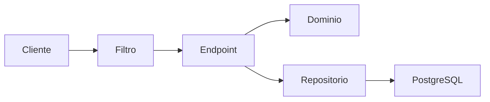
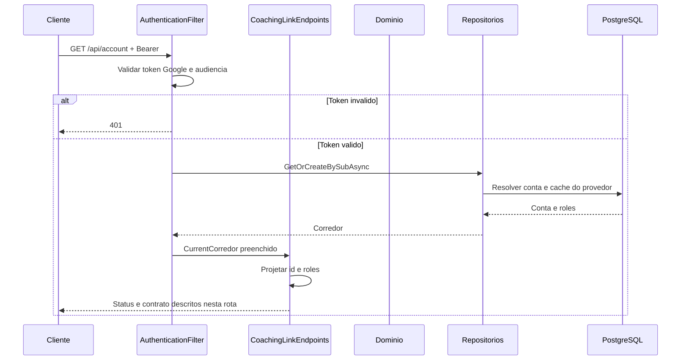
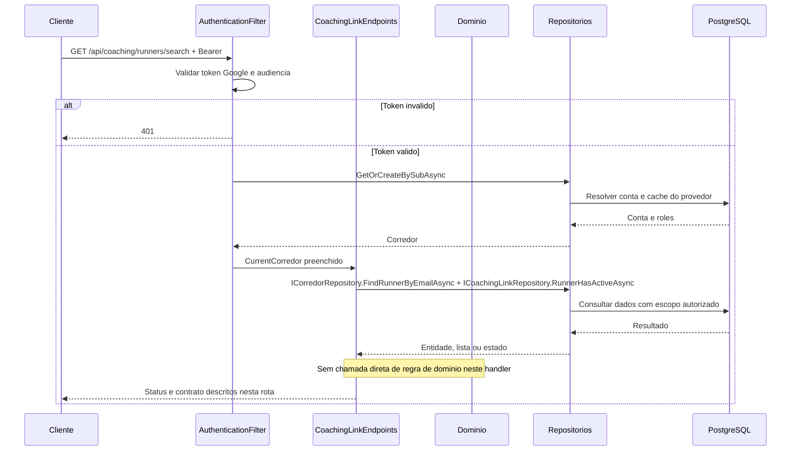
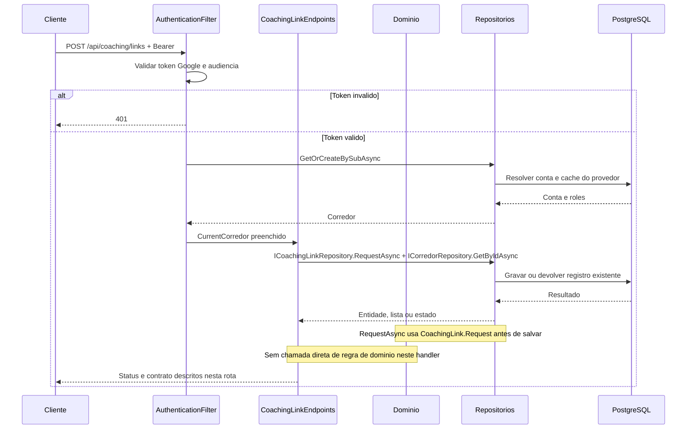
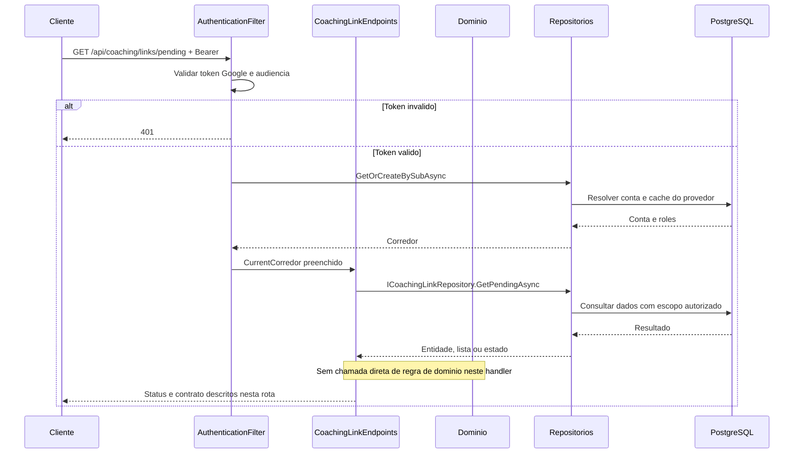
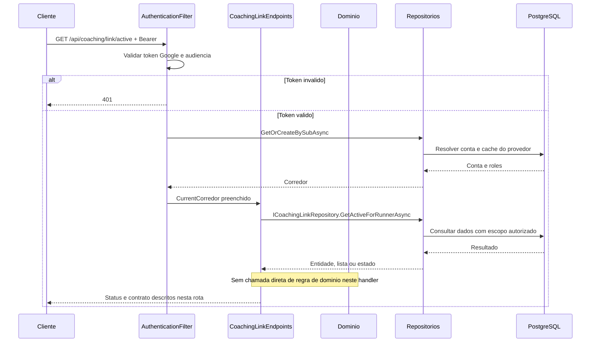
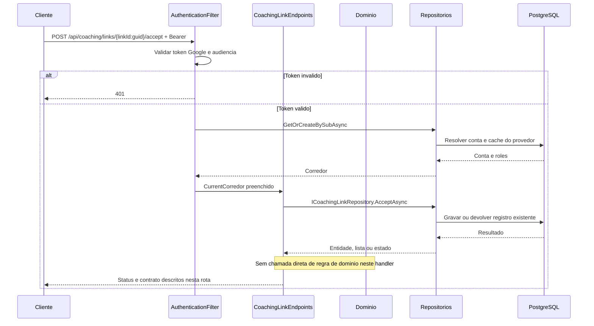
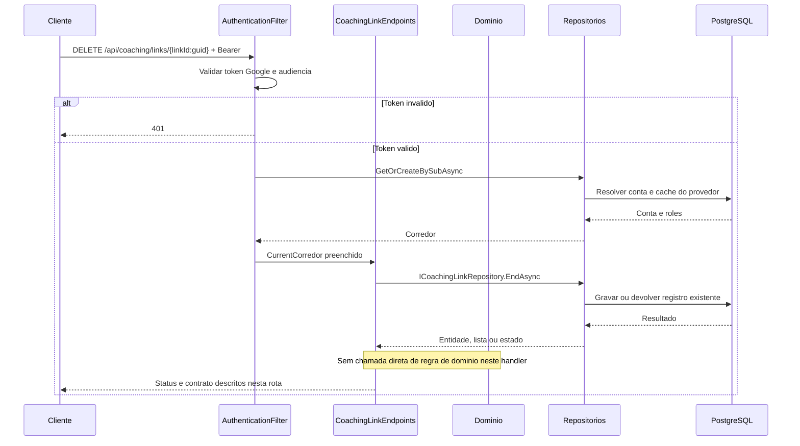
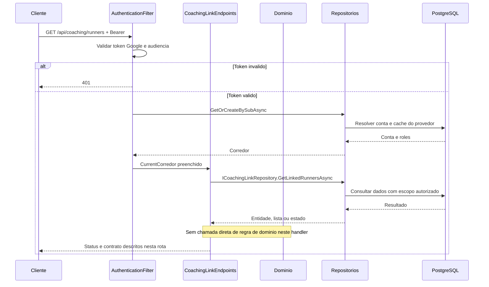

# CoachingLinkEndpoints - Acompanhamento - Especificação Técnica

Auditoria de fontes: 2026-09-27. Unidade: [CoachingLinkEndpoints.cs](../../../src/Steady.Api/Endpoints/CoachingLinkEndpoints.cs).

## Índice

- [1. Visão Geral Técnica](#visao)
- [2. Configuração e Dependências](#config)
- [3. Detalhamento por Rota](#rotas)
- [4. Observações Técnicas](#observacoes)
  - [3.1. Ler conta atual](#rota-1)
  - [3.2. Buscar corredor](#rota-2)
  - [3.3. Solicitar vínculo](#rota-3)
  - [3.4. Listar solicitações recebidas](#rota-4)
  - [3.5. Ler vínculo do corredor](#rota-5)
  - [3.6. Aceitar vínculo](#rota-6)
  - [3.7. Encerrar vínculo](#rota-7)
  - [3.8. Listar corredores vinculados](#rota-8)

## 1. Visão Geral Técnica

**Propósito**: Solicitar, aceitar e encerrar vínculos de acompanhamento, com descoberta por e-mail e acesso restrito por papel.

**Responsabilidades**: autenticar pelo grupo, aplicar escopo do usuário, executar as rotas abaixo e projetar os contratos.

**Integrações**: ASP.NET Core Minimal APIs, Steady.Domain e Steady.Infrastructure com PostgreSQL. Validação Google pertence ao filtro comum. O handler não chama provedor de explicação.

**Fontes de regras**: [STORY-013](../../../specs/STORY-013/spec.bdd.md), [STORY-019](../../../specs/STORY-019/spec.bdd.md), [ADR-002](../../../docs/adr/ADR-002-autenticacao-e-isolamento-de-dados.md), [ADR-008](../../../docs/adr/ADR-008-roles-vinculo-e-autorizacao-do-personal.md).

## 2. Configuração e Dependências

Composição: [Program.cs](../../../src/Steady.Api/Program.cs); persistência: [ServiceCollectionExtensions.cs](../../../src/Steady.Infrastructure/DependencyInjection/ServiceCollectionExtensions.cs). Cada lambda recebe os repositórios listados na rota, CurrentCorredor e CancellationToken quando há I/O. ILogger<CoachingAuditLog> aparece somente nas operações auditadas de vínculo/ficha/histórico.

**Lista de endpoints**:

- **GET** `/api/account` - Ler conta atual.
- **GET** `/api/coaching/runners/search` - Buscar corredor.
- **POST** `/api/coaching/links` - Solicitar vínculo.
- **GET** `/api/coaching/links/pending` - Listar solicitações recebidas.
- **GET** `/api/coaching/link/active` - Ler vínculo do corredor.
- **POST** `/api/coaching/links/{linkId:guid}/accept` - Aceitar vínculo.
- **DELETE** `/api/coaching/links/{linkId:guid}` - Encerrar vínculo.
- **GET** `/api/coaching/runners` - Listar corredores vinculados.

**F. Endpoint Filter - AuthenticationFilter.InvokeAsync**

1. O grupo `/api` recebe o filtro em `Program.cs`; `/health` fica fora do grupo.
2. `Authorization` deve começar exatamente com `Bearer `; token vazio, inválido ou expirado retorna 401 antes da lógica do handler. O binding do framework pode rejeitar uma requisição malformada antes da execução do filtro.
3. `GoogleTokenValidator.ValidateAsync` usa `GoogleJsonWebSignature.ValidateAsync` com Audience restrita a `Google:ClientId`; assinatura e validade são verificadas pela biblioteca com chaves públicas cacheadas. Sem `Google:ClientId`, Program lança erro ao compor a aplicação.
4. Identidade é `sub`. E-mail e nome opcionais são normalizados e usados como cache de exibição, sem substituir identidade. `ICorredorRepository.GetOrCreateBySubAsync` resolve/provisiona corredor; `CurrentCorredor.Id` e `Roles` são preenchidos para a requisição.
5. `CurrentCorredor.HasRole` compara papel com ordinal exato; um token válido não concede automaticamente `Personal`. Falhas de autenticação registram path, motivo e IP, sem token.

**U1. Common/Auth e conversão**

- `CurrentCorredor`: identidade e papéis resolvidos pelo filtro; o cliente não escolhe o dono dos registros.
- `DomainFactory.TryCreate`: captura apenas `ArgumentException` (inclui guard clauses derivadas) e retorna 400 com `{ "error": "mensagem" }`; não converte todo erro de persistência ou desserialização em erro de validação.
- `Idempotency.HeaderName`: `Idempotency-Key`; quando exigida e ausente, `MissingKey` retorna 400. Guid inválido é rejeitado pelo binding; Guid.Empty não recebe validação específica no helper.
- Records HTTP são serializados em camelCase pelo padrão do framework. Datas `DateOnly` são `yyyy-MM-dd`. Enums de StrengthSession não recebem conversor textual global; enums convertidos explicitamente por `ToString` ou por mapping seguem as strings descritas em cada rota.

### Contrato `CurrentAccountResponse`

Fonte: [CoachingContracts.cs](../../../src/Steady.Api/Contracts/CoachingContracts.cs). Os nomes abaixo são os campos HTTP com serialização padrão camelCase.

| Campo | Tipo C# | Opcional/padrão |
|---|---|---|
| `id` | `Guid` | não anulável |
| `roles` | `IReadOnlyList<string>` | não anulável |

### Contrato `RunnerSearchResponse`

Fonte: [CoachingContracts.cs](../../../src/Steady.Api/Contracts/CoachingContracts.cs). Os nomes abaixo são os campos HTTP com serialização padrão camelCase.

| Campo | Tipo C# | Opcional/padrão |
|---|---|---|
| `corredorId` | `Guid` | não anulável |
| `email` | `string` | não anulável |
| `available` | `bool` | não anulável |
| `name` | `string?` | null permitido |

### Contrato `CreateCoachingLinkBody`

Fonte: [CoachingContracts.cs](../../../src/Steady.Api/Contracts/CoachingContracts.cs). Os nomes abaixo são os campos HTTP com serialização padrão camelCase.

| Campo | Tipo C# | Opcional/padrão |
|---|---|---|
| `corredorId` | `Guid` | não anulável |

### Contrato `CoachingLinkResponse`

Fonte: [CoachingContracts.cs](../../../src/Steady.Api/Contracts/CoachingContracts.cs). Os nomes abaixo são os campos HTTP com serialização padrão camelCase.

| Campo | Tipo C# | Opcional/padrão |
|---|---|---|
| `id` | `Guid` | não anulável |
| `personalId` | `Guid` | não anulável |
| `corredorId` | `Guid` | não anulável |
| `status` | `string` | não anulável |
| `requestedAt` | `DateTime` | não anulável |

### Contrato `LinkedRunnerResponse`

Fonte: [CoachingContracts.cs](../../../src/Steady.Api/Contracts/CoachingContracts.cs). Os nomes abaixo são os campos HTTP com serialização padrão camelCase.

| Campo | Tipo C# | Opcional/padrão |
|---|---|---|
| `linkId` | `Guid` | não anulável |
| `corredorId` | `Guid` | não anulável |
| `email` | `string` | não anulável |
| `name` | `string?` | null permitido |

### Catálogo compartilhado de domínio e persistência

CoachingLink.Request é chamado dentro de RequestAsync para validar ids e evitar vínculo consigo mesmo. Aceite/encerramento são transições implementadas no repositório, não chamadas de uma factory no handler.

CoachingLinkRepository mantém pendência única por par e vínculo ativo único por corredor via índices parciais. RequestAsync recupera pendência vencedora após DbUpdateException. AcceptAsync transaciona, expira concorrentes e converte corrida de aceites em AlreadyLinked quando outro venceu. EndAsync filtra participantes. CorredorRepository usa sub como identidade; Email e Name são cache opcional do Google.

## 3. Detalhamento por Rota

### 3.1. Ler conta atual

**Rota**: `GET /api/account`

**Entrada**: Sem corpo. Header Authorization: Bearer obrigatório.

**Saída**: CurrentAccountResponse. Estruturas e tipos completos constam na seção de contratos.

**Status**: 200 conta; todas as rotas podem retornar 401 no filtro. Binding inválido pode retornar 400 antes do handler.

#### Fluxo de Execução

#### Detalhamento do Fluxo

**E.1. Lambda de rota em MapCoachingLinkEndpoints**

Retorna id e roles já carregados por AuthenticationFilter; não faz consulta adicional no handler.

Navegação: [F. autenticação](#f-auth), [D1. domínio](#d-1), [R1. persistência](#r-1), [U1. suporte](#u-common).

**D1.1. Domínio no fluxo**

Sem chamada direta à factory CoachingLink nesta rota. Consulta/transição é executada no repositório conforme os estados descritos no [catálogo](#catalogo).

**R1.1. Métodos e persistência**

Chamada desta rota: `CurrentCorredor`.

A operação específica e seu escopo estão descritos no fluxo acima; detalhes de query, snapshot, transação e reenvio estão no [catálogo de persistência](#catalogo). As consultas próprias filtram o dono no banco; leitura pelo personal exige o vínculo quando indicado. Nenhuma autorização por vínculo é acrescentada implicitamente pelo filtro comum.

[Voltar ao endpoint](#e-1). O [filtro](#f-auth) resolve autenticação antes da lógica; os [utilitários](#u-common) não adicionam autorização por vínculo automaticamente.

### 3.2. Buscar corredor

**Rota**: `GET /api/coaching/runners/search`

**Entrada**: Query email: string obrigatório. Header Authorization: Bearer obrigatório.

**Saída**: RunnerSearchResponse. Estruturas e tipos completos constam na seção de contratos.

**Status**: 200; 400 vazio; 403 sem papel; 404 não encontrado; todas as rotas podem retornar 401 no filtro. Binding inválido pode retornar 400 antes do handler.

#### Fluxo de Execução

#### Detalhamento do Fluxo

**E.2. Lambda de rota em MapCoachingLinkEndpoints**

Exige role Personal; trim de email e rejeita vazio; FindRunnerByEmailAsync limita a corredor; verifica vínculo ativo e retorna available e name opcional.

Navegação: [F. autenticação](#f-auth), [D1. domínio](#d-2), [R1. persistência](#r-2), [U1. suporte](#u-common).

**D1.2. Domínio no fluxo**

Sem chamada direta à factory CoachingLink nesta rota. Consulta/transição é executada no repositório conforme os estados descritos no [catálogo](#catalogo).

**R1.2. Métodos e persistência**

Chamada desta rota: `ICorredorRepository.FindRunnerByEmailAsync + ICoachingLinkRepository.RunnerHasActiveAsync`.

A operação específica e seu escopo estão descritos no fluxo acima; detalhes de query, snapshot, transação e reenvio estão no [catálogo de persistência](#catalogo). As consultas próprias filtram o dono no banco; leitura pelo personal exige o vínculo quando indicado. Nenhuma autorização por vínculo é acrescentada implicitamente pelo filtro comum.

[Voltar ao endpoint](#e-2). O [filtro](#f-auth) resolve autenticação antes da lógica; os [utilitários](#u-common) não adicionam autorização por vínculo automaticamente.

### 3.3. Solicitar vínculo

**Rota**: `POST /api/coaching/links`

**Entrada**: CreateCoachingLinkBody. Header Authorization: Bearer obrigatório.

**Saída**: CoachingLinkResponse. Estruturas e tipos completos constam na seção de contratos.

**Status**: 201 novo; 200 pendente existente; 409 indisponível; 403 sem papel; 404 conta; 400 domínio; todas as rotas podem retornar 401 no filtro. Binding inválido pode retornar 400 antes do handler.

#### Fluxo de Execução

#### Detalhamento do Fluxo

**E.3. Lambda de rota em MapCoachingLinkEndpoints**

Exige Personal; verifica indisponibilidade por vínculo ativo; conta precisa existir e conter Corredor; RequestAsync preserva pendência existente; audit registra ids e created; ArgumentException vira 400.

Navegação: [F. autenticação](#f-auth), [D1. domínio](#d-3), [R1. persistência](#r-3), [U1. suporte](#u-common).

**D1.3. Domínio no fluxo**

RequestAsync chama CoachingLink.Request para validar os participantes antes da gravação; o handler captura ArgumentException como 400.

**R1.3. Métodos e persistência**

Chamada desta rota: `ICoachingLinkRepository.RequestAsync + ICorredorRepository.GetByIdAsync`.

A operação específica e seu escopo estão descritos no fluxo acima; detalhes de query, snapshot, transação e reenvio estão no [catálogo de persistência](#catalogo). As consultas próprias filtram o dono no banco; leitura pelo personal exige o vínculo quando indicado. Nenhuma autorização por vínculo é acrescentada implicitamente pelo filtro comum.

[Voltar ao endpoint](#e-3). O [filtro](#f-auth) resolve autenticação antes da lógica; os [utilitários](#u-common) não adicionam autorização por vínculo automaticamente.

### 3.4. Listar solicitações recebidas

**Rota**: `GET /api/coaching/links/pending`

**Entrada**: Sem corpo. Header Authorization: Bearer obrigatório.

**Saída**: Lista de CoachingLinkResponse. Estruturas e tipos completos constam na seção de contratos.

**Status**: 200 lista; todas as rotas podem retornar 401 no filtro. Binding inválido pode retornar 400 antes do handler.

#### Fluxo de Execução

#### Detalhamento do Fluxo

**E.4. Lambda de rota em MapCoachingLinkEndpoints**

Busca pendências em que current.Id é corredor, ordenadas por RequestedAt decrescente.

Navegação: [F. autenticação](#f-auth), [D1. domínio](#d-4), [R1. persistência](#r-4), [U1. suporte](#u-common).

**D1.4. Domínio no fluxo**

Sem chamada direta à factory CoachingLink nesta rota. Consulta/transição é executada no repositório conforme os estados descritos no [catálogo](#catalogo).

**R1.4. Métodos e persistência**

Chamada desta rota: `ICoachingLinkRepository.GetPendingAsync`.

A operação específica e seu escopo estão descritos no fluxo acima; detalhes de query, snapshot, transação e reenvio estão no [catálogo de persistência](#catalogo). As consultas próprias filtram o dono no banco; leitura pelo personal exige o vínculo quando indicado. Nenhuma autorização por vínculo é acrescentada implicitamente pelo filtro comum.

[Voltar ao endpoint](#e-4). O [filtro](#f-auth) resolve autenticação antes da lógica; os [utilitários](#u-common) não adicionam autorização por vínculo automaticamente.

### 3.5. Ler vínculo do corredor

**Rota**: `GET /api/coaching/link/active`

**Entrada**: Sem corpo. Header Authorization: Bearer obrigatório.

**Saída**: CoachingLinkResponse. Estruturas e tipos completos constam na seção de contratos.

**Status**: 200 vínculo; 404 sem vínculo; todas as rotas podem retornar 401 no filtro. Binding inválido pode retornar 400 antes do handler.

#### Fluxo de Execução

#### Detalhamento do Fluxo

**E.5. Lambda de rota em MapCoachingLinkEndpoints**

Busca vínculo ativo do corredor atual.

Navegação: [F. autenticação](#f-auth), [D1. domínio](#d-5), [R1. persistência](#r-5), [U1. suporte](#u-common).

**D1.5. Domínio no fluxo**

Sem chamada direta à factory CoachingLink nesta rota. Consulta/transição é executada no repositório conforme os estados descritos no [catálogo](#catalogo).

**R1.5. Métodos e persistência**

Chamada desta rota: `ICoachingLinkRepository.GetActiveForRunnerAsync`.

A operação específica e seu escopo estão descritos no fluxo acima; detalhes de query, snapshot, transação e reenvio estão no [catálogo de persistência](#catalogo). As consultas próprias filtram o dono no banco; leitura pelo personal exige o vínculo quando indicado. Nenhuma autorização por vínculo é acrescentada implicitamente pelo filtro comum.

[Voltar ao endpoint](#e-5). O [filtro](#f-auth) resolve autenticação antes da lógica; os [utilitários](#u-common) não adicionam autorização por vínculo automaticamente.

### 3.6. Aceitar vínculo

**Rota**: `POST /api/coaching/links/{linkId:guid}/accept`

**Entrada**: linkId: Guid; sem corpo. Header Authorization: Bearer obrigatório.

**Saída**: Sem corpo. Estruturas e tipos completos constam na seção de contratos.

**Status**: 200 aceito; 409 já vinculado; 404 pendência ausente ou alheia; todas as rotas podem retornar 401 no filtro. Binding inválido pode retornar 400 antes do handler.

#### Fluxo de Execução

#### Detalhamento do Fluxo

**E.6. Lambda de rota em MapCoachingLinkEndpoints**

AcceptAsync exige dono da pendência; usa transação, verifica vínculo ativo, ativa escolhido e expira outras pendências; audit somente em Accepted.

Navegação: [F. autenticação](#f-auth), [D1. domínio](#d-6), [R1. persistência](#r-6), [U1. suporte](#u-common).

**D1.6. Domínio no fluxo**

Sem chamada direta à factory CoachingLink nesta rota. Consulta/transição é executada no repositório conforme os estados descritos no [catálogo](#catalogo).

**R1.6. Métodos e persistência**

Chamada desta rota: `ICoachingLinkRepository.AcceptAsync`.

A operação específica e seu escopo estão descritos no fluxo acima; detalhes de query, snapshot, transação e reenvio estão no [catálogo de persistência](#catalogo). As consultas próprias filtram o dono no banco; leitura pelo personal exige o vínculo quando indicado. Nenhuma autorização por vínculo é acrescentada implicitamente pelo filtro comum.

[Voltar ao endpoint](#e-6). O [filtro](#f-auth) resolve autenticação antes da lógica; os [utilitários](#u-common) não adicionam autorização por vínculo automaticamente.

### 3.7. Encerrar vínculo

**Rota**: `DELETE /api/coaching/links/{linkId:guid}`

**Entrada**: linkId: Guid; sem corpo. Header Authorization: Bearer obrigatório.

**Saída**: Sem corpo. Estruturas e tipos completos constam na seção de contratos.

**Status**: 204 encerrado; 404 não acessível ou já encerrado; todas as rotas podem retornar 401 no filtro. Binding inválido pode retornar 400 antes do handler.

#### Fluxo de Execução

#### Detalhamento do Fluxo

**E.7. Lambda de rota em MapCoachingLinkEndpoints**

EndAsync aceita participante PersonalId ou CorredorId e estado Pending/Active; marca Ended e EndedAt; audit quando encerrado.

Navegação: [F. autenticação](#f-auth), [D1. domínio](#d-7), [R1. persistência](#r-7), [U1. suporte](#u-common).

**D1.7. Domínio no fluxo**

Sem chamada direta à factory CoachingLink nesta rota. Consulta/transição é executada no repositório conforme os estados descritos no [catálogo](#catalogo).

**R1.7. Métodos e persistência**

Chamada desta rota: `ICoachingLinkRepository.EndAsync`.

A operação específica e seu escopo estão descritos no fluxo acima; detalhes de query, snapshot, transação e reenvio estão no [catálogo de persistência](#catalogo). As consultas próprias filtram o dono no banco; leitura pelo personal exige o vínculo quando indicado. Nenhuma autorização por vínculo é acrescentada implicitamente pelo filtro comum.

[Voltar ao endpoint](#e-7). O [filtro](#f-auth) resolve autenticação antes da lógica; os [utilitários](#u-common) não adicionam autorização por vínculo automaticamente.

### 3.8. Listar corredores vinculados

**Rota**: `GET /api/coaching/runners`

**Entrada**: Sem corpo. Header Authorization: Bearer obrigatório.

**Saída**: Lista de LinkedRunnerResponse. Estruturas e tipos completos constam na seção de contratos.

**Status**: 200 lista; 403 sem papel; todas as rotas podem retornar 401 no filtro. Binding inválido pode retornar 400 antes do handler.

#### Fluxo de Execução

#### Detalhamento do Fluxo

**E.8. Lambda de rota em MapCoachingLinkEndpoints**

Exige Personal; join de vínculo ativo com conta; ordena por Name ou Email e projeta name opcional.

Navegação: [F. autenticação](#f-auth), [D1. domínio](#d-8), [R1. persistência](#r-8), [U1. suporte](#u-common).

**D1.8. Domínio no fluxo**

Sem chamada direta à factory CoachingLink nesta rota. Consulta/transição é executada no repositório conforme os estados descritos no [catálogo](#catalogo).

**R1.8. Métodos e persistência**

Chamada desta rota: `ICoachingLinkRepository.GetLinkedRunnersAsync`.

A operação específica e seu escopo estão descritos no fluxo acima; detalhes de query, snapshot, transação e reenvio estão no [catálogo de persistência](#catalogo). As consultas próprias filtram o dono no banco; leitura pelo personal exige o vínculo quando indicado. Nenhuma autorização por vínculo é acrescentada implicitamente pelo filtro comum.

[Voltar ao endpoint](#e-8). O [filtro](#f-auth) resolve autenticação antes da lógica; os [utilitários](#u-common) não adicionam autorização por vínculo automaticamente.

## 4. Observações Técnicas

Nenhum handler recebe roles do corpo. Consultas de conta/vínculo próprio não exigem explicitamente role Corredor. Status da resposta de vínculo é lowercase. Aceite não devolve objeto nem Location. Encerramento revoga leitura do personal nas consultas que exigem vínculo ativo.

**Performance**: consultas são assíncronas com CancellationToken; onde a coleção não possui parâmetros de limite, o resultado é materializado integralmente. Não há paralelização de chamadas ao mesmo contexto no handler.

**Tratamento de erros**: status acima descrevem caminhos explícitos; exceções inesperadas não têm tradução local genérica. 404 não deve ser interpretado como permissão de procurar dados de outro corredor.

**Documentos relacionados**: [Regras](../BusinessRulesDocs/Vinculos-com-Personal-Acompanhamento-Rules.md), [Débitos](../TechnicalDebtsDocs/CoachingLinkEndpoints-Acompanhamento-Debts.md), [Índice](README.md).
