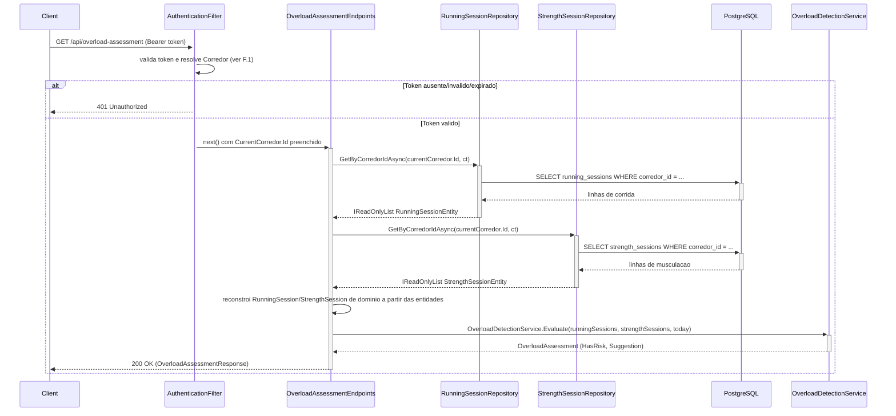

# OverloadAssessmentEndpoints - Sobrecarga - Especificacao Tecnica

## Indice
- [1. Visao Geral Tecnica](#1-visao-geral-tecnica)
- [2. Configuracao e Dependencias](#2-configuracao-e-dependencias)
- [3. Detalhamento por Rota](#3-detalhamento-por-rota)
  - [3.1. Consultar Avaliacao de Sobrecarga Atual](#31-consultar-avaliacao-de-sobrecarga-atual)
- [4. Observacoes Tecnicas](#4-observacoes-tecnicas)

## 1. Visao Geral Tecnica

**Proposito**: Expor via API HTTP o calculo de risco de sobrecarga combinada (corrida + musculacao) do corredor autenticado, a partir do historico persistido, aplicando a regra fundamentada em [ADR-001](../../../docs/adr/ADR-001-regra-sobrecarga-combinada.md).

**Responsabilidades**:
- Carregar todo o historico de sessoes de corrida e musculacao do corredor autenticado.
- Reconstruir instancias de dominio (`RunningSession`, `StrengthSession`) a partir das entidades persistidas.
- Delegar o calculo de risco para `Steady.Domain.Overload.OverloadDetectionService.Evaluate`.
- Retornar `200 OK` com o resultado da avaliacao (`hasRisk` + `suggestion` opcional).

**Integracoes**: PostgreSQL (via `IRunningSessionRepository` e `IStrengthSessionRepository`), Google Sign-In indiretamente atraves do `AuthenticationFilter`. Nao ha chamada a servico externo alem da autenticacao.

## 2. Configuracao e Dependencias

Este arquivo (`src/Steady.Api/Endpoints/OverloadAssessmentEndpoints.cs`) e uma classe estatica que expoe o metodo de extensao `MapOverloadAssessmentEndpoints(RouteGroupBuilder)`, chamado a partir de `Program.cs` sobre o grupo `/api`.

**Dependencias Injetadas (via parametros do delegate da rota)**:
- `IRunningSessionRepository`: le todas as sessoes de corrida do corredor.
- `IStrengthSessionRepository`: le todas as sessoes de musculacao do corredor.
- `CurrentCorredor`: contexto do usuario autenticado, preenchido pelo `AuthenticationFilter`.
- `CancellationToken`: propagado a partir do `HttpContext.RequestAborted`.

**Dependencia estatica (nao injetada)**:
- `Steady.Domain.Overload.OverloadDetectionService` (classe `static`): contem a regra de negocio de deteccao de sobrecarga, sem estado, sem dependencia de infraestrutura.

**Lista de Endpoints**:
- **GET** `/api/overload-assessment` - Retorna a avaliacao de risco de sobrecarga atual do corredor autenticado.

## 3. Detalhamento por Rota

### 3.1. Consultar Avaliacao de Sobrecarga Atual

**Rota**: `GET /api/overload-assessment`

**Autenticacao**: obrigatoria (Bearer ID token do Google) - aplicada pelo `AuthenticationFilter` no grupo `/api`.

**Entrada**: nenhum corpo ou parametro de rota/query - a avaliacao usa exclusivamente o `CurrentCorredor.Id` resolvido pela autenticacao e a data atual (`DateTime.UtcNow`) como referencia de "hoje".

**Saida - 200 OK** (`OverloadAssessmentResponse`, `src/Steady.Api/Contracts/OverloadAssessmentResponse.cs`):
```json
{
  "hasRisk": true,
  "suggestion": "Você teve um treino pesado de perna e sua carga de corrida aumentou nos últimos 7 dias. Considere reduzir a distância ou o ritmo da próxima corrida, ou aliviar a intensidade do próximo treino de perna, para não sobrecarregar."
}
```
Quando nao ha risco: `{"hasRisk": false, "suggestion": null}` (inclui o caso de corredor sem historico algum, ou historico insuficiente - menos de 14 dias).

**Saida - 401 Unauthorized**: sem header `Authorization: Bearer {token}`, ou token invalido/expirado.

Esta rota **nunca** retorna `400` - nao ha entrada de usuario a validar, apenas leitura e calculo.

#### Fluxo de Execucao



#### Detalhamento do Fluxo

**E. Endpoint (OverloadAssessmentEndpoints)**

E.1. `MapOverloadAssessmentEndpoints()` - handler de `GET /overload-assessment`
- Recebe `IRunningSessionRepository`, `IStrengthSessionRepository`, `CurrentCorredor` e `CancellationToken` por injecao de parametros.
- Chama `runningRepository.GetByCorredorIdAsync(currentCorredor.Id, ct)` -> [R1.1](#r11-runningsessionrepositorygetbycorredoridasync).
- Chama `strengthRepository.GetByCorredorIdAsync(currentCorredor.Id, ct)` -> [R2.1](#r21-strengthsessionrepositorygetbycorredoridasync).
- Reconstroi instancias de dominio a partir das entidades: `runningEntities.Select(e => RunningSession.Create(e.Date, e.DistanceKm, e.DurationMinutes, e.AveragePaceMinPerKm, e.PerceivedEffort))` e o equivalente para `StrengthSession.Create` -> [D2.1](#d21-runningsessioncreate-reconstrucao) / [D2.2](#d22-strengthsessioncreate-reconstrucao).
- Calcula `today = DateOnly.FromDateTime(DateTime.UtcNow)`.
- Chama `OverloadDetectionService.Evaluate(runningSessions, strengthSessions, today)` -> [D1.1](#d11-overloaddetectionserviceevaluate).
- Retorna `Results.Ok(new OverloadAssessmentResponse(assessment.HasRisk, assessment.Suggestion))` -> `200 OK`.

**F. Endpoint Filter (AuthenticationFilter)**

<a id="f1-authenticationfilterinvokeasync"></a>
F.1. `InvokeAsync()` - aplicado a todo o grupo `/api`. Mesmo comportamento documentado em [RunningSessionEndpoints DevDocs - F.1](./RunningSessionEndpoints-Treino-Corrida-DevDocs.md#f1-authenticationfilterinvokeasync).

**D1. Domain (OverloadDetectionService, Steady.Domain.Overload)**

<a id="d11-overloaddetectionserviceevaluate"></a>
D1.1. `OverloadDetectionService.Evaluate(runningSessions, strengthSessions, today)` (`src/Steady.Domain/Overload/OverloadDetectionService.cs`) - regra fundamentada em [ADR-001](../../../docs/adr/ADR-001-regra-sobrecarga-combinada.md) (ACWR - Gabbett 2016 - + session-RPE - Foster 2001 - + regra dos 10%).
- Chama `HasSufficientHistory(...)`: calcula a data mais antiga entre todas as sessoes; se nao houver nenhuma sessao (`earliestDate is null`) ou o intervalo entre a data mais antiga e hoje for menor que `MinimumHistoryDays = 14`, retorna `OverloadAssessment.NoRisk()` imediatamente - sem avaliar a regra combinada.
- Define `recentWindow = [hoje-6, hoje]` e `previousWindow = [hoje-13, hoje-7]` (janelas moveis de 7 dias corridos, nao semana de calendario).
- `hasHeavyLegSession`: verifica se existe alguma `StrengthSession` na `recentWindow` com `MuscleGroup` igual a `PernaFrontal` ou `PernaPosterior` **e** `Intensity.Pesado`.
- `recentRunningLoad`/`previousRunningLoad`: soma de `RunningSession.Load` (`DurationMinutes * PerceivedEffort`) em cada janela, via `SumLoad`.
- `isOverloaded = hasHeavyLegSession && previousRunningLoad > 0 && recentRunningLoad >= previousRunningLoad * 1.10` (constante `OverloadThreshold`).
- Retorna `OverloadAssessment.Risk(SuggestionMessage)` (mensagem fixa, nao personalizada por numero) quando `isOverloaded`, senao `OverloadAssessment.NoRisk()`.

<a id="d21-runningsessioncreate-reconstrucao"></a>
D2.1. `RunningSession.Create(...)` - mesma factory documentada em [RunningSessionEndpoints DevDocs - D1.1](./RunningSessionEndpoints-Treino-Corrida-DevDocs.md#d11-runningsessioncreate). Aqui e usada para **reconstruir** instancias de dominio a partir de dados ja persistidos e validados (nao para validar entrada nova do usuario) - as guard clauses tecnicamente rodam de novo, mas nao deveriam falhar porque os dados ja passaram pela validacao no momento do registro original.

<a id="d22-strengthsessioncreate-reconstrucao"></a>
D2.2. `StrengthSession.Create(...)` - mesma factory documentada em [StrengthSessionEndpoints DevDocs - D1.1](./StrengthSessionEndpoints-Treino-Forca-DevDocs.md#d11-strengthsessioncreate), usada aqui para reconstrucao a partir de dados persistidos.

**R1. Repository (RunningSessionRepository)**

<a id="r11-runningsessionrepositorygetbycorredoridasync"></a>
R1.1. `RunningSessionRepository.GetByCorredorIdAsync(corredorId, cancellationToken)` - `dbContext.RunningSessions.Where(s => s.CorredorId == corredorId).ToListAsync(ct)`. Filtro por `CorredorId` direto no banco (nunca busca tudo e filtra em memoria - Playbook A01, [ADR-002](../../../docs/adr/ADR-002-autenticacao-e-isolamento-de-dados.md)). Retorna lista vazia se o corredor nao tiver sessoes.

**R2. Repository (StrengthSessionRepository)**

<a id="r21-strengthsessionrepositorygetbycorredoridasync"></a>
R2.1. `StrengthSessionRepository.GetByCorredorIdAsync(corredorId, cancellationToken)` - equivalente a R1.1, mas sobre `dbContext.StrengthSessions`.

## 4. Observacoes Tecnicas

- **Performance**: carrega **todo** o historico de corrida e musculacao do corredor a cada chamada (sem filtro de data no banco), mesmo que a regra so precise dos ultimos 14 dias. Para um corredor com meses/anos de historico, isso e leitura desnecessaria. Ver [TechnicalDebtsDocs](../TechnicalDebtsDocs/OverloadAssessmentEndpoints-Sobrecarga-Debts.md).
- **Tratamento de Erros**: nao ha validacao de entrada (rota sem parametros) - o unico erro possivel e `401` (falha de autenticacao) ou falha de infraestrutura nao tratada (mesmo debito generico de middleware de excecao ja identificado nos demais endpoints).
- **Reconstrucao de dominio via entidade de persistencia**: o endpoint reconstroi objetos de dominio chamando `RunningSession.Create`/`StrengthSession.Create` novamente sobre dados ja validados - funciona, mas acopla a leitura as mesmas guard clauses da escrita (qualquer mudanca de guard clause afeta tambem a leitura do historico).
- **Consistencia com ADR-001**: a janela de 7 dias e o limiar de 14 dias de historico batem exatamente com o que esta documentado no ADR-001 e na spec BDD da STORY-001 - nenhuma divergencia encontrada entre codigo e documentacao.
