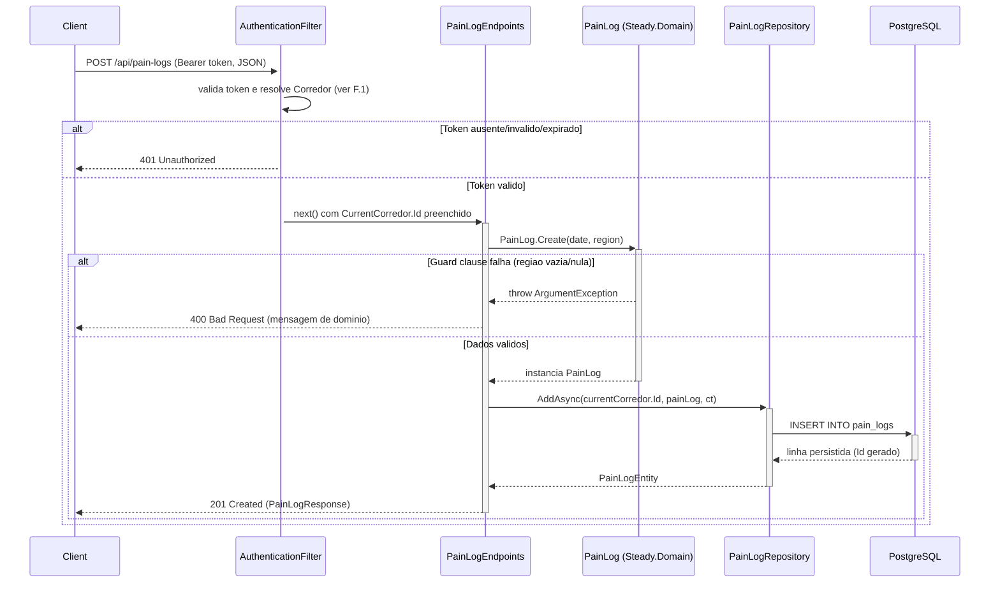

# PainLogEndpoints - Treino-Dor - Especificacao Tecnica

## Indice
- [1. Visao Geral Tecnica](#1-visao-geral-tecnica)
- [2. Configuracao e Dependencias](#2-configuracao-e-dependencias)
- [3. Detalhamento por Rota](#3-detalhamento-por-rota)
  - [3.1. Registrar Dor Pos-Treino](#31-registrar-dor-pos-treino)
- [4. Observacoes Tecnicas](#4-observacoes-tecnicas)

## 1. Visao Geral Tecnica

**Proposito**: Expor via API HTTP o registro de dor/desconforto pos-treino relatado pelo corredor, persistindo em PostgreSQL. Traduz a factory de dominio `Steady.Domain.Training.PainLog` para um endpoint REST.

**Responsabilidades**:
- Receber o payload de um registro de dor via `POST /api/pain-logs`.
- Delegar a validacao de negocio (regiao do corpo obrigatoria) para a factory `PainLog.Create`.
- Persistir o registro associado ao `CorredorId` do usuario autenticado, sem exigir vinculo com uma Sessao de Treino especifica.
- Retornar `201 Created` com a representacao do registro criado, ou `400 Bad Request` quando a validacao de dominio falhar.

**Integracoes**: PostgreSQL (via `IPainLogRepository` / EF Core), Google Sign-In indiretamente atraves do `AuthenticationFilter`. Diferente de `RunningSessionEndpoints`/`StrengthSessionEndpoints`, o registro de dor **nao** e consumido pela regra de deteccao de sobrecarga (`OverloadDetectionService`) - serve como sinal de calibracao para revisao futura da regra (ver [ADR-001](../../../docs/adr/ADR-001-regra-sobrecarga-combinada.md), secao Riscos).

## 2. Configuracao e Dependencias

Este arquivo (`src/Steady.Api/Endpoints/PainLogEndpoints.cs`) e uma classe estatica que expoe o metodo de extensao `MapPainLogEndpoints(RouteGroupBuilder)`, chamado a partir de `Program.cs` sobre o grupo `/api`.

**Dependencias Injetadas (via parametros do delegate da rota)**:
- `IPainLogRepository`: abstracao de persistencia do registro de dor (implementada por `PainLogRepository`, `Steady.Infrastructure`).
- `CurrentCorredor`: contexto do usuario autenticado, preenchido pelo `AuthenticationFilter`.
- `CancellationToken`: propagado a partir do `HttpContext.RequestAborted`.

**Dependencia estatica (nao injetada)**:
- `Steady.Api.Common.DomainFactory` (classe `internal static`): traduz excecoes de guard clause do dominio em `400 Bad Request`.

**Lista de Endpoints**:
- **POST** `/api/pain-logs` - Registra um novo relato de dor/desconforto para o corredor autenticado.

## 3. Detalhamento por Rota

### 3.1. Registrar Dor Pos-Treino

**Rota**: `POST /api/pain-logs`

**Autenticacao**: obrigatoria (Bearer ID token do Google) - aplicada pelo `AuthenticationFilter` no grupo `/api`.

**Entrada** (`PainLogRequest`, `src/Steady.Api/Contracts/PainLogContracts.cs`):
```json
{
  "date": "2026-08-08",
  "region": "Canela"
}
```
`region` e um campo de texto livre (`string`), nao um enum fechado como `MuscleGroup`.

**Saida - 201 Created** (`PainLogResponse`):
```json
{
  "id": "3fa85f64-5717-4562-b3fc-2c963f66afa6",
  "date": "2026-08-08",
  "region": "Canela"
}
```
Header `Location`: `/api/pain-logs/{id}`. Diferente de `RunningSessionEndpoints`/`StrengthSessionEndpoints`, aqui o `Location` aponta para o proprio namespace de `pain-logs` - porem **nao existe** uma rota `GET /api/pain-logs/{id}` implementada (ver [Observacoes Tecnicas](#4-observacoes-tecnicas)).

**Saida - 400 Bad Request**:
```json
{
  "error": "A região do corpo é obrigatória para registrar dor."
}
```

**Saida - 401 Unauthorized**: sem header `Authorization: Bearer {token}`, ou token invalido/expirado.

#### Fluxo de Execucao



#### Detalhamento do Fluxo

**E. Endpoint (PainLogEndpoints)**

E.1. `MapPainLogEndpoints()` - handler de `POST /pain-logs`
- Recebe `PainLogRequest`, `IPainLogRepository`, `CurrentCorredor` e `CancellationToken` por injecao de parametros.
- Chama `DomainFactory.TryCreate` passando uma factory que invoca `PainLog.Create(request.Date, request.Region)` -> [U1.1](#u11-domainfactorytrycreate) -> [D1.1](#d11-painlogcreate).
- Se `TryCreate` retornar `false`, devolve o `IResult` de erro (`400 Bad Request`).
- Se `TryCreate` retornar `true`, chama `repository.AddAsync(currentCorredor.Id, painLog!, cancellationToken)` -> [R1.1](#r11-painlogrepositoryaddasync).
- Monta `PainLogResponse` a partir da entidade persistida.
- Retorna `Results.Created($"/api/pain-logs/{entity.Id}", response)` -> `201 Created`.

**F. Endpoint Filter (AuthenticationFilter)**

<a id="f1-authenticationfilterinvokeasync"></a>
F.1. `InvokeAsync()` - aplicado a todo o grupo `/api`. Mesmo comportamento documentado em [RunningSessionEndpoints DevDocs - F.1](./RunningSessionEndpoints-Treino-Corrida-DevDocs.md#f1-authenticationfilterinvokeasync): valida o Bearer token do Google, resolve/cria o `Corredor`, preenche `CurrentCorredor.Id`, ou retorna `401`.

**D1. Domain (PainLog, Steady.Domain.Training)**

<a id="d11-painlogcreate"></a>
D1.1. `PainLog.Create(date, region)` - factory estatica, construtor privado.
- Guard clause: `string.IsNullOrWhiteSpace(region)` -> `ArgumentException` ("A região do corpo é obrigatória para registrar dor.").
- Regra de negocio #7 do `specs/STORY-001/spec.bdd.md`: o registro de dor e independente de uma Sessao de Treino especifica - so exige data + regiao do corpo. Pode ser registrado a qualquer momento apos o treino, inclusive dias depois (nenhuma validacao de janela temporal existe no dominio).
- Nao ha validacao de formato/lista fechada para `region` - qualquer string nao vazia e aceita (texto livre).
- Se o guard passar, retorna uma instancia imutavel de `PainLog`.
- Nao existe um indicador booleano "doeu/nao doeu" explicito no modelo atual - a propria existencia do registro representa "doeu" (spec nota: "escala de intensidade de dor fica binaria: doeu/nao doeu no MVP" - o "nao doeu" simplesmente nao gera registro).

**U1. Common/Auth (DomainFactory, CurrentCorredor)**

<a id="u11-domainfactorytrycreate"></a>
U1.1. `DomainFactory.TryCreate<T>(factory, out value, out error)` - identico ao comportamento documentado em [RunningSessionEndpoints DevDocs - U1.1](./RunningSessionEndpoints-Treino-Corrida-DevDocs.md#u11-domainfactorytrycreate).

U1.2. `CurrentCorredor` - identico ao documentado em [RunningSessionEndpoints DevDocs](./RunningSessionEndpoints-Treino-Corrida-DevDocs.md): preenchido por [F.1](#f1-authenticationfilterinvokeasync).

**R1. Repository (PainLogRepository, Steady.Infrastructure.Repositories)**

<a id="r11-painlogrepositoryaddasync"></a>
R1.1. `PainLogRepository.AddAsync(corredorId, painLog, cancellationToken)`
- Monta um `PainLogEntity` com `Id = Guid.NewGuid()` e `CorredorId = corredorId`.
- Copia `Date` e `Region` da instancia de dominio validada.
- `dbContext.PainLogs.Add(entity)` seguido de `await dbContext.SaveChangesAsync(cancellationToken)` - grava na tabela `pain_logs`.
- Retorna a entidade persistida. Nota: `IPainLogRepository` expoe **apenas** `AddAsync` - nao ha metodo de leitura (`GetByCorredorIdAsync`/`GetByIdAsync`) nesta interface, ao contrario de `IRunningSessionRepository`/`IStrengthSessionRepository`.

## 4. Observacoes Tecnicas

- **Performance**: operacao unica de `INSERT` por requisicao.
- **Tratamento de Erros**: erros de guard clause do dominio viram `400`. Excecoes fora desse tipo nao sao tratadas explicitamente (mesmo debito ja identificado em `RunningSessionEndpoints`).
- **Integracoes Criticas**: PostgreSQL e o `AuthenticationFilter`/Google Sign-In.
- **Ausencia de leitura**: nao existe nenhuma rota `GET` para consultar registros de dor - nem individualmente, nem em lista, nem no historico consolidado (`TrainingHistoryEndpoints` so lista corrida e musculacao). O `Location` do `201 Created` (`/api/pain-logs/{id}`) referencia uma rota que nao existe. Ver [TechnicalDebtsDocs](../TechnicalDebtsDocs/PainLogEndpoints-Treino-Dor-Debts.md).
- **Sem uso na deteccao de sobrecarga**: apesar de ser parte central da motivacao do produto (dor recorrente pos-treino), o `PainLog` nao alimenta `OverloadDetectionService.Evaluate` - a regra atual usa apenas `RunningSession` e `StrengthSession` (ver [ADR-001](../../../docs/adr/ADR-001-regra-sobrecarga-combinada.md)).
