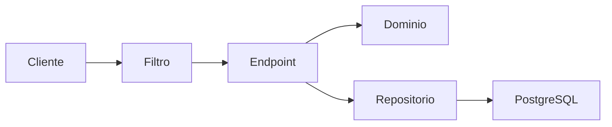
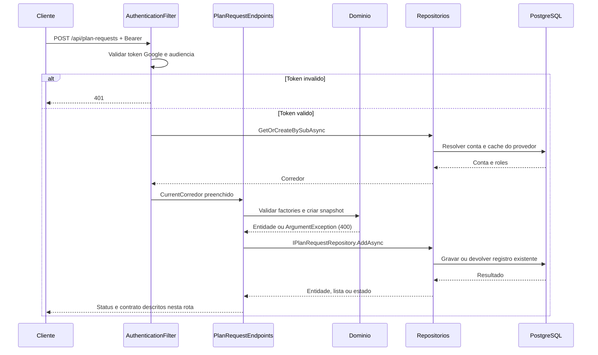
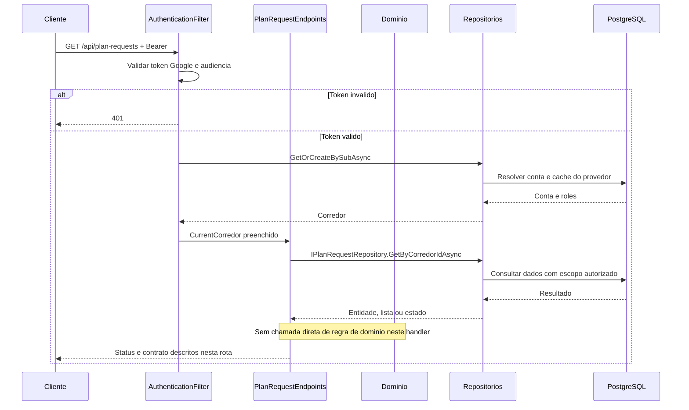
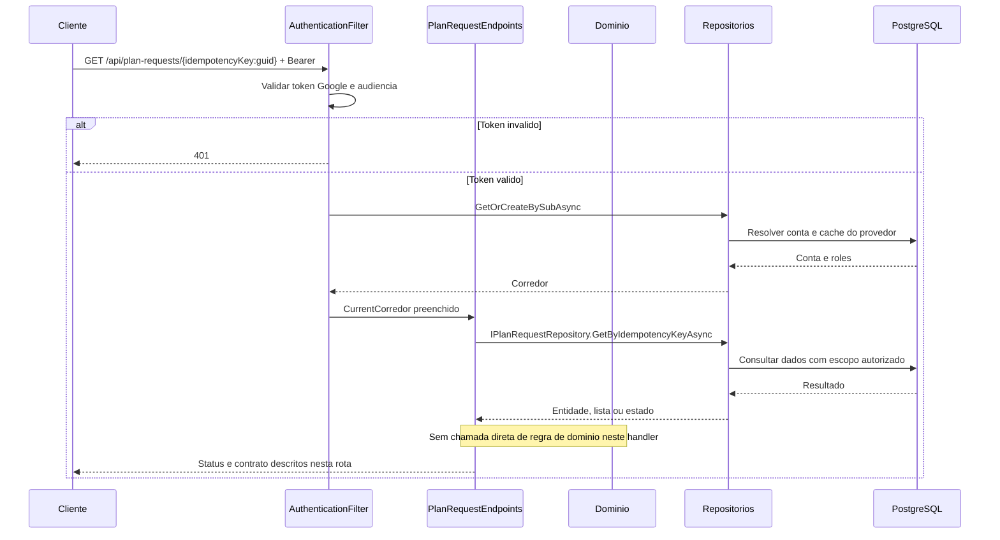

# PlanRequestEndpoints - Planejamento - Especificação Técnica

Auditoria de fontes: 2026-09-27. Unidade: [PlanRequestEndpoints.cs](../../../src/Steady.Api/Endpoints/PlanRequestEndpoints.cs).

## Índice

- [1. Visão Geral Técnica](#visao)
- [2. Configuração e Dependências](#config)
- [3. Detalhamento por Rota](#rotas)
- [4. Observações Técnicas](#observacoes)
  - [3.1. Criar pedido](#rota-1)
  - [3.2. Listar pedidos](#rota-2)
  - [3.3. Consultar pedido](#rota-3)

## 1. Visão Geral Técnica

**Propósito**: Persistir o contexto do planejamento do corredor com identidade estável criada antes da sincronização.

**Responsabilidades**: autenticar pelo grupo, aplicar escopo do usuário, executar as rotas abaixo e projetar os contratos.

**Integrações**: ASP.NET Core Minimal APIs, Steady.Domain e Steady.Infrastructure com PostgreSQL. Validação Google pertence ao filtro comum. O handler não chama provedor de explicação.

**Fontes de regras**: [STORY-010](../../../specs/STORY-010/spec.bdd.md), [ADR-002](../../../docs/adr/ADR-002-autenticacao-e-isolamento-de-dados.md), [ADR-003](../../../docs/adr/ADR-003-chave-de-idempotencia-para-sincronizacao-offline.md), [ADR-007](../../../docs/adr/ADR-007-persistencia-do-pedido-de-plano-de-treino.md).

## 2. Configuração e Dependências

Composição: [Program.cs](../../../src/Steady.Api/Program.cs); persistência: [ServiceCollectionExtensions.cs](../../../src/Steady.Infrastructure/DependencyInjection/ServiceCollectionExtensions.cs). Cada lambda recebe os repositórios listados na rota, CurrentCorredor e CancellationToken quando há I/O. ILogger<CoachingAuditLog> aparece somente nas operações auditadas de vínculo/ficha/histórico.

**Lista de endpoints**:

- **POST** `/api/plan-requests` - Criar pedido.
- **GET** `/api/plan-requests` - Listar pedidos.
- **GET** `/api/plan-requests/{idempotencyKey:guid}` - Consultar pedido.

**F. Endpoint Filter - AuthenticationFilter.InvokeAsync**

1. O grupo `/api` recebe o filtro em `Program.cs`; `/health` fica fora do grupo.
2. `Authorization` deve começar exatamente com `Bearer `; token vazio, inválido ou expirado retorna 401 antes da lógica do handler. O binding do framework pode rejeitar uma requisição malformada antes da execução do filtro.
3. `GoogleTokenValidator.ValidateAsync` usa `GoogleJsonWebSignature.ValidateAsync` com Audience restrita a `Google:ClientId`; assinatura e validade são verificadas pela biblioteca com chaves públicas cacheadas. Sem `Google:ClientId`, Program lança erro ao compor a aplicação.
4. Identidade é `sub`. E-mail e nome opcionais são normalizados e usados como cache de exibição, sem substituir identidade. `ICorredorRepository.GetOrCreateBySubAsync` resolve/provisiona corredor; `CurrentCorredor.Id` e `Roles` são preenchidos para a requisição.
5. `CurrentCorredor.HasRole` compara papel com ordinal exato; um token válido não concede automaticamente `Personal`. Falhas de autenticação registram path, motivo e IP, sem token.

**U1. Common/Auth e conversão**

- `CurrentCorredor`: identidade e papéis resolvidos pelo filtro; o cliente não escolhe o dono dos registros.
- `DomainFactory.TryCreate`: captura apenas `ArgumentException` (inclui guard clauses derivadas) e retorna 400 com `{ "error": "mensagem" }`; não converte todo erro de persistência ou desserialização em erro de validação.
- `Idempotency.HeaderName`: `Idempotency-Key`; quando exigida e ausente, `MissingKey` retorna 400. Guid inválido é rejeitado pelo binding; Guid.Empty não recebe validação específica no helper.
- Records HTTP são serializados em camelCase pelo padrão do framework. Datas `DateOnly` são `yyyy-MM-dd`. Enums de StrengthSession não recebem conversor textual global; enums convertidos explicitamente por `ToString` ou por mapping seguem as strings descritas em cada rota.

### Contrato `PlanRequestBody`

Fonte: [PlanRequestContracts.cs](../../../src/Steady.Api/Contracts/PlanRequestContracts.cs). Os nomes abaixo são os campos HTTP com serialização padrão camelCase.

| Campo | Tipo C# | Opcional/padrão |
|---|---|---|
| `raceDistance` | `string` | não anulável |
| `raceDate` | `string` | não anulável |
| `raceIsFirstTime` | `bool` | não anulável |
| `longestRecentRunKm` | `double` | não anulável |
| `trainingDaysPerWeek` | `int` | não anulável |
| `currentWeeklyRunningDays` | `int?` | null permitido |
| `referenceDistanceKm` | `double?` | null permitido |
| `referenceDuration` | `string?` | null permitido |
| `strengthSessionMinutes` | `int?` | null permitido |
| `equipmentAccess` | `string?` | null permitido |
| `recurringPainAreas` | `IReadOnlyList<string>?` | null permitido |
| `priorInjuries` | `string?` | null permitido |

### Contrato `PlanRequestResponse`

Fonte: [PlanRequestContracts.cs](../../../src/Steady.Api/Contracts/PlanRequestContracts.cs). Os nomes abaixo são os campos HTTP com serialização padrão camelCase.

| Campo | Tipo C# | Opcional/padrão |
|---|---|---|
| `id` | `Guid` | não anulável |
| `idempotencyKey` | `Guid` | não anulável |
| `raceDistance` | `string` | não anulável |
| `raceDate` | `string` | não anulável |
| `raceIsFirstTime` | `bool` | não anulável |
| `longestRecentRunKm` | `double` | não anulável |
| `trainingDaysPerWeek` | `int` | não anulável |
| `currentWeeklyRunningDays` | `int?` | null permitido |
| `referenceDistanceKm` | `double?` | null permitido |
| `referenceDuration` | `string?` | null permitido |
| `strengthSessionMinutes` | `int?` | null permitido |
| `equipmentAccess` | `string?` | null permitido |
| `recurringPainAreas` | `IReadOnlyList<string>` | não anulável |
| `priorInjuries` | `string?` | null permitido |
| `createdAt` | `DateTime` | não anulável |

### Catálogo compartilhado de domínio e persistência

PlanRequest.Create exige prova futura, longestRecentRunKm>0, trainingDaysPerWeek 3..6; opcionais currentWeeklyRunningDays 0..7, referenceDistanceKm>0, strengthSessionMinutes 20..90 e referenceDuration HH:MM:SS. Normaliza textos vazios em null, deduplica dores; nenhuma sozinha vira lista vazia, combinada com outras é erro.

PlanRequestRepository.AddAsync consulta chave e corredor antes de salvar; reenvio preserva o primeiro conteúdo. GetByCorredorIdAsync ordena CreatedAt decrescente; GetByIdempotencyKeyAsync filtra chave e dono. A data é string na persistência. O pedido não altera a versão do plano do corredor.

## 3. Detalhamento por Rota

### 3.1. Criar pedido

**Rota**: `POST /api/plan-requests`

**Entrada**: PlanRequestBody; Idempotency-Key obrigatório. Header Authorization: Bearer obrigatório.

**Saída**: PlanRequestResponse. Estruturas e tipos completos constam na seção de contratos.

**Status**: 201 novo; 200 reenvio; 400 validação; todas as rotas podem retornar 401 no filtro. Binding inválido pode retornar 400 antes do handler.

#### Fluxo de Execução

#### Detalhamento do Fluxo

**E.1. Lambda de rota em MapPlanRequestEndpoints**

Exige chave; PlanRequestWire traduz distância/equipamento/dores; data estrita yyyy-MM-dd; factory compara data da prova ao dia UTC e valida perfil; salva dono e chave; Responder traduz enums para vocabulário do app.

Navegação: [F. autenticação](#f-auth), [D1. domínio](#d-1), [R1. persistência](#r-1), [U1. suporte](#u-common).

**D1.1. Domínio no fluxo**

PlanRequest.Create exige prova futura, longestRecentRunKm>0, trainingDaysPerWeek 3..6; opcionais currentWeeklyRunningDays 0..7, referenceDistanceKm>0, strengthSessionMinutes 20..90 e referenceDuration HH:MM:SS. Normaliza textos vazios em null, deduplica dores; nenhuma sozinha vira lista vazia, combinada com outras é erro.

**R1.1. Métodos e persistência**

Chamada desta rota: `IPlanRequestRepository.AddAsync`.

A operação específica e seu escopo estão descritos no fluxo acima; detalhes de query, snapshot, transação e reenvio estão no [catálogo de persistência](#catalogo). As consultas próprias filtram o dono no banco; leitura pelo personal exige o vínculo quando indicado. Nenhuma autorização por vínculo é acrescentada implicitamente pelo filtro comum.

[Voltar ao endpoint](#e-1). O [filtro](#f-auth) resolve autenticação antes da lógica; os [utilitários](#u-common) não adicionam autorização por vínculo automaticamente.

### 3.2. Listar pedidos

**Rota**: `GET /api/plan-requests`

**Entrada**: Sem corpo; sem parâmetros. Header Authorization: Bearer obrigatório.

**Saída**: Lista de PlanRequestResponse. Estruturas e tipos completos constam na seção de contratos.

**Status**: 200 lista, inclusive vazia; todas as rotas podem retornar 401 no filtro. Binding inválido pode retornar 400 antes do handler.

#### Fluxo de Execução

#### Detalhamento do Fluxo

**E.2. Lambda de rota em MapPlanRequestEndpoints**

Busca pedidos do dono e projeta Responder; sem geração de exercícios.

Navegação: [F. autenticação](#f-auth), [D1. domínio](#d-2), [R1. persistência](#r-2), [U1. suporte](#u-common).

**D1.2. Domínio no fluxo**

Sem criação ou recálculo de plano. Responder usa PlanRequestWire.Escrever para devolver o vocabulário HTTP dos campos persistidos.

**R1.2. Métodos e persistência**

Chamada desta rota: `IPlanRequestRepository.GetByCorredorIdAsync`.

A operação específica e seu escopo estão descritos no fluxo acima; detalhes de query, snapshot, transação e reenvio estão no [catálogo de persistência](#catalogo). As consultas próprias filtram o dono no banco; leitura pelo personal exige o vínculo quando indicado. Nenhuma autorização por vínculo é acrescentada implicitamente pelo filtro comum.

[Voltar ao endpoint](#e-2). O [filtro](#f-auth) resolve autenticação antes da lógica; os [utilitários](#u-common) não adicionam autorização por vínculo automaticamente.

### 3.3. Consultar pedido

**Rota**: `GET /api/plan-requests/{idempotencyKey:guid}`

**Entrada**: idempotencyKey: Guid gerado pelo cliente. Header Authorization: Bearer obrigatório.

**Saída**: PlanRequestResponse. Estruturas e tipos completos constam na seção de contratos.

**Status**: 200 encontrado; 404 inexistente ou de outro corredor; todas as rotas podem retornar 401 no filtro. Binding inválido pode retornar 400 antes do handler.

#### Fluxo de Execução

#### Detalhamento do Fluxo

**E.3. Lambda de rota em MapPlanRequestEndpoints**

Busca pela chave de sincronização e CurrentCorredor.Id; não usa Id interno da entidade.

Navegação: [F. autenticação](#f-auth), [D1. domínio](#d-3), [R1. persistência](#r-3), [U1. suporte](#u-common).

**D1.3. Domínio no fluxo**

Sem criação ou recálculo de plano. Responder usa PlanRequestWire.Escrever para devolver o vocabulário HTTP dos campos persistidos.

**R1.3. Métodos e persistência**

Chamada desta rota: `IPlanRequestRepository.GetByIdempotencyKeyAsync`.

A operação específica e seu escopo estão descritos no fluxo acima; detalhes de query, snapshot, transação e reenvio estão no [catálogo de persistência](#catalogo). As consultas próprias filtram o dono no banco; leitura pelo personal exige o vínculo quando indicado. Nenhuma autorização por vínculo é acrescentada implicitamente pelo filtro comum.

[Voltar ao endpoint](#e-3). O [filtro](#f-auth) resolve autenticação antes da lógica; os [utilitários](#u-common) não adicionam autorização por vínculo automaticamente.

## 4. Observações Técnicas

Valores de distância: 5, 10, 21.1, 42.2, ultra. Equipamento: academia_completa, halteres_casa, peso_corporal. Dor: canela, joelho, it_band, lombar, tornozelo, panturrilha, nenhuma. it_band é um valor de contrato; não se inventa expansão. PriorInjuries é dado sensível e não é logado pelo endpoint. Location usa chave, não Id.

**Performance**: consultas são assíncronas com CancellationToken; onde a coleção não possui parâmetros de limite, o resultado é materializado integralmente. Não há paralelização de chamadas ao mesmo contexto no handler.

**Tratamento de erros**: status acima descrevem caminhos explícitos; exceções inesperadas não têm tradução local genérica. 404 não deve ser interpretado como permissão de procurar dados de outro corredor.

**Documentos relacionados**: [Regras](../BusinessRulesDocs/Pedidos-de-Planejamento-Planejamento-Rules.md), [Débitos](../TechnicalDebtsDocs/PlanRequestEndpoints-Planejamento-Debts.md), [Índice](README.md).
