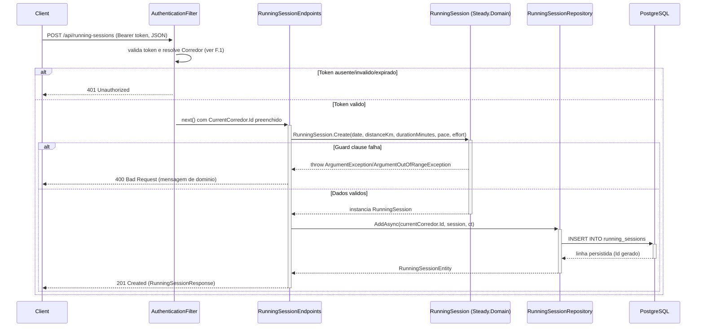

# RunningSessionEndpoints - Treino-Corrida - Especificacao Tecnica

## Indice
- [1. Visao Geral Tecnica](#1-visao-geral-tecnica)
- [2. Configuracao e Dependencias](#2-configuracao-e-dependencias)
- [3. Detalhamento por Rota](#3-detalhamento-por-rota)
  - [3.1. Registrar Sessao de Treino de Corrida](#31-registrar-sessao-de-treino-de-corrida)
- [4. Observacoes Tecnicas](#4-observacoes-tecnicas)

## 1. Visao Geral Tecnica

**Proposito**: Expor via API HTTP o registro de Sessoes de Treino de Corrida do corredor autenticado, persistindo os dados em PostgreSQL. Traduz a factory de dominio `Steady.Domain.Training.RunningSession` para um endpoint REST, sem duplicar regras de validacao.

**Responsabilidades**:
- Receber o payload de uma sessao de corrida via `POST /api/running-sessions`.
- Delegar a validacao de negocio (guard clauses) para a factory `RunningSession.Create`.
- Persistir a sessao associada ao `CorredorId` do usuario autenticado.
- Retornar `201 Created` com a representacao da sessao criada, ou `400 Bad Request` quando a validacao de dominio falhar.

**Integracoes**: PostgreSQL (via `IRunningSessionRepository` / EF Core), Google Sign-In indiretamente atraves do `AuthenticationFilter` aplicado ao grupo `/api`.

## 2. Configuracao e Dependencias

Este arquivo (`src/Steady.Api/Endpoints/RunningSessionEndpoints.cs`) e uma classe estatica que expoe o metodo de extensao `MapRunningSessionEndpoints(RouteGroupBuilder)`, chamado a partir de `Program.cs` sobre o grupo `/api` (que ja tem `AddEndpointFilter<AuthenticationFilter>()` aplicado globalmente).

**Dependencias Injetadas (via parametros do delegate da rota)**:
- `IRunningSessionRepository`: abstracao de persistencia da sessao de corrida (implementada por `RunningSessionRepository`, `Steady.Infrastructure`).
- `CurrentCorredor`: contexto do usuario autenticado (`Id` do corredor), preenchido pelo `AuthenticationFilter` antes do handler ser executado.
- `CancellationToken`: propagado pelo ASP.NET Core a partir do `HttpContext.RequestAborted`.

**Dependencia estatica (nao injetada)**:
- `Steady.Api.Common.DomainFactory` (classe `internal static`): traduz excecoes de guard clause do dominio em `400 Bad Request`.

**Lista de Endpoints**:
- **POST** `/api/running-sessions` - Registra uma nova Sessao de Treino de Corrida para o corredor autenticado.

## 3. Detalhamento por Rota

### 3.1. Registrar Sessao de Treino de Corrida

**Rota**: `POST /api/running-sessions`

**Autenticacao**: obrigatoria (Bearer ID token do Google) - aplicada pelo `AuthenticationFilter` no grupo `/api` (ver [ADR-002](../../../docs/adr/ADR-002-autenticacao-e-isolamento-de-dados.md)).

**Entrada** (`RunningSessionRequest`, `src/Steady.Api/Contracts/RunningSessionContracts.cs`):
```json
{
  "date": "2026-08-10",
  "distanceKm": 10.5,
  "durationMinutes": 55,
  "averagePaceMinPerKm": 5.24,
  "perceivedEffort": 7
}
```

**Saida - 201 Created** (`RunningSessionResponse`):
```json
{
  "id": "3fa85f64-5717-4562-b3fc-2c963f66afa6",
  "date": "2026-08-10",
  "distanceKm": 10.5,
  "durationMinutes": 55,
  "averagePaceMinPerKm": 5.24,
  "perceivedEffort": 7
}
```
Header `Location`: `/api/training-sessions/{id}` (nota: aponta para o recurso consolidado de `TrainingHistoryEndpoints`, nao para uma rota `/api/running-sessions/{id}` propria - ver [Observacoes Tecnicas](#4-observacoes-tecnicas)).

**Saida - 400 Bad Request** (quando a factory de dominio rejeita os dados):
```json
{
  "error": "A distância deve ser maior que zero."
}
```

**Saida - 401 Unauthorized**: sem header `Authorization: Bearer {token}`, ou token invalido/expirado (retornado pelo `AuthenticationFilter` antes do handler ser alcancado).

#### Fluxo de Execucao



#### Detalhamento do Fluxo

**E. Endpoint (RunningSessionEndpoints)**

E.1. `MapRunningSessionEndpoints()` - handler de `POST /running-sessions`
- Recebe `RunningSessionRequest` desserializado do corpo da requisicao, `IRunningSessionRepository`, `CurrentCorredor` e `CancellationToken` por injecao de parametros do Minimal API.
- Chama `DomainFactory.TryCreate` passando uma factory que invoca `RunningSession.Create(...)` -> [U1.1](#u11-domainfactorytrycreate) -> [D1.1](#d11-runningsessioncreate).
- Se `TryCreate` retornar `false`, devolve imediatamente o `IResult` de erro (`400 Bad Request`) contido em `error`.
- Se `TryCreate` retornar `true`, chama `repository.AddAsync(currentCorredor.Id, session!, cancellationToken)` -> [R1.1](#r11-runningsessionrepositoryaddasync).
- Monta `RunningSessionResponse` a partir da entidade persistida (com `Id` gerado pelo repositorio).
- Retorna `Results.Created($"/api/training-sessions/{entity.Id}", response)` -> `201 Created`.

**F. Endpoint Filter (AuthenticationFilter)**

<a id="f1-authenticationfilterinvokeasync"></a>
F.1. `InvokeAsync()` - aplicado a todo o grupo `/api` via `Program.cs` (`api.AddEndpointFilter<AuthenticationFilter>()`), executado antes de qualquer endpoint mapeado neste arquivo.
- Le o header `Authorization`; se nao comecar com `"Bearer "`, retorna `401 Unauthorized` (motivo `missing_bearer_token`, logado via `logger.LogWarning`, nunca com o token em si - OWASP A09).
- Extrai o `idToken` e valida via `IGoogleTokenValidator.ValidateAndGetSubAsync(idToken)` (implementacao real chama a biblioteca oficial `Google.Apis.Auth.GoogleJsonWebSignature`, que valida assinatura/expiracao usando chave publica cacheada - sem round-trip de rede por requisicao).
- Se o `sub` retornado for `null` (token invalido/expirado), retorna `401 Unauthorized` (motivo `invalid_or_expired_token`).
- Com `sub` valido, chama `ICorredorRepository.GetOrCreateBySubAsync(sub, ct)` - upsert automatico do Corredor (ver [ADR-002](../../../docs/adr/ADR-002-autenticacao-e-isolamento-de-dados.md)).
- Preenche `currentCorredor.Id = corredor.Id` (instancia `Scoped`, injetada tambem no handler do endpoint) e invoca `next(context)` para prosseguir ao handler real.

**D1. Domain (RunningSession, Steady.Domain.Training)**

<a id="d11-runningsessioncreate"></a>
D1.1. `RunningSession.Create(date, distanceKm, durationMinutes, averagePaceMinPerKm, perceivedEffort)` - factory estatica, construtor privado.
- Guard clause: `distanceKm <= 0` -> `ArgumentOutOfRangeException` ("A distância deve ser maior que zero.").
- Guard clause: `durationMinutes <= 0` -> `ArgumentOutOfRangeException` ("A duração deve ser maior que zero.").
- Guard clause: `perceivedEffort < 1 || perceivedEffort > 10` -> `ArgumentOutOfRangeException` ("A percepção de esforço deve estar entre 1 e 10.").
- Regras de negocio #1 do `specs/STORY-001/spec.bdd.md`. Ambas `ArgumentOutOfRangeException` e `ArgumentException` derivam de `ArgumentException`, entao sao capturadas por [U1.1](#u11-domainfactorytrycreate).
- Se todos os guards passarem, retorna uma instancia imutavel de `RunningSession` (propriedades somente leitura).
- Expoe tambem a propriedade calculada `Load` (`DurationMinutes * PerceivedEffort` - session-RPE, Foster 2001), nao utilizada diretamente por esta rota, mas consumida pelo fluxo de [OverloadAssessmentEndpoints](./OverloadAssessmentEndpoints-Sobrecarga-DevDocs.md).

**U1. Common/Auth (DomainFactory, CurrentCorredor)**

<a id="u11-domainfactorytrycreate"></a>
U1.1. `DomainFactory.TryCreate<T>(factory, out value, out error)` (`src/Steady.Api/Common/DomainFactory.cs`, classe `internal static`)
- Executa a `Func<T> factory` recebida (neste caso, a chamada a `RunningSession.Create`) dentro de um `try/catch`.
- Sucesso: preenche `value` com a instancia criada, `error = null`, retorna `true`.
- Excecao do tipo `ArgumentException` (inclui `ArgumentOutOfRangeException`): preenche `value = default`, `error = Results.BadRequest(new { error = ex.Message })`, retorna `false`. Reaproveita a mensagem de dominio ja escrita nas guard clauses (spec STORY-002, regra de negocio #5).
- Qualquer outra excecao nao capturada propaga normalmente (nao vira `400` - vira erro nao tratado / `500`).

U1.2. `CurrentCorredor` (`src/Steady.Api/Auth/CurrentCorredor.cs`) - classe simples com propriedade `Guid Id`, registrada como `Scoped` no container de DI. Preenchida por [F.1](#f1-authenticationfilterinvokeasync) e consumida diretamente pelo handler do endpoint para escopar a persistencia por corredor.

**R1. Repository (RunningSessionRepository, Steady.Infrastructure.Repositories)**

<a id="r11-runningsessionrepositoryaddasync"></a>
R1.1. `RunningSessionRepository.AddAsync(corredorId, session, cancellationToken)`
- Monta um `RunningSessionEntity` (modelo de persistencia, distinto da entidade de dominio `RunningSession`) com `Id = Guid.NewGuid()` e `CorredorId = corredorId` (isolamento por corredor conforme [ADR-002](../../../docs/adr/ADR-002-autenticacao-e-isolamento-de-dados.md)).
- Copia `Date`, `DistanceKm`, `DurationMinutes`, `AveragePaceMinPerKm`, `PerceivedEffort` da instancia de dominio validada.
- `dbContext.RunningSessions.Add(entity)` seguido de `await dbContext.SaveChangesAsync(cancellationToken)` - grava na tabela `running_sessions` (mapeada em `SteadyDbContext.OnModelCreating`, colunas em snake_case).
- Retorna a entidade persistida (com `Id` ja atribuido no lado do cliente, nao pelo banco).

## 4. Observacoes Tecnicas

- **Performance**: operacao unica de `INSERT` por requisicao, sem consultas previas. Baixo custo. A validacao do token (F.1) e local (chave publica cacheada), sem round-trip de rede.
- **Tratamento de Erros**: erros de guard clause do dominio (`ArgumentException`/`ArgumentOutOfRangeException`) viram `400` com a mensagem original do dominio, via [U1.1](#u11-domainfactorytrycreate). Qualquer excecao fora desse tipo (ex.: falha de conexao com PostgreSQL) nao e tratada explicitamente neste endpoint e propaga como erro nao tratado.
- **Integracoes Criticas**: PostgreSQL (via `SteadyDbContext`/Npgsql) e o `AuthenticationFilter` (que por sua vez depende do Google Sign-In para validacao do token). Falha em qualquer um bloqueia o registro do treino.
- **Inconsistencia de rota observada**: o `Location` do `201 Created` aponta para `/api/training-sessions/{id}` (rota de `TrainingHistoryEndpoints`), nao para `/api/running-sessions/{id}` - nao existe uma rota `GET /api/running-sessions/{id}` dedicada. Ver [TechnicalDebtsDocs](../TechnicalDebtsDocs/RunningSessionEndpoints-Treino-Corrida-Debts.md).
