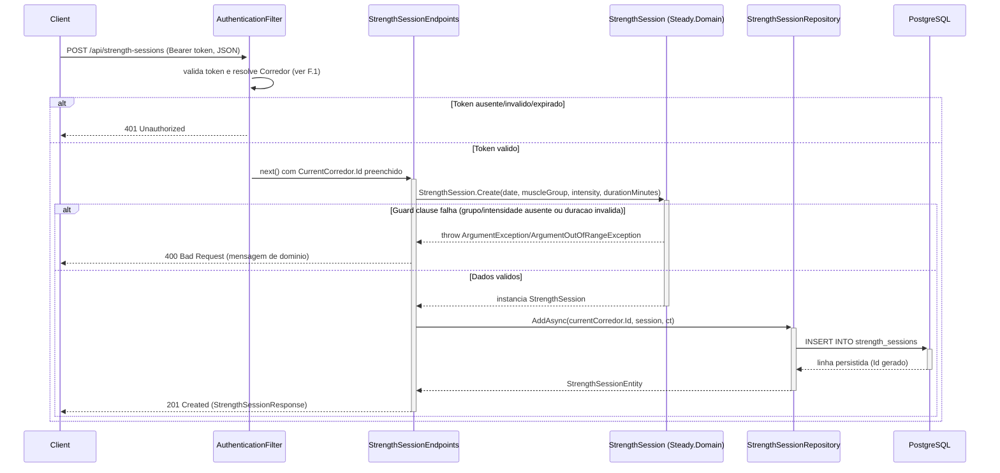

# StrengthSessionEndpoints - Treino-Forca - Especificacao Tecnica

## Indice
- [1. Visao Geral Tecnica](#1-visao-geral-tecnica)
- [2. Configuracao e Dependencias](#2-configuracao-e-dependencias)
- [3. Detalhamento por Rota](#3-detalhamento-por-rota)
  - [3.1. Registrar Sessao de Treino de Musculacao](#31-registrar-sessao-de-treino-de-musculacao)
- [4. Observacoes Tecnicas](#4-observacoes-tecnicas)

## 1. Visao Geral Tecnica

**Proposito**: Expor via API HTTP o registro de Sessoes de Treino de Musculacao (forca) do corredor autenticado, persistindo os dados em PostgreSQL. Traduz a factory de dominio `Steady.Domain.Training.StrengthSession` para um endpoint REST.

**Responsabilidades**:
- Receber o payload de uma sessao de musculacao via `POST /api/strength-sessions`.
- Delegar a validacao de negocio (grupo muscular e intensidade obrigatorios, duracao positiva) para a factory `StrengthSession.Create`.
- Persistir a sessao associada ao `CorredorId` do usuario autenticado.
- Retornar `201 Created` com a representacao da sessao criada, ou `400 Bad Request` quando a validacao de dominio falhar.

**Integracoes**: PostgreSQL (via `IStrengthSessionRepository` / EF Core), Google Sign-In indiretamente atraves do `AuthenticationFilter` aplicado ao grupo `/api`. A sessao de musculacao tambem e insumo direto da regra de deteccao de sobrecarga (musculacao pesada de perna) - ver [OverloadAssessmentEndpoints](./OverloadAssessmentEndpoints-Sobrecarga-DevDocs.md).

## 2. Configuracao e Dependencias

Este arquivo (`src/Steady.Api/Endpoints/StrengthSessionEndpoints.cs`) e uma classe estatica que expoe o metodo de extensao `MapStrengthSessionEndpoints(RouteGroupBuilder)`, chamado a partir de `Program.cs` sobre o grupo `/api`.

**Dependencias Injetadas (via parametros do delegate da rota)**:
- `IStrengthSessionRepository`: abstracao de persistencia da sessao de musculacao (implementada por `StrengthSessionRepository`, `Steady.Infrastructure`).
- `CurrentCorredor`: contexto do usuario autenticado, preenchido pelo `AuthenticationFilter`.
- `CancellationToken`: propagado a partir do `HttpContext.RequestAborted`.

**Dependencia estatica (nao injetada)**:
- `Steady.Api.Common.DomainFactory` (classe `internal static`): traduz excecoes de guard clause do dominio em `400 Bad Request`.

**Lista de Endpoints**:
- **POST** `/api/strength-sessions` - Registra uma nova Sessao de Treino de Musculacao para o corredor autenticado.

## 3. Detalhamento por Rota

### 3.1. Registrar Sessao de Treino de Musculacao

**Rota**: `POST /api/strength-sessions`

**Autenticacao**: obrigatoria (Bearer ID token do Google) - aplicada pelo `AuthenticationFilter` no grupo `/api` (ver [ADR-002](../../../docs/adr/ADR-002-autenticacao-e-isolamento-de-dados.md)).

**Entrada** (`StrengthSessionRequest`, `src/Steady.Api/Contracts/StrengthSessionContracts.cs`):
```json
{
  "date": "2026-08-10",
  "muscleGroup": "PernaFrontal",
  "intensity": "Pesado",
  "durationMinutes": 45
}
```
`muscleGroup` e `intensity` sao enums nulaveis (`MuscleGroup?`, `Intensity?`) - permite que o request chegue sem esses campos para acionar a validacao de dominio (em vez de falhar no model binding).

Valores possiveis de `MuscleGroup` (`src/Steady.Domain/Training/MuscleGroup.cs`): `PeitoTriceps`, `Ombro`, `PernaFrontal`, `PernaPosterior`, `BicepsCostas`.
Valores possiveis de `Intensity` (`src/Steady.Domain/Training/Intensity.cs`): `Leve`, `Moderado`, `Pesado`.

**Saida - 201 Created** (`StrengthSessionResponse`):
```json
{
  "id": "3fa85f64-5717-4562-b3fc-2c963f66afa6",
  "date": "2026-08-10",
  "muscleGroup": "PernaFrontal",
  "intensity": "Pesado",
  "durationMinutes": 45
}
```
Header `Location`: `/api/training-sessions/{id}` (mesma inconsistencia observada em `RunningSessionEndpoints` - ver [Observacoes Tecnicas](#4-observacoes-tecnicas)).

**Saida - 400 Bad Request** (exemplos):
```json
{
  "error": "O grupo muscular é obrigatório para registrar uma sessão de musculação."
}
```
```json
{
  "error": "A intensidade é obrigatória para registrar uma sessão de musculação."
}
```

**Saida - 401 Unauthorized**: sem header `Authorization: Bearer {token}`, ou token invalido/expirado.

#### Fluxo de Execucao



#### Detalhamento do Fluxo

**E. Endpoint (StrengthSessionEndpoints)**

E.1. `MapStrengthSessionEndpoints()` - handler de `POST /strength-sessions`
- Recebe `StrengthSessionRequest`, `IStrengthSessionRepository`, `CurrentCorredor` e `CancellationToken` por injecao de parametros.
- Chama `DomainFactory.TryCreate` passando uma factory que invoca `StrengthSession.Create(...)` -> [U1.1](#u11-domainfactorytrycreate) -> [D1.1](#d11-strengthsessioncreate).
- Se `TryCreate` retornar `false`, devolve o `IResult` de erro (`400 Bad Request`).
- Se `TryCreate` retornar `true`, chama `repository.AddAsync(currentCorredor.Id, session!, cancellationToken)` -> [R1.1](#r11-strengthsessionrepositoryaddasync).
- Monta `StrengthSessionResponse` a partir da entidade persistida.
- Retorna `Results.Created($"/api/training-sessions/{entity.Id}", response)` -> `201 Created`.

**F. Endpoint Filter (AuthenticationFilter)**

<a id="f1-authenticationfilterinvokeasync"></a>
F.1. `InvokeAsync()` - aplicado a todo o grupo `/api`, executado antes de qualquer endpoint mapeado neste arquivo. Mesmo comportamento documentado em [RunningSessionEndpoints DevDocs - F.1](./RunningSessionEndpoints-Treino-Corrida-DevDocs.md#f1-authenticationfilterinvokeasync): valida o Bearer token do Google, resolve/cria o `Corredor` via `sub`, preenche `CurrentCorredor.Id`, ou retorna `401` antes de alcancar o handler.

**D1. Domain (StrengthSession, Steady.Domain.Training)**

<a id="d11-strengthsessioncreate"></a>
D1.1. `StrengthSession.Create(date, muscleGroup, intensity, durationMinutes)` - factory estatica, construtor privado.
- Guard clause: `muscleGroup is null` -> `ArgumentException` ("O grupo muscular é obrigatório para registrar uma sessão de musculação.").
- Guard clause: `intensity is null` -> `ArgumentException` ("A intensidade é obrigatória para registrar uma sessão de musculação.").
- Guard clause: `durationMinutes <= 0` -> `ArgumentOutOfRangeException` ("A duração deve ser maior que zero.").
- Regras de negocio #2 do `specs/STORY-001/spec.bdd.md`.
- Se todos os guards passarem, retorna uma instancia imutavel de `StrengthSession` com `MuscleGroup.Value` e `Intensity.Value` (desempacotados dos nulaveis).
- Expoe a propriedade calculada `Load` (`DurationMinutes * IntensityWeight(Intensity)`, onde `Leve=3`, `Moderado=6`, `Pesado=9` - session-RPE, Foster 2001), nao usada nesta rota mas consumida por [OverloadAssessmentEndpoints](./OverloadAssessmentEndpoints-Sobrecarga-DevDocs.md).

**U1. Common/Auth (DomainFactory, CurrentCorredor)**

<a id="u11-domainfactorytrycreate"></a>
U1.1. `DomainFactory.TryCreate<T>(factory, out value, out error)` - identico ao comportamento documentado em [RunningSessionEndpoints DevDocs - U1.1](./RunningSessionEndpoints-Treino-Corrida-DevDocs.md#u11-domainfactorytrycreate): captura `ArgumentException` (e subtipos como `ArgumentOutOfRangeException`) e traduz para `400 Bad Request` reaproveitando a mensagem de dominio.

U1.2. `CurrentCorredor` - identico ao documentado em [RunningSessionEndpoints DevDocs](./RunningSessionEndpoints-Treino-Corrida-DevDocs.md#3-1-registrar-sessao-de-treino-de-corrida): preenchido por [F.1](#f1-authenticationfilterinvokeasync), consumido pelo handler para escopar a persistencia.

**R1. Repository (StrengthSessionRepository, Steady.Infrastructure.Repositories)**

<a id="r11-strengthsessionrepositoryaddasync"></a>
R1.1. `StrengthSessionRepository.AddAsync(corredorId, session, cancellationToken)`
- Monta um `StrengthSessionEntity` com `Id = Guid.NewGuid()` e `CorredorId = corredorId` (isolamento por corredor).
- Copia `Date`, `MuscleGroup`, `Intensity`, `DurationMinutes` da instancia de dominio validada.
- `dbContext.StrengthSessions.Add(entity)` seguido de `await dbContext.SaveChangesAsync(cancellationToken)` - grava na tabela `strength_sessions`. `MuscleGroup` e `Intensity` sao persistidos como `string` (`HasConversion<string>()` em `SteadyDbContext.OnModelCreating`), nao como inteiro do enum.
- Retorna a entidade persistida.

## 4. Observacoes Tecnicas

- **Performance**: operacao unica de `INSERT` por requisicao, sem consultas previas.
- **Tratamento de Erros**: erros de guard clause do dominio viram `400` com a mensagem original. Excecoes fora desse tipo (ex.: falha do PostgreSQL) nao sao tratadas explicitamente - mesmo debito ja identificado em [RunningSessionEndpoints Debts](../TechnicalDebtsDocs/RunningSessionEndpoints-Treino-Corrida-Debts.md).
- **Integracoes Criticas**: PostgreSQL e o `AuthenticationFilter`/Google Sign-In.
- **Enums como nulaveis no contrato**: `MuscleGroup?`/`Intensity?` no `StrengthSessionRequest` sao uma decisao deliberada para permitir que ausencia do campo chegue ate a validacao de dominio (gerando `400` com mensagem especifica) em vez de falhar silenciosamente no model binding do ASP.NET Core com uma mensagem generica.
- **Mesma inconsistencia de `Location`** identificada em `RunningSessionEndpoints` - ver [TechnicalDebtsDocs](../TechnicalDebtsDocs/StrengthSessionEndpoints-Treino-Forca-Debts.md).
