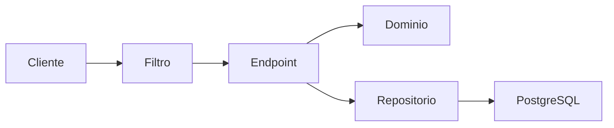
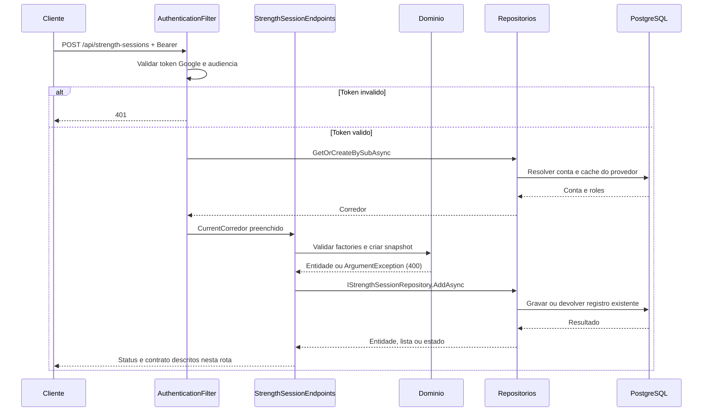

# StrengthSessionEndpoints - Treino-Forca - Especificação Técnica

Auditoria de fontes: 2026-09-27. Unidade: [StrengthSessionEndpoints.cs](../../../src/Steady.Api/Endpoints/StrengthSessionEndpoints.cs).

## Índice

- [1. Visão Geral Técnica](#visao)
- [2. Configuração e Dependências](#config)
- [3. Detalhamento por Rota](#rotas)
- [4. Observações Técnicas](#observacoes)
  - [3.1. Registrar musculação avulsa](#rota-1)

## 1. Visão Geral Técnica

**Propósito**: Registrar musculação avulsa com grupo, intensidade e duração, e opcionalmente dor no encerramento.

**Responsabilidades**: autenticar pelo grupo, aplicar escopo do usuário, executar as rotas abaixo e projetar os contratos.

**Integrações**: ASP.NET Core Minimal APIs, Steady.Domain e Steady.Infrastructure com PostgreSQL. Validação Google pertence ao filtro comum. O handler não chama provedor de explicação.

**Fontes de regras**: [STORY-001](../../../specs/STORY-001/spec.bdd.md), [STORY-002](../../../specs/STORY-002/spec.bdd.md), [STORY-014](../../../specs/STORY-014/spec.bdd.md), [ADR-002](../../../docs/adr/ADR-002-autenticacao-e-isolamento-de-dados.md), [ADR-003](../../../docs/adr/ADR-003-chave-de-idempotencia-para-sincronizacao-offline.md).

## 2. Configuração e Dependências

Composição: [Program.cs](../../../src/Steady.Api/Program.cs); persistência: [ServiceCollectionExtensions.cs](../../../src/Steady.Infrastructure/DependencyInjection/ServiceCollectionExtensions.cs). Cada lambda recebe os repositórios listados na rota, CurrentCorredor e CancellationToken quando há I/O. ILogger<CoachingAuditLog> aparece somente nas operações auditadas de vínculo/ficha/histórico.

**Lista de endpoints**:

- **POST** `/api/strength-sessions` - Registrar musculação avulsa.

**F. Endpoint Filter - AuthenticationFilter.InvokeAsync**

1. O grupo `/api` recebe o filtro em `Program.cs`; `/health` fica fora do grupo.
2. `Authorization` deve começar exatamente com `Bearer `; token vazio, inválido ou expirado retorna 401 antes da lógica do handler. O binding do framework pode rejeitar uma requisição malformada antes da execução do filtro.
3. `GoogleTokenValidator.ValidateAsync` usa `GoogleJsonWebSignature.ValidateAsync` com Audience restrita a `Google:ClientId`; assinatura e validade são verificadas pela biblioteca com chaves públicas cacheadas. Sem `Google:ClientId`, Program lança erro ao compor a aplicação.
4. Identidade é `sub`. E-mail e nome opcionais são normalizados e usados como cache de exibição, sem substituir identidade. `ICorredorRepository.GetOrCreateBySubAsync` resolve/provisiona corredor; `CurrentCorredor.Id` e `Roles` são preenchidos para a requisição.
5. `CurrentCorredor.HasRole` compara papel com ordinal exato; um token válido não concede automaticamente `Personal`. Falhas de autenticação registram path, motivo e IP, sem token.

**U1. Common/Auth e conversão**

- `CurrentCorredor`: identidade e papéis resolvidos pelo filtro; o cliente não escolhe o dono dos registros.
- `DomainFactory.TryCreate`: captura apenas `ArgumentException` (inclui guard clauses derivadas) e retorna 400 com `{ "error": "mensagem" }`; não converte todo erro de persistência ou desserialização em erro de validação.
- `Idempotency.HeaderName`: `Idempotency-Key`; quando exigida e ausente, `MissingKey` retorna 400. Guid inválido é rejeitado pelo binding; Guid.Empty não recebe validação específica no helper.
- Records HTTP são serializados em camelCase pelo padrão do framework. Datas `DateOnly` são `yyyy-MM-dd`. Enums de StrengthSession não recebem conversor textual global; enums convertidos explicitamente por `ToString` ou por mapping seguem as strings descritas em cada rota.

### Contrato `StrengthSessionRequest`

Fonte: [StrengthSessionContracts.cs](../../../src/Steady.Api/Contracts/StrengthSessionContracts.cs). Os nomes abaixo são os campos HTTP com serialização padrão camelCase.

| Campo | Tipo C# | Opcional/padrão |
|---|---|---|
| `date` | `DateOnly` | não anulável |
| `muscleGroup` | `MuscleGroup?` | null permitido |
| `intensity` | `Intensity?` | null permitido |
| `durationMinutes` | `int` | não anulável |
| `painReported` | `bool` | não anulável; padrão `false` |

### Contrato `StrengthSessionResponse`

Fonte: [StrengthSessionContracts.cs](../../../src/Steady.Api/Contracts/StrengthSessionContracts.cs). Os nomes abaixo são os campos HTTP com serialização padrão camelCase.

| Campo | Tipo C# | Opcional/padrão |
|---|---|---|
| `id` | `Guid` | não anulável |
| `date` | `DateOnly` | não anulável |
| `muscleGroup` | `MuscleGroup` | não anulável |
| `intensity` | `Intensity` | não anulável |
| `durationMinutes` | `int` | não anulável |

### Catálogo compartilhado de domínio e persistência

StrengthSession.Create valida grupo/intensidade não nulos e duração positiva. Create não verifica Enum.IsDefined. Load usa Leve=3, Moderado=6, Pesado=9, mas não é retornado nem calculado no handler.

StrengthSessionRepository.AddAsync consulta chave por corredor, insere sessão e, quando solicitado, dor na mesma SaveChangesAsync. Diferentemente de corrida e execução de ficha, não insere ReviewOutboxEntity. Consultas por id e histórico filtram CorredorId.

## 3. Detalhamento por Rota

### 3.1. Registrar musculação avulsa

**Rota**: `POST /api/strength-sessions`

**Entrada**: StrengthSessionRequest; Idempotency-Key obrigatório. Header Authorization: Bearer obrigatório.

**Saída**: StrengthSessionResponse. Estruturas e tipos completos constam na seção de contratos.

**Status**: 201 novo; 200 reenvio; 400 entrada inválida; todas as rotas podem retornar 401 no filtro. Binding inválido pode retornar 400 antes do handler.

#### Fluxo de Execução

#### Detalhamento do Fluxo

**E.1. Lambda de rota em MapStrengthSessionEndpoints**

Exige chave; cria StrengthSession com grupo e intensidade obrigatórios e duração positiva; persiste painReported; responde com enums numéricos, pois Program não instala conversor textual de enums.

Navegação: [F. autenticação](#f-auth), [D1. domínio](#d-1), [R1. persistência](#r-1), [U1. suporte](#u-common).

**D1.1. Domínio no fluxo**

StrengthSession.Create valida grupo/intensidade não nulos e duração positiva. Create não verifica Enum.IsDefined. Load usa Leve=3, Moderado=6, Pesado=9, mas não é retornado nem calculado no handler.

**R1.1. Métodos e persistência**

Chamada desta rota: `IStrengthSessionRepository.AddAsync`.

A operação específica e seu escopo estão descritos no fluxo acima; detalhes de query, snapshot, transação e reenvio estão no [catálogo de persistência](#catalogo). As consultas próprias filtram o dono no banco; leitura pelo personal exige o vínculo quando indicado. Nenhuma autorização por vínculo é acrescentada implicitamente pelo filtro comum.

[Voltar ao endpoint](#e-1). O [filtro](#f-auth) resolve autenticação antes da lógica; os [utilitários](#u-common) não adicionam autorização por vínculo automaticamente.

## 4. Observações Técnicas

Não confundir sessão avulsa com StrengthWorkoutExecution: são contratos e tabelas diferentes. Musculação avulsa não produz intenção de revisão no código atual.

**Performance**: consultas são assíncronas com CancellationToken; onde a coleção não possui parâmetros de limite, o resultado é materializado integralmente. Não há paralelização de chamadas ao mesmo contexto no handler.

**Tratamento de erros**: status acima descrevem caminhos explícitos; exceções inesperadas não têm tradução local genérica. 404 não deve ser interpretado como permissão de procurar dados de outro corredor.

**Documentos relacionados**: [Regras](../BusinessRulesDocs/Registro-de-Musculacao-Treino-Forca-Rules.md), [Débitos](../TechnicalDebtsDocs/StrengthSessionEndpoints-Treino-Forca-Debts.md), [Índice](README.md).
