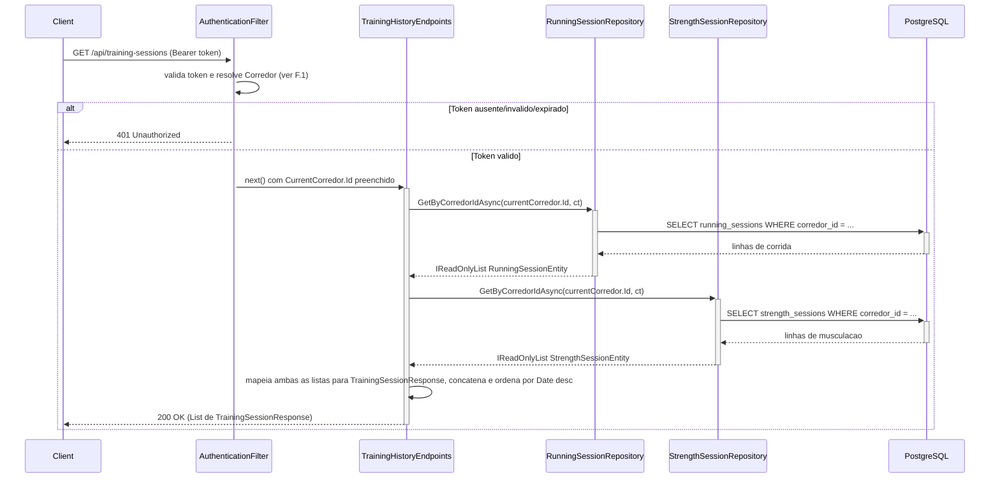
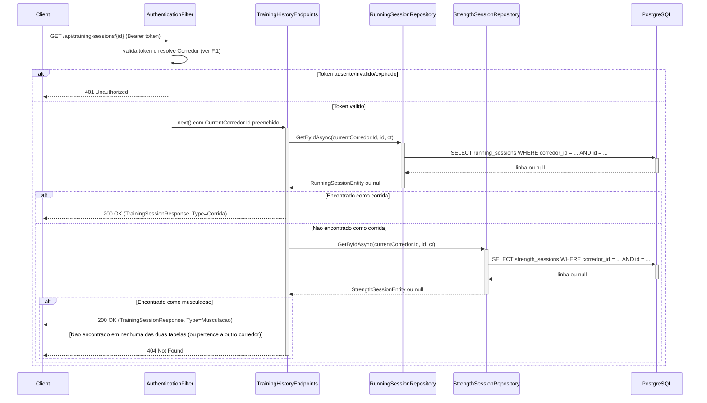

# TrainingHistoryEndpoints - Historico - Especificacao Tecnica

## Indice
- [1. Visao Geral Tecnica](#1-visao-geral-tecnica)
- [2. Configuracao e Dependencias](#2-configuracao-e-dependencias)
- [3. Detalhamento por Rota](#3-detalhamento-por-rota)
  - [3.1. Listar Historico Consolidado de Treinos](#31-listar-historico-consolidado-de-treinos)
  - [3.2. Consultar Sessao de Treino por ID](#32-consultar-sessao-de-treino-por-id)
- [4. Observacoes Tecnicas](#4-observacoes-tecnicas)

## 1. Visao Geral Tecnica

**Proposito**: Expor via API HTTP a consulta do historico consolidado de treinos (corrida + musculacao) do corredor autenticado, unificando os dois tipos de sessao em um unico contrato de resposta (`TrainingSessionResponse`).

**Responsabilidades**:
- Listar todas as sessoes de corrida e musculacao do corredor autenticado, ordenadas por data decrescente.
- Consultar uma sessao especifica (corrida ou musculacao) pelo `Id`, garantindo isolamento por corredor (404 se pertencer a outro corredor ou nao existir).
- Unificar os dois modelos de dominio distintos (`RunningSession`, `StrengthSession`) em um unico DTO de saida (`TrainingSessionResponse`), diferenciado pelo campo `Type` ("Corrida"/"Musculacao").

**Integracoes**: PostgreSQL (via `IRunningSessionRepository` e `IStrengthSessionRepository`), Google Sign-In indiretamente atraves do `AuthenticationFilter`.

## 2. Configuracao e Dependencias

Este arquivo (`src/Steady.Api/Endpoints/TrainingHistoryEndpoints.cs`) e uma classe estatica que expoe o metodo de extensao `MapTrainingHistoryEndpoints(RouteGroupBuilder)`, chamado a partir de `Program.cs` sobre o grupo `/api`.

**Dependencias Injetadas (via parametros do delegate de cada rota)**:
- `IRunningSessionRepository`: le sessoes de corrida do corredor.
- `IStrengthSessionRepository`: le sessoes de musculacao do corredor.
- `CurrentCorredor`: contexto do usuario autenticado, preenchido pelo `AuthenticationFilter`.
- `CancellationToken`: propagado a partir do `HttpContext.RequestAborted`.
- `Guid id` (somente na segunda rota): identificador da sessao, vinculado via `{id:guid}` no template de rota.

**Lista de Endpoints**:
- **GET** `/api/training-sessions` - Lista o historico consolidado (corrida + musculacao) do corredor autenticado.
- **GET** `/api/training-sessions/{id:guid}` - Consulta uma sessao especifica (corrida ou musculacao) pelo Id.

## 3. Detalhamento por Rota

### 3.1. Listar Historico Consolidado de Treinos

**Rota**: `GET /api/training-sessions`

**Autenticacao**: obrigatoria (Bearer ID token do Google) - aplicada pelo `AuthenticationFilter` no grupo `/api`.

**Entrada**: nenhum parametro - usa exclusivamente o `CurrentCorredor.Id` resolvido pela autenticacao.

**Saida - 200 OK** (`List<TrainingSessionResponse>`, `src/Steady.Api/Contracts/TrainingSessionResponse.cs`):
```json
[
  {
    "id": "3fa85f64-5717-4562-b3fc-2c963f66afa6",
    "type": "Corrida",
    "date": "2026-08-10",
    "durationMinutes": 55,
    "distanceKm": 10.5,
    "averagePaceMinPerKm": 5.24,
    "perceivedEffort": 7,
    "muscleGroup": null,
    "intensity": null
  },
  {
    "id": "9c858901-8a57-4791-81fe-4c455b099bc9",
    "type": "Musculacao",
    "date": "2026-08-09",
    "durationMinutes": 45,
    "distanceKm": null,
    "averagePaceMinPerKm": null,
    "perceivedEffort": null,
    "muscleGroup": "PernaFrontal",
    "intensity": "Pesado"
  }
]
```
Sem sessoes: retorna `[]` (lista vazia), nunca erro (spec STORY-002, cenario de edge case "Corredor sem historico consulta seu historico de treinos").

**Saida - 401 Unauthorized**: sem header `Authorization: Bearer {token}`, ou token invalido/expirado.

#### Fluxo de Execucao



#### Detalhamento do Fluxo

**E. Endpoint (TrainingHistoryEndpoints)**

E.1. `MapTrainingHistoryEndpoints()` - handler de `GET /training-sessions`
- Recebe `IRunningSessionRepository`, `IStrengthSessionRepository`, `CurrentCorredor` e `CancellationToken` por injecao de parametros.
- Chama `runningRepository.GetByCorredorIdAsync(currentCorredor.Id, ct)` -> [R1.1](#r11-runningsessionrepositorygetbycorredoridasync).
- Chama `strengthRepository.GetByCorredorIdAsync(currentCorredor.Id, ct)` -> [R2.1](#r21-strengthsessionrepositorygetbycorredoridasync).
- Mapeia entidades de corrida para `TrainingSessionResponse` com `Type = "Corrida"`, preenchendo `DistanceKm`, `AveragePaceMinPerKm`, `PerceivedEffort` e deixando `MuscleGroup`/`Intensity` como `null`.
- Mapeia entidades de musculacao para `TrainingSessionResponse` com `Type = "Musculacao"`, preenchendo `MuscleGroup`/`Intensity` (convertidos para `string` via `.ToString()`) e deixando `DistanceKm`/`AveragePaceMinPerKm`/`PerceivedEffort` como `null`.
- Concatena as duas listas (`.Concat(...)`) e ordena por `Date` decrescente (`.OrderByDescending(s => s.Date)`).
- Retorna `Results.Ok(sessions)` -> `200 OK`.

**F. Endpoint Filter (AuthenticationFilter)**

<a id="f1-authenticationfilterinvokeasync"></a>
F.1. `InvokeAsync()` - aplicado a todo o grupo `/api`. Mesmo comportamento documentado em [RunningSessionEndpoints DevDocs - F.1](./RunningSessionEndpoints-Treino-Corrida-DevDocs.md#f1-authenticationfilterinvokeasync).

**D1. Domain**

Nao ha chamada a factories de dominio nesta rota - o mapeamento e feito diretamente das entidades de persistencia (`RunningSessionEntity`/`StrengthSessionEntity`) para o DTO de resposta (`TrainingSessionResponse`), sem passar por `RunningSession.Create`/`StrengthSession.Create`. Diferente de [OverloadAssessmentEndpoints](./OverloadAssessmentEndpoints-Sobrecarga-DevDocs.md), que reconstroi objetos de dominio para aplicar `OverloadDetectionService`.

**R1. Repository (RunningSessionRepository)**

<a id="r11-runningsessionrepositorygetbycorredoridasync"></a>
R1.1. `RunningSessionRepository.GetByCorredorIdAsync(corredorId, cancellationToken)` - identico ao documentado em [OverloadAssessmentEndpoints DevDocs - R1.1](./OverloadAssessmentEndpoints-Sobrecarga-DevDocs.md#r11-runningsessionrepositorygetbycorredoridasync). Filtro por `CorredorId` direto no banco.

**R2. Repository (StrengthSessionRepository)**

<a id="r21-strengthsessionrepositorygetbycorredoridasync"></a>
R2.1. `StrengthSessionRepository.GetByCorredorIdAsync(corredorId, cancellationToken)` - identico ao documentado em [OverloadAssessmentEndpoints DevDocs - R2.1](./OverloadAssessmentEndpoints-Sobrecarga-DevDocs.md#r21-strengthsessionrepositorygetbycorredoridasync).

---

### 3.2. Consultar Sessao de Treino por ID

**Rota**: `GET /api/training-sessions/{id:guid}`

**Autenticacao**: obrigatoria (Bearer ID token do Google) - aplicada pelo `AuthenticationFilter` no grupo `/api`.

**Entrada**: `id` (`Guid`) - identificador da sessao (corrida ou musculacao), vinculado via constraint de rota `{id:guid}`.

**Saida - 200 OK** (`TrainingSessionResponse`): mesma estrutura da rota de listagem, com um unico objeto (nao array).

**Saida - 404 Not Found**: quando o `id` nao corresponde a nenhuma sessao de corrida **nem** de musculacao pertencente ao corredor autenticado - inclusive quando a sessao existe mas pertence a outro corredor (nao revela a existencia do recurso, conforme regra de negocio #4 de `specs/STORY-002/spec.bdd.md` e [ADR-002](../../../docs/adr/ADR-002-autenticacao-e-isolamento-de-dados.md)).

**Saida - 401 Unauthorized**: sem header `Authorization: Bearer {token}`, ou token invalido/expirado.

#### Fluxo de Execucao



#### Detalhamento do Fluxo

**E. Endpoint (TrainingHistoryEndpoints)**

E.2. `MapTrainingHistoryEndpoints()` - handler de `GET /training-sessions/{id:guid}`
- Recebe `Guid id`, `IRunningSessionRepository`, `IStrengthSessionRepository`, `CurrentCorredor` e `CancellationToken`.
- Chama `runningRepository.GetByIdAsync(currentCorredor.Id, id, ct)` -> [R1.2](#r12-runningsessionrepositorygetbyidasync). Se encontrado, retorna `200 OK` com `Type = "Corrida"` imediatamente (early return).
- Se nao encontrado como corrida, chama `strengthRepository.GetByIdAsync(currentCorredor.Id, id, ct)` -> [R2.2](#r22-strengthsessionrepositorygetbyidasync). Se encontrado, retorna `200 OK` com `Type = "Musculacao"`.
- Se nao encontrado em nenhuma das duas consultas, retorna `Results.NotFound()` -> `404`.

**F. Endpoint Filter (AuthenticationFilter)**

Mesmo comportamento de [F.1](#f1-authenticationfilterinvokeasync), aplicado tambem a esta rota (grupo `/api` inteiro).

**D1. Domain**

Nao ha chamada a factories de dominio - mapeamento direto de entidade de persistencia para DTO de resposta, igual a rota de listagem.

**R1. Repository (RunningSessionRepository)**

<a id="r12-runningsessionrepositorygetbyidasync"></a>
R1.2. `RunningSessionRepository.GetByIdAsync(corredorId, sessionId, cancellationToken)` - `dbContext.RunningSessions.FirstOrDefaultAsync(s => s.CorredorId == corredorId && s.Id == sessionId, ct)`. O filtro combinado por `CorredorId` **e** `Id` no mesmo `WHERE` e o mecanismo que garante o isolamento (uma sessao de outro corredor simplesmente nao e encontrada, retornando `null`, nao lancando excecao de autorizacao) - implementa diretamente a regra de negocio #4 de `specs/STORY-002/spec.bdd.md` (404 sem revelar existencia).

**R2. Repository (StrengthSessionRepository)**

<a id="r22-strengthsessionrepositorygetbyidasync"></a>
R2.2. `StrengthSessionRepository.GetByIdAsync(corredorId, sessionId, cancellationToken)` - equivalente a R1.2, sobre `dbContext.StrengthSessions`.

## 4. Observacoes Tecnicas

- **Performance - listagem sem paginacao**: `GET /api/training-sessions` traz **todas** as sessoes do corredor de uma vez, sem `skip`/`take`/paginacao, e ordena em memoria apos concatenar duas listas ja materializadas (`.ToListAsync()` em cada repositorio, seguido de `.Concat().OrderByDescending()` no C#, nao no banco). Ver [TechnicalDebtsDocs](../TechnicalDebtsDocs/TrainingHistoryEndpoints-Historico-Debts.md).
- **Performance - consulta por ID com duas queries sequenciais**: `GET /api/training-sessions/{id}` sempre tenta `RunningSessionRepository` primeiro; se a sessao for de musculacao, isso custa uma consulta "no banco" a mais (`SELECT` que retorna vazio) antes de encontrar o resultado correto. Nao ha um identificador de tipo (`Type`) no `id` para decidir de antemao qual tabela consultar.
- **Tratamento de Erros**: nao ha validacao de entrada alem da constraint de rota `{id:guid}` (o proprio ASP.NET Core retorna `400` automaticamente se o segmento nao for um GUID valido, antes mesmo de alcancar o handler). Excecoes de infraestrutura nao tratadas seguem o mesmo debito generico ja identificado nos demais endpoints.
- **Isolamento por corredor**: validado por teste de integracao dedicado (`tests/Steady.Api.Tests/AuthorizationTests.cs::AcessoADadoDeOutroCorredor_Retorna404`), cobrindo exatamente o cenario de erro da spec STORY-002.
