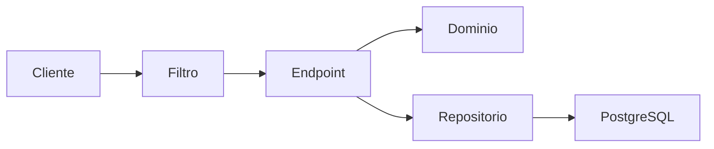
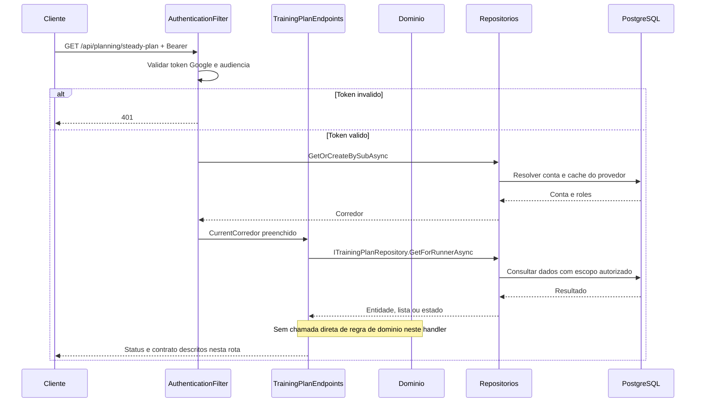

# TrainingPlanEndpoints - Planejamento - Especificação Técnica

Auditoria de fontes: 2026-09-27. Unidade: [TrainingPlanEndpoints.cs](../../../src/Steady.Api/Endpoints/TrainingPlanEndpoints.cs).

## Índice

- [1. Visão Geral Técnica](#visao)
- [2. Configuração e Dependências](#config)
- [3. Detalhamento por Rota](#rotas)
- [4. Observações Técnicas](#observacoes)
  - [3.1. Ler plano associado](#rota-1)

## 1. Visão Geral Técnica

**Propósito**: Ler o documento versionado associado ao corredor, mantendo prescrições e mobilidade sem calcular progressão.

**Responsabilidades**: autenticar pelo grupo, aplicar escopo do usuário, executar as rotas abaixo e projetar os contratos.

**Integrações**: ASP.NET Core Minimal APIs, Steady.Domain e Steady.Infrastructure com PostgreSQL. Validação Google pertence ao filtro comum. O handler não chama provedor de explicação.

**Fontes de regras**: [STORY-016](../../../specs/STORY-016/spec.bdd.md), [STORY-020](../../../specs/STORY-020/spec.bdd.md), [ADR-002](../../../docs/adr/ADR-002-autenticacao-e-isolamento-de-dados.md), [ADR-006](../../../docs/adr/ADR-006-interpolacao-do-longao-semanal.md), [ADR-013](../../../docs/adr/ADR-013-plano-do-steady-como-fonte-de-prescricao.md).

## 2. Configuração e Dependências

Composição: [Program.cs](../../../src/Steady.Api/Program.cs); persistência: [ServiceCollectionExtensions.cs](../../../src/Steady.Infrastructure/DependencyInjection/ServiceCollectionExtensions.cs). Cada lambda recebe os repositórios listados na rota, CurrentCorredor e CancellationToken quando há I/O. ILogger<CoachingAuditLog> aparece somente nas operações auditadas de vínculo/ficha/histórico.

**Lista de endpoints**:

- **GET** `/api/planning/steady-plan` - Ler plano associado.

**F. Endpoint Filter - AuthenticationFilter.InvokeAsync**

1. O grupo `/api` recebe o filtro em `Program.cs`; `/health` fica fora do grupo.
2. `Authorization` deve começar exatamente com `Bearer `; token vazio, inválido ou expirado retorna 401 antes da lógica do handler. O binding do framework pode rejeitar uma requisição malformada antes da execução do filtro.
3. `GoogleTokenValidator.ValidateAsync` usa `GoogleJsonWebSignature.ValidateAsync` com Audience restrita a `Google:ClientId`; assinatura e validade são verificadas pela biblioteca com chaves públicas cacheadas. Sem `Google:ClientId`, Program lança erro ao compor a aplicação.
4. Identidade é `sub`. E-mail e nome opcionais são normalizados e usados como cache de exibição, sem substituir identidade. `ICorredorRepository.GetOrCreateBySubAsync` resolve/provisiona corredor; `CurrentCorredor.Id` e `Roles` são preenchidos para a requisição.
5. `CurrentCorredor.HasRole` compara papel com ordinal exato; um token válido não concede automaticamente `Personal`. Falhas de autenticação registram path, motivo e IP, sem token.

**U1. Common/Auth e conversão**

- `CurrentCorredor`: identidade e papéis resolvidos pelo filtro; o cliente não escolhe o dono dos registros.
- `DomainFactory.TryCreate`: captura apenas `ArgumentException` (inclui guard clauses derivadas) e retorna 400 com `{ "error": "mensagem" }`; não converte todo erro de persistência ou desserialização em erro de validação.
- `Idempotency.HeaderName`: `Idempotency-Key`; quando exigida e ausente, `MissingKey` retorna 400. Guid inválido é rejeitado pelo binding; Guid.Empty não recebe validação específica no helper.
- Records HTTP são serializados em camelCase pelo padrão do framework. Datas `DateOnly` são `yyyy-MM-dd`. Enums de StrengthSession não recebem conversor textual global; enums convertidos explicitamente por `ToString` ou por mapping seguem as strings descritas em cada rota.

### Contrato `SteadyTrainingPlanResponse`

Fonte: [TrainingPlanContracts.cs](../../../src/Steady.Api/Contracts/TrainingPlanContracts.cs). Os nomes abaixo são os campos HTTP com serialização padrão camelCase.

| Campo | Tipo C# | Opcional/padrão |
|---|---|---|
| `version` | `int` | não anulável |
| `title` | `string` | não anulável |
| `subtitle` | `string` | não anulável |
| `principle` | `PlanPrincipleResponse` | não anulável |
| `phases` | `IReadOnlyList<PlanPhaseResponse>` | não anulável |
| `phaseCycleNote` | `string` | não anulável |
| `weekOverview` | `IReadOnlyList<PlanWeekdayFocusResponse>` | não anulável |
| `weekOverviewNote` | `string` | não anulável |
| `weekPlan` | `IReadOnlyList<PlanWeekDayResponse>` | não anulável |
| `taperAdjustment` | `PlanTaperAdjustmentResponse` | não anulável |
| `longRunProgression` | `IReadOnlyList<PlanLongRunProgressionResponse>` | não anulável |
| `mobility` | `IReadOnlyList<PlanMobilityBlockResponse>` | não anulável |
| `goldenRules` | `IReadOnlyList<PlanGoldenRuleResponse>` | não anulável |
| `paceNote` | `string` | não anulável |

### Contrato `PlanPrincipleResponse`

Fonte: [TrainingPlanContracts.cs](../../../src/Steady.Api/Contracts/TrainingPlanContracts.cs). Os nomes abaixo são os campos HTTP com serialização padrão camelCase.

| Campo | Tipo C# | Opcional/padrão |
|---|---|---|
| `intro` | `string` | não anulável |
| `points` | `IReadOnlyList<string>` | não anulável |

### Contrato `PlanPhaseResponse`

Fonte: [TrainingPlanContracts.cs](../../../src/Steady.Api/Contracts/TrainingPlanContracts.cs). Os nomes abaixo são os campos HTTP com serialização padrão camelCase.

| Campo | Tipo C# | Opcional/padrão |
|---|---|---|
| `name` | `string` | não anulável |
| `weeks` | `string` | não anulável |
| `runFocus` | `string` | não anulável |
| `strengthFocus` | `string` | não anulável |

### Contrato `PlanWeekdayFocusResponse`

Fonte: [TrainingPlanContracts.cs](../../../src/Steady.Api/Contracts/TrainingPlanContracts.cs). Os nomes abaixo são os campos HTTP com serialização padrão camelCase.

| Campo | Tipo C# | Opcional/padrão |
|---|---|---|
| `day` | `string` | não anulável |
| `strengthFocus` | `string` | não anulável |
| `runLabel` | `string?` | null permitido |

### Contrato `PlanWeekDayResponse`

Fonte: [TrainingPlanContracts.cs](../../../src/Steady.Api/Contracts/TrainingPlanContracts.cs). Os nomes abaixo são os campos HTTP com serialização padrão camelCase.

| Campo | Tipo C# | Opcional/padrão |
|---|---|---|
| `day` | `string` | não anulável |
| `focus` | `string` | não anulável |
| `hasRun` | `bool` | não anulável |
| `runLabel` | `string?` | null permitido |
| `intro` | `string` | não anulável |
| `runNote` | `string?` | null permitido |
| `exercises` | `IReadOnlyList<PlanExerciseResponse>` | não anulável |
| `run` | `RunPrescriptionResponse?` | null permitido |

### Contrato `PlanTaperAdjustmentResponse`

Fonte: [TrainingPlanContracts.cs](../../../src/Steady.Api/Contracts/TrainingPlanContracts.cs). Os nomes abaixo são os campos HTTP com serialização padrão camelCase.

| Campo | Tipo C# | Opcional/padrão |
|---|---|---|
| `title` | `string` | não anulável |
| `intro` | `string` | não anulável |
| `items` | `IReadOnlyList<string>` | não anulável |

### Contrato `PlanLongRunProgressionResponse`

Fonte: [TrainingPlanContracts.cs](../../../src/Steady.Api/Contracts/TrainingPlanContracts.cs). Os nomes abaixo são os campos HTTP com serialização padrão camelCase.

| Campo | Tipo C# | Opcional/padrão |
|---|---|---|
| `phase` | `string` | não anulável |
| `range` | `string` | não anulável |

### Contrato `PlanMobilityBlockResponse`

Fonte: [TrainingPlanContracts.cs](../../../src/Steady.Api/Contracts/TrainingPlanContracts.cs). Os nomes abaixo são os campos HTTP com serialização padrão camelCase.

| Campo | Tipo C# | Opcional/padrão |
|---|---|---|
| `title` | `string` | não anulável |
| `items` | `IReadOnlyList<PlanExerciseResponse>` | não anulável |

### Contrato `PlanGoldenRuleResponse`

Fonte: [TrainingPlanContracts.cs](../../../src/Steady.Api/Contracts/TrainingPlanContracts.cs). Os nomes abaixo são os campos HTTP com serialização padrão camelCase.

| Campo | Tipo C# | Opcional/padrão |
|---|---|---|
| `number` | `string` | não anulável |
| `text` | `string` | não anulável |

### Contrato `PlanExerciseResponse`

Fonte: [TrainingPlanContracts.cs](../../../src/Steady.Api/Contracts/TrainingPlanContracts.cs). Os nomes abaixo são os campos HTTP com serialização padrão camelCase.

| Campo | Tipo C# | Opcional/padrão |
|---|---|---|
| `name` | `string` | não anulável |
| `series` | `string` | não anulável |

### Contrato `RunPrescriptionResponse`

Fonte: [CoachingContracts.cs](../../../src/Steady.Api/Contracts/CoachingContracts.cs). Os nomes abaixo são os campos HTTP com serialização padrão camelCase.

| Campo | Tipo C# | Opcional/padrão |
|---|---|---|
| `description` | `string` | não anulável |
| `distanceKm` | `NumericRangeResponse?` | null permitido |
| `durationMinutes` | `IntRangeResponse?` | null permitido |
| `perceivedEffort` | `IntRangeResponse?` | null permitido |

### Contrato `NumericRangeResponse`

Fonte: [CoachingContracts.cs](../../../src/Steady.Api/Contracts/CoachingContracts.cs). Os nomes abaixo são os campos HTTP com serialização padrão camelCase.

| Campo | Tipo C# | Opcional/padrão |
|---|---|---|
| `min` | `double` | não anulável |
| `max` | `double?` | null permitido |

### Contrato `IntRangeResponse`

Fonte: [CoachingContracts.cs](../../../src/Steady.Api/Contracts/CoachingContracts.cs). Os nomes abaixo são os campos HTTP com serialização padrão camelCase.

| Campo | Tipo C# | Opcional/padrão |
|---|---|---|
| `min` | `int` | não anulável |
| `max` | `int?` | null permitido |

### Catálogo compartilhado de domínio e persistência

SteadyTrainingPlan é documento imutável por versão. A leitura não chama PlanRequest nem gera exercícios. RunPrescription ausente permanece null; faixas por fase de longRunProgression não são convertidas em distância diária.

TrainingPlanRepository.GetForRunnerAsync consulta TrainingPlanVersionId de Corredores e depois TrainingPlanVersions; SteadyTrainingPlanDocuments.Deserialize restitui domínio. GetCurrentVersionAsync é usado no provisionamento de corredor e lança InvalidOperationException se não existe versão vigente.

## 3. Detalhamento por Rota

### 3.1. Ler plano associado

**Rota**: `GET /api/planning/steady-plan`

**Entrada**: Sem corpo; não recebe corredorId. Header Authorization: Bearer obrigatório.

**Saída**: SteadyTrainingPlanResponse. Estruturas e tipos completos constam na seção de contratos.

**Status**: 200 documento; 404 associação/versão ausente; todas as rotas podem retornar 401 no filtro. Binding inválido pode retornar 400 antes do handler.

#### Fluxo de Execução

#### Detalhamento do Fluxo

**E.1. Lambda de rota em MapTrainingPlanEndpoints**

Busca a versão apontada pelo corredor; se ausente devolve 404; TrainingPlanMapping.Respond projeta conteúdo e weekPlan, incluindo RunPrescription e faixas opcionais.

Navegação: [F. autenticação](#f-auth), [D1. domínio](#d-1), [R1. persistência](#r-1), [U1. suporte](#u-common).

**D1.1. Domínio no fluxo**

SteadyTrainingPlan é documento imutável por versão. A leitura não chama PlanRequest nem gera exercícios. RunPrescription ausente permanece null; faixas por fase de longRunProgression não são convertidas em distância diária.

**R1.1. Métodos e persistência**

Chamada desta rota: `ITrainingPlanRepository.GetForRunnerAsync`.

A operação específica e seu escopo estão descritos no fluxo acima; detalhes de query, snapshot, transação e reenvio estão no [catálogo de persistência](#catalogo). As consultas próprias filtram o dono no banco; leitura pelo personal exige o vínculo quando indicado. Nenhuma autorização por vínculo é acrescentada implicitamente pelo filtro comum.

[Voltar ao endpoint](#e-1). O [filtro](#f-auth) resolve autenticação antes da lógica; os [utilitários](#u-common) não adicionam autorização por vínculo automaticamente.

## 4. Observações Técnicas

TrainingPlanMapping.Respond converte título, subtítulo, princípio, fases, notas, visão semanal, dias, taper, progressão por fase, mobilidade, regras e nota de ritmo. Publicar versão nova não realoca o corredor automaticamente. A ordem de mobilidade recebida é preservada; mover a apresentação para a aba Semana pertence ao app (STORY-020).

**Performance**: consultas são assíncronas com CancellationToken; onde a coleção não possui parâmetros de limite, o resultado é materializado integralmente. Não há paralelização de chamadas ao mesmo contexto no handler.

**Tratamento de erros**: status acima descrevem caminhos explícitos; exceções inesperadas não têm tradução local genérica. 404 não deve ser interpretado como permissão de procurar dados de outro corredor.

**Documentos relacionados**: [Regras](../BusinessRulesDocs/Plano-do-Steady-Planejamento-Rules.md), [Débitos](../TechnicalDebtsDocs/TrainingPlanEndpoints-Planejamento-Debts.md), [Índice](README.md).
