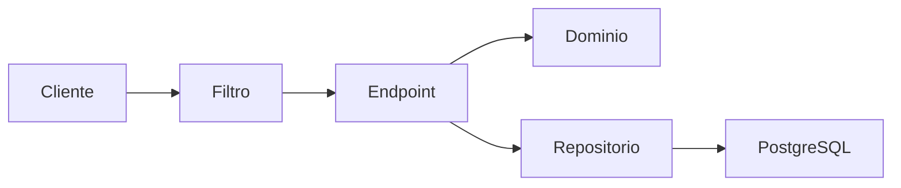
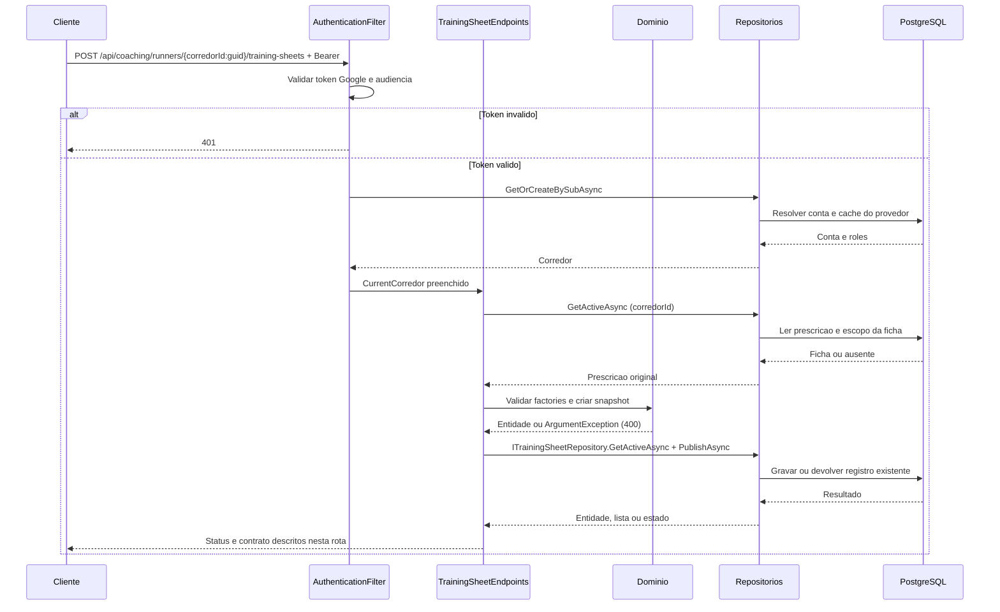
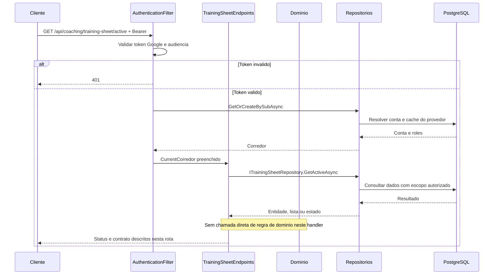
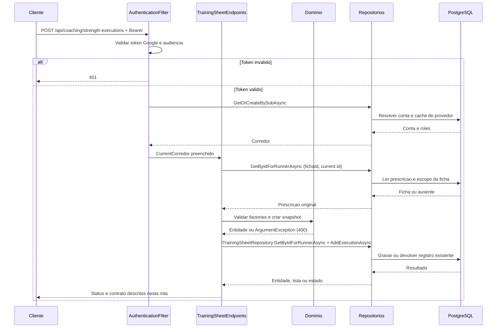
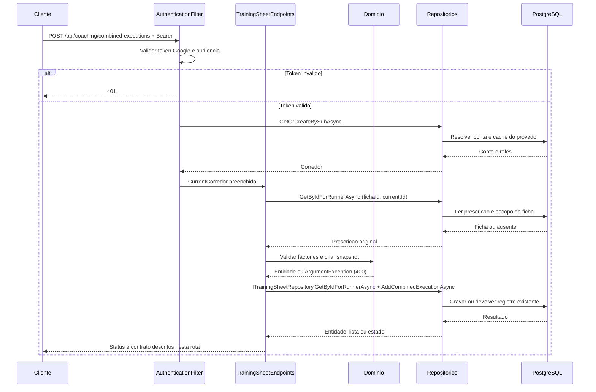
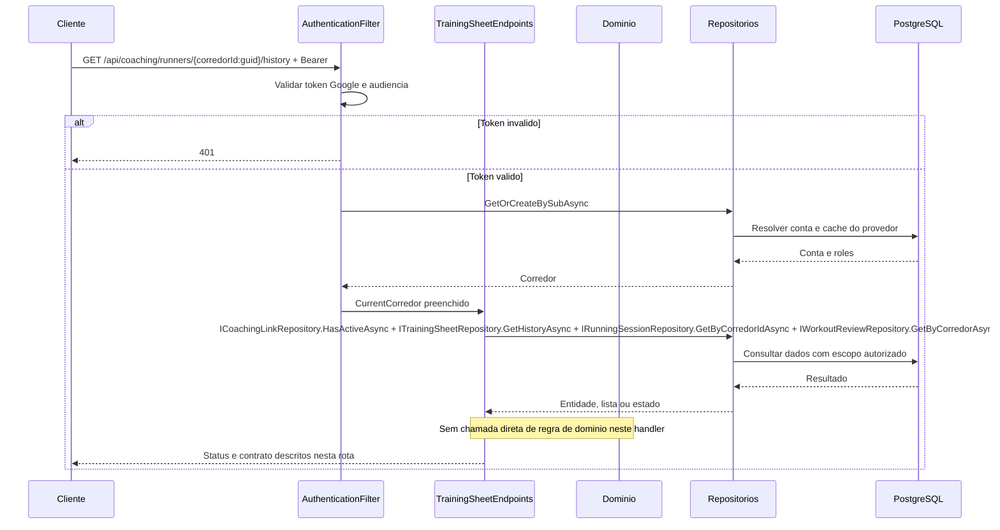
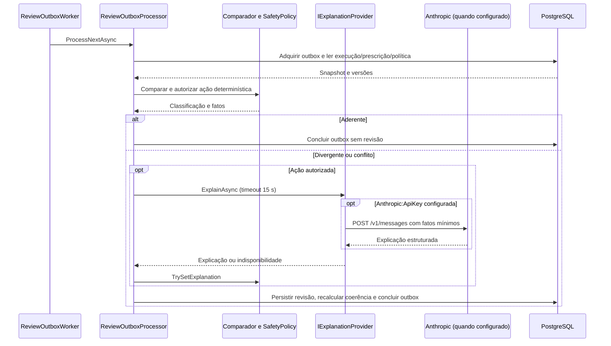

# TrainingSheetEndpoints - Ficha - Especificação Técnica

Auditoria de fontes: 2026-09-27. Unidade: [TrainingSheetEndpoints.cs](../../../src/Steady.Api/Endpoints/TrainingSheetEndpoints.cs).

## Índice

- [1. Visão Geral Técnica](#visao)
- [2. Configuração e Dependências](#config)
- [3. Detalhamento por Rota](#rotas)
- [4. Observações Técnicas](#observacoes)
  - [3.1. Publicar ficha](#rota-1)
  - [3.2. Ler ficha ativa própria](#rota-2)
  - [3.3. Registrar execução de ficha](#rota-3)
  - [3.4. Registrar treino combinado](#rota-4)
  - [3.5. Ler histórico pelo personal](#rota-5)

## 1. Visão Geral Técnica

**Propósito**: Publicar ficha versionada, registrar musculação ou treino combinado e disponibilizar histórico ao personal vinculado.

**Responsabilidades**: autenticar pelo grupo, aplicar escopo do usuário, executar as rotas abaixo e projetar os contratos.

**Integrações**: ASP.NET Core Minimal APIs, Steady.Domain e Steady.Infrastructure com PostgreSQL. Validação Google pertence ao filtro comum. A explicação externa é posterior ao registro ou solicitada explicitamente no retry.

**Fontes de regras**: [STORY-013](../../../specs/STORY-013/spec.bdd.md), [STORY-014](../../../specs/STORY-014/spec.bdd.md), [STORY-015](../../../specs/STORY-015/spec.bdd.md), [STORY-017](../../../specs/STORY-017/spec.bdd.md), [STORY-019](../../../specs/STORY-019/spec.bdd.md), [ADR-002](../../../docs/adr/ADR-002-autenticacao-e-isolamento-de-dados.md), [ADR-009](../../../docs/adr/ADR-009-ficha-ativa-e-execucao-imutavel.md), [ADR-010](../../../docs/adr/ADR-010-ficha-com-prescricoes-de-corrida-por-dia.md), [ADR-011](../../../docs/adr/ADR-011-registro-combinado-de-musculacao-e-corrida.md), [ADR-012](../../../docs/adr/ADR-012-prescricao-de-corrida-estruturada.md), [ADR-018](../../../docs/adr/ADR-018-outbox-transacional-da-revisao.md), [ADR-019](../../../docs/adr/ADR-019-identidade-historica-do-exercicio.md).

## 2. Configuração e Dependências

Composição: [Program.cs](../../../src/Steady.Api/Program.cs); persistência: [ServiceCollectionExtensions.cs](../../../src/Steady.Infrastructure/DependencyInjection/ServiceCollectionExtensions.cs). Cada lambda recebe os repositórios listados na rota, CurrentCorredor e CancellationToken quando há I/O. ILogger<CoachingAuditLog> aparece somente nas operações auditadas de vínculo/ficha/histórico.

**Lista de endpoints**:

- **POST** `/api/coaching/runners/{corredorId:guid}/training-sheets` - Publicar ficha.
- **GET** `/api/coaching/training-sheet/active` - Ler ficha ativa própria.
- **POST** `/api/coaching/strength-executions` - Registrar execução de ficha.
- **POST** `/api/coaching/combined-executions` - Registrar treino combinado.
- **GET** `/api/coaching/runners/{corredorId:guid}/history` - Ler histórico pelo personal.

**F. Endpoint Filter - AuthenticationFilter.InvokeAsync**

1. O grupo `/api` recebe o filtro em `Program.cs`; `/health` fica fora do grupo.
2. `Authorization` deve começar exatamente com `Bearer `; token vazio, inválido ou expirado retorna 401 antes da lógica do handler. O binding do framework pode rejeitar uma requisição malformada antes da execução do filtro.
3. `GoogleTokenValidator.ValidateAsync` usa `GoogleJsonWebSignature.ValidateAsync` com Audience restrita a `Google:ClientId`; assinatura e validade são verificadas pela biblioteca com chaves públicas cacheadas. Sem `Google:ClientId`, Program lança erro ao compor a aplicação.
4. Identidade é `sub`. E-mail e nome opcionais são normalizados e usados como cache de exibição, sem substituir identidade. `ICorredorRepository.GetOrCreateBySubAsync` resolve/provisiona corredor; `CurrentCorredor.Id` e `Roles` são preenchidos para a requisição.
5. `CurrentCorredor.HasRole` compara papel com ordinal exato; um token válido não concede automaticamente `Personal`. Falhas de autenticação registram path, motivo e IP, sem token.

**U1. Common/Auth e conversão**

- `CurrentCorredor`: identidade e papéis resolvidos pelo filtro; o cliente não escolhe o dono dos registros.
- `DomainFactory.TryCreate`: captura apenas `ArgumentException` (inclui guard clauses derivadas) e retorna 400 com `{ "error": "mensagem" }`; não converte todo erro de persistência ou desserialização em erro de validação.
- `Idempotency.HeaderName`: `Idempotency-Key`; quando exigida e ausente, `MissingKey` retorna 400. Guid inválido é rejeitado pelo binding; Guid.Empty não recebe validação específica no helper.
- Records HTTP são serializados em camelCase pelo padrão do framework. Datas `DateOnly` são `yyyy-MM-dd`. Enums de StrengthSession não recebem conversor textual global; enums convertidos explicitamente por `ToString` ou por mapping seguem as strings descritas em cada rota.

### Contrato `PublishTrainingSheetBody`

Fonte: [CoachingContracts.cs](../../../src/Steady.Api/Contracts/CoachingContracts.cs). Os nomes abaixo são os campos HTTP com serialização padrão camelCase.

| Campo | Tipo C# | Opcional/padrão |
|---|---|---|
| `push` | `IReadOnlyList<ExercisePrescriptionBody>?` | null permitido |
| `pull` | `IReadOnlyList<ExercisePrescriptionBody>?` | null permitido |
| `lower` | `IReadOnlyList<ExercisePrescriptionBody>?` | null permitido |
| `tuesdayRun` | `RunPrescriptionBody?` | null permitido |
| `thursdayRun` | `RunPrescriptionBody?` | null permitido |
| `saturdayRun` | `RunPrescriptionBody?` | null permitido |

### Contrato `TrainingSheetResponse`

Fonte: [CoachingContracts.cs](../../../src/Steady.Api/Contracts/CoachingContracts.cs). Os nomes abaixo são os campos HTTP com serialização padrão camelCase.

| Campo | Tipo C# | Opcional/padrão |
|---|---|---|
| `id` | `Guid` | não anulável |
| `corredorId` | `Guid` | não anulável |
| `createdAt` | `DateTime` | não anulável |
| `workouts` | `IReadOnlyList<WorkoutPrescriptionResponse>` | não anulável |

### Contrato `StrengthWorkoutExecutionBody`

Fonte: [CoachingContracts.cs](../../../src/Steady.Api/Contracts/CoachingContracts.cs). Os nomes abaixo são os campos HTTP com serialização padrão camelCase.

| Campo | Tipo C# | Opcional/padrão |
|---|---|---|
| `trainingSheetId` | `Guid` | não anulável |
| `workoutType` | `string` | não anulável |
| `date` | `string` | não anulável |
| `exercises` | `IReadOnlyList<ExerciseExecutionBody>?` | null permitido |
| `painReported` | `bool` | não anulável; padrão `false` |

### Contrato `StrengthWorkoutExecutionResponse`

Fonte: [CoachingContracts.cs](../../../src/Steady.Api/Contracts/CoachingContracts.cs). Os nomes abaixo são os campos HTTP com serialização padrão camelCase.

| Campo | Tipo C# | Opcional/padrão |
|---|---|---|
| `id` | `Guid` | não anulável |
| `trainingSheetId` | `Guid` | não anulável |
| `workoutType` | `string` | não anulável |
| `date` | `string` | não anulável |
| `exercises` | `IReadOnlyList<ExerciseExecutionResponse>` | não anulável |
| `createdAt` | `DateTime` | não anulável |

### Contrato `CombinedWorkoutExecutionBody`

Fonte: [CoachingContracts.cs](../../../src/Steady.Api/Contracts/CoachingContracts.cs). Os nomes abaixo são os campos HTTP com serialização padrão camelCase.

| Campo | Tipo C# | Opcional/padrão |
|---|---|---|
| `strength` | `StrengthWorkoutExecutionBody` | não anulável |
| `running` | `RunningSessionRequest` | não anulável |

### Contrato `RunningSessionRequest`

Fonte: [RunningSessionContracts.cs](../../../src/Steady.Api/Contracts/RunningSessionContracts.cs). Os nomes abaixo são os campos HTTP com serialização padrão camelCase.

| Campo | Tipo C# | Opcional/padrão |
|---|---|---|
| `date` | `DateOnly` | não anulável |
| `distanceKm` | `double` | não anulável |
| `durationMinutes` | `int` | não anulável |
| `averagePaceMinPerKm` | `double` | não anulável |
| `perceivedEffort` | `int` | não anulável |
| `painReported` | `bool` | não anulável; padrão `false` |

### Contrato `RunningSessionResponse`

Fonte: [RunningSessionContracts.cs](../../../src/Steady.Api/Contracts/RunningSessionContracts.cs). Os nomes abaixo são os campos HTTP com serialização padrão camelCase.

| Campo | Tipo C# | Opcional/padrão |
|---|---|---|
| `id` | `Guid` | não anulável |
| `date` | `DateOnly` | não anulável |
| `distanceKm` | `double` | não anulável |
| `durationMinutes` | `int` | não anulável |
| `averagePaceMinPerKm` | `double` | não anulável |
| `perceivedEffort` | `int` | não anulável |

### Contrato `CoachingHistoryResponse`

Fonte: [CoachingContracts.cs](../../../src/Steady.Api/Contracts/CoachingContracts.cs). Os nomes abaixo são os campos HTTP com serialização padrão camelCase.

| Campo | Tipo C# | Opcional/padrão |
|---|---|---|
| `strengthExecutions` | `IReadOnlyList<StrengthWorkoutExecutionResponse>` | não anulável |
| `runningSessions` | `IReadOnlyList<RunningHistoryResponse>` | não anulável |
| `reviews` | `IReadOnlyList<WorkoutReviewResponse>` | não anulável |

### Contrato `ExercisePrescriptionBody`

Fonte: [CoachingContracts.cs](../../../src/Steady.Api/Contracts/CoachingContracts.cs). Os nomes abaixo são os campos HTTP com serialização padrão camelCase.

| Campo | Tipo C# | Opcional/padrão |
|---|---|---|
| `name` | `string` | não anulável |
| `sets` | `int` | não anulável |
| `repetitions` | `int` | não anulável |
| `durationSeconds` | `int?` | null permitido; padrão `null` |
| `observation` | `string?` | null permitido; padrão `null` |
| `exerciseKey` | `Guid?` | null permitido; padrão `null` |

### Contrato `RunPrescriptionBody`

Fonte: [CoachingContracts.cs](../../../src/Steady.Api/Contracts/CoachingContracts.cs). Os nomes abaixo são os campos HTTP com serialização padrão camelCase.

| Campo | Tipo C# | Opcional/padrão |
|---|---|---|
| `description` | `string` | não anulável |
| `distanceKm` | `NumericRangeBody?` | null permitido |
| `durationMinutes` | `IntRangeBody?` | null permitido |
| `perceivedEffort` | `IntRangeBody?` | null permitido |

### Contrato `WorkoutPrescriptionResponse`

Fonte: [CoachingContracts.cs](../../../src/Steady.Api/Contracts/CoachingContracts.cs). Os nomes abaixo são os campos HTTP com serialização padrão camelCase.

| Campo | Tipo C# | Opcional/padrão |
|---|---|---|
| `type` | `string` | não anulável |
| `exercises` | `IReadOnlyList<ExercisePrescriptionResponse>` | não anulável |
| `runDescriptions` | `RunningPrescriptionsResponse?` | null permitido |

### Contrato `ExerciseExecutionBody`

Fonte: [CoachingContracts.cs](../../../src/Steady.Api/Contracts/CoachingContracts.cs). Os nomes abaixo são os campos HTTP com serialização padrão camelCase.

| Campo | Tipo C# | Opcional/padrão |
|---|---|---|
| `exerciseId` | `Guid` | não anulável |
| `loadKg` | `decimal?` | null permitido |
| `note` | `string?` | null permitido |
| `skipped` | `bool` | não anulável |

### Contrato `ExerciseExecutionResponse`

Fonte: [CoachingContracts.cs](../../../src/Steady.Api/Contracts/CoachingContracts.cs). Os nomes abaixo são os campos HTTP com serialização padrão camelCase.

| Campo | Tipo C# | Opcional/padrão |
|---|---|---|
| `exerciseId` | `Guid` | não anulável |
| `name` | `string` | não anulável |
| `sets` | `int` | não anulável |
| `repetitions` | `int` | não anulável |
| `loadKg` | `decimal?` | null permitido |
| `note` | `string?` | null permitido |
| `skipped` | `bool` | não anulável |
| `exerciseKey` | `Guid` | não anulável |
| `durationSeconds` | `int?` | null permitido |

### Contrato `RunningHistoryResponse`

Fonte: [CoachingContracts.cs](../../../src/Steady.Api/Contracts/CoachingContracts.cs). Os nomes abaixo são os campos HTTP com serialização padrão camelCase.

| Campo | Tipo C# | Opcional/padrão |
|---|---|---|
| `id` | `Guid` | não anulável |
| `date` | `DateOnly` | não anulável |
| `distanceKm` | `double` | não anulável |
| `durationMinutes` | `int` | não anulável |
| `averagePaceMinPerKm` | `double` | não anulável |
| `perceivedEffort` | `int` | não anulável |

### Contrato `WorkoutReviewResponse`

Fonte: [WorkoutReviewContracts.cs](../../../src/Steady.Api/Contracts/WorkoutReviewContracts.cs). Os nomes abaixo são os campos HTTP com serialização padrão camelCase.

| Campo | Tipo C# | Opcional/padrão |
|---|---|---|
| `id` | `Guid` | não anulável |
| `executionId` | `Guid` | não anulável |
| `executionKind` | `string` | não anulável |
| `executionDate` | `DateOnly` | não anulável |
| `status` | `string` | não anulável |
| `action` | `string?` | null permitido |
| `policyVersion` | `int` | não anulável |
| `planVersion` | `int?` | null permitido |
| `trainingSheetId` | `Guid?` | null permitido |
| `comparisonJson` | `string` | não anulável |
| `explanationStatus` | `string` | não anulável |
| `explanationJson` | `string?` | null permitido |
| `understoodAt` | `DateTime?` | null permitido |
| `contested` | `bool` | não anulável |
| `coherenceStatus` | `string` | não anulável |
| `nextExecutionId` | `Guid?` | null permitido |
| `coherencePolicyVersion` | `int?` | null permitido |
| `coherenceEvaluatedAt` | `DateTime?` | null permitido |
| `createdAt` | `DateTime` | não anulável |

### Contrato `NumericRangeBody`

Fonte: [CoachingContracts.cs](../../../src/Steady.Api/Contracts/CoachingContracts.cs). Os nomes abaixo são os campos HTTP com serialização padrão camelCase.

| Campo | Tipo C# | Opcional/padrão |
|---|---|---|
| `min` | `double` | não anulável |
| `max` | `double?` | null permitido |

### Contrato `IntRangeBody`

Fonte: [CoachingContracts.cs](../../../src/Steady.Api/Contracts/CoachingContracts.cs). Os nomes abaixo são os campos HTTP com serialização padrão camelCase.

| Campo | Tipo C# | Opcional/padrão |
|---|---|---|
| `min` | `int` | não anulável |
| `max` | `int?` | null permitido |

### Contrato `ExercisePrescriptionResponse`

Fonte: [CoachingContracts.cs](../../../src/Steady.Api/Contracts/CoachingContracts.cs). Os nomes abaixo são os campos HTTP com serialização padrão camelCase.

| Campo | Tipo C# | Opcional/padrão |
|---|---|---|
| `id` | `Guid` | não anulável |
| `name` | `string` | não anulável |
| `sets` | `int` | não anulável |
| `repetitions` | `int` | não anulável |
| `suggestedLoadKg` | `decimal?` | null permitido |
| `durationSeconds` | `int?` | null permitido |
| `observation` | `string?` | null permitido |
| `exerciseKey` | `Guid` | não anulável |

### Contrato `RunningPrescriptionsResponse`

Fonte: [CoachingContracts.cs](../../../src/Steady.Api/Contracts/CoachingContracts.cs). Os nomes abaixo são os campos HTTP com serialização padrão camelCase.

| Campo | Tipo C# | Opcional/padrão |
|---|---|---|
| `tuesday` | `RunPrescriptionResponse` | não anulável |
| `thursday` | `RunPrescriptionResponse` | não anulável |
| `saturday` | `RunPrescriptionResponse` | não anulável |

### Contrato `RunPrescriptionResponse`

Fonte: [CoachingContracts.cs](../../../src/Steady.Api/Contracts/CoachingContracts.cs). Os nomes abaixo são os campos HTTP com serialização padrão camelCase.

| Campo | Tipo C# | Opcional/padrão |
|---|---|---|
| `description` | `string` | não anulável |
| `distanceKm` | `NumericRangeResponse?` | null permitido |
| `durationMinutes` | `IntRangeResponse?` | null permitido |
| `perceivedEffort` | `IntRangeResponse?` | null permitido |

### Contrato `NumericRangeResponse`

Fonte: [CoachingContracts.cs](../../../src/Steady.Api/Contracts/CoachingContracts.cs). Os nomes abaixo são os campos HTTP com serialização padrão camelCase.

| Campo | Tipo C# | Opcional/padrão |
|---|---|---|
| `min` | `double` | não anulável |
| `max` | `double?` | null permitido |

### Contrato `IntRangeResponse`

Fonte: [CoachingContracts.cs](../../../src/Steady.Api/Contracts/CoachingContracts.cs). Os nomes abaixo são os campos HTTP com serialização padrão camelCase.

| Campo | Tipo C# | Opcional/padrão |
|---|---|---|
| `min` | `int` | não anulável |
| `max` | `int?` | null permitido |

### Catálogo compartilhado de domínio e persistência

TryCreateSheet chama TrainingSheet.Create com Push, Pull, Lower e RunningWorkout de terça/quinta/sábado. TrainingSheetMapping.CreateExercises gera Id novo; key ausente ganha nova identidade, key fornecida deve pertencer à ativa. RunPrescription.Create valida descrição e faixas; números ausentes permanecem null. TryCreateExecution valida conjunto completo de ExerciseId e cria snapshot por prescrição; nota é opcional e tem no máximo 200 caracteres; executado exige carga de 0,01 a 999,99 kg, com até duas casas decimais (loadKg ausente vira zero e é rejeitado). Exercício prescrito exige nome aparado de 2 a 100 caracteres, 1..20 séries, 1..100 repetições e tempo opcional positivo; observação aparada tem até 200 caracteres e vazio vira null. Cada treino de força exige pelo menos um exercício. Faixa numérica exige máximo maior que mínimo quando fornecido; esforço mínimo fica entre 1 e 10.

TrainingSheetRepository.PublishAsync verifica vínculo, desativa antigas e insere nova em transação. GetActiveAsync preserva versões e usa execução mais recente por CreatedAt para sugestões desta ficha; pulado produz sugestão null. GetByIdForRunnerAsync não exige IsActive, permitindo sync tardia. AddExecutionAsync salva execução+outbox+dor em SaveChangesAsync. AddCombinedExecutionAsync usa transação para duas sessões, outbox Combined e dor; se só uma modalidade existe com a chave, lança InvalidOperationException. GetHistoryAsync exige vínculo; consultas são completas, sem paginação.

## 3. Detalhamento por Rota

### 3.1. Publicar ficha

**Rota**: `POST /api/coaching/runners/{corredorId:guid}/training-sheets`

**Entrada**: corredorId: Guid; PublishTrainingSheetBody. Header Authorization: Bearer obrigatório.

**Saída**: TrainingSheetResponse. Estruturas e tipos completos constam na seção de contratos.

**Status**: 201 publicada; 400 inválida; 403 sem papel; 404 sem vínculo; todas as rotas podem retornar 401 no filtro. Binding inválido pode retornar 400 antes do handler.

#### Fluxo de Execução

#### Detalhamento do Fluxo

**E.1. Lambda de rota em MapTrainingSheetEndpoints**

Exige Personal; lê ficha ativa para allowedExerciseKeys; TryCreateSheet exige os seis blocos e keys sem duplicação; mapping cria exercícios e prescrições; PublishAsync exige vínculo ativo e troca a ficha em transação; audit; relê ativa para resposta.

Navegação: [F. autenticação](#f-auth), [D1. domínio](#d-1), [R1. persistência](#r-1), [U1. suporte](#u-common).

**D1.1. Domínio no fluxo**

TryCreateSheet --> TrainingSheetMapping.CreateExercises/CreateRunPrescription --> ExercisePrescription.Create, StrengthWorkout.Create, RunPrescription.Create, RunningWorkout.Create e TrainingSheet.Create. Chaves fornecidas são verificadas contra a ficha ativa; limites constam no [catálogo](#catalogo).

**R1.1. Métodos e persistência**

Chamada desta rota: `ITrainingSheetRepository.GetActiveAsync + PublishAsync`.

A operação específica e seu escopo estão descritos no fluxo acima; detalhes de query, snapshot, transação e reenvio estão no [catálogo de persistência](#catalogo). As consultas próprias filtram o dono no banco; leitura pelo personal exige o vínculo quando indicado. Nenhuma autorização por vínculo é acrescentada implicitamente pelo filtro comum.

[Voltar ao endpoint](#e-1). O [filtro](#f-auth) resolve autenticação antes da lógica; os [utilitários](#u-common) não adicionam autorização por vínculo automaticamente.

### 3.2. Ler ficha ativa própria

**Rota**: `GET /api/coaching/training-sheet/active`

**Entrada**: Sem corpo. Header Authorization: Bearer obrigatório.

**Saída**: TrainingSheetResponse. Estruturas e tipos completos constam na seção de contratos.

**Status**: 200 ficha; 404 ausente; todas as rotas podem retornar 401 no filtro. Binding inválido pode retornar 400 antes do handler.

#### Fluxo de Execução

#### Detalhamento do Fluxo

**E.2. Lambda de rota em MapTrainingSheetEndpoints**

Busca ativa de current.Id e sugestões de carga a partir de execuções dessa ficha; Mapping.Respond serializa workouts e faixas.

Navegação: [F. autenticação](#f-auth), [D1. domínio](#d-2), [R1. persistência](#r-2), [U1. suporte](#u-common).

**D1.2. Domínio no fluxo**

Sem chamada de factory ou serviço de domínio no handler. Mapping/Respond e desserialização projetam dados persistidos, sem criar nova regra de treino.

**R1.2. Métodos e persistência**

Chamada desta rota: `ITrainingSheetRepository.GetActiveAsync`.

A operação específica e seu escopo estão descritos no fluxo acima; detalhes de query, snapshot, transação e reenvio estão no [catálogo de persistência](#catalogo). As consultas próprias filtram o dono no banco; leitura pelo personal exige o vínculo quando indicado. Nenhuma autorização por vínculo é acrescentada implicitamente pelo filtro comum.

[Voltar ao endpoint](#e-2). O [filtro](#f-auth) resolve autenticação antes da lógica; os [utilitários](#u-common) não adicionam autorização por vínculo automaticamente.

### 3.3. Registrar execução de ficha

**Rota**: `POST /api/coaching/strength-executions`

**Entrada**: StrengthWorkoutExecutionBody; Idempotency-Key obrigatório. Header Authorization: Bearer obrigatório.

**Saída**: StrengthWorkoutExecutionResponse. Estruturas e tipos completos constam na seção de contratos.

**Status**: 201 nova; 200 reenvio; 400 inválida; 404 ficha alheia/ausente; todas as rotas podem retornar 401 no filtro. Binding inválido pode retornar 400 antes do handler.

#### Fluxo de Execução

#### Detalhamento do Fluxo

**E.3. Lambda de rota em MapTrainingSheetEndpoints**

Exige chave; traduz tipo exceto run; data yyyy-MM-dd; busca ficha por id e dono, inclusive inativa; desserializa prescrição; exige todos os exercícios uma vez; copia nome/séries/repetições/key/duração da prescrição; executado usa loadKg ?? 0; pulado não usa carga; salva dor e outbox.

Navegação: [F. autenticação](#f-auth), [D1. domínio](#d-3), [R1. persistência](#r-3), [U1. suporte](#u-common).

**D1.3. Domínio no fluxo**

TryCreateExecution --> ExerciseExecution.Executed/SkippedExercise --> StrengthWorkoutExecution.Create. O conjunto enviado deve coincidir com a prescrição uma vez por ExerciseId. Limites e snapshots constam no [catálogo](#catalogo).

**R1.3. Métodos e persistência**

Chamada desta rota: `ITrainingSheetRepository.GetByIdForRunnerAsync + AddExecutionAsync`.

A operação específica e seu escopo estão descritos no fluxo acima; detalhes de query, snapshot, transação e reenvio estão no [catálogo de persistência](#catalogo). As consultas próprias filtram o dono no banco; leitura pelo personal exige o vínculo quando indicado. Nenhuma autorização por vínculo é acrescentada implicitamente pelo filtro comum.

[Voltar ao endpoint](#e-3). O [filtro](#f-auth) resolve autenticação antes da lógica; os [utilitários](#u-common) não adicionam autorização por vínculo automaticamente.

### 3.4. Registrar treino combinado

**Rota**: `POST /api/coaching/combined-executions`

**Entrada**: CombinedWorkoutExecutionBody; Idempotency-Key obrigatório. Header Authorization: Bearer obrigatório.

**Saída**: Objeto { strength: StrengthWorkoutExecutionResponse, running: RunningSessionResponse }. Estruturas e tipos completos constam na seção de contratos.

**Status**: 201 novo; 200 reenvio de ambas; 400 validação; 404 ficha; todas as rotas podem retornar 401 no filtro. Binding inválido pode retornar 400 antes do handler.

#### Fluxo de Execução

#### Detalhamento do Fluxo

**E.4. Lambda de rota em MapTrainingSheetEndpoints**

Valida Strength igual à execução de ficha e RunningSession.Create separadamente; AddCombinedExecutionAsync insere as duas modalidades, um evento Combined e dor com Strength.PainReported; Running.PainReported não é passado; responde com os dois registros.

Navegação: [F. autenticação](#f-auth), [D1. domínio](#d-4), [R1. persistência](#r-4), [U1. suporte](#u-common).

**D1.4. Domínio no fluxo**

TryCreateExecution --> ExerciseExecution.Executed/SkippedExercise --> StrengthWorkoutExecution.Create. O conjunto enviado deve coincidir com a prescrição uma vez por ExerciseId. RunningSession.Create também valida a modalidade corrida antes da persistência combinada. Limites e snapshots constam no [catálogo](#catalogo).

**R1.4. Métodos e persistência**

Chamada desta rota: `ITrainingSheetRepository.GetByIdForRunnerAsync + AddCombinedExecutionAsync`.

A operação específica e seu escopo estão descritos no fluxo acima; detalhes de query, snapshot, transação e reenvio estão no [catálogo de persistência](#catalogo). As consultas próprias filtram o dono no banco; leitura pelo personal exige o vínculo quando indicado. Nenhuma autorização por vínculo é acrescentada implicitamente pelo filtro comum.

[Voltar ao endpoint](#e-4). O [filtro](#f-auth) resolve autenticação antes da lógica; os [utilitários](#u-common) não adicionam autorização por vínculo automaticamente.

### 3.5. Ler histórico pelo personal

**Rota**: `GET /api/coaching/runners/{corredorId:guid}/history`

**Entrada**: corredorId: Guid; sem corpo. Header Authorization: Bearer obrigatório.

**Saída**: CoachingHistoryResponse. Estruturas e tipos completos constam na seção de contratos.

**Status**: 200 histórico; 403 sem papel; 404 sem vínculo; todas as rotas podem retornar 401 no filtro. Binding inválido pode retornar 400 antes do handler.

#### Fluxo de Execução

#### Detalhamento do Fluxo

**E.5. Lambda de rota em MapTrainingSheetEndpoints**

Exige Personal e HasActiveAsync; consulta execuções de ficha, corridas e revisões do corredor; audit; projeta três coleções. Não inclui musculação avulsa.

Navegação: [F. autenticação](#f-auth), [D1. domínio](#d-5), [R1. persistência](#r-5), [U1. suporte](#u-common).

**D1.5. Domínio no fluxo**

Sem chamada de factory ou serviço de domínio no handler. Mapping/Respond e desserialização projetam dados persistidos, sem criar nova regra de treino.

**R1.5. Métodos e persistência**

Chamada desta rota: `ICoachingLinkRepository.HasActiveAsync + ITrainingSheetRepository.GetHistoryAsync + IRunningSessionRepository.GetByCorredorIdAsync + IWorkoutReviewRepository.GetByCorredorAsync`.

A operação específica e seu escopo estão descritos no fluxo acima; detalhes de query, snapshot, transação e reenvio estão no [catálogo de persistência](#catalogo). As consultas próprias filtram o dono no banco; leitura pelo personal exige o vínculo quando indicado. Nenhuma autorização por vínculo é acrescentada implicitamente pelo filtro comum.

[Voltar ao endpoint](#e-5). O [filtro](#f-auth) resolve autenticação antes da lógica; os [utilitários](#u-common) não adicionam autorização por vínculo automaticamente.

## 4. Observações Técnicas

TrainingSheetMapping separa conversão de roteamento. A execução guarda ExerciseKey e DurationSeconds no snapshot, mas não campo de duração efetivamente realizada. Faixas de corrida aceitam km decimal. TrainingSheetResponse contém runDescriptions por dia. Reenvio é validado antes da consulta de deduplicação. Location de ficha/execução aponta a caminhos sem GET individual mapeado.

**Performance**: consultas são assíncronas com CancellationToken; onde a coleção não possui parâmetros de limite, o resultado é materializado integralmente. Não há paralelização de chamadas ao mesmo contexto no handler.

**Tratamento de erros**: status acima descrevem caminhos explícitos; exceções inesperadas não têm tradução local genérica. 404 não deve ser interpretado como permissão de procurar dados de outro corredor.

### Processamento posterior à resposta

`ReviewOutboxWorker` é registrado como serviço hospedado. Com `ReviewProcessing:Enabled` ausente, opera habilitado; `false` desliga o processamento. Drena pendências e volta a consultar a cada 2 segundos. `ReviewOutboxProcessor.ProcessNextAsync` adquire um item via `FOR UPDATE SKIP LOCKED`, lease de 2 minutos e contagem de tentativas. Falha de processamento devolve Pending com backoff exponencial limitado a 60 segundos. Falha da explicação gera revisão com ExplanationStatus Unavailable, sem invalidar a execução.

O comparador usa faixas opcionais, versões de tolerância e ExerciseKey para mediana histórica. Ausência de número não vira zero. Plano e ficha conflitantes não recebem precedência nem recomendação. A dor capturada no encerramento participa da política; PainLog avulso posterior não reabre revisão. Coerência é recalculada pela data de execução quando chega treino posterior ou sincronização tardia.

`Program` escolhe `UnavailableExplanationProvider` sem `Anthropic:ApiKey` e `ClaudeExplanationProvider` quando configurada. O provedor envia fatos/ação autorizados, sem e-mail ou sub, exige ferramenta `submit_review` e permite somente ação do enum. HTTP não bem-sucedido ou saída incompleta pode resultar em explicação indisponível. `Anthropic:Model` pode sobrescrever o modelo padrão presente no código. O modelo não classifica aderência nem autoriza ação.

**Documentos relacionados**: [Regras](../BusinessRulesDocs/Ficha-e-Execucao-Ficha-Rules.md), [Débitos](../TechnicalDebtsDocs/TrainingSheetEndpoints-Ficha-Debts.md), [Índice](README.md).
