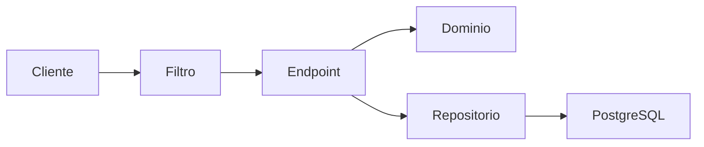
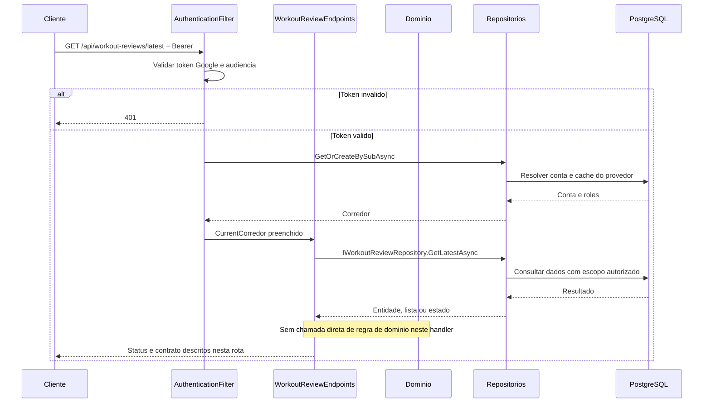
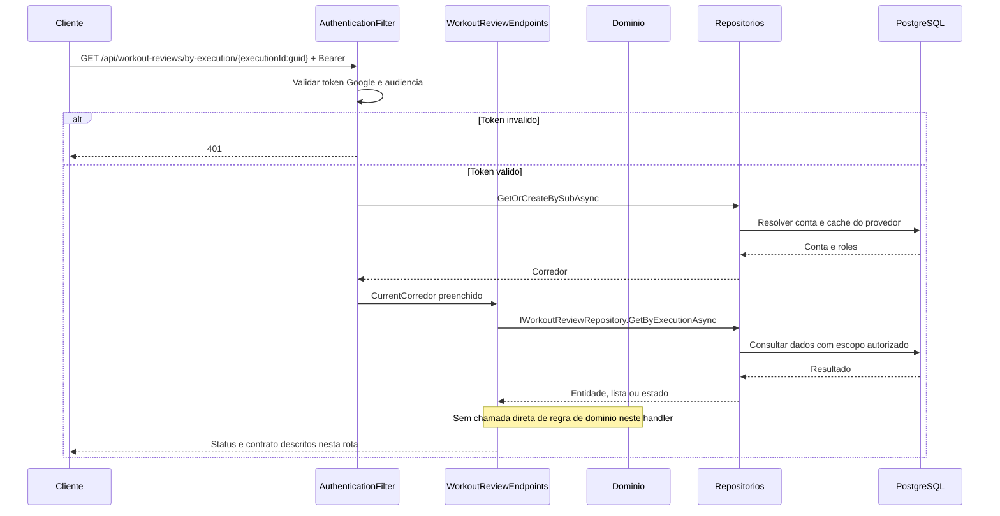
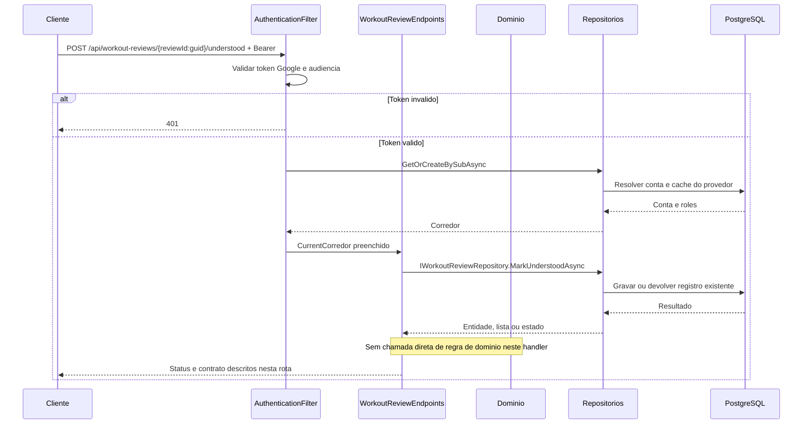
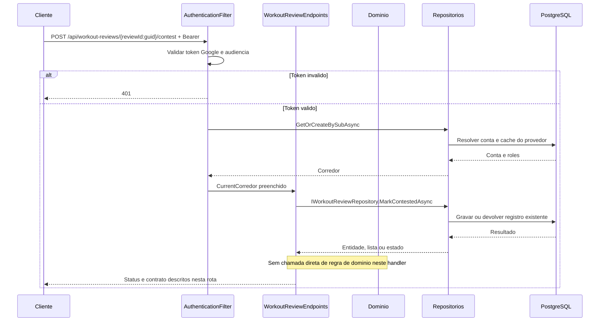
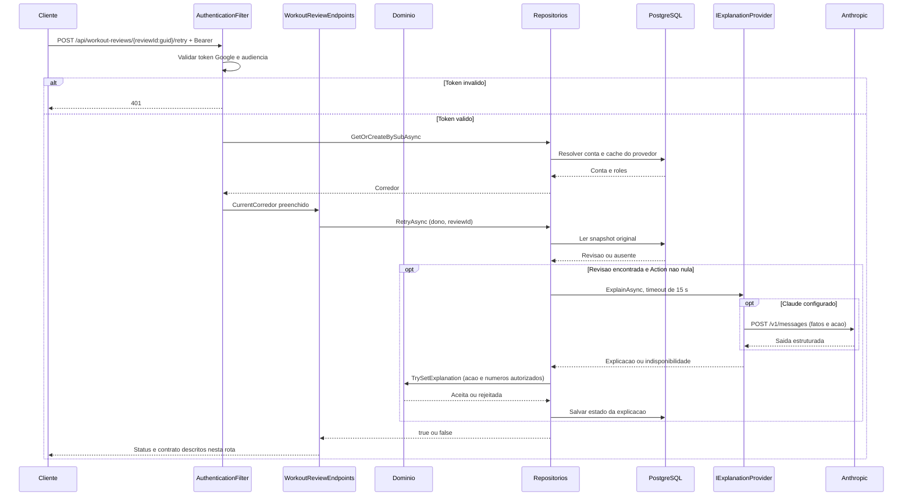
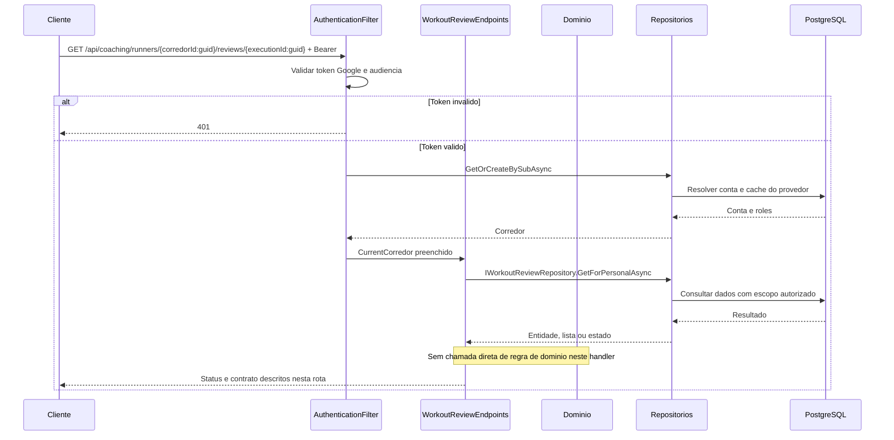
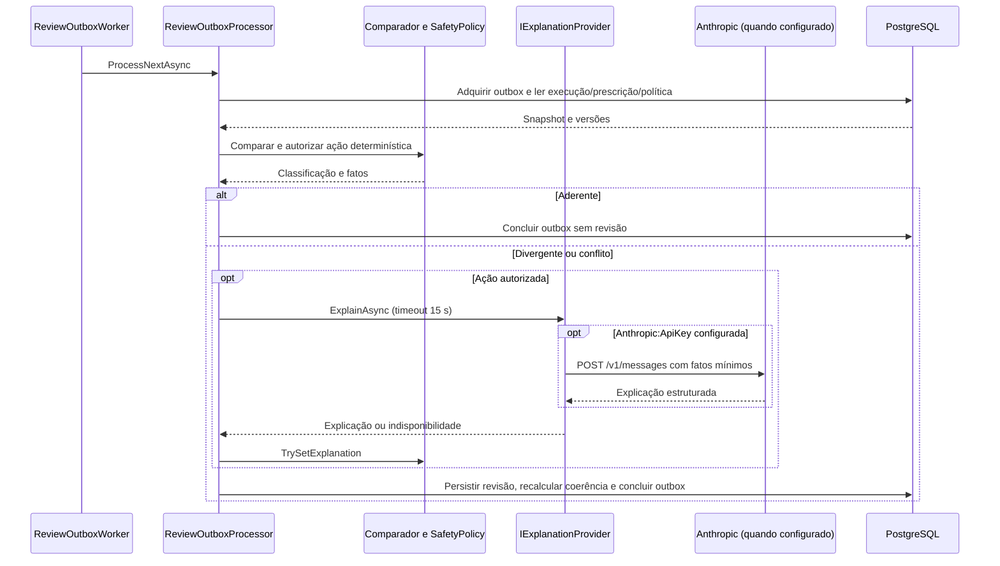

# WorkoutReviewEndpoints - Revisao - Especificação Técnica

Auditoria de fontes: 2026-09-27. Unidade: [WorkoutReviewEndpoints.cs](../../../src/Steady.Api/Endpoints/WorkoutReviewEndpoints.cs).

## Índice

- [1. Visão Geral Técnica](#visao)
- [2. Configuração e Dependências](#config)
- [3. Detalhamento por Rota](#rotas)
- [4. Observações Técnicas](#observacoes)
  - [3.1. Ler revisão mais recente](#rota-1)
  - [3.2. Ler revisão por execução](#rota-2)
  - [3.3. Registrar compreensão](#rota-3)
  - [3.4. Contestar revisão](#rota-4)
  - [3.5. Solicitar nova explicação](#rota-5)
  - [3.6. Ler revisão pelo personal](#rota-6)

## 1. Visão Geral Técnica

**Propósito**: Consultar revisão determinística, registrar compreensão/contestação e solicitar nova explicação sem alterar o treino.

**Responsabilidades**: autenticar pelo grupo, aplicar escopo do usuário, executar as rotas abaixo e projetar os contratos.

**Integrações**: ASP.NET Core Minimal APIs, Steady.Domain e Steady.Infrastructure com PostgreSQL. Validação Google pertence ao filtro comum. A explicação externa é posterior ao registro ou solicitada explicitamente no retry.

**Fontes de regras**: [STORY-014](../../../specs/STORY-014/spec.bdd.md), [ADR-002](../../../docs/adr/ADR-002-autenticacao-e-isolamento-de-dados.md), [ADR-014](../../../docs/adr/ADR-014-fronteira-deterministica-da-revisao.md), [ADR-015](../../../docs/adr/ADR-015-tolerancias-e-politicas-versionadas.md), [ADR-016](../../../docs/adr/ADR-016-provedor-da-explicacao-da-revisao.md), [ADR-018](../../../docs/adr/ADR-018-outbox-transacional-da-revisao.md), [ADR-019](../../../docs/adr/ADR-019-identidade-historica-do-exercicio.md).

## 2. Configuração e Dependências

Composição: [Program.cs](../../../src/Steady.Api/Program.cs); persistência: [ServiceCollectionExtensions.cs](../../../src/Steady.Infrastructure/DependencyInjection/ServiceCollectionExtensions.cs). Cada lambda recebe os repositórios listados na rota, CurrentCorredor e CancellationToken quando há I/O. ILogger<CoachingAuditLog> aparece somente nas operações auditadas de vínculo/ficha/histórico.

**Lista de endpoints**:

- **GET** `/api/workout-reviews/latest` - Ler revisão mais recente.
- **GET** `/api/workout-reviews/by-execution/{executionId:guid}` - Ler revisão por execução.
- **POST** `/api/workout-reviews/{reviewId:guid}/understood` - Registrar compreensão.
- **POST** `/api/workout-reviews/{reviewId:guid}/contest` - Contestar revisão.
- **POST** `/api/workout-reviews/{reviewId:guid}/retry` - Solicitar nova explicação.
- **GET** `/api/coaching/runners/{corredorId:guid}/reviews/{executionId:guid}` - Ler revisão pelo personal.

**F. Endpoint Filter - AuthenticationFilter.InvokeAsync**

1. O grupo `/api` recebe o filtro em `Program.cs`; `/health` fica fora do grupo.
2. `Authorization` deve começar exatamente com `Bearer `; token vazio, inválido ou expirado retorna 401 antes da lógica do handler. O binding do framework pode rejeitar uma requisição malformada antes da execução do filtro.
3. `GoogleTokenValidator.ValidateAsync` usa `GoogleJsonWebSignature.ValidateAsync` com Audience restrita a `Google:ClientId`; assinatura e validade são verificadas pela biblioteca com chaves públicas cacheadas. Sem `Google:ClientId`, Program lança erro ao compor a aplicação.
4. Identidade é `sub`. E-mail e nome opcionais são normalizados e usados como cache de exibição, sem substituir identidade. `ICorredorRepository.GetOrCreateBySubAsync` resolve/provisiona corredor; `CurrentCorredor.Id` e `Roles` são preenchidos para a requisição.
5. `CurrentCorredor.HasRole` compara papel com ordinal exato; um token válido não concede automaticamente `Personal`. Falhas de autenticação registram path, motivo e IP, sem token.

**U1. Common/Auth e conversão**

- `CurrentCorredor`: identidade e papéis resolvidos pelo filtro; o cliente não escolhe o dono dos registros.
- `DomainFactory.TryCreate`: captura apenas `ArgumentException` (inclui guard clauses derivadas) e retorna 400 com `{ "error": "mensagem" }`; não converte todo erro de persistência ou desserialização em erro de validação.
- `Idempotency.HeaderName`: `Idempotency-Key`; quando exigida e ausente, `MissingKey` retorna 400. Guid inválido é rejeitado pelo binding; Guid.Empty não recebe validação específica no helper.
- Records HTTP são serializados em camelCase pelo padrão do framework. Datas `DateOnly` são `yyyy-MM-dd`. Enums de StrengthSession não recebem conversor textual global; enums convertidos explicitamente por `ToString` ou por mapping seguem as strings descritas em cada rota.

### Contrato `WorkoutReviewResponse`

Fonte: [WorkoutReviewContracts.cs](../../../src/Steady.Api/Contracts/WorkoutReviewContracts.cs). Os nomes abaixo são os campos HTTP com serialização padrão camelCase.

| Campo | Tipo C# | Opcional/padrão |
|---|---|---|
| `id` | `Guid` | não anulável |
| `executionId` | `Guid` | não anulável |
| `executionKind` | `string` | não anulável |
| `executionDate` | `DateOnly` | não anulável |
| `status` | `string` | não anulável |
| `action` | `string?` | null permitido |
| `policyVersion` | `int` | não anulável |
| `planVersion` | `int?` | null permitido |
| `trainingSheetId` | `Guid?` | null permitido |
| `comparisonJson` | `string` | não anulável |
| `explanationStatus` | `string` | não anulável |
| `explanationJson` | `string?` | null permitido |
| `understoodAt` | `DateTime?` | null permitido |
| `contested` | `bool` | não anulável |
| `coherenceStatus` | `string` | não anulável |
| `nextExecutionId` | `Guid?` | null permitido |
| `coherencePolicyVersion` | `int?` | null permitido |
| `coherenceEvaluatedAt` | `DateTime?` | null permitido |
| `createdAt` | `DateTime` | não anulável |

### Catálogo compartilhado de domínio e persistência

Não calcula aderência nos GET/POST de confirmação. Retry usa WorkoutReview.Create e TrySetExplanation para impedir ação incompatível e números fora dos fatos autorizados. Comparação, ação, política e prescrição foram capturadas pelo processamento original; não se recarrega ficha atual para explicar novamente.

WorkoutReviewRepository filtra CorredorId em todas as operações próprias. GetForPersonalAsync verifica HasActiveAsync antes da leitura. UpdateAsync persiste compreensão/contestação. ReviewExplanationRetryService usa SteadyDbContext diretamente, desserializa ComparisonJson e chama IExplanationProvider fora da gravação; guarda ExplanationStatus/ExplanationJson e logs com reviewId/policyVersion.

## 3. Detalhamento por Rota

### 3.1. Ler revisão mais recente

**Rota**: `GET /api/workout-reviews/latest`

**Entrada**: Sem corpo. Header Authorization: Bearer obrigatório.

**Saída**: WorkoutReviewResponse. Estruturas e tipos completos constam na seção de contratos.

**Status**: 200 revisão; 404 nenhuma; todas as rotas podem retornar 401 no filtro. Binding inválido pode retornar 400 antes do handler.

#### Fluxo de Execução

#### Detalhamento do Fluxo

**E.1. Lambda de rota em MapWorkoutReviewEndpoints**

GetLatestAsync ordena ExecutionDate e CreatedAt decrescentes; Respond projeta versão de política/plano, snapshots e estados de explicação/coerência.

Navegação: [F. autenticação](#f-auth), [D1. domínio](#d-1), [R1. persistência](#r-1), [U1. suporte](#u-common).

**D1.1. Domínio no fluxo**

Sem comparação ou autorização de ação de domínio nesta rota. Consulta/confirmação usa o fato de revisão já persistido.

**R1.1. Métodos e persistência**

Chamada desta rota: `IWorkoutReviewRepository.GetLatestAsync`.

A operação específica e seu escopo estão descritos no fluxo acima; detalhes de query, snapshot, transação e reenvio estão no [catálogo de persistência](#catalogo). As consultas próprias filtram o dono no banco; leitura pelo personal exige o vínculo quando indicado. Nenhuma autorização por vínculo é acrescentada implicitamente pelo filtro comum.

[Voltar ao endpoint](#e-1). O [filtro](#f-auth) resolve autenticação antes da lógica; os [utilitários](#u-common) não adicionam autorização por vínculo automaticamente.

### 3.2. Ler revisão por execução

**Rota**: `GET /api/workout-reviews/by-execution/{executionId:guid}`

**Entrada**: executionId: Guid. Header Authorization: Bearer obrigatório.

**Saída**: WorkoutReviewResponse. Estruturas e tipos completos constam na seção de contratos.

**Status**: 200; 404 revisão não existente ou alheia; todas as rotas podem retornar 401 no filtro. Binding inválido pode retornar 400 antes do handler.

#### Fluxo de Execução

#### Detalhamento do Fluxo

**E.2. Lambda de rota em MapWorkoutReviewEndpoints**

Busca review.ExecutionId e dono; não produz revisão na leitura.

Navegação: [F. autenticação](#f-auth), [D1. domínio](#d-2), [R1. persistência](#r-2), [U1. suporte](#u-common).

**D1.2. Domínio no fluxo**

Sem comparação ou autorização de ação de domínio nesta rota. Consulta/confirmação usa o fato de revisão já persistido.

**R1.2. Métodos e persistência**

Chamada desta rota: `IWorkoutReviewRepository.GetByExecutionAsync`.

A operação específica e seu escopo estão descritos no fluxo acima; detalhes de query, snapshot, transação e reenvio estão no [catálogo de persistência](#catalogo). As consultas próprias filtram o dono no banco; leitura pelo personal exige o vínculo quando indicado. Nenhuma autorização por vínculo é acrescentada implicitamente pelo filtro comum.

[Voltar ao endpoint](#e-2). O [filtro](#f-auth) resolve autenticação antes da lógica; os [utilitários](#u-common) não adicionam autorização por vínculo automaticamente.

### 3.3. Registrar compreensão

**Rota**: `POST /api/workout-reviews/{reviewId:guid}/understood`

**Entrada**: reviewId: Guid; sem corpo. Header Authorization: Bearer obrigatório.

**Saída**: Sem corpo. Estruturas e tipos completos constam na seção de contratos.

**Status**: 204; 404 revisão ausente ou alheia; todas as rotas podem retornar 401 no filtro. Binding inválido pode retornar 400 antes do handler.

#### Fluxo de Execução

#### Detalhamento do Fluxo

**E.3. Lambda de rota em MapWorkoutReviewEndpoints**

MarkUnderstoodAsync usa UnderstoodAt ??= UtcNow; preserva primeiro aceite; não altera execução ou recomendação.

Navegação: [F. autenticação](#f-auth), [D1. domínio](#d-3), [R1. persistência](#r-3), [U1. suporte](#u-common).

**D1.3. Domínio no fluxo**

Sem comparação ou autorização de ação de domínio nesta rota. Consulta/confirmação usa o fato de revisão já persistido.

**R1.3. Métodos e persistência**

Chamada desta rota: `IWorkoutReviewRepository.MarkUnderstoodAsync`.

A operação específica e seu escopo estão descritos no fluxo acima; detalhes de query, snapshot, transação e reenvio estão no [catálogo de persistência](#catalogo). As consultas próprias filtram o dono no banco; leitura pelo personal exige o vínculo quando indicado. Nenhuma autorização por vínculo é acrescentada implicitamente pelo filtro comum.

[Voltar ao endpoint](#e-3). O [filtro](#f-auth) resolve autenticação antes da lógica; os [utilitários](#u-common) não adicionam autorização por vínculo automaticamente.

### 3.4. Contestar revisão

**Rota**: `POST /api/workout-reviews/{reviewId:guid}/contest`

**Entrada**: reviewId: Guid; sem corpo. Header Authorization: Bearer obrigatório.

**Saída**: Sem corpo. Estruturas e tipos completos constam na seção de contratos.

**Status**: 204; 404 revisão ausente ou alheia; todas as rotas podem retornar 401 no filtro. Binding inválido pode retornar 400 antes do handler.

#### Fluxo de Execução

#### Detalhamento do Fluxo

**E.4. Lambda de rota em MapWorkoutReviewEndpoints**

MarkContestedAsync marca Contested=true no registro do dono; não recalcula comparação.

Navegação: [F. autenticação](#f-auth), [D1. domínio](#d-4), [R1. persistência](#r-4), [U1. suporte](#u-common).

**D1.4. Domínio no fluxo**

Sem comparação ou autorização de ação de domínio nesta rota. Consulta/confirmação usa o fato de revisão já persistido.

**R1.4. Métodos e persistência**

Chamada desta rota: `IWorkoutReviewRepository.MarkContestedAsync`.

A operação específica e seu escopo estão descritos no fluxo acima; detalhes de query, snapshot, transação e reenvio estão no [catálogo de persistência](#catalogo). As consultas próprias filtram o dono no banco; leitura pelo personal exige o vínculo quando indicado. Nenhuma autorização por vínculo é acrescentada implicitamente pelo filtro comum.

[Voltar ao endpoint](#e-4). O [filtro](#f-auth) resolve autenticação antes da lógica; os [utilitários](#u-common) não adicionam autorização por vínculo automaticamente.

### 3.5. Solicitar nova explicação

**Rota**: `POST /api/workout-reviews/{reviewId:guid}/retry`

**Entrada**: reviewId: Guid; sem corpo. Header Authorization: Bearer obrigatório.

**Saída**: Sem corpo. Estruturas e tipos completos constam na seção de contratos.

**Status**: 204 mesmo se explicação indisponível; 404 revisão ausente/alheia; todas as rotas podem retornar 401 no filtro. Binding inválido pode retornar 400 antes do handler.

#### Fluxo de Execução

#### Detalhamento do Fluxo

**E.5. Lambda de rota em MapWorkoutReviewEndpoints**

RetryAsync busca revisão do dono; sem Action retorna true sem provedor; reutiliza ComparisonJson e ação; timeout 15 segundos; domínio valida ação e números; persiste explicação aceita ou Unavailable sem mudar comparação.

Navegação: [F. autenticação](#f-auth), [D1. domínio](#d-5), [R1. persistência](#r-5), [U1. suporte](#u-common).

**D1.5. Domínio no fluxo**

Não calcula aderência nos GET/POST de confirmação. Retry usa WorkoutReview.Create e TrySetExplanation para impedir ação incompatível e números fora dos fatos autorizados. Comparação, ação, política e prescrição foram capturadas pelo processamento original; não se recarrega ficha atual para explicar novamente.

**R1.5. Métodos e persistência**

Chamada desta rota: `ReviewExplanationRetryService.RetryAsync`.

A operação específica e seu escopo estão descritos no fluxo acima; detalhes de query, snapshot, transação e reenvio estão no [catálogo de persistência](#catalogo). As consultas próprias filtram o dono no banco; leitura pelo personal exige o vínculo quando indicado. Nenhuma autorização por vínculo é acrescentada implicitamente pelo filtro comum.

[Voltar ao endpoint](#e-5). O [filtro](#f-auth) resolve autenticação antes da lógica; os [utilitários](#u-common) não adicionam autorização por vínculo automaticamente.

### 3.6. Ler revisão pelo personal

**Rota**: `GET /api/coaching/runners/{corredorId:guid}/reviews/{executionId:guid}`

**Entrada**: corredorId e executionId: Guid. Header Authorization: Bearer obrigatório.

**Saída**: WorkoutReviewResponse. Estruturas e tipos completos constam na seção de contratos.

**Status**: 200; 403 sem papel; 404 sem vínculo ou revisão; todas as rotas podem retornar 401 no filtro. Binding inválido pode retornar 400 antes do handler.

#### Fluxo de Execução

#### Detalhamento do Fluxo

**E.6. Lambda de rota em MapWorkoutReviewEndpoints**

Exige Personal; GetForPersonalAsync verifica vínculo ativo, depois busca revisão do corredor e execução.

Navegação: [F. autenticação](#f-auth), [D1. domínio](#d-6), [R1. persistência](#r-6), [U1. suporte](#u-common).

**D1.6. Domínio no fluxo**

Sem comparação ou autorização de ação de domínio nesta rota. Consulta/confirmação usa o fato de revisão já persistido.

**R1.6. Métodos e persistência**

Chamada desta rota: `IWorkoutReviewRepository.GetForPersonalAsync`.

A operação específica e seu escopo estão descritos no fluxo acima; detalhes de query, snapshot, transação e reenvio estão no [catálogo de persistência](#catalogo). As consultas próprias filtram o dono no banco; leitura pelo personal exige o vínculo quando indicado. Nenhuma autorização por vínculo é acrescentada implicitamente pelo filtro comum.

[Voltar ao endpoint](#e-6). O [filtro](#f-auth) resolve autenticação antes da lógica; os [utilitários](#u-common) não adicionam autorização por vínculo automaticamente.

## 4. Observações Técnicas

Respond devolve ComparisonJson e ExplanationJson como strings JSON, não objetos expandidos. Enums são strings ToString (por exemplo Running), com Action opcional. Retry não exige ExplanationStatus indisponível: pode repetir revisão já explicada e responde sem detalhes da tentativa. Falta de revisão pode significar aderência, processamento pendente ou ausência de recurso; GET não distingue esses estados.

**Performance**: consultas são assíncronas com CancellationToken; onde a coleção não possui parâmetros de limite, o resultado é materializado integralmente. Não há paralelização de chamadas ao mesmo contexto no handler.

**Tratamento de erros**: status acima descrevem caminhos explícitos; exceções inesperadas não têm tradução local genérica. 404 não deve ser interpretado como permissão de procurar dados de outro corredor.

### Processamento posterior à resposta

`ReviewOutboxWorker` é registrado como serviço hospedado. Com `ReviewProcessing:Enabled` ausente, opera habilitado; `false` desliga o processamento. Drena pendências e volta a consultar a cada 2 segundos. `ReviewOutboxProcessor.ProcessNextAsync` adquire um item via `FOR UPDATE SKIP LOCKED`, lease de 2 minutos e contagem de tentativas. Falha de processamento devolve Pending com backoff exponencial limitado a 60 segundos. Falha da explicação gera revisão com ExplanationStatus Unavailable, sem invalidar a execução.

O comparador usa faixas opcionais, versões de tolerância e ExerciseKey para mediana histórica. Ausência de número não vira zero. Plano e ficha conflitantes não recebem precedência nem recomendação. A dor capturada no encerramento participa da política; PainLog avulso posterior não reabre revisão. Coerência é recalculada pela data de execução quando chega treino posterior ou sincronização tardia.

`Program` escolhe `UnavailableExplanationProvider` sem `Anthropic:ApiKey` e `ClaudeExplanationProvider` quando configurada. O provedor envia fatos/ação autorizados, sem e-mail ou sub, exige ferramenta `submit_review` e permite somente ação do enum. HTTP não bem-sucedido ou saída incompleta pode resultar em explicação indisponível. `Anthropic:Model` pode sobrescrever o modelo padrão presente no código. O modelo não classifica aderência nem autoriza ação.

**Documentos relacionados**: [Regras](../BusinessRulesDocs/Revisao-do-Treino-Revisao-Rules.md), [Débitos](../TechnicalDebtsDocs/WorkoutReviewEndpoints-Revisao-Debts.md), [Índice](README.md).
