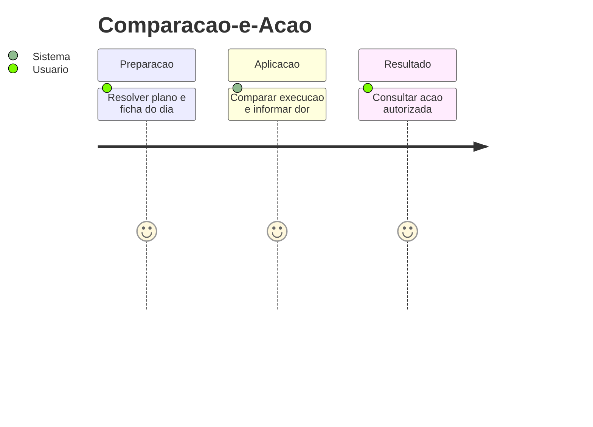
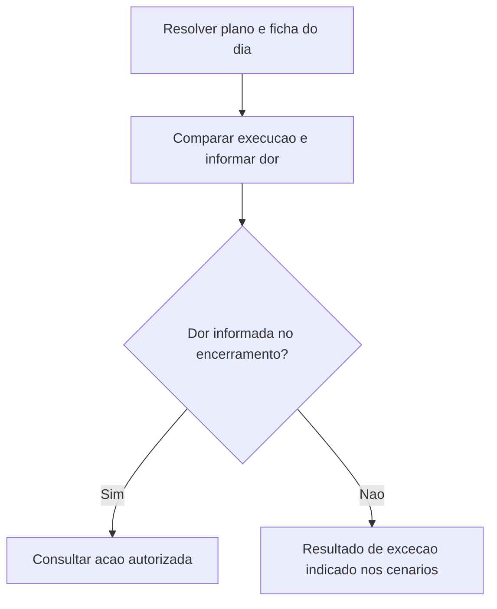
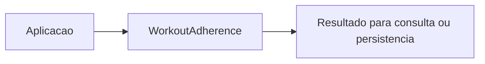

# Comparacao-e-Acao - Aderencia - Regras de Negocio

## Indice

- [1. Resumo da Funcionalidade](#resumo)
- [2. Jornada do Usuario](#jornada)
- [3. Regras por Funcionalidade](#regras)
- [4. Validacoes e Restricoes](#validacoes)
- [5. Fluxos de Processo](#fluxos)
- [6. Casos de Uso e Cenarios](#cenarios)

## 1. Resumo da Funcionalidade

**Proposito e valor**: Resolver prescricoes e comparar execucoes com decisao deterministica de seguranca.
**Usuarios**: corredor; personal quando o processo admite acompanhamento por vinculo ativo.
**Frequencia**: conforme criacao, consulta ou conclusao de treino; o dominio nao agenda execucoes.
**Impacto operacional**: preservar dados consistentes e tornar resultado e restricoes verificaveis.
**Origem**: [STORY-014](../../../specs/STORY-014/spec.bdd.md), [ADR-014](../../../docs/adr/ADR-014-fronteira-deterministica-da-revisao.md), [ADR-015](../../../docs/adr/ADR-015-tolerancias-e-politicas-versionadas.md), [ADR-019](../../../docs/adr/ADR-019-identidade-historica-do-exercicio.md).

## 2. Jornada do Usuario

**Pontos de contato**: entrada de dados na aplicacao, validacao de dominio, consulta do resultado. O modelo nao implementa telas nem autenticacao.

## 3. Regras de Negocio por Funcionalidade

**O que faz**: Resolver prescricoes e comparar execucoes com decisao deterministica de seguranca.

- **Regra 1**: Um campo divergente torna o treino divergente; exercicio pulado diverge pela conclusao.
- **Regra 2**: Prescricoes numericas disjuntas geram conflito sem escolher uma fonte.
- **Regra 3**: Dor no encerramento tem precedencia inclusive sobre conflito ou dados insuficientes.
- **Regra 4**: Excesso de carga de pelo menos 10% ou sobrecarga previamente detectada recomenda reduzir.
- **Regra 5**: Sem excesso, a acao e manter; nenhum metodo compensa automaticamente um treino curto.

**Exemplo pratico**: Plano 8..10 km e ficha 10..12 km resolvem alvo 10; plano 8..10 e ficha 12..14 conflitam. Carga prescrita 100 e executada 110 autoriza ReduceLoad, salvo dor que prioriza recuperacao.

**Cenario principal**: dados coerentes produzem o resultado descrito. **Alternativo**: campos opcionais ausentes seguem a semantica documentada. **Excecao**: entrada que viola guard clause interrompe a operacao; transicoes sem efeito sao explicitadas na documentacao tecnica.

**Resultado esperado**: objeto ou estado conforme regras, sem alteracao automatica de treino futuro.

## 4. Validacoes e Restricoes

**Controle de acesso**: responsabilidade dos endpoints e repositorios; o objeto de dominio nao identifica usuario autenticado.
**Dados obrigatorios, formatos e limites**: as regras acima e o [detalhamento por metodo](../DevDocs/WorkoutAdherence-Aderencia-DevDocs.md#metodos) registram todos os limites implementados.
**Dependencias e horarios**: nao ha janela operacional nem rede no modelo; a aplicacao fornece dados e datas quando exigidos.
**Limites**: Snapshot, selecao de ficha/plano pela data, consolidacao combinada e elegibilidade para criar revisao ficam nas camadas externas. SafetyPolicy recebe sinais prontos; nao consulta PainLog.

## 5. Fluxos de Processo

## 6. Casos de Uso e Cenarios

**Ator principal**: usuario pelo fluxo da aplicacao. **Objetivo**: Resolver prescricoes e comparar execucoes com decisao deterministica de seguranca.
**Pre-condicoes**: acesso autorizado nas camadas externas e dados necessarios disponiveis.

1. Fornecer os dados ou comando ao fluxo.
2. Aplicar as regras documentadas nesta unidade.
3. Consultar acao autorizada recusada.

**Pos-condicao**: estado devolvido conforme codigo, sem persistencia implicita.

| Cenario | Entrada | Acao do sistema | Resultado esperado |
|---|---|---|---|
| Caso 1 | Plano 8..10 km, ficha 10..12 km | Intersectar faixas | Alvo exato 10 km, sem conflito |
| Caso 2 | Plano 8..10 km, ficha 12..14 km | Detectar faixas disjuntas | HasConflict=true, Prescription=null |
| Caso 3 | Divergent, sem dor, campo comparavel, carga 100/110 | Aplicar excesso de 10 por cento | ReduceLoad |

**Evidencia automatizada**: [Testes](../../../tests/Steady.Domain.Tests/WorkoutAdherenceTests.cs); leitura de testes existente nesta rodada, sem execucao de testes de produto para alteracoes apenas documentais.
