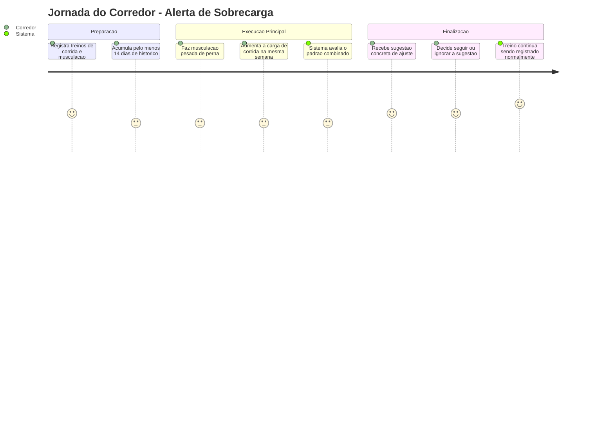
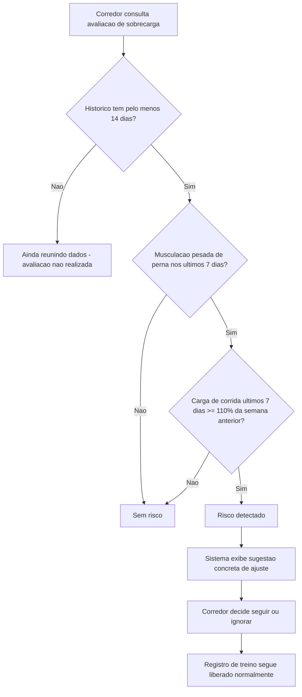
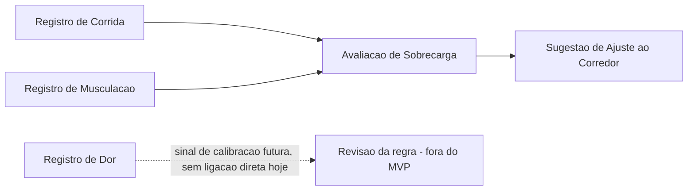

# Detecção de Sobrecarga - Sobrecarga - Regras de Negócio

## Índice
- [1. Resumo da Funcionalidade](#1-resumo-da-funcionalidade)
- [2. Jornada do Usuário](#2-jornada-do-usuário)
- [3. Regras de Negócio por Funcionalidade](#3-regras-de-negócio-por-funcionalidade)
- [4. Validações e Restrições](#4-validações-e-restrições)
- [5. Fluxos de Processo](#5-fluxos-de-processo)
- [6. Casos de Uso e Cenários](#6-casos-de-uso-e-cenários)

## 1. Resumo da Funcionalidade

**Propósito**: alertar o corredor, com uma sugestão concreta, quando a combinação de musculação pesada de perna e aumento recente de carga de corrida indica risco de sobrecarga - sem nunca impedir o registro do treino. Quando o corredor ainda não tem histórico suficiente para essa avaliação, o sistema é honesto sobre isso ("ainda estou reunindo dados") em vez de sugerir uma falsa garantia de segurança.

**Usuários**: corredores autenticados no Steady que treinam corrida e musculação simultaneamente.

**Valor de Negócio**: é a funcionalidade central do produto - o problema que o Steady existe para resolver (ver `specs/STORY-001/spec.bdd.md`, discovery original). Um corredor sem formação técnica não sabe intuitivamente que musculação pesada de perna combinada com aumento de carga de corrida é um padrão de risco; o sistema traduz uma regra fundamentada em ciência do treino (ver [ADR-001](../../../docs/adr/ADR-001-regra-sobrecarga-combinada.md)) em um alerta simples.

**Frequência de Uso**: recorrente - a avaliação é recalculada a cada consulta (tipicamente, sempre que o corredor registra um novo treino ou abre a tela de avaliação).

**Impacto Operacional**: nunca bloqueia o fluxo normal de treino. É um alerta informativo, não uma trava.

## 2. Jornada do Usuário

### Visão Geral da Jornada

### Pontos de Contato
- **Consulta de avaliação de sobrecarga**: onde o corredor vê se há risco no momento e, se houver, a sugestão de ajuste.
- **Registro de novo treino**: gatilho natural para uma nova avaliação, mas o registro em si nunca é impedido pelo resultado da avaliação.

## 3. Regras de Negócio por Funcionalidade

### 3.1. Avaliação de Risco de Sobrecarga Combinada

**O que faz**: analisa o histórico de treino do corredor (corrida + musculação) e determina se o padrão dos últimos 7 dias indica risco de sobrecarga, sugerindo um ajuste concreto quando for o caso.

**Regras Aplicadas**:
- **Janela móvel de 7 dias corridos, não semana de calendário**: a avaliação sempre olha para os últimos 7 dias a partir de hoje, e não para "segunda a domingo".
  - *Exemplo*: se hoje é quarta-feira, a "última semana" vai da quarta-feira anterior até hoje - não da segunda até domingo passados.
- **Gatilho de musculação**: precisa existir pelo menos uma sessão de musculação de **perna** (frontal ou posterior) com intensidade **pesada** nos últimos 7 dias. Musculação leve ou moderada de perna, ou musculação pesada de outros grupos (peito, ombro, costas), não ativa esta parte da regra.
  - *Exemplo*: uma sessão de perna posterior com intensidade pesada na segunda-feira desta semana conta; a mesma sessão com intensidade moderada não conta.
- **Gatilho de carga de corrida**: a carga de treino de corrida (que combina duração e esforço percebido, não apenas distância) dos últimos 7 dias precisa ser pelo menos **110%** da carga dos 7 dias anteriores a esses.
  - *Exemplo*: se a carga de corrida da semana anterior foi 300 (unidade de carga), a carga desta semana precisa ser 330 ou mais para disparar o gatilho.
- **Os dois gatilhos precisam ocorrer juntos**: só há sobrecarga quando musculação pesada de perna **e** aumento de carga de corrida acontecem na mesma janela de 7 dias. Um sem o outro não gera alerta.
  - *Exemplo*: aumento de carga de corrida sem musculação pesada de perna na semana não dispara alerta; musculação pesada de perna sem aumento de carga de corrida também não.
- **Sem histórico suficiente, nenhum alerta é gerado - e o sistema diz isso claramente**: é preciso ter pelo menos 14 dias de histórico de treino (contando da sessão mais antiga até hoje) para que a regra seja avaliada. Menos que isso, o sistema não arrisca um falso alerta por falta de dados de comparação. Esse caso é sinalizado ao corredor como "ainda reunindo dados" - um estado diferente de "avaliei e está tudo bem", para que ninguém confunda "o sistema ainda não pôde avaliar" com "o sistema avaliou e não há risco".
  - *Exemplo*: um corredor com apenas 10 dias de uso do app, mesmo treinando pesado, não recebe alerta de sobrecarga - mas também não vê "sem risco", e sim "ainda reunindo dados", porque o sistema ainda não tem uma "semana anterior" completa para comparar. Só a partir do 14º dia de histórico o corredor passa a ver de fato "sem risco" ou "risco detectado".
- **A sugestão é concreta, não um aviso genérico**: quando a sobrecarga é detectada, o sistema apresenta uma recomendação prática (reduzir distância/ritmo da corrida ou aliviar a intensidade do próximo treino de perna), não apenas um "cuidado, risco de lesão".
- **O alerta nunca bloqueia o treino**: mesmo com risco detectado, o corredor pode registrar a próxima sessão normalmente. A sugestão é uma recomendação, não uma trava.

**Cenários de Uso**:
- **Cenário Principal**: corredor com histórico suficiente treina musculação pesada de perna e aumenta a carga de corrida na mesma semana - recebe a sugestão de ajuste.
- **Cenário Alternativo**: corredor com padrão de treino equilibrado (sem os dois gatilhos simultâneos) e com histórico suficiente vê "sem risco" - avaliação feita, nada de preocupante encontrado.
- **Cenário de Exceção**: corredor recém-chegado, sem 14 dias de histórico, nunca recebe alerta de sobrecarga, independentemente do padrão de treino - e vê "ainda reunindo dados" em vez de "sem risco", para não passar a falsa impressão de que já foi avaliado.

**Resultado Esperado**: o corredor toma uma decisão informada sobre ajustar (ou não) o próximo treino, sem nunca ficar impedido de treinar, e sempre sabe se o que está vendo é "ainda reunindo dados", "sem risco" ou "risco detectado com sugestão".

## 4. Validações e Restrições

### Controle de Acesso
- **Permissões**: a avaliação é sempre feita sobre o histórico do próprio corredor autenticado - isolamento entre corredores é responsabilidade de `Steady.Api`/`Steady.Infrastructure` (ver ADR-002).
- **Hierarquia**: não existe hierarquia de papéis dentro desta funcionalidade.

### Dados e Entrada
- **Dados Obrigatórios**: histórico de sessões de corrida e de musculação do corredor (podem estar vazios - nesse caso, o resultado é sempre "ainda reunindo dados", já que sem nenhuma sessão o histórico jamais alcança os 14 dias mínimos).
- **Formatos Aceitos**: a avaliação recebe uma data de referência ("hoje") explícita, não depende do relógio interno do servidor diretamente na regra de negócio.
- **Limitações de Volume**: nenhuma limitação de quantidade de sessões no histórico.

### Restrições do Sistema
- **Horários de Funcionamento**: nenhuma restrição - a avaliação pode ser consultada a qualquer momento.
- **Dependências**: nenhuma dependência externa na regra de negócio em si; depende do histórico de corrida e musculação já estar registrado.
- **Limitações Técnicas**: nenhuma limitação de performance conhecida para o volume de dados esperado de um corredor individual.

## 5. Fluxos de Processo

### Fluxo Principal

### Integrações com Outros Processos

## 6. Casos de Uso e Cenários

### Caso de Uso 1: Sistema sugere ajuste por sobrecarga combinada
**Ator Principal**: Corredor
**Objetivo**: ser avisado antes de acumular estresse excessivo entre musculação de perna e corrida.
**Pré-condições**: pelo menos 14 dias de histórico de treino.

**Fluxo Principal**:
1. Corredor registra musculação pesada de perna nos últimos 7 dias.
2. Corredor aumenta a carga de corrida na mesma janela de 7 dias em pelo menos 10% em relação à semana anterior.
3. Sistema identifica os dois gatilhos simultaneamente.
4. Sistema exibe a sugestão concreta de ajuste.

**Pós-condições**: corredor recebe a sugestão; o treino já registrado permanece salvo normalmente.

### Caso de Uso 2: Corredor ignora a sugestão e treina mesmo assim
**Ator Principal**: Corredor
**Objetivo**: continuar treinando mesmo após receber a sugestão de ajuste.
**Pré-condições**: sugestão de ajuste já foi exibida em uma consulta anterior.

**Fluxo Principal**:
1. Corredor registra a próxima sessão de treino sem seguir a sugestão.
2. Sistema salva a sessão normalmente.

**Pós-condições**: nenhum bloqueio ocorre; a nova sessão passa a fazer parte do histórico e influencia a próxima avaliação.

### Caso de Uso 3: Corredor recém-chegado ainda não tem avaliação possível
**Ator Principal**: Corredor
**Objetivo**: entender por que o app ainda não diz se há risco ou não, sem receber uma falsa garantia de segurança.
**Pré-condições**: corredor com menos de 14 dias de histórico de treino (contando da sessão mais antiga até hoje) - inclusive o caso de nenhuma sessão registrada ainda.

**Fluxo Principal**:
1. Corredor consulta a avaliação de sobrecarga na primeira ou segunda semana de uso do app.
2. Sistema identifica que o histórico ainda não cobre os 14 dias mínimos exigidos pela regra.
3. Sistema exibe "ainda reunindo dados" - explicitamente diferente de "sem risco".

**Pós-condições**: corredor entende que a avaliação ainda não foi feita (não que foi feita e deu "tudo bem"); volta a consultar depois de acumular mais dias de treino.

*Exemplo prático*: um corredor que se cadastrou no Steady há 8 dias e já fez 3 corridas e 1 treino pesado de perna não vê "sem risco" - vê "ainda reunindo dados", porque faltam 6 dias para o sistema ter uma janela anterior completa de comparação.

### Matriz de Cenários
| Cenário | Entrada | Ação do Sistema | Resultado Esperado |
|---|---|---|---|
| Sobrecarga detectada | Perna pesada nos últimos 7 dias + carga de corrida >= 110% da semana anterior | Avalia os dois gatilhos | Risco = true, sugestão concreta exibida |
| Sem histórico suficiente | Menos de 14 dias de histórico total | Retorna sem avaliar | "Ainda reunindo dados" (não é "sem risco" nem "risco"), mesmo que o padrão parecesse arriscado |
| Musculação leve/moderada de perna | Perna com intensidade leve ou moderada, carga de corrida em alta | Avalia, gatilho de musculação não dispara | Risco = false ("sem risco", histórico já suficiente) |
| Carga de corrida estável ou em queda | Perna pesada, carga de corrida < 110% da semana anterior | Avalia, gatilho de corrida não dispara | Risco = false ("sem risco", histórico já suficiente) |
| Sem carga de corrida na semana anterior | Nenhuma sessão de corrida na janela anterior | Avalia, comparação não é feita | Risco = false ("sem risco", evita comparação com base zero) |
