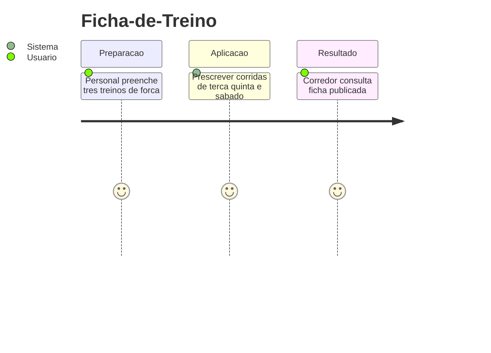
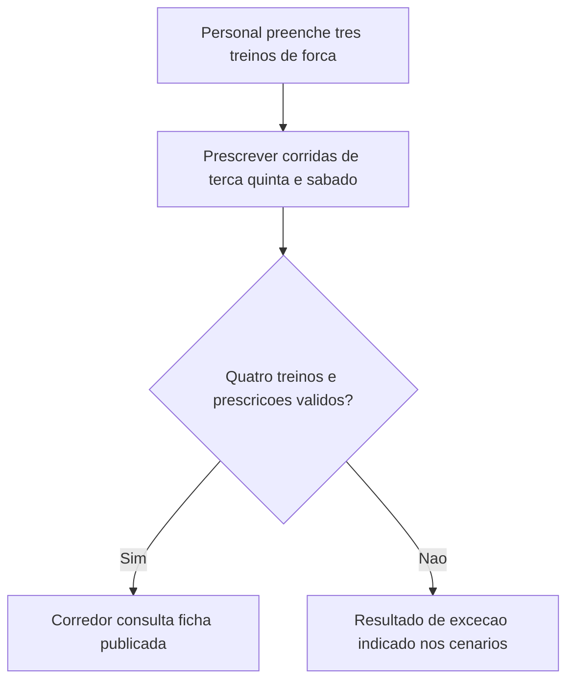
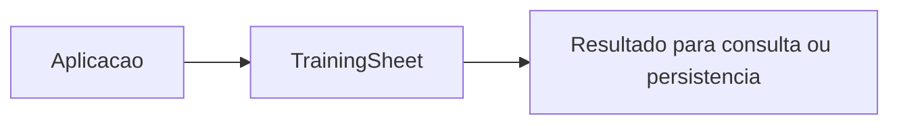

# Ficha-de-Treino - Prescricao - Regras de Negocio

## Indice

- [1. Resumo da Funcionalidade](#resumo)
- [2. Jornada do Usuario](#jornada)
- [3. Regras por Funcionalidade](#regras)
- [4. Validacoes e Restricoes](#validacoes)
- [5. Fluxos de Processo](#fluxos)
- [6. Casos de Uso e Cenarios](#cenarios)

## 1. Resumo da Funcionalidade

**Proposito e valor**: Agrupar tres treinos de forca e as prescricoes de corrida de terca, quinta e sabado.
**Usuarios**: corredor; personal quando o processo admite acompanhamento por vinculo ativo.
**Frequencia**: conforme criacao, consulta ou conclusao de treino; o dominio nao agenda execucoes.
**Impacto operacional**: preservar dados consistentes e tornar resultado e restricoes verificaveis.
**Origem**: [STORY-013](../../../specs/STORY-013/spec.bdd.md), [STORY-014](../../../specs/STORY-014/spec.bdd.md), [STORY-017](../../../specs/STORY-017/spec.bdd.md), [ADR-010](../../../docs/adr/ADR-010-ficha-com-prescricoes-de-corrida-por-dia.md), [ADR-012](../../../docs/adr/ADR-012-prescricao-de-corrida-estruturada.md), [ADR-019](../../../docs/adr/ADR-019-identidade-historica-do-exercicio.md).

## 2. Jornada do Usuario

**Pontos de contato**: entrada de dados na aplicacao, validacao de dominio, consulta do resultado. O modelo nao implementa telas nem autenticacao.

## 3. Regras de Negocio por Funcionalidade

**O que faz**: Agrupar tres treinos de forca e as prescricoes de corrida de terca, quinta e sabado.

- **Regra 1**: Ficha exige Empurrada, Puxada, Inferiores e Corrida.
- **Regra 2**: Forca exige ao menos um exercicio sem Id duplicado; nome 2..100, series 1..20 e repeticoes 1..100.
- **Regra 3**: Tempo de serie e opcional, positivo e nao substitui series/repeticoes; observacao tem ate 200 caracteres.
- **Regra 4**: Corrida tem descricao obrigatoria em cada um dos tres dias; numeros ausentes continuam ausentes.
- **Regra 5**: Faixa tem minimo e maximo estritamente maior; alvo exato omite maximo.

**Exemplo pratico**: Prescrever 8 a 10 km e valido; maximo 10 sem minimo e recusado. Prancha com 3 series, 1 repeticao e 40 segundos preserva todos os campos.

**Cenario principal**: dados coerentes produzem o resultado descrito. **Alternativo**: campos opcionais ausentes seguem a semantica documentada. **Excecao**: entrada que viola guard clause interrompe a operacao; transicoes sem efeito sao explicitadas na documentacao tecnica.

**Resultado esperado**: objeto ou estado conforme regras, sem alteracao automatica de treino futuro.

## 4. Validacoes e Restricoes

**Controle de acesso**: responsabilidade dos endpoints e repositorios; o objeto de dominio nao identifica usuario autenticado.
**Dados obrigatorios, formatos e limites**: as regras acima e o [detalhamento por metodo](../DevDocs/TrainingSheet-Prescricao-DevDocs.md#metodos) registram todos os limites implementados.
**Dependencias e horarios**: nao ha janela operacional nem rede no modelo; a aplicacao fornece dados e datas quando exigidos.
**Limites**: Ficha ativa, linhagem da ExerciseKey, substituicao e acesso por vinculo ficam nas camadas externas.

## 5. Fluxos de Processo

## 6. Casos de Uso e Cenarios

**Ator principal**: usuario pelo fluxo da aplicacao. **Objetivo**: Agrupar tres treinos de forca e as prescricoes de corrida de terca, quinta e sabado.
**Pre-condicoes**: acesso autorizado nas camadas externas e dados necessarios disponiveis.

1. Fornecer os dados ou comando ao fluxo.
2. Aplicar as regras documentadas nesta unidade.
3. Corredor consulta ficha publicada recusada.

**Pos-condicao**: estado devolvido conforme codigo, sem persistencia implicita.

| Cenario | Entrada | Acao do sistema | Resultado esperado |
|---|---|---|---|
| Caso 1 | Exercicio com 4 series, 6 repeticoes e nome Agachamento | Criar prescricao | Prescricao valida |
| Caso 2 | Corrida 8 a 10 km com descricao | Criar faixa | DistanceKm.Min=8 e Max=10 |
| Caso 3 | 21 series | Recusar prescricao | ArgumentOutOfRangeException |

**Evidencia automatizada**: [Testes](../../../tests/Steady.Domain.Tests/TrainingSheetTests.cs); leitura de testes existente nesta rodada, sem execucao de testes de produto para alteracoes apenas documentais.
