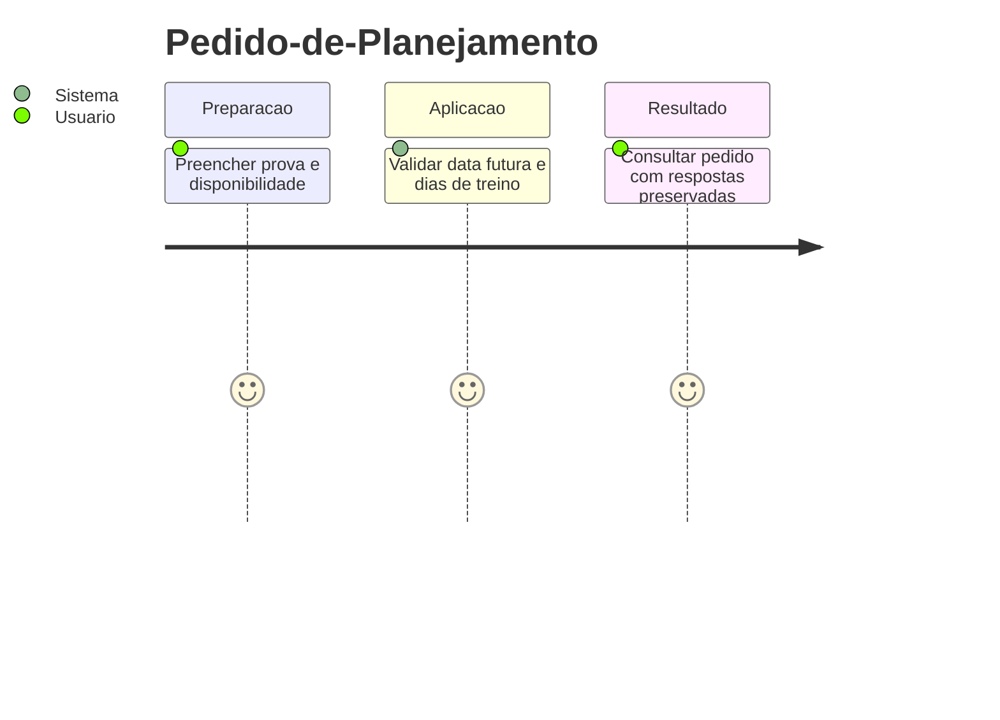
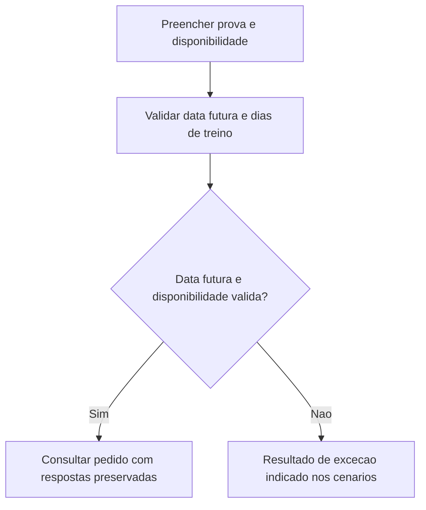
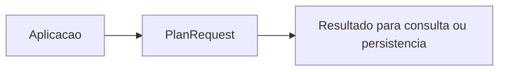

# Pedido-de-Planejamento - Planejamento - Regras de Negocio

## Indice

- [1. Resumo da Funcionalidade](#resumo)
- [2. Jornada do Usuario](#jornada)
- [3. Regras por Funcionalidade](#regras)
- [4. Validacoes e Restricoes](#validacoes)
- [5. Fluxos de Processo](#fluxos)
- [6. Casos de Uso e Cenarios](#cenarios)

## 1. Resumo da Funcionalidade

**Proposito e valor**: Preservar respostas do corredor sobre prova e disponibilidade, sem calcular exercicios.
**Usuarios**: corredor; personal quando o processo admite acompanhamento por vinculo ativo.
**Frequencia**: conforme criacao, consulta ou conclusao de treino; o dominio nao agenda execucoes.
**Impacto operacional**: preservar dados consistentes e tornar resultado e restricoes verificaveis.
**Origem**: [STORY-010](../../../specs/STORY-010/spec.bdd.md), [ADR-007](../../../docs/adr/ADR-007-persistencia-do-pedido-de-plano-de-treino.md).

## 2. Jornada do Usuario

**Pontos de contato**: entrada de dados na aplicacao, validacao de dominio, consulta do resultado. O modelo nao implementa telas nem autenticacao.

## 3. Regras de Negocio por Funcionalidade

**O que faz**: Preservar respostas do corredor sobre prova e disponibilidade, sem calcular exercicios.

- **Regra 1**: A prova deve ocorrer depois do today recebido; hoje e passado sao recusados.
- **Regra 2**: Disponibilidade aceita 3 a 6 dias; rotina atual opcional aceita 0 a 7 corridas.
- **Regra 3**: Maior corrida e distancia de referencia informada devem ser positivas; forca informada aceita 20 a 90 minutos.
- **Regra 4**: Duracao informada usa HH:MM:SS; textos em branco ficam ausentes.
- **Regra 5**: Nenhuma dor e representada por lista vazia, sem combinacao contraditoria.

**Exemplo pratico**: Prova amanha, maior corrida 21 km e 4 dias geram um pedido valido com opcionais nulos; 2 dias ou prova hoje sao recusados.

**Cenario principal**: dados coerentes produzem o resultado descrito. **Alternativo**: campos opcionais ausentes seguem a semantica documentada. **Excecao**: entrada que viola guard clause interrompe a operacao; transicoes sem efeito sao explicitadas na documentacao tecnica.

**Resultado esperado**: objeto ou estado conforme regras, sem alteracao automatica de treino futuro.

## 4. Validacoes e Restricoes

**Controle de acesso**: responsabilidade dos endpoints e repositorios; o objeto de dominio nao identifica usuario autenticado.
**Dados obrigatorios, formatos e limites**: as regras acima e o [detalhamento por metodo](../DevDocs/PlanRequest-Planejamento-DevDocs.md#metodos) registram todos os limites implementados.
**Dependencias e horarios**: nao ha janela operacional nem rede no modelo; a aplicacao fornece dados e datas quando exigidos.
**Limites**: Identidade do pedido, titularidade, fila e idempotencia pertencem as camadas externas. Nao valida valores numericos indefinidos de enum nem finitude de double.

## 5. Fluxos de Processo

## 6. Casos de Uso e Cenarios

**Ator principal**: usuario pelo fluxo da aplicacao. **Objetivo**: Preservar respostas do corredor sobre prova e disponibilidade, sem calcular exercicios.
**Pre-condicoes**: acesso autorizado nas camadas externas e dados necessarios disponiveis.

1. Fornecer os dados ou comando ao fluxo.
2. Aplicar as regras documentadas nesta unidade.
3. Consultar pedido com respostas preservadas recusada.

**Pos-condicao**: estado devolvido conforme codigo, sem persistencia implicita.

| Cenario | Entrada | Acao do sistema | Resultado esperado |
|---|---|---|---|
| Caso 1 | Prova amanha, corrida recente 21 km, 4 dias | Criar pedido | Pedido valido; opcionais omitidos null |
| Caso 2 | Prova hoje, demais campos validos | Recusar data | ArgumentOutOfRangeException |
| Caso 3 | Dores Nenhuma e Joelho | Recusar selecao contraditoria | ArgumentException |

**Evidencia automatizada**: [Testes](../../../tests/Steady.Domain.Tests/PlanRequestTests.cs); leitura de testes existente nesta rodada, sem execucao de testes de produto para alteracoes apenas documentais.
