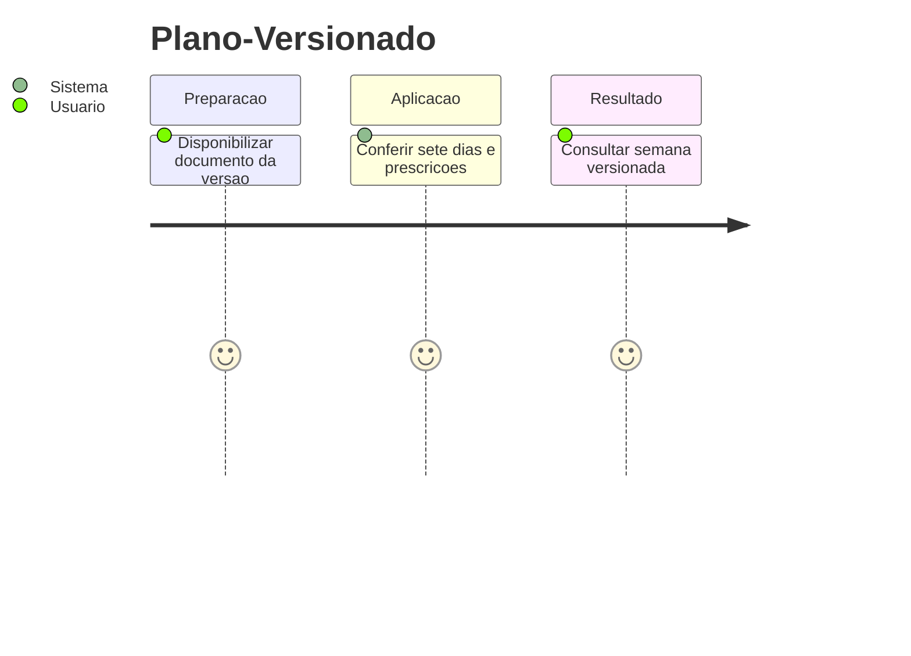
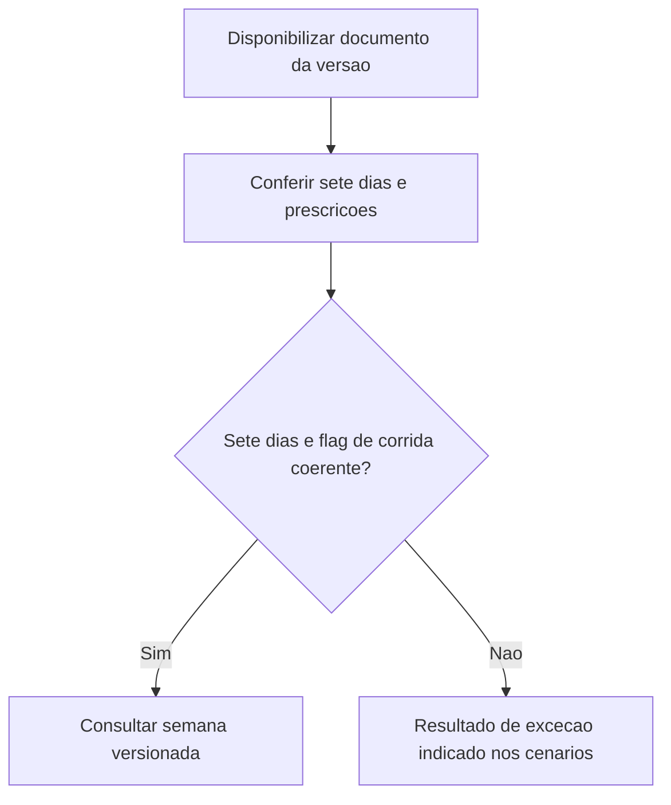
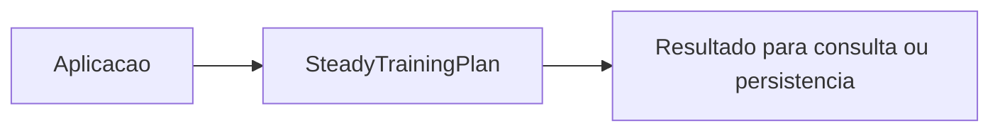

# Plano-Versionado - Planejamento - Regras de Negocio

## Indice

- [1. Resumo da Funcionalidade](#resumo)
- [2. Jornada do Usuario](#jornada)
- [3. Regras por Funcionalidade](#regras)
- [4. Validacoes e Restricoes](#validacoes)
- [5. Fluxos de Processo](#fluxos)
- [6. Casos de Uso e Cenarios](#cenarios)

## 1. Resumo da Funcionalidade

**Proposito e valor**: Representar uma versao do documento semanal do Steady e seu conteudo estatico.
**Usuarios**: corredor; personal quando o processo admite acompanhamento por vinculo ativo.
**Frequencia**: conforme criacao, consulta ou conclusao de treino; o dominio nao agenda execucoes.
**Impacto operacional**: preservar dados consistentes e tornar resultado e restricoes verificaveis.
**Origem**: [STORY-016](../../../specs/STORY-016/spec.bdd.md), [ADR-013](../../../docs/adr/ADR-013-plano-do-steady-como-fonte-de-prescricao.md).

## 2. Jornada do Usuario

**Pontos de contato**: entrada de dados na aplicacao, validacao de dominio, consulta do resultado. O modelo nao implementa telas nem autenticacao.

## 3. Regras de Negocio por Funcionalidade

**O que faz**: Representar uma versao do documento semanal do Steady e seu conteudo estatico.

- **Regra 1**: Versao deve ser positiva; uma semana exige exatamente 7 entradas.
- **Regra 2**: Flag de corrida e prescricao precisam concordar em cada dia.
- **Regra 3**: Conteudo estatico e obrigatorio; a factory nao gera exercicios a partir de PlanRequest.
- **Regra 4**: Publicacao e associacao de versoes sao responsabilidades externas; o objeto expoe propriedades somente para leitura.

**Exemplo pratico**: Uma semana com 7 dias e Run no dia HasRun=true e aceita; retirar Run desse dia impede a criacao.

**Cenario principal**: dados coerentes produzem o resultado descrito. **Alternativo**: campos opcionais ausentes seguem a semantica documentada. **Excecao**: entrada que viola guard clause interrompe a operacao; transicoes sem efeito sao explicitadas na documentacao tecnica.

**Resultado esperado**: objeto ou estado conforme regras, sem alteracao automatica de treino futuro.

## 4. Validacoes e Restricoes

**Controle de acesso**: responsabilidade dos endpoints e repositorios; o objeto de dominio nao identifica usuario autenticado.
**Dados obrigatorios, formatos e limites**: as regras acima e o [detalhamento por metodo](../DevDocs/SteadyTrainingPlan-Planejamento-DevDocs.md#metodos) registram todos os limites implementados.
**Dependencias e horarios**: nao ha janela operacional nem rede no modelo; a aplicacao fornece dados e datas quando exigidos.
**Limites**: Nao valida unicidade dos nomes dos dias, membros nulos da lista ou conteudo interno dos records. A imutabilidade de publicacao da ADR-013 depende tambem de persistencia.

## 5. Fluxos de Processo

## 6. Casos de Uso e Cenarios

**Ator principal**: usuario pelo fluxo da aplicacao. **Objetivo**: Representar uma versao do documento semanal do Steady e seu conteudo estatico.
**Pre-condicoes**: acesso autorizado nas camadas externas e dados necessarios disponiveis.

1. Fornecer os dados ou comando ao fluxo.
2. Aplicar as regras documentadas nesta unidade.
3. Consultar semana versionada recusada.

**Pos-condicao**: estado devolvido conforme codigo, sem persistencia implicita.

| Cenario | Entrada | Acao do sistema | Resultado esperado |
|---|---|---|---|
| Caso 1 | Versao 1, 7 dias coerentes e conteudo | Criar plano | Version=1 e WeekPlan.Count=7 |
| Caso 2 | Versao 0 | Recusar versao | ArgumentOutOfRangeException |
| Caso 3 | HasRun=true e Run=null | Recusar dia incoerente | ArgumentException |

**Evidencia automatizada**: [Testes](../../../tests/Steady.Domain.Tests/SteadyTrainingPlanTests.cs); leitura de testes existente nesta rodada, sem execucao de testes de produto para alteracoes apenas documentais.
