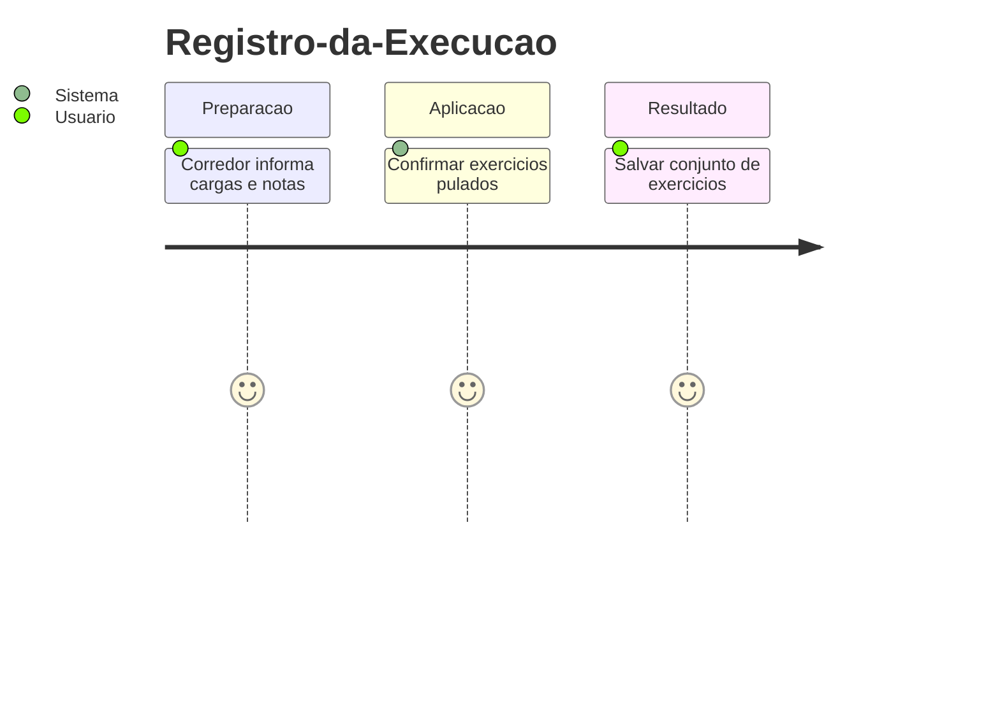
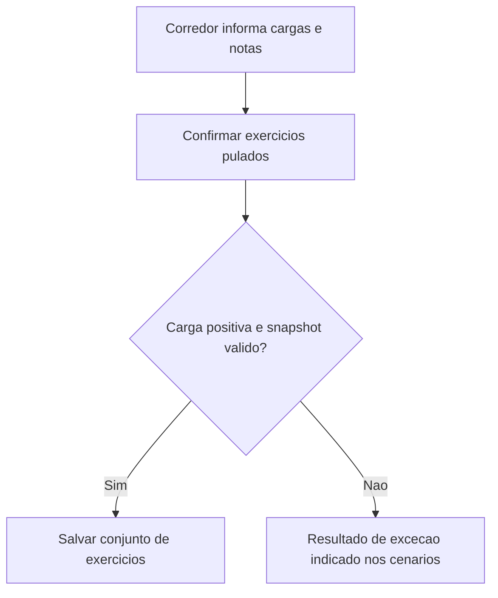
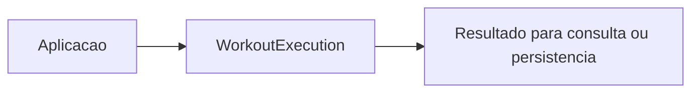

# Registro-da-Execucao - Execucao - Regras de Negocio

## Indice

- [1. Resumo da Funcionalidade](#resumo)
- [2. Jornada do Usuario](#jornada)
- [3. Regras por Funcionalidade](#regras)
- [4. Validacoes e Restricoes](#validacoes)
- [5. Fluxos de Processo](#fluxos)
- [6. Casos de Uso e Cenarios](#cenarios)

## 1. Resumo da Funcionalidade

**Proposito e valor**: Preservar snapshot da musculacao realizada ou pulada, com identidade historica e nota.
**Usuarios**: corredor; personal quando o processo admite acompanhamento por vinculo ativo.
**Frequencia**: conforme criacao, consulta ou conclusao de treino; o dominio nao agenda execucoes.
**Impacto operacional**: preservar dados consistentes e tornar resultado e restricoes verificaveis.
**Origem**: [STORY-013](../../../specs/STORY-013/spec.bdd.md), [STORY-014](../../../specs/STORY-014/spec.bdd.md), [ADR-009](../../../docs/adr/ADR-009-ficha-ativa-e-execucao-imutavel.md), [ADR-011](../../../docs/adr/ADR-011-registro-combinado-de-musculacao-e-corrida.md), [ADR-019](../../../docs/adr/ADR-019-identidade-historica-do-exercicio.md).

## 2. Jornada do Usuario

**Pontos de contato**: entrada de dados na aplicacao, validacao de dominio, consulta do resultado. O modelo nao implementa telas nem autenticacao.

## 3. Regras de Negocio por Funcionalidade

**O que faz**: Preservar snapshot da musculacao realizada ou pulada, com identidade historica e nota.

- **Regra 1**: Carga real aceita de 0,01 a 999,99 kg com ate duas casas.
- **Regra 2**: Pulado tem carga ausente; zero nao e aceito como carga positiva. A confirmacao do usuario acontece no app.
- **Regra 3**: Nota opcional aceita ate 200 caracteres apos remover espacos nas pontas.
- **Regra 4**: Snapshot preserva ExerciseId, ExerciseKey e DurationSeconds; nome nao determina identidade historica.
- **Regra 5**: Agregado exige ao menos um exercicio e nao permite ExerciseId repetido.

**Exemplo pratico**: Agachamento com 60,50 kg e nota e executado; Leg press confirmado como pulado fica com carga null. 10,123 kg e recusado.

**Cenario principal**: dados coerentes produzem o resultado descrito. **Alternativo**: campos opcionais ausentes seguem a semantica documentada. **Excecao**: entrada que viola guard clause interrompe a operacao; transicoes sem efeito sao explicitadas na documentacao tecnica.

**Resultado esperado**: objeto ou estado conforme regras, sem alteracao automatica de treino futuro.

## 4. Validacoes e Restricoes

**Controle de acesso**: responsabilidade dos endpoints e repositorios; o objeto de dominio nao identifica usuario autenticado.
**Dados obrigatorios, formatos e limites**: as regras acima e o [detalhamento por metodo](../DevDocs/WorkoutExecution-Execucao-DevDocs.md#metodos) registram todos os limites implementados.
**Dependencias e horarios**: nao ha janela operacional nem rede no modelo; a aplicacao fornece dados e datas quando exigidos.
**Limites**: Registro combinado e transacao/idempotencia pertencem a API/infraestrutura; nao existe classe CombinedWorkout neste arquivo. Corrida reutiliza RunningSession. Ficha aplicavel e pertencimento dos exercicios sao verificados externamente.

## 5. Fluxos de Processo

## 6. Casos de Uso e Cenarios

**Ator principal**: usuario pelo fluxo da aplicacao. **Objetivo**: Preservar snapshot da musculacao realizada ou pulada, com identidade historica e nota.
**Pre-condicoes**: acesso autorizado nas camadas externas e dados necessarios disponiveis.

1. Fornecer os dados ou comando ao fluxo.
2. Aplicar as regras documentadas nesta unidade.
3. Salvar conjunto de exercicios recusada.

**Pos-condicao**: estado devolvido conforme codigo, sem persistencia implicita.

| Cenario | Entrada | Acao do sistema | Resultado esperado |
|---|---|---|---|
| Caso 1 | 60.50 kg, nota com espacos nas pontas | Normalizar e registrar | Skipped=false, LoadKg=60.50, nota Trim |
| Caso 2 | SkippedExercise com snapshot valido | Registrar pulado | Skipped=true e LoadKg=null |
| Caso 3 | 10.123 kg | Recusar precisao | ArgumentOutOfRangeException |

**Evidencia automatizada**: [Testes](../../../tests/Steady.Domain.Tests/WorkoutExecutionTests.cs); leitura de testes existente nesta rodada, sem execucao de testes de produto para alteracoes apenas documentais.
