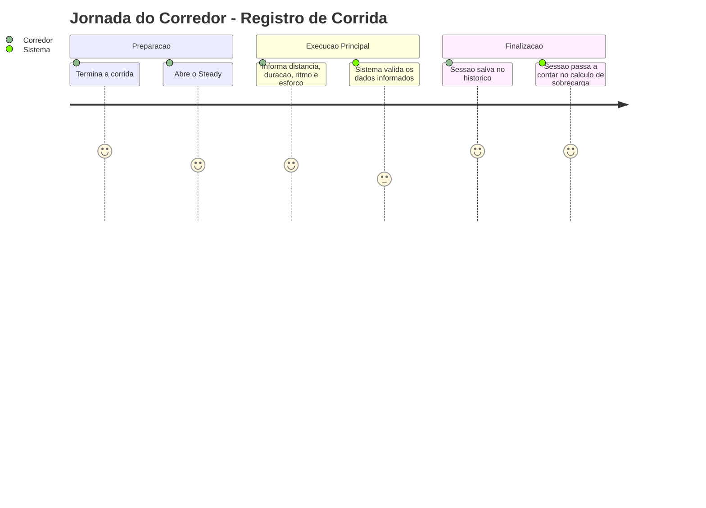
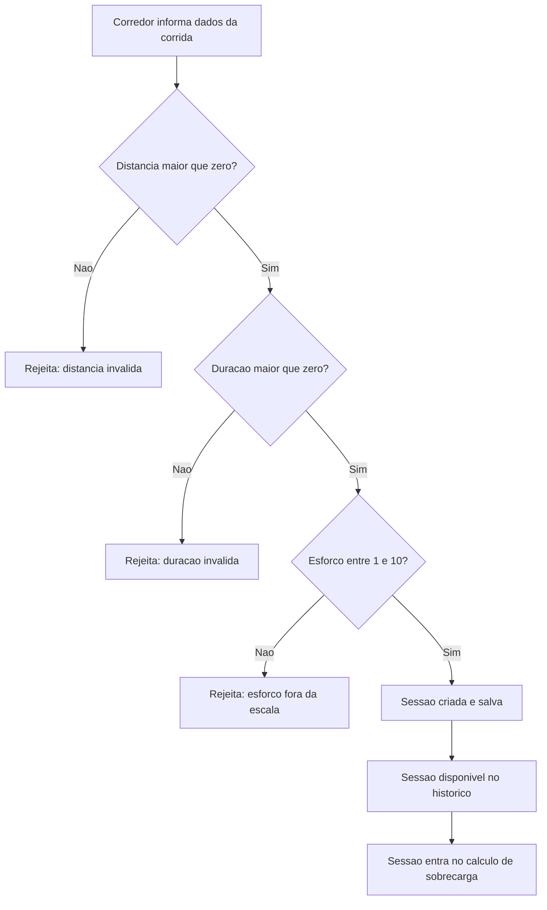
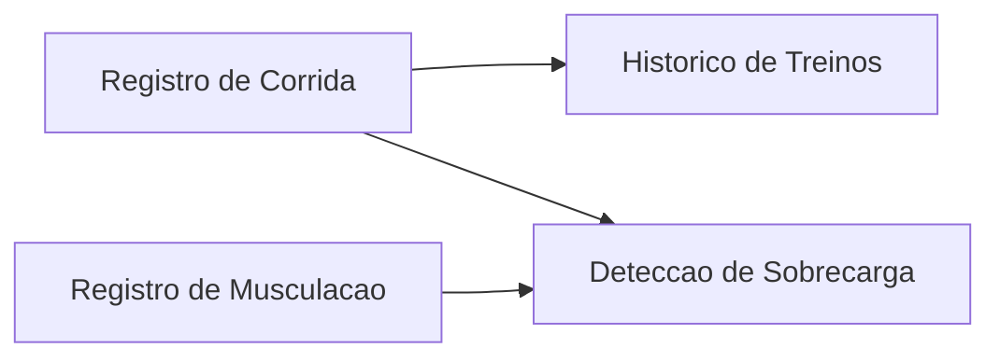

# Registro de Sessão de Corrida - Treino-Corrida - Regras de Negócio

## Índice
- [1. Resumo da Funcionalidade](#1-resumo-da-funcionalidade)
- [2. Jornada do Usuário](#2-jornada-do-usuário)
- [3. Regras de Negócio por Funcionalidade](#3-regras-de-negócio-por-funcionalidade)
- [4. Validações e Restrições](#4-validações-e-restrições)
- [5. Fluxos de Processo](#5-fluxos-de-processo)
- [6. Casos de Uso e Cenários](#6-casos-de-uso-e-cenários)

## 1. Resumo da Funcionalidade

**Propósito**: permitir que o corredor registre uma sessão de treino de corrida (distância, duração, ritmo e esforço percebido) para acompanhar o histórico de treino e alimentar a detecção de sobrecarga.

**Usuários**: corredores autenticados no Steady.

**Valor de Negócio**: sem o registro de corrida, o sistema não tem como calcular a carga de treino nem alertar sobre risco de sobrecarga combinada com musculação - é a base de dados de toda a proposta de valor do produto (ver `specs/STORY-001/spec.bdd.md`).

**Frequência de Uso**: alta - potencialmente a cada sessão de corrida realizada pelo usuário.

**Impacto Operacional**: dado incorreto (ex: distância zero) nunca é salvo. O sistema rejeita na entrada, protegendo a integridade dos cálculos de sobrecarga que dependem desses dados.

## 2. Jornada do Usuário

### Visão Geral da Jornada

### Pontos de Contato
- **Registro de treino**: onde o corredor informa os dados da corrida recém-realizada.
- **Histórico de treinos**: onde a sessão registrada aparece depois de salva com sucesso.
- **Avaliação de sobrecarga**: consome silenciosamente os dados desta sessão nos cálculos das próximas duas semanas.

## 3. Regras de Negócio por Funcionalidade

### 3.1. Registro de Sessão de Corrida

**O que faz**: recebe os dados de uma corrida (distância, duração, ritmo médio, percepção de esforço) e, se estiverem dentro dos limites de negócio, salva a sessão associada ao corredor.

**Regras Aplicadas**:
- **Distância deve ser maior que zero**: uma corrida sem distância registrada não faz sentido para o sistema.
  - *Exemplo*: tentar registrar 0 km ou -2 km é rejeitado com a mensagem "A distância deve ser maior que zero."
- **Duração deve ser maior que zero**: a duração é usada para calcular a carga de treino da sessão (duração x esforço percebido); uma duração zero invalidaria esse cálculo.
  - *Exemplo*: registrar uma corrida de 10 km com 0 minutos de duração é rejeitado com a mensagem "A duração deve ser maior que zero."
- **Percepção de esforço deve estar entre 1 e 10**: escala padronizada de "quão difícil foi o treino" na visão do próprio corredor, de 1 (muito fácil) a 10 (esforço máximo).
  - *Exemplo*: informar esforço 11 ou 0 é rejeitado com a mensagem "A percepção de esforço deve estar entre 1 e 10."
- **Ritmo médio (minutos por km) não tem faixa de validação**: o sistema aceita qualquer valor informado para o ritmo, mesmo que pareça fora do comum.

**Cenários de Uso**:
- **Cenário Principal**: corredor termina o treino e registra distância, tempo, ritmo médio e percepção de esforço reais.
- **Cenário Alternativo**: não há variação alternativa documentada além do fluxo principal.
- **Cenário de Exceção**: corredor informa distância, duração ou esforço fora dos limites de negócio - o sistema rejeita o registro e explica o motivo.

**Resultado Esperado**: a sessão fica salva e disponível no histórico de treinos do corredor, e passa a contar para o cálculo de sobrecarga combinada dos próximos dias (janela móvel de 7 dias, com histórico mínimo de 14 dias - ver [Deteccao-de-Sobrecarga-Sobrecarga-Rules.md](./Deteccao-de-Sobrecarga-Sobrecarga-Rules.md)).

## 4. Validações e Restrições

### Controle de Acesso
- **Permissões**: qualquer corredor autenticado pode registrar suas próprias sessões. Autenticação e isolamento de dados entre corredores são responsabilidade de `Steady.Api`/`Steady.Infrastructure` - fora do escopo deste domínio (ver ADR-002).
- **Hierarquia**: não existe hierarquia de papéis dentro desta funcionalidade.

### Dados e Entrada
- **Dados Obrigatórios**: data, distância, duração, ritmo médio e percepção de esforço.
- **Formatos Aceitos**: distância e ritmo em números decimais (quilômetros e minutos por quilômetro); duração e esforço em números inteiros (minutos e escala de 1 a 10); data sem componente de hora.
- **Limitações de Volume**: distância e duração devem ser estritamente positivas; esforço restrito à escala fechada de 1 a 10.

### Restrições do Sistema
- **Horários de Funcionamento**: nenhuma restrição de horário - o registro pode ocorrer a qualquer momento.
- **Dependências**: nenhuma dependência externa nesta camada de regra de negócio; a persistência real depende de `Steady.Infrastructure`.
- **Limitações Técnicas**: nenhuma limitação de performance conhecida neste nível.

## 5. Fluxos de Processo

### Fluxo Principal

### Integrações com Outros Processos

## 6. Casos de Uso e Cenários

### Caso de Uso 1: Registrar corrida válida
**Ator Principal**: Corredor
**Objetivo**: manter o histórico de treino atualizado e alimentar a avaliação de sobrecarga.
**Pré-condições**: corredor autenticado.

**Fluxo Principal**:
1. Corredor informa distância, duração, ritmo médio e esforço percebido.
2. Sistema valida cada campo contra as regras de negócio.
3. Sistema salva a sessão e a associa ao corredor.

**Pós-condições**: sessão aparece no histórico e passa a contar para os cálculos futuros de sobrecarga.

### Caso de Uso 2: Tentar registrar corrida com dado inválido
**Ator Principal**: Corredor
**Objetivo**: registrar uma corrida, mas informa um dado fora dos limites de negócio.
**Pré-condições**: corredor autenticado.

**Fluxo Principal**:
1. Corredor informa um dado inválido (ex: distância negativa).
2. Sistema identifica a violação da regra correspondente.
3. Sistema rejeita o registro e explica o motivo em linguagem clara.

**Pós-condições**: nenhuma sessão é salva; corredor recebe mensagem explicando o que precisa corrigir.

### Matriz de Cenários
| Cenário | Entrada | Ação do Sistema | Resultado Esperado |
|---|---|---|---|
| Registro válido | distância 10 km, duração 55 min, ritmo 5.5, esforço 6 | Cria e salva a sessão | Sessão aparece no histórico |
| Distância inválida | distância 0 ou negativa | Rejeita o registro | "A distância deve ser maior que zero." |
| Duração inválida | duração 0 ou negativa | Rejeita o registro | "A duração deve ser maior que zero." |
| Esforço fora da escala | esforço 0 ou 11 | Rejeita o registro | "A percepção de esforço deve estar entre 1 e 10." |
