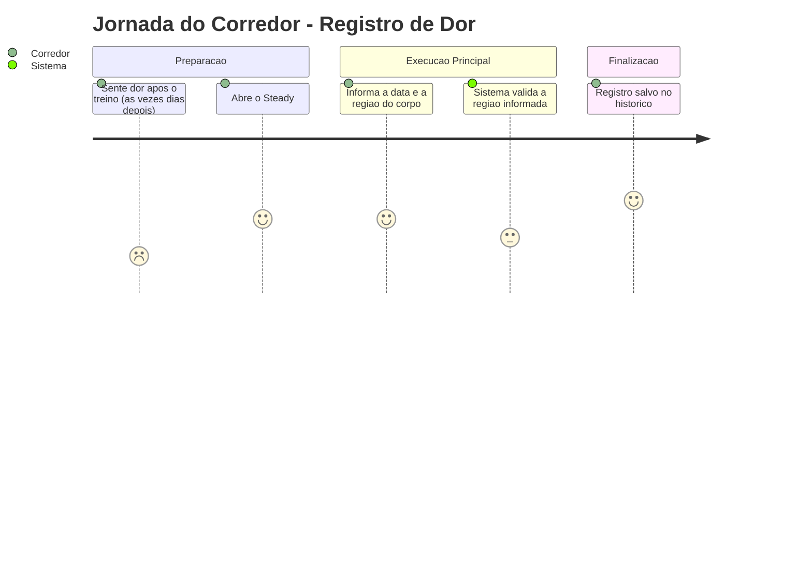
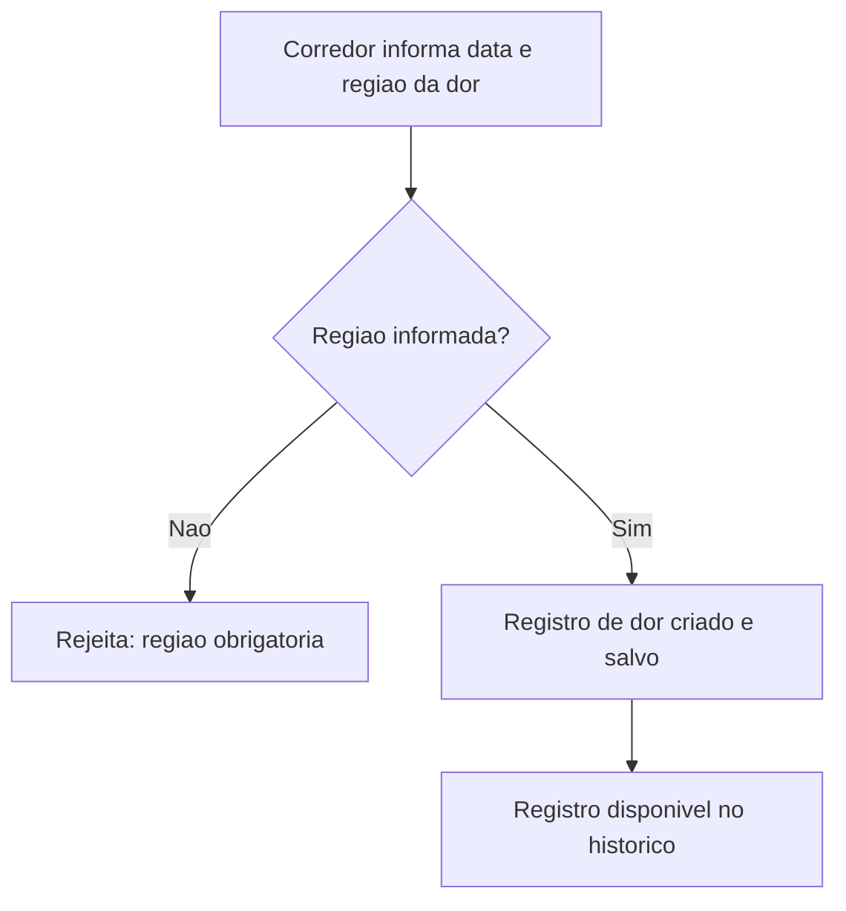
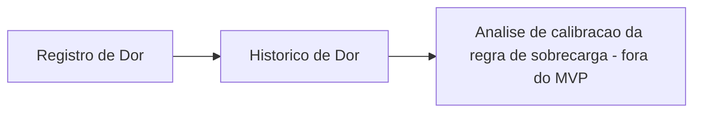

# Registro de Dor - Treino-Dor - Regras de Negócio

## Índice
- [1. Resumo da Funcionalidade](#1-resumo-da-funcionalidade)
- [2. Jornada do Usuário](#2-jornada-do-usuário)
- [3. Regras de Negócio por Funcionalidade](#3-regras-de-negócio-por-funcionalidade)
- [4. Validações e Restrições](#4-validações-e-restrições)
- [5. Fluxos de Processo](#5-fluxos-de-processo)
- [6. Casos de Uso e Cenários](#6-casos-de-uso-e-cenários)

## 1. Resumo da Funcionalidade

**Propósito**: permitir que o corredor registre que sentiu dor em alguma região do corpo, a qualquer momento - mesmo dias após o treino que possivelmente a causou.

**Usuários**: corredores autenticados no Steady.

**Valor de Negócio**: o registro de dor é o principal sinal de que a regra de detecção de sobrecarga está (ou não está) funcionando na prática. Segundo a fundamentação da regra de sobrecarga (ADR-001), se o corredor continuar sentindo dor sem que o sistema tenha emitido alerta, isso é um indício de que a regra precisa ser recalibrada - o registro de dor é o "termômetro" de acompanhamento do produto.

**Frequência de Uso**: esporádica - apenas quando o corredor de fato sente dor.

**Impacto operacional**: registro avulso preserva o historico e nao reabre revisao publicada. No encerramento do treino, informar dor faz a politica deterministica priorizar recuperacao; isso nao bloqueia registro nem diagnostica causa (STORY-014, ADR-014).

## 2. Jornada do Usuário

### Visão Geral da Jornada

### Pontos de Contato
- **Registro de dor**: onde o corredor informa data e região da dor sentida, sem precisar vincular a uma sessão de treino específica.
- **Histórico**: onde o registro fica salvo para consulta e análise futura.

## 3. Regras de Negócio por Funcionalidade

### 3.1. Registro de Dor Pós-Treino

**O que faz**: recebe a data em que a dor foi sentida e a região do corpo afetada, salvando o registro associado ao corredor - sem exigir vínculo com uma sessão de treino específica.

**Regras Aplicadas**:
- **Região do corpo é obrigatória**: não é possível registrar dor sem informar onde ela foi sentida.
  - *Exemplo*: tentar registrar dor sem informar a região (campo vazio ou só espaços em branco) é rejeitado com a mensagem "A região do corpo é obrigatória para registrar dor."
- **Registro independente de sessão de treino**: o corredor não precisa (nem consegue) vincular o registro a uma corrida ou sessão de musculação específica - apenas informa data + região.
  - *Exemplo*: corredor treinou na segunda-feira, sentiu dor na canela na quarta-feira e registra o incômodo na quarta, sem precisar apontar qual treino causou.
- **Pode ser registrado a qualquer momento após o treino**: inclusive dias depois, sem prazo limite.
  - *Exemplo*: um corredor que treinou há 3 dias ainda pode registrar a dor sentida hoje normalmente.

**Cenários de Uso**:
- **Cenário Principal**: corredor sente dor em algum momento (durante ou após o treino) e registra a região afetada.
- **Cenário Alternativo**: corredor registra a dor dias depois do treino que possivelmente a causou.
- **Cenário de Exceção**: corredor tenta registrar dor sem informar a região do corpo - sistema rejeita e pede a informação.

**Resultado Esperado**: o registro fica salvo com data e região, disponível para consulta posterior - sem qualquer bloqueio ou alteração de comportamento do restante do sistema.

## 4. Validações e Restrições

### Controle de Acesso
- **Permissões**: qualquer corredor autenticado pode registrar suas próprias ocorrências de dor. Autenticação e isolamento entre corredores são responsabilidade de `Steady.Api`/`Steady.Infrastructure` (ver ADR-002).
- **Hierarquia**: não existe hierarquia de papéis dentro desta funcionalidade.

### Dados e Entrada
- **Dados Obrigatórios**: data do registro, região do corpo.
- **Formatos Aceitos**: região é texto livre (não é uma lista fechada de opções, diferente do grupo muscular da musculação); data sem componente de hora.
- **Limitações de Volume**: nenhuma limitação de tamanho de texto documentada para a região.

### Restrições do Sistema
- **Horários de Funcionamento**: nenhuma restrição - pode ser registrado a qualquer momento, inclusive dias após o treino.
- **Dependências**: nenhuma dependência externa nesta camada de regra de negócio.
- **Limitações Técnicas**: nenhuma limitação de performance conhecida neste nível.

## 5. Fluxos de Processo

### Fluxo Principal

### Integrações com Outros Processos

## 6. Casos de Uso e Cenários

### Caso de Uso 1: Registrar dor válida dias após o treino
**Ator Principal**: Corredor
**Objetivo**: registrar uma dor sentida, mesmo que não seja no mesmo dia do treino que a causou.
**Pré-condições**: corredor autenticado.

**Fluxo Principal**:
1. Corredor informa a data em que sentiu a dor.
2. Corredor informa a região do corpo afetada.
3. Sistema valida a região e salva o registro.

**Pós-condições**: registro de dor aparece no histórico, associado ao corredor.

### Caso de Uso 2: Tentar registrar dor sem informar a região
**Ator Principal**: Corredor
**Objetivo**: registrar uma dor, mas esquece de informar onde sentiu.
**Pré-condições**: corredor autenticado.

**Fluxo Principal**:
1. Corredor envia o registro sem preencher a região do corpo.
2. Sistema identifica a violação da regra.
3. Sistema rejeita o registro e explica que a região é obrigatória.

**Pós-condições**: nenhum registro é salvo; corredor recebe mensagem explicando o motivo.

### Matriz de Cenários
| Cenário | Entrada | Ação do Sistema | Resultado Esperado |
|---|---|---|---|
| Registro válido no mesmo dia | data = hoje, região = "Joelho" | Cria e salva o registro | Registro no histórico |
| Registro válido dias depois | data = 3 dias após o treino, região = "Canela" | Cria e salva o registro | Registro no histórico, sem vínculo com sessão específica |
| Região ausente | região = "" ou só espaços | Rejeita o registro | "A região do corpo é obrigatória para registrar dor." |
