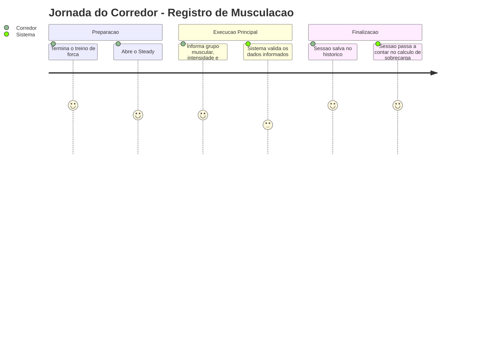
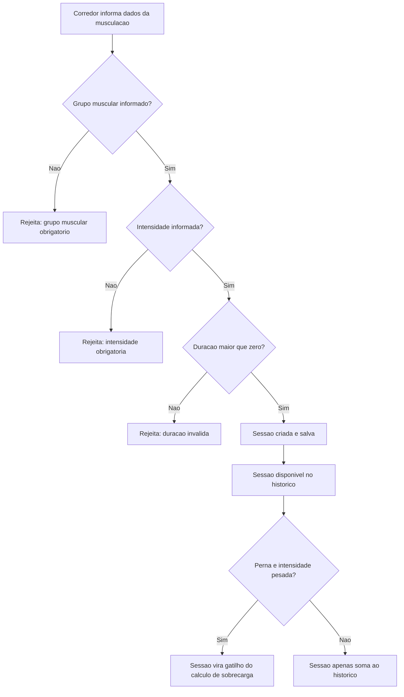

# Registro de Sessão de Musculação - Treino-Forca - Regras de Negócio

## Índice
- [1. Resumo da Funcionalidade](#1-resumo-da-funcionalidade)
- [2. Jornada do Usuário](#2-jornada-do-usuário)
- [3. Regras de Negócio por Funcionalidade](#3-regras-de-negócio-por-funcionalidade)
- [4. Validações e Restrições](#4-validações-e-restrições)
- [5. Fluxos de Processo](#5-fluxos-de-processo)
- [6. Casos de Uso e Cenários](#6-casos-de-uso-e-cenários)

## 1. Resumo da Funcionalidade

**Propósito**: permitir que o corredor registre uma sessão de treino de musculação (grupo muscular, intensidade e duração), tanto para acompanhar o histórico de treino quanto para alimentar a detecção de sobrecarga combinada com a corrida.

**Usuários**: corredores autenticados no Steady que complementam a corrida com treino de força.

**Valor de Negócio**: é a segunda metade do dado necessário para a regra de sobrecarga (junto com a corrida) - sem saber quando o corredor fez musculação pesada de perna, o sistema não consegue relacionar isso ao aumento de carga de corrida e sugerir o ajuste certo (ver `specs/STORY-001/spec.bdd.md`).

**Frequência de Uso**: alta - potencialmente a cada sessão de musculação realizada.

**Impacto Operacional**: dado incompleto (sem grupo muscular ou intensidade) nunca é salvo, evitando que a regra de sobrecarga rode com dados incompletos.

## 2. Jornada do Usuário

### Visão Geral da Jornada

### Pontos de Contato
- **Registro de treino**: onde o corredor informa grupo muscular, intensidade e duração da sessão.
- **Histórico de treinos**: onde a sessão registrada aparece depois de salva com sucesso.
- **Avaliação de sobrecarga**: uma sessão pesada de perna nos últimos 7 dias é um dos dois gatilhos da regra de alerta.

## 3. Regras de Negócio por Funcionalidade

### 3.1. Registro de Sessão de Musculação

**O que faz**: recebe os dados de uma sessão de musculação (grupo muscular, intensidade, duração) e, se estiverem completos e válidos, salva a sessão associada ao corredor.

**Regras Aplicadas**:
- **Grupo muscular é obrigatório**: deve ser um dos cinco grupos suportados pelo sistema (Peito+Tríceps, Ombro, Perna Frontal, Perna Posterior, Bíceps+Costas).
  - *Exemplo*: tentar registrar uma sessão sem informar o grupo muscular é rejeitado com a mensagem "O grupo muscular é obrigatório para registrar uma sessão de musculação."
- **Intensidade é obrigatória**: deve ser uma das três opções (Leve, Moderado, Pesado).
  - *Exemplo*: tentar registrar uma sessão sem informar a intensidade é rejeitado com a mensagem "A intensidade é obrigatória para registrar uma sessão de musculação."
- **Duração deve ser maior que zero**: a duração é usada para calcular a carga de treino da sessão.
  - *Exemplo*: registrar uma sessão de musculação com 0 minutos é rejeitado com a mensagem "A duração deve ser maior que zero."
- **Peso da intensidade para cálculo de carga**: internamente, cada nível de intensidade tem um peso equivalente ao esforço percebido de corrida - Leve = 3, Moderado = 6, Pesado = 9. Isso permite comparar a carga de musculação com a carga de corrida na mesma escala.

**Cenários de Uso**:
- **Cenário Principal**: corredor termina o treino de força e registra grupo muscular, intensidade e duração reais.
- **Cenário Alternativo**: não há variação alternativa documentada além do fluxo principal.
- **Cenário de Exceção**: corredor tenta registrar sem grupo muscular, sem intensidade, ou com duração inválida - o sistema rejeita o registro e indica o(s) campo(s) faltante(s).

**Resultado Esperado**: a sessão fica salva e disponível no histórico de treinos do corredor. Se for uma sessão de perna (frontal ou posterior) com intensidade pesada, ela passa a ser um dos dois fatores observados pela regra de sobrecarga nos próximos 7 dias.

## 4. Validações e Restrições

### Controle de Acesso
- **Permissões**: qualquer corredor autenticado pode registrar suas próprias sessões. Autenticação e isolamento entre corredores são responsabilidade de `Steady.Api`/`Steady.Infrastructure` (ver ADR-002).
- **Hierarquia**: não existe hierarquia de papéis dentro desta funcionalidade.

### Dados e Entrada
- **Dados Obrigatórios**: data, grupo muscular, intensidade, duração.
- **Formatos Aceitos**: grupo muscular e intensidade são opções fechadas (não é texto livre); duração é número inteiro de minutos, deve ser positiva.
- **Limitações de Volume**: apenas os cinco grupos musculares e as três intensidades suportadas pelo sistema são aceitos; qualquer outro valor não é uma opção válida na origem (tipagem fechada).

### Restrições do Sistema
- **Horários de Funcionamento**: nenhuma restrição de horário.
- **Dependências**: nenhuma dependência externa nesta camada de regra de negócio.
- **Limitações Técnicas**: nenhuma limitação de performance conhecida neste nível.

## 5. Fluxos de Processo

### Fluxo Principal

### Integrações com Outros Processos

## 6. Casos de Uso e Cenários

### Caso de Uso 1: Registrar musculação válida
**Ator Principal**: Corredor
**Objetivo**: manter o histórico de treino atualizado e alimentar a avaliação de sobrecarga.
**Pré-condições**: corredor autenticado.

**Fluxo Principal**:
1. Corredor informa grupo muscular, intensidade e duração.
2. Sistema valida cada campo contra as regras de negócio.
3. Sistema salva a sessão e a associa ao corredor.

**Pós-condições**: sessão aparece no histórico; se for perna pesada, passa a ser observada pela regra de sobrecarga.

### Caso de Uso 2: Tentar registrar musculação com campo obrigatório ausente
**Ator Principal**: Corredor
**Objetivo**: registrar uma sessão de musculação, mas esquece de informar grupo muscular ou intensidade.
**Pré-condições**: corredor autenticado.

**Fluxo Principal**:
1. Corredor envia o registro sem grupo muscular e/ou sem intensidade.
2. Sistema identifica o(s) campo(s) ausente(s).
3. Sistema rejeita o registro e indica exatamente qual campo falta.

**Pós-condições**: nenhuma sessão é salva; corredor recebe mensagem explicando o campo faltante.

### Matriz de Cenários
| Cenário | Entrada | Ação do Sistema | Resultado Esperado |
|---|---|---|---|
| Registro válido | Perna Frontal, Pesado, 60 min | Cria e salva a sessão | Sessão aparece no histórico e vira gatilho potencial de sobrecarga |
| Grupo muscular ausente | grupo = (nenhum), intensidade = Pesado | Rejeita o registro | "O grupo muscular é obrigatório para registrar uma sessão de musculação." |
| Intensidade ausente | grupo = Ombro, intensidade = (nenhuma) | Rejeita o registro | "A intensidade é obrigatória para registrar uma sessão de musculação." |
| Duração inválida | duração 0 | Rejeita o registro | "A duração deve ser maior que zero." |
