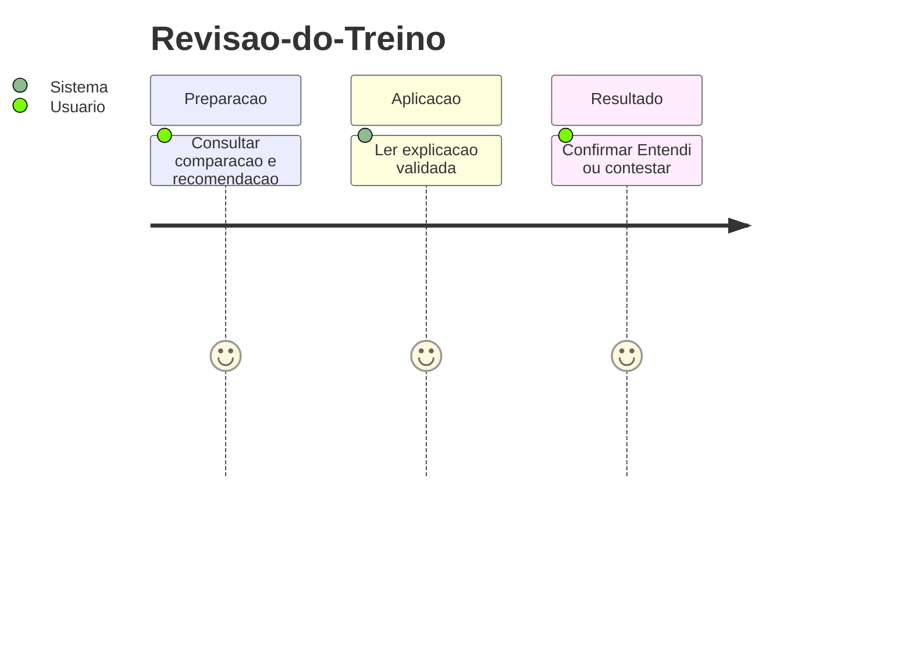
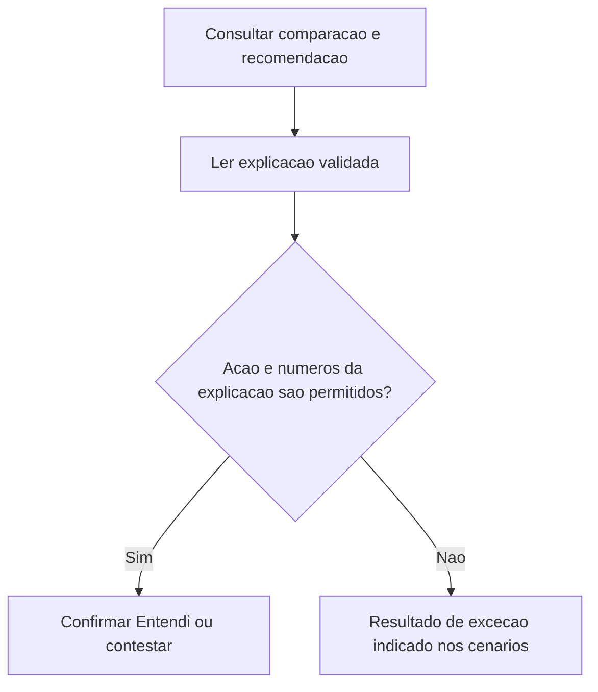
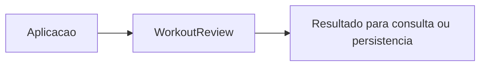

# Revisao-do-Treino - Aderencia - Regras de Negocio

## Indice

- [1. Resumo da Funcionalidade](#resumo)
- [2. Jornada do Usuario](#jornada)
- [3. Regras por Funcionalidade](#regras)
- [4. Validacoes e Restricoes](#validacoes)
- [5. Fluxos de Processo](#fluxos)
- [6. Casos de Uso e Cenarios](#cenarios)

## 1. Resumo da Funcionalidade

**Proposito e valor**: Guardar comparacao, acao, versoes e estado da explicacao separados da execucao.
**Usuarios**: corredor; personal quando o processo admite acompanhamento por vinculo ativo.
**Frequencia**: conforme criacao, consulta ou conclusao de treino; o dominio nao agenda execucoes.
**Impacto operacional**: preservar dados consistentes e tornar resultado e restricoes verificaveis.
**Origem**: [STORY-014](../../../specs/STORY-014/spec.bdd.md), [ADR-014](../../../docs/adr/ADR-014-fronteira-deterministica-da-revisao.md), [ADR-015](../../../docs/adr/ADR-015-tolerancias-e-politicas-versionadas.md), [ADR-016](../../../docs/adr/ADR-016-provedor-da-explicacao-da-revisao.md), [ADR-018](../../../docs/adr/ADR-018-outbox-transacional-da-revisao.md).

## 2. Jornada do Usuario

**Pontos de contato**: entrada de dados na aplicacao, validacao de dominio, consulta do resultado. O modelo nao implementa telas nem autenticacao.

## 3. Regras de Negocio por Funcionalidade

**O que faz**: Guardar comparacao, acao, versoes e estado da explicacao separados da execucao.

- **Regra 1**: Snapshot e versoes preservam os fatos usados na decisao; confirmacao e coerencia sao campos separados.
- **Regra 2**: Entendi registra a primeira data; contestacao marca um booleano.
- **Regra 3**: Texto deve repetir a acao autorizada e usar somente numeros dos fatos.
- **Regra 4**: Termos diagnósticos listados sao rejeitados; rejeicao deixa explicacao indisponivel sem apagar recomendacao.
- **Regra 5**: Sem proximo treino calculado externamente, coerencia continua desconhecida; ausencia nao significa descanso.

**Exemplo pratico**: Acao ReduceLoad com texto citando 17 km quando allowedNumbers=[8,10] e rejeitada por UnknownNumber; MarkUnderstood repetido preserva a primeira data.

**Cenario principal**: dados coerentes produzem o resultado descrito. **Alternativo**: campos opcionais ausentes seguem a semantica documentada. **Excecao**: entrada que viola guard clause interrompe a operacao; transicoes sem efeito sao explicitadas na documentacao tecnica.

**Resultado esperado**: objeto ou estado conforme regras, sem alteracao automatica de treino futuro.

## 4. Validacoes e Restricoes

**Controle de acesso**: responsabilidade dos endpoints e repositorios; o objeto de dominio nao identifica usuario autenticado.
**Dados obrigatorios, formatos e limites**: as regras acima e o [detalhamento por metodo](../DevDocs/WorkoutReview-Aderencia-DevDocs.md#metodos) registram todos os limites implementados.
**Dependencias e horarios**: nao ha janela operacional nem rede no modelo; a aplicacao fornece dados e datas quando exigidos.
**Limites**: A porta nao escolhe provedor. Timeout, retentativa manual, outbox e autorizacao ficam externos. Create permite revisao aderente; a regra de nao cria-la pertence ao orquestrador da API.

## 5. Fluxos de Processo

## 6. Casos de Uso e Cenarios

**Ator principal**: usuario pelo fluxo da aplicacao. **Objetivo**: Guardar comparacao, acao, versoes e estado da explicacao separados da execucao.
**Pre-condicoes**: acesso autorizado nas camadas externas e dados necessarios disponiveis.

1. Fornecer os dados ou comando ao fluxo.
2. Aplicar as regras documentadas nesta unidade.
3. Confirmar Entendi ou contestar recusada.

**Pos-condicao**: estado devolvido conforme codigo, sem persistencia implicita.

| Cenario | Entrada | Acao do sistema | Resultado esperado |
|---|---|---|---|
| Caso 1 | Acao ReduceLoad e explicacao Maintain | Reject ActionMismatch | ExplanationStatus=Unavailable |
| Caso 2 | Texto com 17 km, numeros permitidos 8 e 10 | Reject UnknownNumber | Explanation=null; acao preservada |
| Caso 3 | Entendi em T1 e nova confirmacao T2 | Preservar primeira confirmacao | UnderstoodAt=T1 |

**Evidencia automatizada**: [Testes](../../../tests/Steady.Domain.Tests/WorkoutReviewTests.cs); leitura de testes existente nesta rodada, sem execucao de testes de produto para alteracoes apenas documentais.
