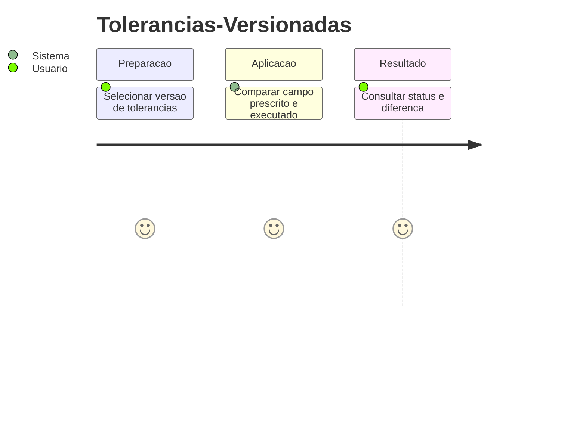
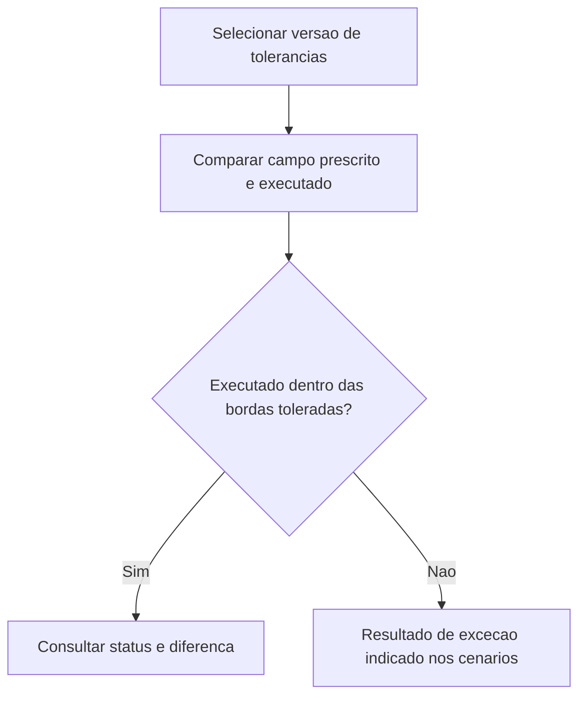
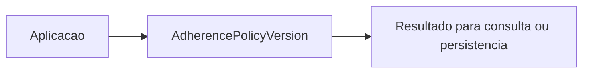

# Tolerancias-Versionadas - Aderencia - Regras de Negocio

## Indice

- [1. Resumo da Funcionalidade](#resumo)
- [2. Jornada do Usuario](#jornada)
- [3. Regras por Funcionalidade](#regras)
- [4. Validacoes e Restricoes](#validacoes)
- [5. Fluxos de Processo](#fluxos)
- [6. Casos de Uso e Cenarios](#cenarios)

## 1. Resumo da Funcionalidade

**Proposito e valor**: Comparar campos numericos com tolerancias rastreaveis por versao.
**Usuarios**: corredor; personal quando o processo admite acompanhamento por vinculo ativo.
**Frequencia**: conforme criacao, consulta ou conclusao de treino; o dominio nao agenda execucoes.
**Impacto operacional**: preservar dados consistentes e tornar resultado e restricoes verificaveis.
**Origem**: [STORY-014](../../../specs/STORY-014/spec.bdd.md), [ADR-015](../../../docs/adr/ADR-015-tolerancias-e-politicas-versionadas.md).

## 2. Jornada do Usuario

**Pontos de contato**: entrada de dados na aplicacao, validacao de dominio, consulta do resultado. O modelo nao implementa telas nem autenticacao.

## 3. Regras de Negocio por Funcionalidade

**O que faz**: Comparar campos numericos com tolerancias rastreaveis por versao.

- **Regra 1**: Tolerancia percentual e aplicada as bordas da faixa, nao ao ponto medio.
- **Regra 2**: Versao 1 permite 10% em distancia/duracao/carga, 20% em repeticoes, 2 pontos de esforco e 1 serie.
- **Regra 3**: Campo sem prescricao numerica e nao comparavel; carga sem mediana historica tambem.
- **Regra 4**: Versao e limites usados devem acompanhar a revisao; vigencia e publicacao sao controles externos.

**Exemplo pratico**: Alvo 10 km aceita 9 a 11 km; faixa 8..12 aceita 7,2 a 13,2 km. Executar 13,21 km fica divergente.

**Cenario principal**: dados coerentes produzem o resultado descrito. **Alternativo**: campos opcionais ausentes seguem a semantica documentada. **Excecao**: entrada que viola guard clause interrompe a operacao; transicoes sem efeito sao explicitadas na documentacao tecnica.

**Resultado esperado**: objeto ou estado conforme regras, sem alteracao automatica de treino futuro.

## 4. Validacoes e Restricoes

**Controle de acesso**: responsabilidade dos endpoints e repositorios; o objeto de dominio nao identifica usuario autenticado.
**Dados obrigatorios, formatos e limites**: as regras acima e o [detalhamento por metodo](../DevDocs/AdherencePolicyVersion-Aderencia-DevDocs.md#metodos) registram todos os limites implementados.
**Dependencias e horarios**: nao ha janela operacional nem rede no modelo; a aplicacao fornece dados e datas quando exigidos.
**Limites**: Nenhum metodo valida o dado executado ou calcula historico; chamadores fornecem dados normalizados. Diferenca assinada usa faixa original, classificacao usa faixa tolerada.

## 5. Fluxos de Processo

## 6. Casos de Uso e Cenarios

**Ator principal**: usuario pelo fluxo da aplicacao. **Objetivo**: Comparar campos numericos com tolerancias rastreaveis por versao.
**Pre-condicoes**: acesso autorizado nas camadas externas e dados necessarios disponiveis.

1. Fornecer os dados ou comando ao fluxo.
2. Aplicar as regras documentadas nesta unidade.
3. Consultar status e diferenca recusada.

**Pos-condicao**: estado devolvido conforme codigo, sem persistencia implicita.

| Cenario | Entrada | Acao do sistema | Resultado esperado |
|---|---|---|---|
| Caso 1 | Politica v1, alvo 10 km, executado 9 km | Aplicar 10 por cento | Adherent, Difference=-1 |
| Caso 2 | Politica v1, faixa 8..12 km, executado 13.21 km | Comparar borda 13.2 | Divergent, Difference=1.21 |
| Caso 3 | Prescricao ausente, executado 10 km | Preservar ausencia | NotComparable, Executed=10 |

**Evidencia automatizada**: [Testes](../../../tests/Steady.Domain.Tests/AdherencePolicyTests.cs); leitura de testes existente nesta rodada, sem execucao de testes de produto para alteracoes apenas documentais.
