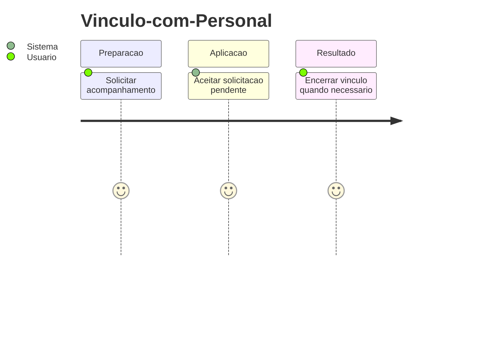
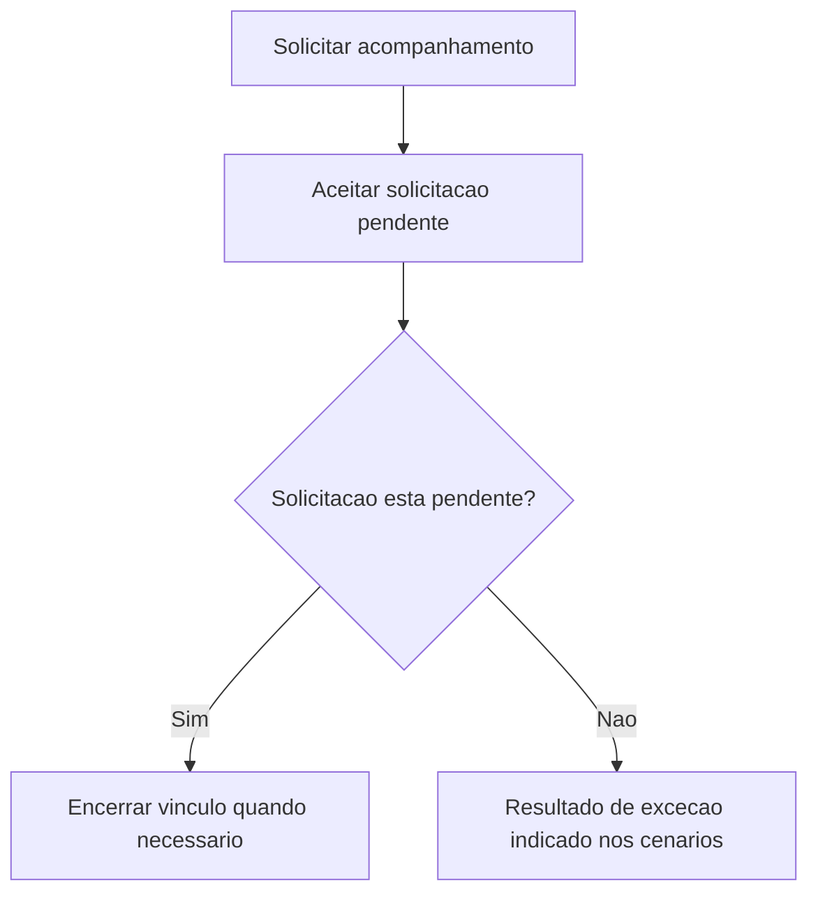
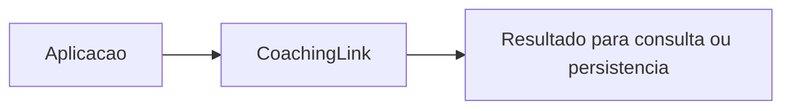

# Vinculo-com-Personal - Acompanhamento - Regras de Negocio

## Indice

- [1. Resumo da Funcionalidade](#resumo)
- [2. Jornada do Usuario](#jornada)
- [3. Regras por Funcionalidade](#regras)
- [4. Validacoes e Restricoes](#validacoes)
- [5. Fluxos de Processo](#fluxos)
- [6. Casos de Uso e Cenarios](#cenarios)

## 1. Resumo da Funcionalidade

**Proposito e valor**: Controlar o ciclo de solicitacao, aceitacao e revogacao de acesso do personal.
**Usuarios**: corredor; personal quando o processo admite acompanhamento por vinculo ativo.
**Frequencia**: conforme criacao, consulta ou conclusao de treino; o dominio nao agenda execucoes.
**Impacto operacional**: preservar dados consistentes e tornar resultado e restricoes verificaveis.
**Origem**: [STORY-013](../../../specs/STORY-013/spec.bdd.md), [ADR-008](../../../docs/adr/ADR-008-roles-vinculo-e-autorizacao-do-personal.md).

## 2. Jornada do Usuario

**Pontos de contato**: entrada de dados na aplicacao, validacao de dominio, consulta do resultado. O modelo nao implementa telas nem autenticacao.

## 3. Regras de Negocio por Funcionalidade

**O que faz**: Controlar o ciclo de solicitacao, aceitacao e revogacao de acesso do personal.

- **Regra 1**: Solicitacao pendente nao libera dados.
- **Regra 2**: Somente aceitacao de Pending torna o vinculo ativo.
- **Regra 3**: Encerramento revoga acesso; repeticao nao altera a primeira data de encerramento.
- **Regra 4**: Expiracao afeta apenas solicitacoes pendentes.
- **Regra 5**: Um corredor pode ter varias solicitacoes, mas so um vinculo ativo pela STORY-013; essa cardinalidade e controlada fora desta entidade.

**Exemplo pratico**: Solicitar --> aceitar --> encerrar produz Pending --> Active --> Ended; GrantsAccess fica false --> true --> false.

**Cenario principal**: dados coerentes produzem o resultado descrito. **Alternativo**: campos opcionais ausentes seguem a semantica documentada. **Excecao**: entrada que viola guard clause interrompe a operacao; transicoes sem efeito sao explicitadas na documentacao tecnica.

**Resultado esperado**: objeto ou estado conforme regras, sem alteracao automatica de treino futuro.

## 4. Validacoes e Restricoes

**Controle de acesso**: responsabilidade dos endpoints e repositorios; o objeto de dominio nao identifica usuario autenticado.
**Dados obrigatorios, formatos e limites**: as regras acima e o [detalhamento por metodo](../DevDocs/CoachingLink-Acompanhamento-DevDocs.md#metodos) registram todos os limites implementados.
**Dependencias e horarios**: nao ha janela operacional nem rede no modelo; a aplicacao fornece dados e datas quando exigidos.
**Limites**: Nenhum metodo valida UTC ou ordem cronologica. Restore e uma porta confiada a persistencia. Cardinalidade global exige operacao transacional externa.

## 5. Fluxos de Processo

## 6. Casos de Uso e Cenarios

**Ator principal**: usuario pelo fluxo da aplicacao. **Objetivo**: Controlar o ciclo de solicitacao, aceitacao e revogacao de acesso do personal.
**Pre-condicoes**: acesso autorizado nas camadas externas e dados necessarios disponiveis.

1. Fornecer os dados ou comando ao fluxo.
2. Aplicar as regras documentadas nesta unidade.
3. Encerrar vinculo quando necessario recusada.

**Pos-condicao**: estado devolvido conforme codigo, sem persistencia implicita.

| Cenario | Entrada | Acao do sistema | Resultado esperado |
|---|---|---|---|
| Caso 1 | IDs distintos, Request | Criar solicitacao | Pending e GrantsAccess=false |
| Caso 2 | Pending, Accept(data) | Ativar vinculo | Active e GrantsAccess=true |
| Caso 3 | Ended, Accept(data) | Recusar aceitacao | InvalidOperationException |

**Evidencia automatizada**: [Testes](../../../tests/Steady.Domain.Tests/CoachingLinkTests.cs); leitura de testes existente nesta rodada, sem execucao de testes de produto para alteracoes apenas documentais.
