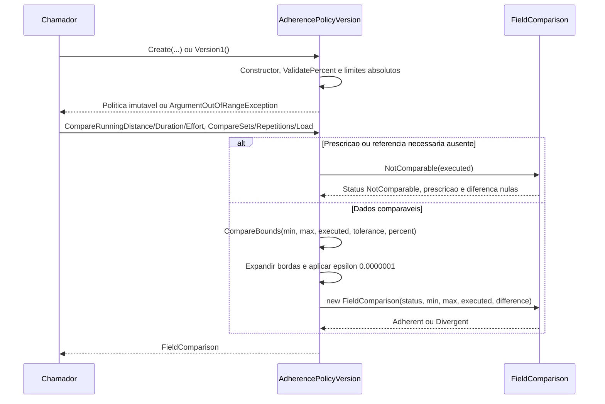

# AdherencePolicyVersion - Aderencia - Especificacao Tecnica

## Indice

- [1. Visao Geral Tecnica](#visao)
- [2. Configuracao e Dependencias](#dependencias)
- [3. Detalhamento por Metodo](#metodos)
- [D1. Create](#metodo-1)
- [D1. Version1](#metodo-2)
- [D1. CompareRunningDistance](#metodo-3)
- [D1. CompareRunningDuration](#metodo-4)
- [D1. ComparePerceivedEffort](#metodo-5)
- [D1. CompareSets](#metodo-6)
- [D1. CompareRepetitions](#metodo-7)
- [D1. CompareLoad](#metodo-8)
- [D1. CompareRange](#metodo-9)
- [D1. CompareBounds](#metodo-10)
- [D1. ValidatePercent](#metodo-11)
- [U1. FieldComparison.NotComparable](#metodo-12)
- [4. Observacoes Tecnicas](#observacoes)

## 1. Visao Geral Tecnica

**Proposito e responsabilidades**: Comparar campos numericos com tolerancias rastreaveis por versao.

**Fontes verificadas**: [Fonte](../../../src/Steady.Domain/Adherence/AdherencePolicyVersion.cs); [Testes](../../../tests/Steady.Domain.Tests/AdherencePolicyTests.cs); [STORY-014](../../../specs/STORY-014/spec.bdd.md), [ADR-015](../../../docs/adr/ADR-015-tolerancias-e-politicas-versionadas.md). As regras abaixo descrevem o codigo atual; controles das outras camadas sao identificados explicitamente.

## 2. Configuracao e Dependencias

Dominio C# puro, sem injecao de framework, endpoints, repositorios ou acesso ao banco. Tipos de apoio constam na secao U1. Persistencia e integracao ficam em [Steady.Infrastructure](../../Steady.Infrastructure/DevDocs/README.md) e [Steady.Api](../../Steady.Api/DevDocs/README.md).

**Entrada e saida**: assinaturas, campos, estados e erros de cada operacao sao discriminados abaixo. Os tipos nao sao contratos HTTP; uma excecao de dominio nao equivale por si so a status HTTP.

**Assinaturas do codigo (entrada tipada e tipo de retorno)**:

- `public sealed record FieldComparison( FieldAdherenceStatus Status, double? PrescribedMin, double? PrescribedMax, double? Executed, double? Difference)`
- `public static FieldComparison NotComparable(double? executed = null)`
- `public static AdherencePolicyVersion Create( int version, decimal runningDistancePercent, decimal runningDurationPercent, int perceivedEffortPoints, int setsAbsolute, decimal repetitionsPercent, decimal loadPercent)`
- `public static AdherencePolicyVersion Version1()`
- `public FieldComparison CompareRunningDistance(NumericRange<double>? prescribed, double executed)`
- `public FieldComparison CompareRunningDuration(NumericRange<int>? prescribed, int executed)`
- `public FieldComparison ComparePerceivedEffort(NumericRange<int>? prescribed, int executed)`
- `public FieldComparison CompareSets(int prescribed, int executed)`
- `public FieldComparison CompareRepetitions(int prescribed, int executed)`
- `public FieldComparison CompareLoad(decimal? historicalMedian, decimal? executed)`
- `private static FieldComparison CompareRange( NumericRange<double>? prescribed, double executed, double tolerance)`
- `private static FieldComparison CompareBounds( double min, double? max, double executed, double tolerance, bool percent = true)`
- `private static decimal ValidatePercent(decimal value, string name)`

## 3. Detalhamento por Metodo

**D. Entidade/Servico de Dominio**: AdherencePolicyVersion. D1 identifica operacoes de dominio; U1 identifica tipos de apoio agrupados nesta unidade.

### Fluxo completo da unidade

### D1. Create

Recebe versao e seis tolerancias. Versao >0; percentuais RunningDistancePercent, RunningDurationPercent, RepetitionsPercent e LoadPercent estritamente entre 0 e 1; PerceivedEffortPoints e SetsAbsolute >0. Falhas geram ArgumentOutOfRangeException; retorna objeto imutavel.

### D1. Version1

Retorna versao 1: distancia 0.10; duracao 0.10; esforco 2 pontos; series 1; repeticoes 0.20; carga 0.10. Origem ADR-015: calibracao inicial de piloto, nao evidencia clinica.

### D1. CompareRunningDistance

Faixa double opcional via CompareRange; ausente retorna NotComparable com executado preservado; presente usa percentual de distancia.

### D1. CompareRunningDuration

Faixa int opcional; ausencia NotComparable; percentual de duracao aplicado nas bordas.

### D1. ComparePerceivedEffort

Faixa int opcional; ausencia NotComparable; tolerancia absoluta em pontos.

### D1. CompareSets

Alvo inteiro exato, tolerancia absoluta SetsAbsolute.

### D1. CompareRepetitions

Alvo exato, percentual RepetitionsPercent.

### D1. CompareLoad

Mediana historica ou carga executada ausente retorna NotComparable. Ambas presentes sao convertidas a double e comparadas pelo percentual LoadPercent; nao calcula mediana.

### D1. CompareRange

Privado: ausencia retorna FieldComparison.NotComparable; presente encaminha Min/Max para CompareBounds.

### D1. CompareBounds

Privado: upper=max ?? min. Percentual: limites min*(1-tolerance) e upper*(1+tolerance); absoluto: min-tolerance e upper+tolerance. Aderente quando executado >= inferior-0.0000001 e <= superior+0.0000001. Difference e executado-min abaixo do minimo, executado-upper acima do maximo, ou 0 dentro da faixa original, mesmo quando a tolerancia permite diferenca externa.

### D1. ValidatePercent

Privado: valor >0 e <1; exclui 0 e 1.

### U1. FieldComparison.NotComparable

Retorna status NotComparable, PrescribedMin/Max e Difference null, e Executed opcional preservado. Outros estados FieldAdherenceStatus sao Adherent e Divergent.

## 4. Observacoes Tecnicas

**Limites reais**: Nenhum metodo valida o dado executado ou calcula historico; chamadores fornecem dados normalizados. Diferenca assinada usa faixa original, classificacao usa faixa tolerada.

**Erros**: guard clauses interrompem antes de devolver objeto; metodos de transicao podem lancar InvalidOperationException quando descrito acima. Nao ha tratamento de excecoes ou logs internos.

**Desempenho**: factories e comparacoes percorrem apenas os campos/colecoes recebidos; nao fazem rede. Validacao de explicacao percorre texto e numeros permitidos. Nao ha medicao de desempenho publicada nestes testes.

**Documentos associados**: [Regras](../BusinessRulesDocs/Tolerancias-Versionadas-Aderencia-Rules.md) e [Debitos](../TechnicalDebtsDocs/AdherencePolicyVersion-Aderencia-Debts.md).
