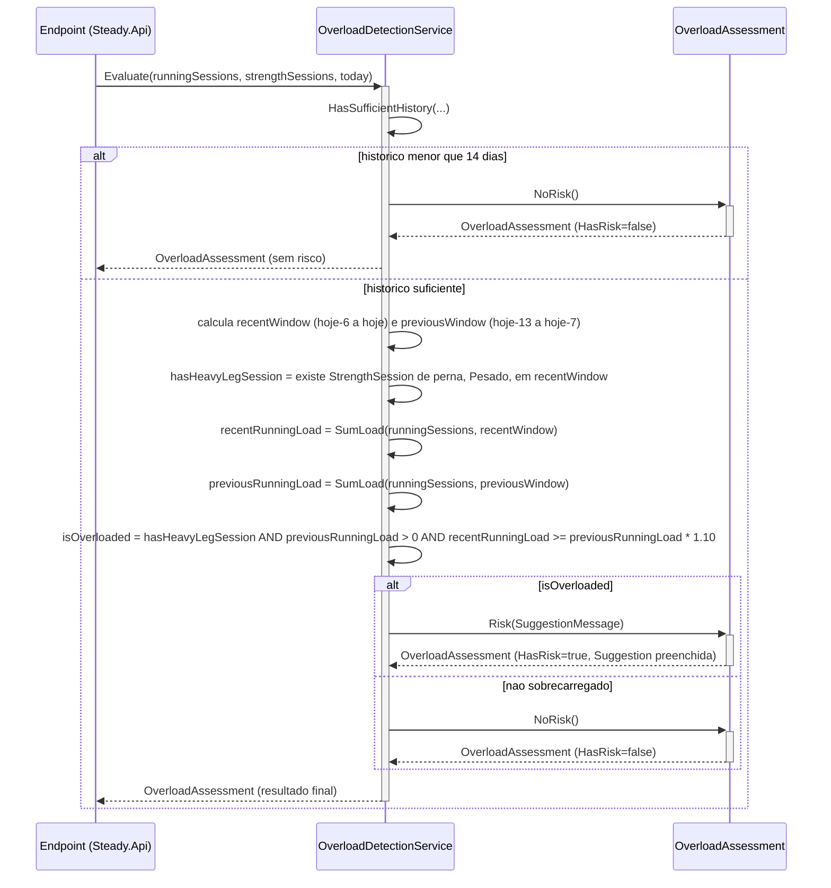

# OverloadDetectionService - Sobrecarga - Especificação Técnica

## Índice
- [1. Visão Geral Técnica](#1-visão-geral-técnica)
- [2. Configuração e Dependências](#2-configuração-e-dependências)
- [3. Detalhamento por Método](#3-detalhamento-por-método)
  - [3.1. Evaluate - Avaliação de Risco de Sobrecarga](#31-evaluate---avaliação-de-risco-de-sobrecarga)
- [4. Observações Técnicas](#4-observações-técnicas)

## 1. Visão Geral Técnica

**Propósito**: serviço de domínio estático e stateless que implementa o algoritmo de detecção de sobrecarga combinada (corrida + musculação), fundamentado em [ADR-001](../../../docs/adr/ADR-001-regra-sobrecarga-combinada.md). Retorna um `OverloadAssessment` — value object que representa o resultado da avaliação (com ou sem risco, com sugestão opcional).

**Responsabilidades**:
- Determinar se o corredor tem histórico suficiente (mínimo 14 dias) para que a regra seja avaliada com segurança.
- Identificar se houve sessão de musculação de perna com intensidade pesada nos últimos 7 dias.
- Calcular e comparar a carga de treino de corrida entre a janela recente (últimos 7 dias) e a janela anterior (7 dias antes dela).
- Combinar os dois sinais acima em um veredito único: `OverloadAssessment.Risk(sugestão)` ou `OverloadAssessment.NoRisk()`.

**Integrações**:
- Consome `RunningSession` (`Training/RunningSession.cs`) e `StrengthSession` (`Training/StrengthSession.cs`) — ver [RunningSession-Treino-Corrida-DevDocs.md](./RunningSession-Treino-Corrida-DevDocs.md) e [StrengthSession-Treino-Forca-DevDocs.md](./StrengthSession-Treino-Forca-DevDocs.md).
- Retorna `OverloadAssessment` (`Overload/OverloadAssessment.cs`), documentado como U1 abaixo, pois seu único propósito é ser o tipo de retorno deste serviço.
- Chamado por `Steady.Api.Endpoints.OverloadAssessmentEndpoints` (`GET /api/overload-assessment`), que busca as sessões persistidas do corredor autenticado, reconstrói `RunningSession`/`StrengthSession` via as próprias factories de domínio, e chama `Evaluate` passando `DateOnly.FromDateTime(DateTime.UtcNow)` como `today`. Detalhe da camada HTTP foge do escopo deste documento.

## 2. Configuração e Dependências

**Dependências Injetadas**: nenhuma — `OverloadDetectionService` é uma classe `static`, sem estado, sem construtor, sem injeção de dependência. Depende apenas de `System`, `System.Collections.Generic`, `System.Linq` e dos tipos do próprio `Steady.Domain.Training`.

**Constantes de negócio** (fundamentadas em ADR-001):
- `OverloadThreshold = 1.10` — limiar de 110% (regra dos 10% aplicada à carga combinada).
- `MinimumHistoryDays = 14` — histórico mínimo para a regra ser avaliada.
- `SuggestionMessage` — texto único e fixo da sugestão exibida quando há risco (ver seção 4).

**Membros públicos**:
- `static OverloadAssessment Evaluate(IReadOnlyCollection<RunningSession> runningSessions, IReadOnlyCollection<StrengthSession> strengthSessions, DateOnly today)` - único ponto de entrada do serviço.

## 3. Detalhamento por Método

### 3.1. Evaluate - Avaliação de Risco de Sobrecarga

**Assinatura**: `public static OverloadAssessment Evaluate(IReadOnlyCollection<RunningSession> runningSessions, IReadOnlyCollection<StrengthSession> strengthSessions, DateOnly today)`

**Entrada**:
```json
{
  "runningSessions": "IReadOnlyCollection<RunningSession> - historico completo de sessoes de corrida do corredor",
  "strengthSessions": "IReadOnlyCollection<StrengthSession> - historico completo de sessoes de musculacao do corredor",
  "today": "DateOnly - data de referencia para o calculo (recebida como parametro, nao lida do relogio do sistema - ver Observacoes Tecnicas)"
}
```

**Saída**:
```json
{
  "resultado": "OverloadAssessment - HasRisk (bool) e Suggestion (string?, preenchido apenas quando HasRisk = true)"
}
```

Este método **nunca lança exceção de negócio** — não há guard clauses. Coleções vazias ou nulas de sessões resultam em `NoRisk()` (via `HasSufficientHistory` retornando `false` quando não há nenhuma data).

#### Fluxo de Execução



**Nota sobre o participante Endpoint**: em produção, `Evaluate` é chamado por `Steady.Api.Endpoints.OverloadAssessmentEndpoints`, que busca todo o histórico do corredor no banco antes de invocar o serviço — o carregamento e a persistência estão fora do escopo de `Steady.Domain` por decisão arquitetural (domínio isolado de infraestrutura).

#### Detalhamento do Fluxo

**D. Serviço de Domínio (OverloadDetectionService)**

<a id="d1-evaluate"></a>
D1. `Evaluate()`
- Passo 1 — **checagem de histórico mínimo**: chama `HasSufficientHistory` (ver D1.1). Se insuficiente, retorna imediatamente `OverloadAssessment.NoRisk()`, sem calcular nada — implementa a regra de negócio #6 da spec ("Sem um período anterior completo de 7 dias para comparação... nenhum alerta é gerado — falta de dados não gera falso positivo").
- Passo 2 — **define as duas janelas móveis**: `recentWindow = (today - 6 dias, today)` — 7 dias corridos incluindo hoje; `previousWindow = (today - 13 dias, today - 7 dias)` — os 7 dias imediatamente anteriores, sem sobreposição com a janela recente. Note que é janela de dias corridos, não semana de calendário (regra de negócio #3 da spec).
- Passo 3 — **verifica gatilho de musculação**: `hasHeavyLegSession` é `true` se existir ao menos uma `StrengthSession` dentro de `recentWindow` cujo `MuscleGroup` seja de perna (`IsLeg`, ver D1.3) **e** cuja `Intensity` seja exatamente `Pesado`.
- Passo 4 — **soma a carga de corrida em cada janela**: `recentRunningLoad = SumLoad(runningSessions, recentWindow)`; `previousRunningLoad = SumLoad(runningSessions, previousWindow)` (ver D1.4).
- Passo 5 — **combina os sinais**: `isOverloaded = hasHeavyLegSession && previousRunningLoad > 0 && recentRunningLoad >= previousRunningLoad * OverloadThreshold (1.10)`. A checagem `previousRunningLoad > 0` evita divisão conceitual por zero/comparação degenerada — sem carga de corrida na janela anterior, qualquer carga recente "pareceria" um aumento infinito; a regra trata esse caso como não avaliável, não como sobrecarga automática.
- Passo 6 — **retorna o veredito**: `OverloadAssessment.Risk(SuggestionMessage)` se `isOverloaded`, senão `OverloadAssessment.NoRisk()`.

<a id="d1-hassufficienthistory"></a>
D1.1. `HasSufficientHistory()` (privado)
- Calcula a data mais antiga entre **todas** as sessões (corrida + musculação combinadas) via `Select(...).Concat(...).Min()`.
- Se não houver nenhuma sessão (`earliestDate is null`), retorna `false` imediatamente.
- Caso contrário, calcula `historySpanDays = today.DayNumber - earliestDate.Value.DayNumber + 1` (inclusive nas duas pontas) e retorna `historySpanDays >= MinimumHistoryDays (14)`.
- Nota: a checagem é sobre o **span de calendário** entre a sessão mais antiga e hoje, não sobre a *quantidade* de sessões registradas. Duas sessões distantes 14 dias entre si já satisfazem esta checagem, mesmo com poucos dados no meio (ver [TechnicalDebtsDocs](../TechnicalDebtsDocs/OverloadDetectionService-Sobrecarga-Debts.md) para discussão sobre esparsidade de dados).

<a id="d1-isleg"></a>
D1.3. `IsLeg()` (privado)
- `muscleGroup is MuscleGroup.PernaFrontal or MuscleGroup.PernaPosterior` — os dois únicos grupos de perna do `enum` (ver [U1.1 MuscleGroup](./StrengthSession-Treino-Forca-DevDocs.md#u1-muscleGroup)).

<a id="d1-iswithin"></a>
D1.4. `IsWithin()` (privado)
- `date >= window.Start && date <= window.End` — checagem de intervalo fechado dos dois lados, reutilizada tanto para filtrar `StrengthSession` quanto `RunningSession` por janela.

<a id="d1-sumload"></a>
D1.5. `SumLoad()` (privado)
- `sessions.Where(s => IsWithin(s.Date, window)).Sum(s => s.Load)` — filtra as sessões de corrida dentro da janela e soma a propriedade `Load` de cada uma (ver [D1.2 Load de RunningSession](./RunningSession-Treino-Corrida-DevDocs.md#d1-load)).

**U1. Value Object/Enum de apoio**

<a id="u1-overloadassessment"></a>
U1.1. `OverloadAssessment` (`Overload/OverloadAssessment.cs`)
- Value object imutável com dois construtores nomeados (factory methods), sem construtor público direto:
  - `NoRisk()` → `new(false, null)`.
  - `Risk(string suggestion)` → `new(true, suggestion)`.
- Propriedades: `bool HasRisk`, `string? Suggestion` (nulo quando `HasRisk = false`, sempre preenchido quando `HasRisk = true` — invariante garantida pelos dois factory methods, não checada em tempo de execução por guard clause explícita).
- É o único tipo de retorno de `Evaluate` — não é reutilizado por nenhuma outra entidade do domínio, por isso é documentado junto com o serviço em vez de como uma unidade separada (a fragmentação separaria a explicação do algoritmo descrito em ADR-001).

## 4. Observações Técnicas

- **Fundamentação obrigatória**: toda a regra implementada aqui é uma tradução direta de [ADR-001](../../../docs/adr/ADR-001-regra-sobrecarga-combinada.md), que por sua vez cita Gabbett (2016) para o modelo Acute:Chronic Workload Ratio (ACWR — sigla expandida na própria ADR-001), Foster (2001) para session-RPE (RPE em si não é expandida em nenhum artefato do repositório — [Sigla não definida no contexto - verificar com a equipe]), e a "regra dos 10%" da Lei do Domínio do projeto (`.sdd/PROJECT-CONSTITUTION.md`). O comentário XML no topo da classe (`OverloadDetectionService.cs`, linhas 8-11) já referencia essa ADR diretamente no código-fonte.
- **`today` como parâmetro, não como leitura de relógio**: `Evaluate` recebe `today` explicitamente em vez de chamar `DateTime.UtcNow` internamente. Essa é a razão pela qual o serviço é 100% testável de forma determinística (ver `tests/Steady.Domain.Tests/OverloadDetectionTests.cs`, que usa `DateOnly Today = new(2026, 8, 10)` fixo). É também o que mantém `Steady.Domain` isolado de qualquer noção de "tempo real do sistema" — quem decide "o que é hoje" é a camada de chamada (`Steady.Api`).
- **O algoritmo nunca bloqueia**: `Evaluate` é uma função pura de leitura — não tem efeito colateral, não impede a criação de nenhuma `RunningSession`/`StrengthSession`. Implementa diretamente a regra de negócio #5 da spec ("o registro do treino nunca é bloqueado, mesmo que o corredor ignore a sugestão") simplesmente por não ter nenhum mecanismo de bloqueio — a garantia é estrutural, não uma checagem explícita.
- **Suggestion é uma mensagem fixa, não personalizada**: o texto de `SuggestionMessage` é uma constante única, igual para qualquer corredor e qualquer combinação de dados que dispare `isOverloaded = true` — não referencia os valores reais de carga, datas ou o grupo muscular específico envolvido. Ver análise em [TechnicalDebtsDocs](../TechnicalDebtsDocs/OverloadDetectionService-Sobrecarga-Debts.md).
- **Performance**: para o volume esperado de dados de um corredor individual (dezenas a poucas centenas de sessões), o custo de `Concat`/`Min`/`Where`/`Sum` (todos O(n) sobre coleções pequenas) é irrelevante. Não há otimização prematura no código, o que é apropriado neste contexto.
- **Isolamento de framework**: `OverloadDetectionService` é `static` e sem estado — não precisa ser registrado em nenhum container de injeção de dependência; é chamado diretamente como `OverloadDetectionService.Evaluate(...)` pela camada de API.
