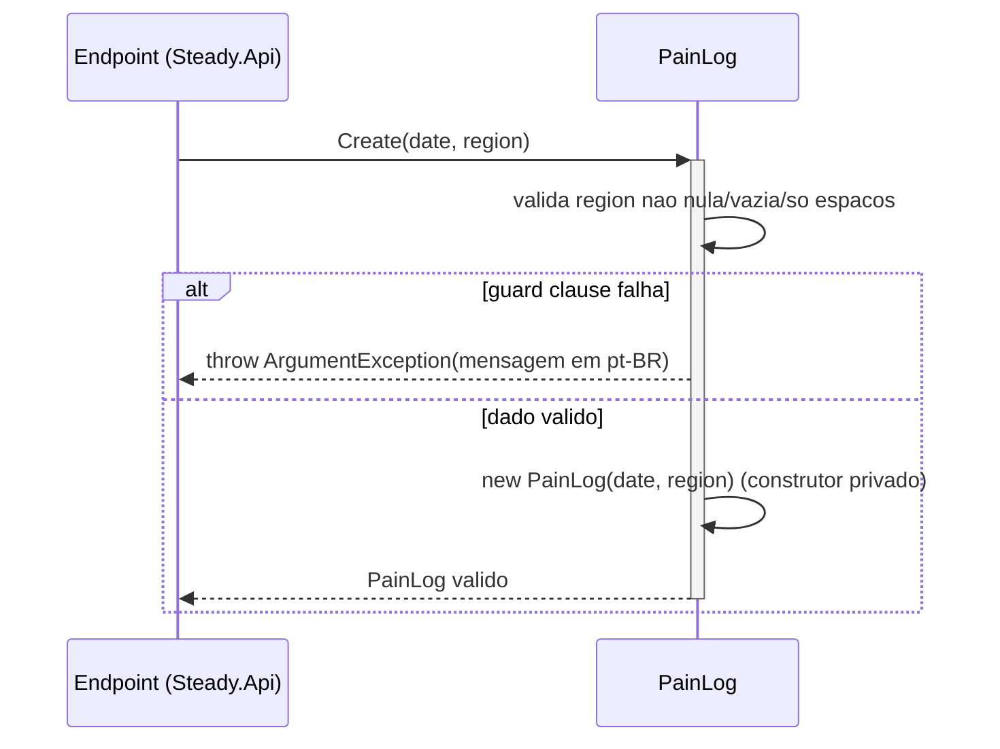

# PainLog - Treino-Dor - Especificação Técnica

## Índice
- [1. Visão Geral Técnica](#1-visão-geral-técnica)
- [2. Configuração e Dependências](#2-configuração-e-dependências)
- [3. Detalhamento por Método](#3-detalhamento-por-método)
  - [3.1. Create - Registro de Dor](#31-create---registro-de-dor)
- [4. Observações Técnicas](#4-observações-técnicas)

## 1. Visão Geral Técnica

**Propósito**: entidade rica que representa um registro de dor relatado pelo corredor — a mais simples das entidades de `Steady.Domain`, com apenas dois campos.

**Responsabilidades**:
- Garantir que todo `PainLog` tenha uma região do corpo informada (não vazia).
- Representar um registro independente de qualquer sessão de treino específica.

**Integrações**:
- **Não é consumida por `OverloadDetectionService`** — ao contrário de `RunningSession` e `StrengthSession`, `PainLog` não entra no cálculo do algoritmo de sobrecarga. Segundo `docs/adr/ADR-001-regra-sobrecarga-combinada.md` (seção Riscos), o registro de dor serve como **sinal de calibração retrospectiva** da regra ("se dor continuar ocorrendo sem alerta, a regra deve ser revisada"), não como insumo direto do cálculo atual.
- Persistida via `Steady.Infrastructure.Repositories.PainLogRepository` (mapeada para `PainLogEntity`). Fora do escopo deste documento — ver `DocumentAIReadme/Steady.Infrastructure/DevDocs/`, se existir.
- Exposta via `Steady.Api.Endpoints.PainLogEndpoints` (`POST /api/pain-logs`). Fora do escopo deste documento — ver `DocumentAIReadme/Steady.Api/DevDocs/`, se existir.

## 2. Configuração e Dependências

**Dependências Injetadas**: nenhuma. `PainLog` é uma classe `sealed` sem dependências de framework, construída exclusivamente por `Create`.

**Membros públicos**:
- `static PainLog Create(DateOnly date, string region)` - cria um registro de dor validado.
- `DateOnly Date`, `string Region` - propriedades `get`-only expostas após a criação.

## 3. Detalhamento por Método

### 3.1. Create - Registro de Dor

**Assinatura**: `public static PainLog Create(DateOnly date, string region)`

**Entrada**:
```json
{
  "date": "DateOnly - data do registro de dor (não necessariamente a data do treino que a causou), sem validação de negócio",
  "region": "string - região do corpo onde a dor foi sentida, texto livre, obrigatório e não pode ser vazio/só espaços"
}
```

**Saída**:
```json
{
  "resultado": "PainLog - instância imutável com Date e Region"
}
```

Em caso de dado inválido, o método lança `ArgumentException` — não retorna objeto.

#### Fluxo de Execução



**Nota sobre o participante Endpoint**: em produção, `Create` é chamado a partir de `Steady.Api.Endpoints.PainLogEndpoints.MapPainLogEndpoints` (`POST /pain-logs`), via `Steady.Api.Common.DomainFactory.TryCreate`. Detalhe fora do escopo deste documento.

#### Detalhamento do Fluxo

**D. Entidade de Domínio (PainLog)**

<a id="d1-create"></a>
D1. `Create()`
- Recebe `date` (sem validação de negócio) e `region` (texto livre).
- Guard clause única: `string.IsNullOrWhiteSpace(region)` → lança `ArgumentException("A região do corpo é obrigatória para registrar dor.", nameof(region))`.
- Se a validação passa, invoca o construtor privado e retorna a instância imutável.
- Não valida que `date` esteja no passado ou futuro — a spec explicitamente permite registrar dor "a qualquer momento após o treino, inclusive dias depois" (`specs/STORY-001/spec.bdd.md`, regra de negócio #7), então `date` aqui representa a data em que a dor foi sentida/percebida, não necessariamente a data de hoje nem a data de uma sessão de treino.

**U1. Value Object/Enum de apoio**

Nenhum. `PainLog.Region` é `string` (texto livre), sem `enum` ou value object restringindo os valores aceitos — diferente de `StrengthSession.MuscleGroup`, que usa um `enum` fechado para grupo muscular (ver observação em [TechnicalDebtsDocs](../TechnicalDebtsDocs/PainLog-Treino-Dor-Debts.md)).

## 4. Observações Técnicas

- **Performance**: sem preocupação — classe trivial, sem I/O.
- **Tratamento de Erros**: única violação possível lança `ArgumentException` com mensagem pt-BR pronta para exibição ("A região do corpo é obrigatória para registrar dor.").
- **Desacoplado de sessão de treino**: por desenho, `PainLog` não referencia `RunningSession` nem `StrengthSession` — não há chave estrangeira nem ID de sessão. Isso reflete a regra de negócio #7 (`specs/STORY-001/spec.bdd.md`): "O registro de dor é independente de sessão específica: data + região do corpo + doeu/não doeu."
- **Gap entre spec e modelo — indicador "doeu"**: a spec (regra #7 e o cenário "Corredor registra dor pós-treino dias depois") descreve o registro como "data + região do corpo + doeu/não doeu", e o `Then` do cenário afirma que "o registro de dor é salvo com a data, a região e o indicador 'doeu'". O modelo `PainLog` atual **não tem um campo explícito para esse indicador** — apenas `Date` e `Region`. Na prática, a existência do registro já implica "doeu = true" (não há como registrar "não doeu" hoje). Ver análise detalhada em [TechnicalDebtsDocs](../TechnicalDebtsDocs/PainLog-Treino-Dor-Debts.md).
- **Isolamento de framework**: mesma decisão arquitetural das demais entidades de `Training/` — sem dependência de infraestrutura (ver `tests/Steady.Domain.Tests/PainLogTests.cs`).
- **Integrações Críticas**: nenhuma no estado atual do código — `PainLog` é isolado do algoritmo de sobrecarga. Isso é uma decisão de escopo do MVP (ver `specs/STORY-001/spec.bdd.md`, seção "Fora do escopo desta story": "escala de intensidade de dor (fica binário: doeu/não doeu no MVP)"), não uma omissão acidental.
