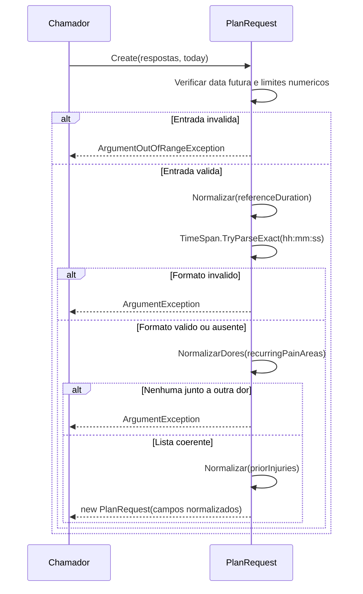

# PlanRequest - Planejamento - Especificacao Tecnica

## Indice

- [1. Visao Geral Tecnica](#visao)
- [2. Configuracao e Dependencias](#dependencias)
- [3. Detalhamento por Metodo](#metodos)
- [D1. Create](#metodo-1)
- [D1. Normalizar](#metodo-2)
- [D1. NormalizarDores](#metodo-3)
- [U1. Enums Planning](#metodo-4)
- [4. Observacoes Tecnicas](#observacoes)

## 1. Visao Geral Tecnica

**Proposito e responsabilidades**: Preservar respostas do corredor sobre prova e disponibilidade, sem calcular exercicios.

**Fontes verificadas**: [Fonte](../../../src/Steady.Domain/Planning/PlanRequest.cs); [Testes](../../../tests/Steady.Domain.Tests/PlanRequestTests.cs); [STORY-010](../../../specs/STORY-010/spec.bdd.md), [ADR-007](../../../docs/adr/ADR-007-persistencia-do-pedido-de-plano-de-treino.md). As regras abaixo descrevem o codigo atual; controles das outras camadas sao identificados explicitamente.

## 2. Configuracao e Dependencias

Dominio C# puro, sem injecao de framework, endpoints, repositorios ou acesso ao banco. Tipos de apoio constam na secao U1. Persistencia e integracao ficam em [Steady.Infrastructure](../../Steady.Infrastructure/DevDocs/README.md) e [Steady.Api](../../Steady.Api/DevDocs/README.md).

**Entrada e saida**: assinaturas, campos, estados e erros de cada operacao sao discriminados abaixo. Os tipos nao sao contratos HTTP; uma excecao de dominio nao equivale por si so a status HTTP.

**Assinaturas do codigo (entrada tipada e tipo de retorno)**:

- `public static PlanRequest Create( RaceDistance raceDistance, DateOnly raceDate, bool raceIsFirstTime, double longestRecentRunKm, int trainingDaysPerWeek, int? currentWeeklyRunningDays, double? referenceDistanceKm, string? referenceDuration, int? strengthSessionMinutes, EquipmentAccess? equipmentAccess, IReadOnlyList<PainArea>? recurringPainAreas, string? priorInjuries, DateOnly today)`
- `private static IReadOnlyList<PainArea> NormalizarDores(IReadOnlyList<PainArea>? areas)`
- `private static string? Normalizar(string? texto)`

## 3. Detalhamento por Metodo

**D. Entidade/Servico de Dominio**: PlanRequest. D1 identifica operacoes de dominio; U1 identifica tipos de apoio agrupados nesta unidade.

### Fluxo completo da unidade

### D1. Create

Recebe RaceDistance, RaceDate, RaceIsFirstTime, LongestRecentRunKm, TrainingDaysPerWeek, opcionais e today; devolve PlanRequest. Rejeita raceDate <= today; longestRecentRunKm <= 0; dias fora de 3..6; corridas atuais fora de 0..7; distancia de referencia <= 0; forca fora de 20..90 minutos. Opcionais nulos sao aceitos. Duracao normalizada exige TimeSpan.TryParseExact com hh:mm:ss e cultura invariavel; formato incorreto gera ArgumentException. Os demais limites geram ArgumentOutOfRangeException. Chama Normalizar e NormalizarDores.

### D1. Normalizar

Metodo privado: Trim no texto; vazio vira null. Aplica-se a duracao de referencia e lesoes anteriores.

### D1. NormalizarDores

Metodo privado: null/vazio vira lista vazia; Distinct remove repeticoes. Nenhuma sozinha vira vazio; Nenhuma junto a outra regiao gera ArgumentException.

### U1. Enums Planning

RaceDistance: FiveK, TenK, HalfMarathon, Marathon, Ultra. EquipmentAccess: AcademiaCompleta, HalteresCasa, PesoCorporal. PainArea: Canela, Joelho, ItBand, Lombar, Tornozelo, Panturrilha, Nenhuma. ItBand [Sigla nao definida no contexto - verificar com a equipe]. Os enums nao recebem validacao Enum.IsDefined nesta factory.

## 4. Observacoes Tecnicas

**Limites reais**: Identidade do pedido, titularidade, fila e idempotencia pertencem as camadas externas. Nao valida valores numericos indefinidos de enum nem finitude de double.

**Erros**: guard clauses interrompem antes de devolver objeto; metodos de transicao podem lancar InvalidOperationException quando descrito acima. Nao ha tratamento de excecoes ou logs internos.

**Desempenho**: factories e comparacoes percorrem apenas os campos/colecoes recebidos; nao fazem rede. Validacao de explicacao percorre texto e numeros permitidos. Nao ha medicao de desempenho publicada nestes testes.

**Documentos associados**: [Regras](../BusinessRulesDocs/Pedido-de-Planejamento-Planejamento-Rules.md) e [Debitos](../TechnicalDebtsDocs/PlanRequest-Planejamento-Debts.md).
