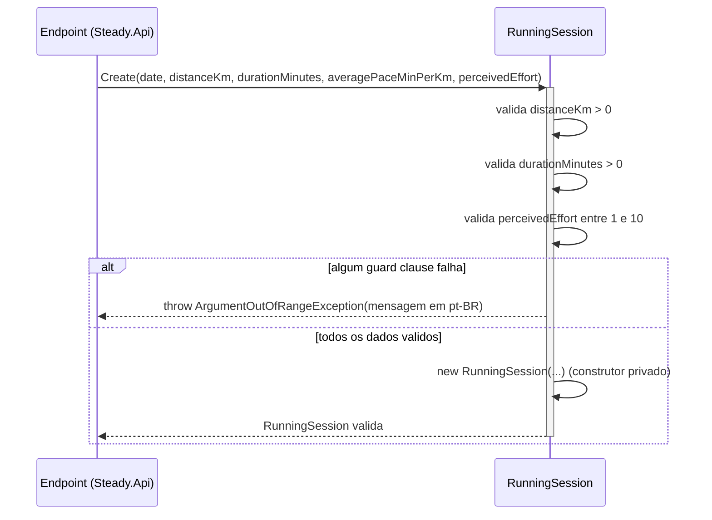

# RunningSession - Treino-Corrida - Especificação Técnica

## Índice
- [1. Visão Geral Técnica](#1-visão-geral-técnica)
- [2. Configuração e Dependências](#2-configuração-e-dependências)
- [3. Detalhamento por Método](#3-detalhamento-por-método)
  - [3.1. Create - Registro de Sessão de Corrida](#31-create---registro-de-sessão-de-corrida)
- [4. Observações Técnicas](#4-observações-técnicas)

## 1. Visão Geral Técnica

**Propósito**: entidade rica que representa uma sessão de treino de corrida registrada pelo corredor. A validação de negócio vive dentro da própria entidade, no factory method `Create` — não existe camada de validação externa neste projeto.

**Responsabilidades**:
- Garantir que toda instância de `RunningSession` existente em memória seja válida (distância, duração e percepção de esforço dentro dos limites de negócio).
- Calcular a carga de treino (`Load`) da sessão, segundo o método session-RPE (Foster, 2001).
- Permanecer imutável após a criação (todas as propriedades são `get`-only).

**Integrações**:
- Consumida por `Steady.Domain.Overload.OverloadDetectionService` (`src/Steady.Domain/Overload/OverloadDetectionService.cs`) como uma das duas fontes de carga de treino do algoritmo de detecção de sobrecarga — ver [OverloadDetectionService-Sobrecarga-DevDocs.md](./OverloadDetectionService-Sobrecarga-DevDocs.md).
- Persistida via `Steady.Infrastructure.Repositories.RunningSessionRepository` (mapeada para `RunningSessionEntity`). Detalhe de persistência foge do escopo deste documento — ver `DocumentAIReadme/Steady.Infrastructure/DevDocs/`, se existir.
- Exposta via `Steady.Api.Endpoints.RunningSessionEndpoints` (`POST /api/running-sessions`). Detalhe da camada HTTP foge do escopo deste documento — ver `DocumentAIReadme/Steady.Api/DevDocs/`, se existir.

## 2. Configuração e Dependências

**Dependências Injetadas**: nenhuma. `RunningSession` é uma classe `sealed` sem dependências de framework (`System` apenas), construída exclusivamente pelo método factory estático `Create`. O construtor de instância é `private`.

**Membros públicos**:
- `static RunningSession Create(DateOnly date, double distanceKm, int durationMinutes, double averagePaceMinPerKm, int perceivedEffort)` - cria uma sessão de corrida validada.
- `double Load { get; }` - propriedade calculada com a carga de treino da sessão.
- `DateOnly Date`, `double DistanceKm`, `int DurationMinutes`, `double AveragePaceMinPerKm`, `int PerceivedEffort` - propriedades `get`-only expostas após a criação.

## 3. Detalhamento por Método

### 3.1. Create - Registro de Sessão de Corrida

**Assinatura**: `public static RunningSession Create(DateOnly date, double distanceKm, int durationMinutes, double averagePaceMinPerKm, int perceivedEffort)`

**Entrada**:
```json
{
  "date": "DateOnly - data em que a corrida ocorreu, sem validação de negócio",
  "distanceKm": "double - distância percorrida em quilômetros, deve ser maior que zero",
  "durationMinutes": "int - duração da sessão em minutos, deve ser maior que zero",
  "averagePaceMinPerKm": "double - ritmo médio em minutos por quilômetro, sem validação de negócio",
  "perceivedEffort": "int - percepção de esforço (RPE) [Sigla não definida no contexto - verificar com a equipe], escala de 1 a 10"
}
```

**Saída**:
```json
{
  "resultado": "RunningSession - instância imutável com Date, DistanceKm, DurationMinutes, AveragePaceMinPerKm, PerceivedEffort e a propriedade calculada Load"
}
```

Em caso de dado inválido, o método não retorna objeto nenhum: lança `ArgumentOutOfRangeException`.

#### Fluxo de Execução



**Nota sobre o participante Endpoint**: em produção, `Create` é chamado a partir de `Steady.Api.Endpoints.RunningSessionEndpoints.MapRunningSessionEndpoints` (`POST /running-sessions`), via `Steady.Api.Common.DomainFactory.TryCreate`, que captura a `ArgumentException` (classe-base de `ArgumentOutOfRangeException`) e a traduz em HTTP 400 reaproveitando `ex.Message`. O detalhamento dessa camada foge do escopo deste documento — `Steady.Domain` é isolado de framework por decisão arquitetural (ver seção 4).

#### Detalhamento do Fluxo

**D. Entidade de Domínio (RunningSession)**

<a id="d1-create"></a>
D1. `Create()`
- Recebe os 5 parâmetros primitivos que descrevem uma sessão de corrida.
- Guard clause 1: `distanceKm <= 0` → lança `ArgumentOutOfRangeException(nameof(distanceKm), distanceKm, "A distância deve ser maior que zero.")`.
- Guard clause 2: `durationMinutes <= 0` → lança `ArgumentOutOfRangeException(nameof(durationMinutes), durationMinutes, "A duração deve ser maior que zero.")`.
- Guard clause 3: `perceivedEffort is < 1 or > 10` → lança `ArgumentOutOfRangeException(nameof(perceivedEffort), perceivedEffort, "A percepção de esforço deve estar entre 1 e 10.")`.
- Se todas as validações passam, invoca o construtor privado e retorna a instância imutável.
- `averagePaceMinPerKm` não recebe nenhuma validação de negócio — aceito como veio (ver [TechnicalDebtsDocs](../TechnicalDebtsDocs/RunningSession-Treino-Corrida-Debts.md)).

<a id="d1-load"></a>
D1.2. `Load` (propriedade)
- Calculada sob demanda a cada acesso (não persistida como campo próprio): `DurationMinutes * PerceivedEffort`.
- Implementa o método session-RPE (Foster, 2001) — carga de treino = duração x intensidade percebida — citado no comentário XML do código-fonte e fundamentado em [ADR-001](../../../docs/adr/ADR-001-regra-sobrecarga-combinada.md).
- Consumida como valor de apoio pelo algoritmo de `OverloadDetectionService` para somar a carga de corrida em uma janela de dias — ver [D1. Evaluate](./OverloadDetectionService-Sobrecarga-DevDocs.md#d1-evaluate).

**U1. Value Object/Enum de apoio**

Nenhum. `RunningSession` não depende de nenhum `enum` ou value object do domínio — todos os parâmetros são tipos primitivos (`DateOnly`, `double`, `int`).

## 4. Observações Técnicas

- **Performance**: sem preocupação — classe simples, sem I/O, sem laços, custo O(1) por instância.
- **Tratamento de Erros**: todas as violações de regra lançam `ArgumentOutOfRangeException` com mensagem em pt-BR já pronta para exibição ao usuário final (a camada `Steady.Api` reaproveita `ex.Message` diretamente na resposta 400 — ver `specs/STORY-002/spec.bdd.md`, regra de negócio #5).
- **Imutabilidade**: todas as propriedades são `get`-only, atribuídas apenas no construtor privado. Não existe setter nem método de mutação — para "editar" uma sessão, o padrão do domínio é sempre recriar via `Create`.
- **Isolamento de framework**: `Steady.Domain` não depende de ASP.NET, EF Core ou qualquer infraestrutura — decisão arquitetural deliberada (domínio isolado). Isso é o que permite testar `RunningSession` e o algoritmo de sobrecarga sem subir API nem banco (ver `tests/Steady.Domain.Tests/RunningSessionTests.cs`).
- **Integrações Críticas**: `RunningSession.Load` é insumo direto do algoritmo de `OverloadDetectionService`. Qualquer mudança na fórmula de `Load` ou no significado de `PerceivedEffort` exige revisitar [ADR-001](../../../docs/adr/ADR-001-regra-sobrecarga-combinada.md), pois a regra de sobrecarga depende dessa unidade de carga ser comparável com a carga de musculação.
- **Sigla RPE**: aparece apenas em comentário de código-fonte ("session-RPE — Foster, 2001"), sem expansão explícita em nenhum artefato do repositório (código, ADR ou spec). Mantida como está — [Sigla não definida no contexto - verificar com a equipe].
