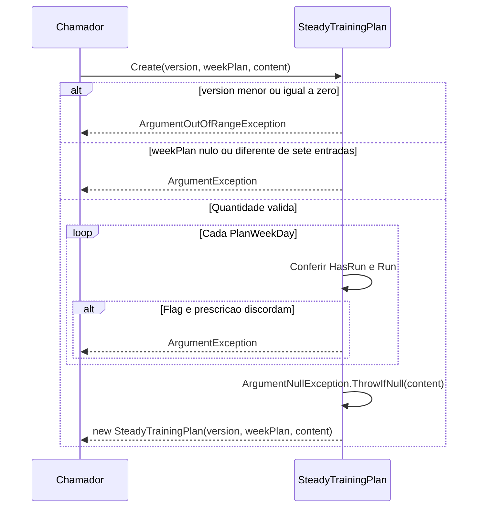

# SteadyTrainingPlan - Planejamento - Especificacao Tecnica

## Indice

- [1. Visao Geral Tecnica](#visao)
- [2. Configuracao e Dependencias](#dependencias)
- [3. Detalhamento por Metodo](#metodos)
- [D1. Create](#metodo-1)
- [U1. PlanWeekDay](#metodo-2)
- [U1. PlanStaticContent](#metodo-3)
- [4. Observacoes Tecnicas](#observacoes)

## 1. Visao Geral Tecnica

**Proposito e responsabilidades**: Representar uma versao do documento semanal do Steady e seu conteudo estatico.

**Fontes verificadas**: [Fonte](../../../src/Steady.Domain/Planning/SteadyTrainingPlan.cs); [Testes](../../../tests/Steady.Domain.Tests/SteadyTrainingPlanTests.cs); [STORY-016](../../../specs/STORY-016/spec.bdd.md), [ADR-013](../../../docs/adr/ADR-013-plano-do-steady-como-fonte-de-prescricao.md). As regras abaixo descrevem o codigo atual; controles das outras camadas sao identificados explicitamente.

## 2. Configuracao e Dependencias

Dominio C# puro, sem injecao de framework, endpoints, repositorios ou acesso ao banco. Tipos de apoio constam na secao U1. Persistencia e integracao ficam em [Steady.Infrastructure](../../Steady.Infrastructure/DevDocs/README.md) e [Steady.Api](../../Steady.Api/DevDocs/README.md).

**Entrada e saida**: assinaturas, campos, estados e erros de cada operacao sao discriminados abaixo. Os tipos nao sao contratos HTTP; uma excecao de dominio nao equivale por si so a status HTTP.

**Assinaturas do codigo (entrada tipada e tipo de retorno)**:

- `public sealed record PlanPrinciple(string Intro, IReadOnlyList<string> Points)`
- `public sealed record PlanPhase(string Name, string Weeks, string RunFocus, string StrengthFocus)`
- `public sealed record PlanWeekdayFocus(string Day, string StrengthFocus, string? RunLabel)`
- `public sealed record PlanExercise(string Name, string Series)`
- `public sealed record PlanTaperAdjustment(string Title, string Intro, IReadOnlyList<string> Items)`
- `public sealed record PlanLongRunProgression(string Phase, string Range)`
- `public sealed record PlanMobilityBlock(string Title, IReadOnlyList<PlanExercise> Items)`
- `public sealed record PlanGoldenRule(string Number, string Text)`
- `public sealed record PlanWeekDay( string Day, string Focus, bool HasRun, string? RunLabel, string Intro, string? RunNote, IReadOnlyList<PlanExercise> Exercises, RunPrescription? Run)`
- `public sealed record PlanStaticContent( string Title, string Subtitle, PlanPrinciple Principle, IReadOnlyList<PlanPhase> Phases, string PhaseCycleNote, IReadOnlyList<PlanWeekdayFocus> WeekOverview, string WeekOverviewNote, PlanTaperAdjustment TaperAdjustment, IReadOnlyList<PlanLongRunProgression> LongRunProgression, IReadOnlyList<PlanMobilityBlock> Mobility, IReadOnlyList<PlanGoldenRule> GoldenRules, string PaceNote)`
- `public static SteadyTrainingPlan Create( int version, IReadOnlyList<PlanWeekDay> weekPlan, PlanStaticContent content)`

## 3. Detalhamento por Metodo

**D. Entidade/Servico de Dominio**: SteadyTrainingPlan. D1 identifica operacoes de dominio; U1 identifica tipos de apoio agrupados nesta unidade.

### Fluxo completo da unidade

### D1. Create

Entrada: version, weekPlan e content. Versao <= 0 gera ArgumentOutOfRangeException. weekPlan null ou quantidade diferente de 7 gera ArgumentException. Para cada dia, HasRun=true exige Run; HasRun=false proibe Run. content null gera ArgumentNullException. Retorna versao e referencias recebidas, sem copiar listas nem calcular fase.

### U1. PlanWeekDay

Day, Focus, HasRun, RunLabel, Intro, RunNote, Exercises e Run. Run usa RunPrescription, documentada em TrainingSheet. Texto de fase nao vira prescricao numerica por dia.

### U1. PlanStaticContent

Title, Subtitle, Principle, Phases, PhaseCycleNote, WeekOverview, WeekOverviewNote, TaperAdjustment, LongRunProgression, Mobility, GoldenRules e PaceNote. Records PlanPrinciple(Intro,Points), PlanPhase(Name,Weeks,RunFocus,StrengthFocus), PlanWeekdayFocus(Day,StrengthFocus,RunLabel), PlanExercise(Name,Series), PlanTaperAdjustment(Title,Intro,Items), PlanLongRunProgression(Phase,Range), PlanMobilityBlock(Title,Items) e PlanGoldenRule(Number,Text) guardam texto sem guard clauses.

## 4. Observacoes Tecnicas

**Limites reais**: Nao valida unicidade dos nomes dos dias, membros nulos da lista ou conteudo interno dos records. A imutabilidade de publicacao da ADR-013 depende tambem de persistencia.

**Erros**: guard clauses interrompem antes de devolver objeto; metodos de transicao podem lancar InvalidOperationException quando descrito acima. Nao ha tratamento de excecoes ou logs internos.

**Desempenho**: factories e comparacoes percorrem apenas os campos/colecoes recebidos; nao fazem rede. Validacao de explicacao percorre texto e numeros permitidos. Nao ha medicao de desempenho publicada nestes testes.

**Documentos associados**: [Regras](../BusinessRulesDocs/Plano-Versionado-Planejamento-Rules.md) e [Debitos](../TechnicalDebtsDocs/SteadyTrainingPlan-Planejamento-Debts.md).
