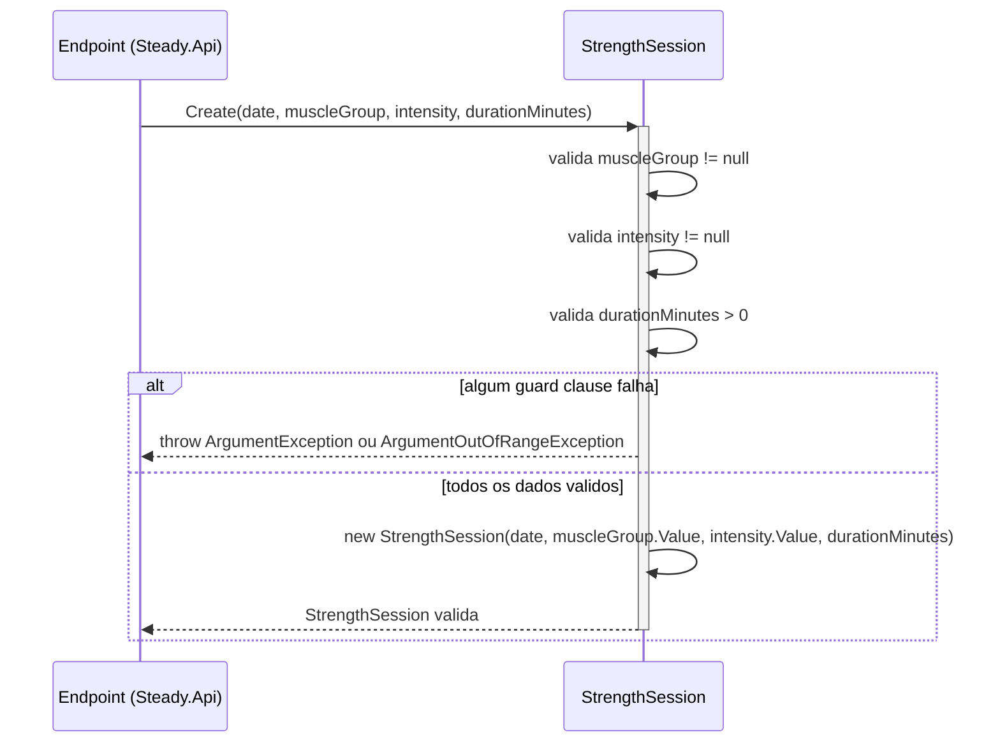

# StrengthSession - Treino-Forca - Especificação Técnica

## Índice
- [1. Visão Geral Técnica](#1-visão-geral-técnica)
- [2. Configuração e Dependências](#2-configuração-e-dependências)
- [3. Detalhamento por Método](#3-detalhamento-por-método)
  - [3.1. Create - Registro de Sessão de Musculação](#31-create---registro-de-sessão-de-musculação)
  - [3.2. Load - Cálculo de Carga de Treino](#32-load---cálculo-de-carga-de-treino)
- [4. Observações Técnicas](#4-observações-técnicas)

## 1. Visão Geral Técnica

**Propósito**: entidade rica que representa uma sessão de treino de musculação registrada pelo corredor. Assim como `RunningSession`, a validação de negócio vive no factory method `Create`.

**Responsabilidades**:
- Garantir que toda instância de `StrengthSession` seja válida (grupo muscular e intensidade informados, duração positiva).
- Calcular a carga de treino (`Load`) da sessão, mapeando a escala qualitativa de intensidade (Leve/Moderado/Pesado) para uma escala numérica comparável à carga de corrida (session-RPE, Foster 2001).
- Permanecer imutável após a criação.

**Integrações**:
- Consumida por `Steady.Domain.Overload.OverloadDetectionService` para identificar sessões de musculação de perna com intensidade pesada - ver [OverloadDetectionService-Sobrecarga-DevDocs.md](./OverloadDetectionService-Sobrecarga-DevDocs.md).
- Persistida via `Steady.Infrastructure.Repositories.StrengthSessionRepository` (mapeada para `StrengthSessionEntity`). Fora do escopo deste documento - ver `DocumentAIReadme/Steady.Infrastructure/DevDocs/`, se existir.
- Exposta via `Steady.Api.Endpoints.StrengthSessionEndpoints` (`POST /api/strength-sessions`). Fora do escopo deste documento - ver `DocumentAIReadme/Steady.Api/DevDocs/`, se existir.

## 2. Configuração e Dependências

**Dependências Injetadas**: nenhuma. `StrengthSession` é uma classe `sealed` sem dependências de framework, construída exclusivamente por `Create`. Depende de dois tipos de apoio do próprio domínio: o `enum` `MuscleGroup` e o `enum` `Intensity` (ambos em `Steady.Domain.Training`).

**Membros públicos**:
- `static StrengthSession Create(DateOnly date, MuscleGroup? muscleGroup, Intensity? intensity, int durationMinutes)` - cria uma sessão de musculação validada.
- `double Load { get; }` - propriedade calculada com a carga de treino da sessão.
- `DateOnly Date`, `MuscleGroup MuscleGroup`, `Intensity Intensity`, `int DurationMinutes` - propriedades `get`-only expostas após a criação.

## 3. Detalhamento por Método

### 3.1. Create - Registro de Sessão de Musculação

**Assinatura**: `public static StrengthSession Create(DateOnly date, MuscleGroup? muscleGroup, Intensity? intensity, int durationMinutes)`

**Entrada**:
```json
{
  "date": "DateOnly - data em que a sessão ocorreu, sem validação de negócio",
  "muscleGroup": "MuscleGroup? - grupo muscular trabalhado, obrigatório (ver enum na secao U1)",
  "intensity": "Intensity? - intensidade da sessão, obrigatória (ver enum na secao U1)",
  "durationMinutes": "int - duração da sessão em minutos, deve ser maior que zero"
}
```

**Saída**:
```json
{
  "resultado": "StrengthSession - instância imutável com Date, MuscleGroup, Intensity, DurationMinutes e a propriedade calculada Load"
}
```

Em caso de dado inválido, o método lança `ArgumentException` (campos ausentes) ou `ArgumentOutOfRangeException` (duração inválida) - não retorna objeto.

#### Fluxo de Execução



**Nota sobre o participante Endpoint**: em produção, `Create` é chamado a partir de `Steady.Api.Endpoints.StrengthSessionEndpoints.MapStrengthSessionEndpoints` (`POST /strength-sessions`), via `Steady.Api.Common.DomainFactory.TryCreate`, que traduz a exceção capturada em HTTP 400. Detalhe fora do escopo deste documento.

#### Detalhamento do Fluxo

**D. Entidade de Domínio (StrengthSession)**

<a id="d1-create"></a>
D1. `Create()`
- Recebe grupo muscular e intensidade como tipos anuláveis (`MuscleGroup?`, `Intensity?`) - a nulidade é o mecanismo usado para representar "campo obrigatório ausente" nesta assinatura, já que `enum` não tem valor nulo nativo.
- Guard clause 1: `muscleGroup is null` --> lança `ArgumentException("O grupo muscular é obrigatório para registrar uma sessão de musculação.", nameof(muscleGroup))`.
- Guard clause 2: `intensity is null` --> lança `ArgumentException("A intensidade é obrigatória para registrar uma sessão de musculação.", nameof(intensity))`.
- Guard clause 3: `durationMinutes <= 0` --> lança `ArgumentOutOfRangeException(nameof(durationMinutes), durationMinutes, "A duração deve ser maior que zero.")`.
- Se todas as validações passam, desembrulha os `Nullable<T>` (`.Value`) e invoca o construtor privado.

### 3.2. Load - Cálculo de Carga de Treino

<a id="d1-load"></a>
D1.2. `Load` (propriedade)
- Calculada sob demanda: `DurationMinutes * IntensityWeight(Intensity)`.
- `IntensityWeight` é um método privado estático que mapeia a escala qualitativa para peso numérico: `Leve = 3`, `Moderado = 6`, `Pesado = 9`. Esse mapeamento é o método session-RPE (Foster, 2001) aplicado à musculação - fundamentado em [ADR-001](../../../docs/adr/ADR-001-regra-sobrecarga-combinada.md), que define exatamente esses três valores.
- Se `Intensity` receber um valor fora do `enum` conhecido (ex: cast inválido de um inteiro arbitrário), `IntensityWeight` lança `ArgumentOutOfRangeException(nameof(intensity), intensity, "Intensidade desconhecida.")` - guard defensivo contra estado impossível pelo `enum`, mas alcançável via cast explícito em C#.
- Ao contrário de `RunningSession.Load`, esta carga não é diretamente somada pelo `OverloadDetectionService` - o serviço usa `StrengthSession` apenas para checar a *existência* de uma sessão pesada de perna na janela recente, não para somar sua carga numérica (ver [D1. Evaluate](./OverloadDetectionService-Sobrecarga-DevDocs.md#d1-evaluate)).

**U1. Value Object/Enum de apoio**

<a id="u1-muscleGroup"></a>
U1.1. `MuscleGroup` (enum, `Training/MuscleGroup.cs`)
- Valores: `PeitoTriceps`, `Ombro`, `PernaFrontal`, `PernaPosterior`, `BicepsCostas`.
- Usado por `StrengthSession` para descrever o grupo muscular trabalhado, e por `OverloadDetectionService` para identificar sessões de perna (`PernaFrontal` ou `PernaPosterior`) - ver método privado `IsLeg` no serviço de sobrecarga.

<a id="u1-intensity"></a>
U1.2. `Intensity` (enum, `Training/Intensity.cs`)
- Valores: `Leve`, `Moderado`, `Pesado`.
- Usado por `StrengthSession` para descrever a intensidade da sessão e calcular `Load`; usado por `OverloadDetectionService` para verificar se a sessão de perna é especificamente `Pesado` (única intensidade que dispara a regra de sobrecarga).

## 4. Observações Técnicas

- **Performance**: sem preocupação - classe simples, sem I/O, custo O(1) por instância.
- **Tratamento de Erros**: guard clauses de campo ausente lançam `ArgumentException` (não `ArgumentOutOfRangeException`, diferente de `RunningSession`), pois representam ausência de valor, não valor fora de faixa. Ambas as exceções derivam de `ArgumentException`, então `Steady.Api.Common.DomainFactory` as trata de forma uniforme.
- **Nullable como sinalizador de obrigatoriedade**: o uso de `MuscleGroup?`/`Intensity?` na assinatura de `Create` é uma escolha deliberada para forçar quem chama (tipicamente a desserialização de um request HTTP) a lidar explicitamente com o caso de campo ausente, em vez de depender de um valor padrão de `enum` (que seria `PeitoTriceps`/`Leve` - o `0` de cada enum - mascarando um campo não informado como um valor válido).
- **Isolamento de framework**: mesma decisão arquitetural de `RunningSession` - sem dependências de infraestrutura (ver `tests/Steady.Domain.Tests/StrengthSessionTests.cs`).
- **Integrações Críticas**: os valores de `IntensityWeight` (3/6/9) e o `enum` `MuscleGroup` são diretamente referenciados por [ADR-001](../../../docs/adr/ADR-001-regra-sobrecarga-combinada.md). Qualquer alteração nesses valores ou na lista de grupos musculares de perna precisa revisitar essa ADR.
