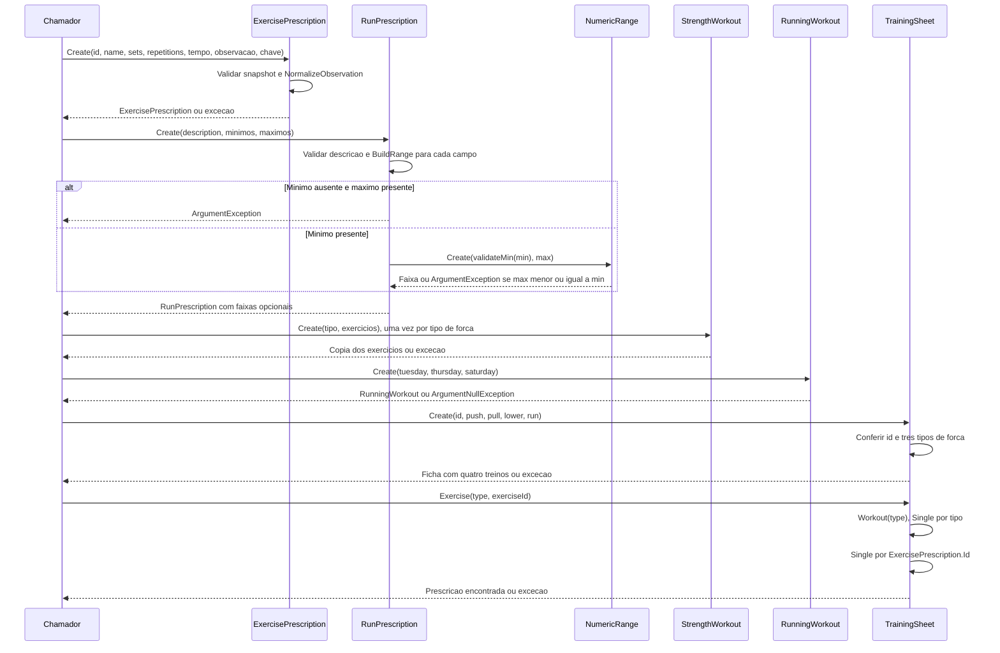

# TrainingSheet - Prescricao - Especificacao Tecnica

## Indice

- [1. Visao Geral Tecnica](#visao)
- [2. Configuracao e Dependencias](#dependencias)
- [3. Detalhamento por Metodo](#metodos)
- [D1. TrainingSheet.Create](#metodo-1)
- [D1. Workout](#metodo-2)
- [D1. Exercise](#metodo-3)
- [U1. ExercisePrescription.Create](#metodo-4)
- [U1. NormalizeObservation](#metodo-5)
- [U1. RunPrescription.Create](#metodo-6)
- [U1. BuildRange](#metodo-7)
- [U1. NumericRange.Create](#metodo-8)
- [U1. StrengthWorkout.Create](#metodo-9)
- [U1. RunningWorkout.Create](#metodo-10)
- [U1. WorkoutPrescription e WorkoutType](#metodo-11)
- [4. Observacoes Tecnicas](#observacoes)

## 1. Visao Geral Tecnica

**Proposito e responsabilidades**: Agrupar tres treinos de forca e as prescricoes de corrida de terca, quinta e sabado.

**Fontes verificadas**: [Fonte](../../../src/Steady.Domain/Coaching/TrainingSheet.cs); [Testes](../../../tests/Steady.Domain.Tests/TrainingSheetTests.cs); [STORY-013](../../../specs/STORY-013/spec.bdd.md), [STORY-014](../../../specs/STORY-014/spec.bdd.md); [STORY-015](../../../specs/STORY-015/spec.bdd.md), [STORY-017](../../../specs/STORY-017/spec.bdd.md), [ADR-010](../../../docs/adr/ADR-010-ficha-com-prescricoes-de-corrida-por-dia.md), [ADR-012](../../../docs/adr/ADR-012-prescricao-de-corrida-estruturada.md), [ADR-019](../../../docs/adr/ADR-019-identidade-historica-do-exercicio.md). As regras abaixo descrevem o codigo atual; controles das outras camadas sao identificados explicitamente.

## 2. Configuracao e Dependencias

Dominio C# puro, sem injecao de framework, endpoints, repositorios ou acesso ao banco. Tipos de apoio constam na secao U1. Persistencia e integracao ficam em [Steady.Infrastructure](../../Steady.Infrastructure/DevDocs/README.md) e [Steady.Api](../../Steady.Api/DevDocs/README.md).

**Entrada e saida**: assinaturas, campos, estados e erros de cada operacao sao discriminados abaixo. Os tipos nao sao contratos HTTP; uma excecao de dominio nao equivale por si so a status HTTP.

**Assinaturas do codigo (entrada tipada e tipo de retorno)**:

- `public static ExercisePrescription Create( Guid id, string name, int sets, int repetitions, int? durationSeconds = null, string? observation = null, Guid? exerciseKey = null)`
- `private static string? NormalizeObservation(string? observation)`
- `public static RunPrescription Create( string description, double? distanceKmMin = null, double? distanceKmMax = null, int? durationMinutesMin = null, int? durationMinutesMax = null, int? perceivedEffortMin = null, int? perceivedEffortMax = null)`
- `private static NumericRange<T>? BuildRange<T>(T? min, T? max, Func<T, T> validateMin)`
- `public static StrengthWorkout Create( WorkoutType type, IReadOnlyList<ExercisePrescription>? exercises)`
- `public static RunningWorkout Create( RunPrescription tuesday, RunPrescription thursday, RunPrescription saturday)`
- `public static TrainingSheet Create( Guid id, StrengthWorkout push, StrengthWorkout pull, StrengthWorkout lower, RunningWorkout run)`
- `public WorkoutPrescription Workout(WorkoutType type)`
- `public ExercisePrescription Exercise(WorkoutType type, Guid exerciseId)`
- `public static NumericRange<T> Create(T min, T? max)`
- `public static NumericRange<T> Create(T min)`

## 3. Detalhamento por Metodo

**D. Entidade/Servico de Dominio**: TrainingSheet. D1 identifica operacoes de dominio; U1 identifica tipos de apoio agrupados nesta unidade.

### Fluxo completo da unidade

### D1. TrainingSheet.Create

ID nao vazio; push.Type=Push, pull.Type=Pull e lower.Type=Lower, senao ArgumentException. Retorna quatro treinos na ordem Push, Pull, Lower, Run. Nao aplica guard explicito a run null; argumentos de forca null falham ao acessar Type.

### D1. Workout

Single por WorkoutType; ausencia ou multiplicidade gera InvalidOperationException.

### D1. Exercise

Localiza Workout; se nao for StrengthWorkout gera ArgumentException. Usa Single por Id, nao por ExerciseKey; ausencia gera InvalidOperationException.

### U1. ExercisePrescription.Create

ID obrigatorio; nome Trim com 2..100 caracteres; Sets 1..20; Repetitions 1..100; DurationSeconds opcional >0. ExerciseKey vazio e recusado; omitido assume Id (ADR-019). Retorna record com valores somente para leitura.

### U1. NormalizeObservation

Trim; vazio vira null; mais de 200 caracteres gera ArgumentException. Observacao do personal nao e nota do corredor.

### U1. RunPrescription.Create

Descricao Trim obrigatoria. DistanceKm, DurationMinutes e PerceivedEffort sao faixas opcionais independentes; nao extrai numeros de texto. Minimo de distancia/duracao >0; minimo de esforco 1..10.

### U1. BuildRange

Privado generico: sem minimo e com maximo gera ArgumentException; ambos ausentes retornam null; minimo presente e validado e enviado a NumericRange.Create. Maximo nao recebe validateMin: esforco maximo acima de 10 passa se maior que minimo.

### U1. NumericRange.Create

Com maximo, exige max > min, senao ArgumentException. Overload de um argumento representa alvo exato com Max=null. O tipo generico nao impõe unidade, positividade ou finitude.

### U1. StrengthWorkout.Create

Proibe tipo Run; exige lista nao vazia; proibe Id repetido; copia lista com ToArray. Nao valida valores de enum fora dos declarados.

### U1. RunningWorkout.Create

Tuesday, Thursday e Saturday obrigatorios (ArgumentNullException). Type sempre Run.

### U1. WorkoutPrescription e WorkoutType

Base abstrata expoe Type. Tipos declarados: Push, Pull, Lower e Run.

## 4. Observacoes Tecnicas

**Limites reais**: Ficha ativa, linhagem da ExerciseKey, substituicao e acesso por vinculo ficam nas camadas externas.

**Erros**: guard clauses interrompem antes de devolver objeto; metodos de transicao podem lancar InvalidOperationException quando descrito acima. Nao ha tratamento de excecoes ou logs internos.

**Desempenho**: factories e comparacoes percorrem apenas os campos/colecoes recebidos; nao fazem rede. Validacao de explicacao percorre texto e numeros permitidos. Nao ha medicao de desempenho publicada nestes testes.

**Documentos associados**: [Regras](../BusinessRulesDocs/Ficha-de-Treino-Prescricao-Rules.md) e [Debitos](../TechnicalDebtsDocs/TrainingSheet-Prescricao-Debts.md).
