# WorkoutAdherence - Aderencia - Especificacao Tecnica

## Indice

- [1. Visao Geral Tecnica](#visao)
- [2. Configuracao e Dependencias](#dependencias)
- [3. Detalhamento por Metodo](#metodos)
- [D1. CompareRunning](#metodo-1)
- [D1. ResolveRunningPrescription](#metodo-2)
- [D1. CompareStrengthExercise](#metodo-3)
- [D1. Merge](#metodo-4)
- [D1. Intersect](#metodo-5)
- [D1. Disjoint](#metodo-6)
- [D1. SafetyPolicy.Authorize](#metodo-7)
- [U1. Tipos de apoio e factories](#metodo-8)
- [4. Observacoes Tecnicas](#observacoes)

## 1. Visao Geral Tecnica

**Proposito e responsabilidades**: Resolver prescricoes e comparar execucoes com decisao deterministica de seguranca.

**Fontes verificadas**: [Fonte](../../../src/Steady.Domain/Adherence/WorkoutAdherence.cs); [Testes](../../../tests/Steady.Domain.Tests/WorkoutAdherenceTests.cs); [STORY-014](../../../specs/STORY-014/spec.bdd.md), [ADR-014](../../../docs/adr/ADR-014-fronteira-deterministica-da-revisao.md), [ADR-015](../../../docs/adr/ADR-015-tolerancias-e-politicas-versionadas.md), [ADR-019](../../../docs/adr/ADR-019-identidade-historica-do-exercicio.md). As regras abaixo descrevem o codigo atual; controles das outras camadas sao identificados explicitamente.

## 2. Configuracao e Dependencias

Dominio C# puro, sem injecao de framework, endpoints, repositorios ou acesso ao banco. Tipos de apoio constam na secao U1. Persistencia e integracao ficam em [Steady.Infrastructure](../../Steady.Infrastructure/DevDocs/README.md) e [Steady.Api](../../Steady.Api/DevDocs/README.md).

**Entrada e saida**: assinaturas, campos, estados e erros de cada operacao sao discriminados abaixo. Os tipos nao sao contratos HTTP; uma excecao de dominio nao equivale por si so a status HTTP.

**Assinaturas do codigo (entrada tipada e tipo de retorno)**:

- `public sealed record RunningAdherencePrescription( NumericRange<double>? DistanceKm, NumericRange<int>? DurationMinutes, NumericRange<int>? PerceivedEffort)`
- `public static RunningAdherencePrescription Create( NumericRange<double>? distanceKm, NumericRange<int>? durationMinutes, NumericRange<int>? perceivedEffort)`
- `public sealed record RunningAdherenceExecution( bool Completed, double DistanceKm, int DurationMinutes, int PerceivedEffort)`
- `public sealed record RunningAdherenceResult( WorkoutAdherenceStatus Status, FieldComparison Completion, FieldComparison Distance, FieldComparison Duration, FieldComparison PerceivedEffort)`
- `public sealed record ResolvedRunningPrescription( bool HasConflict, RunningAdherencePrescription? Prescription)`
- `public sealed record StrengthExerciseAdherencePrescription( Guid ExerciseKey, string Name, int Sets, int Repetitions)`
- `public static StrengthExerciseAdherencePrescription Create( Guid exerciseKey, string name, int sets, int repetitions)`
- `public sealed record StrengthExerciseAdherenceExecution( Guid ExerciseKey, string Name, bool Completed, int Sets, int Repetitions, decimal? LoadKg)`
- `public static StrengthExerciseAdherenceExecution Skipped( Guid exerciseKey, string name, int sets, int repetitions)`
- `public static StrengthExerciseAdherenceExecution Executed( Guid exerciseKey, string name, int sets, int repetitions, decimal loadKg)`
- `public sealed record StrengthExerciseAdherenceResult( FieldComparison Completion, FieldComparison Sets, FieldComparison Repetitions, FieldComparison Load)`
- `public static RunningAdherenceResult CompareRunning( RunningAdherencePrescription prescription, RunningAdherenceExecution execution, AdherencePolicyVersion policy)`
- `public static ResolvedRunningPrescription ResolveRunningPrescription( RunningAdherencePrescription plan, RunningAdherencePrescription sheet)`
- `public static StrengthExerciseAdherenceResult CompareStrengthExercise( StrengthExerciseAdherencePrescription prescription, StrengthExerciseAdherenceExecution execution, decimal? historicalMedianLoad, AdherencePolicyVersion policy)`
- `private static RunningAdherencePrescription Merge( RunningAdherencePrescription plan, RunningAdherencePrescription sheet)`
- `private static NumericRange<T>? Intersect<T>(NumericRange<T>? left, NumericRange<T>? right)`
- `private static bool Disjoint<T>(NumericRange<T>? left, NumericRange<T>? right)`
- `public static AuthorizedAction? Authorize( WorkoutAdherenceStatus status, bool hasComparableField, bool painReportedAtCompletion, double? prescribedLoad, double? executedLoad, bool overloadAlreadyDetected)`

## 3. Detalhamento por Metodo

**D. Entidade/Servico de Dominio**: WorkoutAdherence. D1 identifica operacoes de dominio; U1 identifica tipos de apoio agrupados nesta unidade.

### Fluxo completo da unidade

```mermaid
sequenceDiagram
    participant Chamador
    participant Comparador as WorkoutAdherenceComparer
    participant Politica as AdherencePolicyVersion
    participant Seguranca as SafetyPolicy
    Chamador->>Comparador: ResolveRunningPrescription(plan, sheet)
    Comparador->>Comparador: Disjoint por distancia, duracao e esforco
    alt Faixa disjunta
        Comparador-->>Chamador: HasConflict=true, Prescription=null
    else Sem conflito
        Comparador->>Comparador: Merge, Intersect por campo
        Comparador-->>Chamador: Prescricao resolvida
    end
    Chamador->>Comparador: CompareRunning(prescription, execution, policy)
    Comparador->>Comparador: Completion comparavel, 1 ou 0
    Comparador->>Politica: CompareRunningDistance(...)
    Comparador->>Politica: CompareRunningDuration(...)
    Comparador->>Politica: ComparePerceivedEffort(...)
    Politica-->>Comparador: FieldComparison por campo
    Comparador-->>Chamador: RunningAdherenceResult conforme campos divergentes
    Chamador->>Comparador: CompareStrengthExercise(prescription, execution, median, policy)
    Comparador->>Comparador: Conferir ExerciseKey e Completion
    Comparador->>Politica: CompareSets, CompareRepetitions, CompareLoad
    Politica-->>Comparador: Comparacoes de forca
    Comparador-->>Chamador: StrengthExerciseAdherenceResult ou ArgumentException
    Chamador->>Seguranca: Authorize(status, comparavel, dor, cargas, sobrecarga)
    alt Dor no encerramento
        Seguranca-->>Chamador: PrioritizeRecovery
    else Conflito ou dados insuficientes ou sem campo comparavel
        Seguranca-->>Chamador: null
    else Sobrecarga ou excesso de pelo menos dez por cento
        Seguranca-->>Chamador: ReduceLoad
    else Demais casos
        Seguranca-->>Chamador: Maintain
    end
```

### D1. CompareRunning

Recebe prescricao, execucao e politica. Completion sempre comparavel: prescrito 1, executado 1/0, diferenca 0/-1. Compara distancia, duracao e esforco via politica. Havendo qualquer Divergent, status Divergent; demais Adherent. A verificacao de InsufficientData existe, mas Completion garante um campo comparavel nesta implementacao.

### D1. ResolveRunningPrescription

Se DistanceKm, DurationMinutes ou PerceivedEffort tiver faixas disjuntas entre plano e ficha, devolve HasConflict=true e Prescription=null. Senao Merge devolve intersecoes; texto livre nao cria conflito.

### D1. CompareStrengthExercise

ExerciseKey deve coincidir, senao ArgumentException. Completion 1/0; series/repeticoes pela politica; carga pela mediana fornecida. Nao calcula mediana nem decide acao.

### D1. Merge

Privado: interseccao independente dos tres campos de corrida.

### D1. Intersect

Privado generico: uma borda ausente retorna a outra faixa; ambas presentes usam maior minimo e menor maximo (max ausente e alvo exato). Interseccao de um ponto usa NumericRange.Create(min), demais usam min/max.

### D1. Disjoint

Privado: ausencia de uma prescricao nao cria conflito; max ?? min. Testa separacao estrita; faixas que se tocam possuem interseccao de um ponto.

### D1. SafetyPolicy.Authorize

Ordem: dor no encerramento --> PrioritizeRecovery; PrescriptionConflict ou InsufficientData --> null; !hasComparableField --> null; overloadAlreadyDetected --> ReduceLoad; prescribedLoad>0 e executedLoad+0.0000001 >= prescribedLoad*1.10 --> ReduceLoad; demais --> Maintain. ExecutedLoad null nao satisfaz excesso. Nao modifica treino nem prescricao.

### U1. Tipos de apoio e factories

RunningAdherencePrescription.Create guarda tres faixas sem novas validacoes. RunningAdherenceExecution guarda Completed/distancia/duracao/esforco. RunningAdherenceResult guarda status e quatro FieldComparison; ResolvedRunningPrescription guarda conflito e prescricao. StrengthExerciseAdherencePrescription.Create exige ExerciseKey nao vazia, mas nao valida nome/series/repeticoes. StrengthExerciseAdherenceExecution.Skipped cria Completed=false e carga null; Executed cria Completed=true com carga recebida, sem guard adicional. StrengthExerciseAdherenceResult.Status e Divergent se qualquer campo divergir; senao Adherent. WorkoutAdherenceStatus: Adherent, Divergent, PrescriptionConflict, InsufficientData. AuthorizedAction: Maintain, ReduceLoad, PrioritizeRecovery.

## 4. Observacoes Tecnicas

**Limites reais**: Snapshot, selecao de ficha/plano pela data, consolidacao combinada e elegibilidade para criar revisao ficam nas camadas externas. SafetyPolicy recebe sinais prontos; nao consulta PainLog.

**Erros**: guard clauses interrompem antes de devolver objeto; metodos de transicao podem lancar InvalidOperationException quando descrito acima. Nao ha tratamento de excecoes ou logs internos.

**Desempenho**: factories e comparacoes percorrem apenas os campos/colecoes recebidos; nao fazem rede. Validacao de explicacao percorre texto e numeros permitidos. Nao ha medicao de desempenho publicada nestes testes.

**Documentos associados**: [Regras](../BusinessRulesDocs/Comparacao-e-Acao-Aderencia-Rules.md) e [Debitos](../TechnicalDebtsDocs/WorkoutAdherence-Aderencia-Debts.md).
