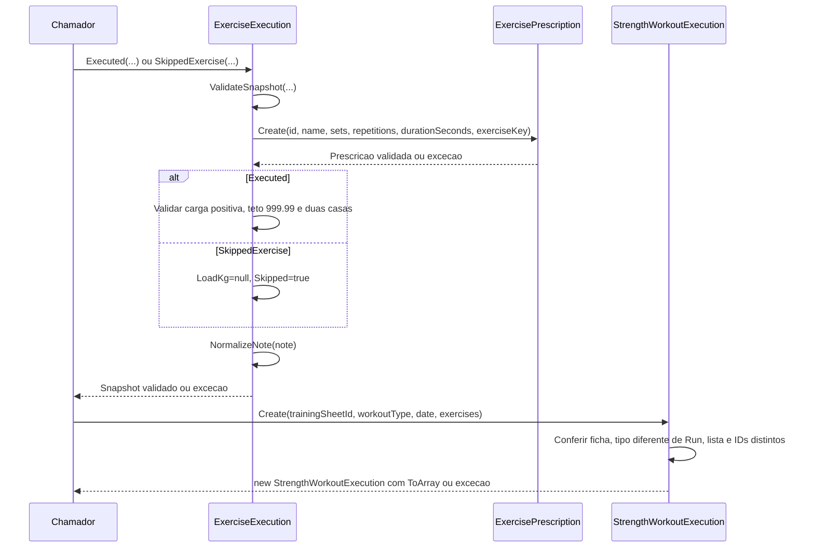

# WorkoutExecution - Execucao - Especificacao Tecnica

## Indice

- [1. Visao Geral Tecnica](#visao)
- [2. Configuracao e Dependencias](#dependencias)
- [3. Detalhamento por Metodo](#metodos)
- [U1. ExerciseExecution.Executed](#metodo-1)
- [U1. SkippedExercise](#metodo-2)
- [U1. ValidateSnapshot](#metodo-3)
- [U1. NormalizeNote](#metodo-4)
- [D1. StrengthWorkoutExecution.Create](#metodo-5)
- [4. Observacoes Tecnicas](#observacoes)

## 1. Visao Geral Tecnica

**Proposito e responsabilidades**: Preservar snapshot da musculacao realizada ou pulada, com identidade historica e nota.

**Fontes verificadas**: [Fonte](../../../src/Steady.Domain/Coaching/WorkoutExecution.cs); [Testes](../../../tests/Steady.Domain.Tests/WorkoutExecutionTests.cs); [STORY-013](../../../specs/STORY-013/spec.bdd.md), [STORY-014](../../../specs/STORY-014/spec.bdd.md), [ADR-009](../../../docs/adr/ADR-009-ficha-ativa-e-execucao-imutavel.md), [ADR-011](../../../docs/adr/ADR-011-registro-combinado-de-musculacao-e-corrida.md), [ADR-019](../../../docs/adr/ADR-019-identidade-historica-do-exercicio.md). As regras abaixo descrevem o codigo atual; controles das outras camadas sao identificados explicitamente.

## 2. Configuracao e Dependencias

Dominio C# puro, sem injecao de framework, endpoints, repositorios ou acesso ao banco. Tipos de apoio constam na secao U1. Persistencia e integracao ficam em [Steady.Infrastructure](../../Steady.Infrastructure/DevDocs/README.md) e [Steady.Api](../../Steady.Api/DevDocs/README.md).

**Entrada e saida**: assinaturas, campos, estados e erros de cada operacao sao discriminados abaixo. Os tipos nao sao contratos HTTP; uma excecao de dominio nao equivale por si so a status HTTP.

**Assinaturas do codigo (entrada tipada e tipo de retorno)**:

- `public static ExerciseExecution Executed( Guid exerciseId, string name, int sets, int repetitions, decimal loadKg, string? note, Guid? exerciseKey = null, int? durationSeconds = null)`
- `public static ExerciseExecution SkippedExercise( Guid exerciseId, string name, int sets, int repetitions, string? note, Guid? exerciseKey = null, int? durationSeconds = null)`
- `private static void ValidateSnapshot( Guid id, string name, int sets, int repetitions, Guid? exerciseKey, int? durationSeconds)`
- `private static string? NormalizeNote(string? note)`
- `public static StrengthWorkoutExecution Create( Guid trainingSheetId, WorkoutType workoutType, DateOnly date, IReadOnlyList<ExerciseExecution>? exercises)`

## 3. Detalhamento por Metodo

**D. Entidade/Servico de Dominio**: WorkoutExecution. D1 identifica operacoes de dominio; U1 identifica tipos de apoio agrupados nesta unidade.

### Fluxo completo da unidade

### U1. ExerciseExecution.Executed

Recebe ExerciseId, nome, series, repeticoes, carga, nota e opcionais ExerciseKey/DurationSeconds. ValidateSnapshot reaproveita ExercisePrescription.Create. Carga >0 e <=999.99 e decimal.Round(carga,2)==carga; invalida gera ArgumentOutOfRangeException. Retorna Skipped=false, nome Trim e identidade omitida assume ExerciseId.

### U1. SkippedExercise

Mesma validacao do snapshot; retorna Skipped=true e LoadKg=null, preservando nome, series, repeticoes, identidade, tempo e nota.

### U1. ValidateSnapshot

Privado: chama ExercisePrescription.Create com ID/nome/series/repeticoes/tempo/chave; herda ID obrigatorio, nome 2..100, series 1..20, repeticoes 1..100, tempo positivo e chave nao vazia.

### U1. NormalizeNote

Trim; vazio vira null; acima de 200 caracteres gera ArgumentException.

### D1. StrengthWorkoutExecution.Create

Recebe ficha, tipo, data e exercicios. Ficha nao vazia; proibe Run; exige lista nao vazia e ExerciseId distinto, senao ArgumentException. Retorna copia ToArray; nao compara itens com a ficha nem valida data.

## 4. Observacoes Tecnicas

**Limites reais**: Registro combinado e transacao/idempotencia pertencem a API/infraestrutura; nao existe classe CombinedWorkout neste arquivo. Corrida reutiliza RunningSession. Ficha aplicavel e pertencimento dos exercicios sao verificados externamente.

**Erros**: guard clauses interrompem antes de devolver objeto; metodos de transicao podem lancar InvalidOperationException quando descrito acima. Nao ha tratamento de excecoes ou logs internos.

**Desempenho**: factories e comparacoes percorrem apenas os campos/colecoes recebidos; nao fazem rede. Validacao de explicacao percorre texto e numeros permitidos. Nao ha medicao de desempenho publicada nestes testes.

**Documentos associados**: [Regras](../BusinessRulesDocs/Registro-da-Execucao-Execucao-Rules.md) e [Debitos](../TechnicalDebtsDocs/WorkoutExecution-Execucao-Debts.md).
