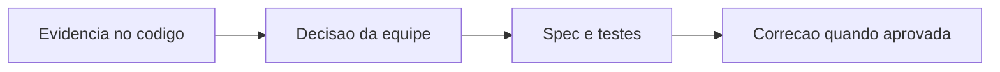

# PlanRequest - Planejamento - Debitos Tecnicos

## Indice

- [1. Resumo Executivo](#resumo)
- [2. Problemas por Criticidade](#problemas)
- [3. Plano de Acao](#plano)
- [4. User Stories para Implementacao](#stories)

## 1. Resumo Executivo

**Estado atual**: dominio isolado, com factories/metodos e evidencias em [Fonte](../../../src/Steady.Domain/Planning/PlanRequest.cs) e [Testes](../../../tests/Steady.Domain.Tests/PlanRequestTests.cs).
**Principais problemas**: Double nao finito atravessa a validacao
**Impacto no negocio**: longestRecentRunKm e referenceDistanceKm usam apenas <= 0; NaN e infinito positivo passam em chamada direta.
**Fontes**: [STORY-010](../../../specs/STORY-010/spec.bdd.md), [ADR-007](../../../docs/adr/ADR-007-persistencia-do-pedido-de-plano-de-treino.md). Calibracao de tolerancia e regras complexas aceitas nao sao classificadas como defeito.

## 2. Problemas por Criticidade

### Importante

**Double nao finito atravessa a validacao**: longestRecentRunKm e referenceDistanceKm usam apenas <= 0; NaN e infinito positivo passam em chamada direta.

**Acao recomendada**: Validar double.IsFinite antes da comparacao de positividade, preservando opcionais nulos.

Demais niveis: nenhum debito comprovado nesta analise.

## 3. Plano de Acao

1. Criticos: nenhum identificado nesta unidade.
2. Importantes: validar a proposta abaixo e reproduzir a evidencia antes de implementar.
3. Menores: manter documentacao sincronizada ao alterar regras ou contratos.

## 4. User Stories para Implementacao

### Story proposta: Double nao finito atravessa a validacao

**Contexto atual**: longestRecentRunKm e referenceDistanceKm usam apenas <= 0; NaN e infinito positivo passam em chamada direta.
**Objetivo**: fechar a lacuna observada sem mudar o restante da regra.
**Regras de negocio**: preservar limites e semantica estabelecidos nas fontes citadas.
**Especificacao tecnica**: Validar double.IsFinite antes da comparacao de positividade, preservando opcionais nulos.

**Criterios de aceite**:

- [ ] NaN e infinito devem ser recusados; 21 km e null opcional continuam aceitos.
- [ ] Cenários da regra atual continuam validos.
- [ ] Spec, testes e codigo refletem a decisao aceita pela equipe.

**Roteiro de teste**:

1. **Entrada**: `longestRecentRunKm=double.NaN e demais campos validos`. **Resultado esperado**: Hoje Create aceita; apos correcao proposta deve lancar ArgumentOutOfRangeException.
2. **Entrada**: `longestRecentRunKm=21 e referenceDistanceKm=null`. **Resultado esperado**: Pedido continua valido.

Esta story e recomendacao documental, nao autorizacao de implementacao.

**Referencia funcional**: [Regras](../BusinessRulesDocs/Pedido-de-Planejamento-Planejamento-Rules.md). **Detalhes tecnicos**: [DevDocs](../DevDocs/PlanRequest-Planejamento-DevDocs.md).
