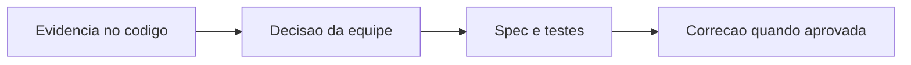

# SteadyTrainingPlan - Planejamento - Debitos Tecnicos

## Indice

- [1. Resumo Executivo](#resumo)
- [2. Problemas por Criticidade](#problemas)
- [3. Plano de Acao](#plano)
- [4. User Stories para Implementacao](#stories)

## 1. Resumo Executivo

**Estado atual**: dominio isolado, com factories/metodos e evidencias em [Fonte](../../../src/Steady.Domain/Planning/SteadyTrainingPlan.cs) e [Testes](../../../tests/Steady.Domain.Tests/SteadyTrainingPlanTests.cs).
**Principais problemas**: Lista recebida permite alterar semana apos validacao
**Impacto no negocio**: Create guarda weekPlan por referencia; IReadOnlyList nao garante que o produtor nao altere um List ou array.
**Fontes**: [STORY-015](../../../specs/STORY-015/spec.bdd.md), [ADR-013](../../../docs/adr/ADR-013-plano-do-steady-como-fonte-de-prescricao.md). Calibracao de tolerancia e regras complexas aceitas nao sao classificadas como defeito.

## 2. Problemas por Criticidade

### Importante

**Lista recebida permite alterar semana apos validacao**: Create guarda weekPlan por referencia; IReadOnlyList nao garante que o produtor nao altere um List ou array.

**Acao recomendada**: Copiar colecoes na fronteira e definir se o conteudo aninhado tambem deve ser defensivamente copiado.

Demais niveis: nenhum debito comprovado nesta analise.

## 3. Plano de Acao

1. Criticos: nenhum identificado nesta unidade.
2. Importantes: validar a proposta abaixo e reproduzir a evidencia antes de implementar.
3. Menores: manter documentacao sincronizada ao alterar regras ou contratos.

## 4. User Stories para Implementacao

### Story proposta: Lista recebida permite alterar semana apos validacao

**Contexto atual**: Create guarda weekPlan por referencia; IReadOnlyList nao garante que o produtor nao altere um List ou array.
**Objetivo**: fechar a lacuna observada sem mudar o restante da regra.
**Regras de negocio**: preservar limites e semantica estabelecidos nas fontes citadas.
**Especificacao tecnica**: Copiar colecoes na fronteira e definir se o conteudo aninhado tambem deve ser defensivamente copiado.

**Criterios de aceite**:

- [ ] Alterar a lista original apos Create nao deve mudar a semana do plano; invariantes de 7 dias devem persistir.
- [ ] Cenários da regra atual continuam validos.
- [ ] Spec, testes e codigo refletem a decisao aceita pela equipe.

**Roteiro de teste**:

1. **Entrada**: `Criar plano com List contendo 7 dias e depois remover um dia da lista original`. **Resultado esperado**: Hoje WeekPlan passa a 6; apos correcao deve permanecer 7.
2. **Entrada**: `Lista original com 7 dias coerentes, sem alteracao posterior`. **Resultado esperado**: Conteudo e versao do plano permanecem iguais.

Esta story e recomendacao documental, nao autorizacao de implementacao.

**Referencia funcional**: [Regras](../BusinessRulesDocs/Plano-Versionado-Planejamento-Rules.md). **Detalhes tecnicos**: [DevDocs](../DevDocs/SteadyTrainingPlan-Planejamento-DevDocs.md).
